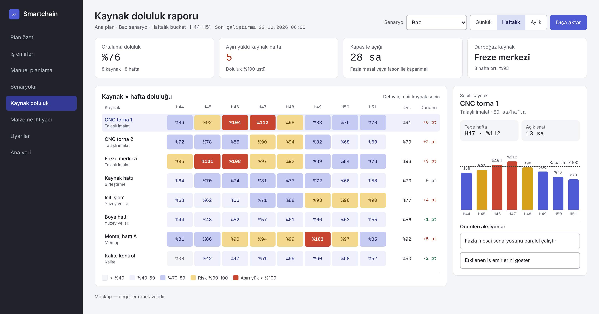
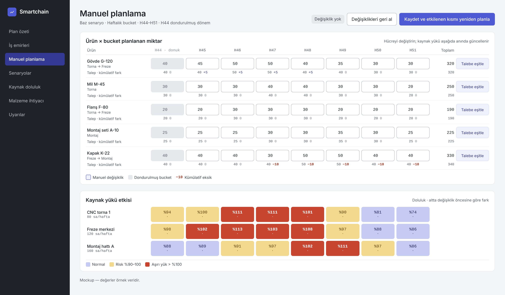

# Arayüz prensipleri (MDD adım 23)

Kaynak: Master Design Document (MDD) 26.10.2026. Bu dosya desteden üretilmiştir; değişiklik önce burada yapılır, deste dilim sonlarında buradan güncellenir (K-54).

### 23. Arayüz prensipleri
tamamlandı

- **Ne yapılacak:** Tüm ekranlarda geçerli görsel kimlik ve arayüz standartları: renk paleti ve kullanım kuralları, tablo davranışı (alanlar, sıralama, filtre), görünümler, veri giriş ve dışa aktarım, tutarlılık ve teknik ilkeler. 24. adımdaki ekran tasarımları bu prensiplere uyar. Çıktı: U-1…U-23 arayüz prensipleri, renk paleti, örnek ekranlar
- **Bu adımın slaytları**
  - 1/7  Renk paleti ve kullanım kuralları
  - 2/7  Örnek ekran: kaynak doluluk raporu
  - 3/7  Örnek ekran: manuel planlama
  - 4/7  Tablo davranışı: alanlar, sıralama, filtre
  - 5/7  Görünüm ve tablo düzeni
  - 6/7  Veri giriş ve dışa aktarım
  - 7/7  Tutarlılık ve teknik ilkeler
- **Kararlar**
  - K-30  Ürün paleti indigo + kurşun; durum renkleri hardal (risk) ve kiremit (aşırı yük). Yazı tipleri Instrument Sans ve JetBrains Mono.
  - K-31  U-1…U-23 arayüz prensipleri tüm ekran ve raporlar için bağlayıcıdır; yeni ekran bu listeye göre gözden geçirilir.
- **Açık konular:** A-14  Manuel girilen miktar, optimizasyon yeniden çalıştığında sabit mi kalır, yoksa başlangıç önerisi mi sayılır? Cevaba göre hücre bazında kilit gerekir.

### Renk paleti ve kullanım kuralları
23. Arayüz prensipleri · 1/7

- İndigo — aksiyon, seçim, aktif durum
- **U-1:** Ekran ağırlıkla nötrdür
- Yaklaşık %70 kurşun, %20 indigo, %10 durum rengi. Göz yalnızca istisnaya gider.
- EEF0FB · DCE0F7 · 8F98E3 · 4F5BD5 · 333A94 · 1E2257
- **U-2:** Durum renkleri yalnızca durum içindir
- Kurşun — zemin, metin, çizgi
- Hardal = risk, kiremit = aşırı yük veya gecikme, yeşil = olumlu. Dekor için kullanılmaz.
- **U-3:** Renk tek başına anlam taşımaz

| F4F5F7 | E6E8EC | B4B9C2 | 5A606B | 3F444D |
|---|---|---|---|---|
|  |  |  |  | Durum her zaman değer, etiket veya ikonla birlikte gösterilir (renk körlüğü). |
| Doluluk skalası ve durum renkleri |  |  |  |  |
| %55 | %82 | %94 | %108 | + i |
|  |  |  |  | İndigo aksiyon ve seçimdir U-4 |
|  |  |  |  | Ana buton, seçili satır, aktif menü. Manuel değişiklik indigo çerçeveyle işaretlenir. |
| %40–69 | %70–89 | risk | aşırı yük | olumlu bilgi |
| Yazı tipleri  Instrument Sans (metin) · JetBrains Mono (sayı, tarih, kod) |  |  |  | Grafik serileri sabit sıradadır |
|  |  |  |  | U-5 |
|  |  |  |  | İndigo, petrol, hardal, kurşun. Kiremit hiçbir grafikte seri rengi olmaz. |

### Örnek ekran: kaynak doluluk raporu
23. Arayüz prensipleri · 2/7

- **Nötr zemin (U-1):** Menü, kartlar ve tablo kurşun tonlarında; indigo sadece seçim ve ana butonda.
- **Doluluk skalası (U-2):** Normal yük indigo tonlarında, risk hardal, %100 üstü kiremit.
- **Değer + renk (U-3):** Her hücrede yüzde yazar; renk yalnızca vurgu yapar.
- **Dünden farkı:** Değişim odaklı planlama: önceki plana göre kaç puan değiştiği görünür.

### Örnek ekran: manuel planlama
23. Arayüz prensipleri · 3/7

- **Bucket bazlı giriş:** Planlamacı ürün × hafta miktarını yazar; dondurulmuş bucket gri ve kilitli.
- **Manuel değişiklik (U-4):** Değişen hücre indigo çerçeveyle işaretlenir, sayaç başlıkta görünür.
- **Kümülatif eksik (U-2):** Talebe göre eksik kalan haftalar kiremit renkte gösterilir.
- **Anlık kaynak etkisi:** Her değişiklikte doluluk yeniden hesaplanır; kaydet yalnızca etkilenen kısmı yeniden planlar.

### Tablo davranışı: alanlar, sıralama, filtre
23. Arayüz prensipleri · 4/7

- **U-6 · Alan ekle / çıkar:** Kullanıcı her tabloya o tablonun tanımlı alanlarından istediğini ekler veya çıkarır. Kapalı alanlar bir listeden geri açılır.
- **U-7 · Her alan sıralanabilir:** Tüm alanlar artan / azalan sıralanır. Birden fazla alanla sıralama yapılabilir (örn. önce kaynak grubu, sonra doluluk); sıralama önceliği görünür.
- **U-8 · Her alan filtrelenebilir:** Filtre tipi alanın veri tipine göre gelir; birden fazla alanda aynı anda filtre uygulanır.
- **U-8 filtre tipleri**
- **Metin**
- **Liste değerleri**
- **Sayı**
- **Tarih ve bucket:** içerir / içermez, eşittir, ile başlar; metinle arama çoklu seçim, liste içinde arama aralık (min–maks), eşit, büyük / küçük aralık; göreli seçim (bu hafta, sonraki 4 hafta)

### Görünüm ve tablo düzeni
23. Arayüz prensipleri · 5/7

- **U-9 · Kayıtlı görünüm:** Kolon seti, sıralama ve filtre bir isimle kaydedilir. Kişisel veya paylaşılan olabilir; kullanıcı varsayılan görünümünü seçer.
- **U-10 · Kolon düzeni:** Kolonlar sürüklenerek sıralanır, genişliği ayarlanır; ilk kolonlar sabitlenir, yatay kaydırmada kaybolmaz.
- **U-11 · Gruplama ve ara toplam:** Tablo bir veya birden fazla alana göre gruplanır (örn. kaynak grubu, ürün ailesi); grup başına ara toplam alınır.
- **U-12 · Aktif filtre görünür:** Uygulanan filtreler tablonun üstünde etiket olarak durur, tek tıkla temizlenir. Kayıt sayısı "120 / 840" gibi gösterilir.
- **U-13 · Boş değer seçeneği:** Her filtrede "boş" seçilebilir; eksik veri ayrıca bulunabilir.
- **U-22 · Ana tablo ekrana sığar:** Ekranın ana tablosu görünür alanı doldurur ve görünürlüğü en yüksek öğedir. Kenar menü daraltılıp açılabilir; daraltılınca alan tabloya geçer.
- **U-23 · Yazı boyutu kullanıcıya göre ayarlanır:** Varsayılan yazı boyutu sıkıdır; ekrana en çok bilgi sığar (U-22). Kullanıcı kendi ayarından dört seviyeden birini seçer: Küçük 12 px · Standart 13 px (varsayılan) · Rahat 14 px · Büyük 16 px. Seviye yalnız yazıyı değil bütün arayüzü ölçekler: satır yüksekliği, boşluk, ikon ve menü birlikte değişir, düzen bozulmaz. Ayar kullanıcıya özeldir, kaydedilir ve her girişte hatırlanır. Excel çıktısını ve rapor baskısını etkilemez.

### Veri giriş ve dışa aktarım
23. Arayüz prensipleri · 6/7

- **U-14 · Excel'e aktarım:** Ekranda ne görünüyorsa o aktarılır: aynı kolonlar, filtre ve sıralama.
- **U-15 · Excel'den yapıştırma:** Düzenlenebilir tablolarda Excel'den blok kopyala-yapıştır ve toplu düzenleme yapılır.
- **U-16 · Değişiklik izi:** Manuel değiştirilen hücre her ekranda aynı şekilde işaretlenir; kimin ne zaman değiştirdiği görülür.

### Tutarlılık ve teknik ilkeler
23. Arayüz prensipleri · 7/7

- **U-17 · Global bağlam:** Senaryo, plan versiyonu ve bucket seçimi her ekranın başlığında aynı yerde durur ve ekranlar arasında taşınır.
- **U-18 · Detaya iniş:** Hücreye tıklayınca ilgili kayıtlara filtresiyle gidilir (örn. aşırı yüklü hafta → o haftanın iş emirleri).
- **U-19 · Format standardı:** Sayılar 1.234,5; tarihler gg.aa.yyyy; haftalar H44. Birimler kolon başlığında yazılır.
- **U-20 · Fontlar ürünle paketlenir:** Kurulum internetsiz olduğu için yazı tipleri ve tüm arayüz varlıkları dışarıdan yüklenmez.
- **U-21 · Sunucu tarafı işlem:** Filtre, sıralama ve gruplama sunucuda yapılır; binlerce satırda ekran yavaşlamaz.
