# Ekranlar (MDD adım 24 · ekran listesi ve ekran mockupları)

Kaynak: Master Design Document (MDD) 26.10.2026. Bu dosya desteden üretilmiştir; değişiklik önce burada yapılır, deste dilim sonlarında buradan güncellenir (K-54).

### 24. Ekranlar ve fonksiyonlar
tamamlandı

- **Ne yapılacak:** Üç başlıkta: (1) ekran listesi ve açıklamaları, (2) fonksiyon listesi ve açıklamaları, (3) her ekran için mockup tasarım. Ekranlar 23. adımdaki arayüz prensiplerine uyar. Çıktı: ekran envanteri, fonksiyon listesi, mockuplar
  - Bu adımın slaytları
  - 01–04 Ekran listesi
  - 05–12 Fonksiyon listesi
  - 13–37 Mockup · ekran 01–25
  - 38–78 Prensip · A Veri alma
  - 79–130 Prensip · B Ana veri ve veri kuralları
  - 131–164 Prensip · C Parametre
  - 165–207 Prensip · D Planlama motoru (arka planda)
  - 208–251 Prensip · E Senaryo ve çalışma
  - 252–320 Prensip · F Manuel planlama
  - 321–349 Prensip · G Malzeme ve öneriler
  - 350–379 Prensip · H Analiz
  - 380–404 Prensip · I Yayın
  - 405–432 Prensip · J Takip ve rapor
  - 433–483 Prensip · K Yönetim ve sistem
- **Kararlar**
  - K-42  Manuel planlama dört görünümle yapılır: ürün bazlı, kaynak bazlı, sipariş bazlı ve bucket bazlı Gantt (sürükle-bırak). Dördü aynı planın farklı yüzleridir.
  - K-43  Planlama ekranları bir çalışmanın içinde açılır; end user onaylı planı salt okunur görür.
- **Açık konular**
  - A-19  Fonksiyon listesi, prensipleri ve mockupları ilk taslak; öneri olanlar konuşulacak.
  - A-20  Mockuplar ilk taslak; ekran ekran gözden geçirilecek.

### Ekran listesi
24. Ekranlar ve fonksiyonlar · Ekran listesi · 1/4

#### BAŞLANGIÇ

- **01 · Sabah ekranı:** Gece akışının özeti (hangi senaryo bitti, hata verdi), kritik uyarılar, dünden bugüne veride ve planda ne değişti.

#### VERI

- **02 · Veri yükleme:** Çekilen veriyi görme, doğrulama sonucu, tam ya da kısmi yükleme, yükleme geçmişi.
- **03 · Ana veri ekranları:** Kaynak, malzeme, ürün ağacı, rota, tedarikçi, müşteri, proje, takvim, vardiya… Her değerin kaynağı (ERP, kural, elle) görünür; elle düzeltme yapılır.
- **04 · Veri kuralları:** Kural listesi, kural editörü, önizleme (kaç kayıt değişir).
- **05 · Veri kalitesi:** Ana veri ve işlem verisi uyarıları; düzeltme listesi.

#### PARAMETRE

- **06 · Parametre setleri:** Verim, dönem üst limitleri, fazla mesai limitleri, alokasyon, öncelik kuralı, zaman yapısı, uyarı eşikleri, genel planlama ayarları.
- **07 · Gece senaryo tanımları:** Hangi senaryolar gece çalışır; parametre seti, eksen ayarları, öncelik.

### Ekran listesi
24. Ekranlar ve fonksiyonlar · Ekran listesi · 2/4

#### PLANLAMA

- **08 · Senaryolar:** Gece senaryolarının listesi, durumu ve metrikleri; yan yana karşılaştırma; çalışma açma.
- **09 · Çalışma:** Bir senaryo üzerindeki çalışma alanı: özet metrikler, yapılan değişiklikler, yeniden hesap, yayın. 10–19 numaralı ekranlar bu bağlamda açılır.
- **10 · Kaynak doluluk raporu:** Kaynak × dönem doluluğu; dünden farkı; detaya iniş.
- **11 · Ürün bazlı planlama:** Ürün × dönem: talep, üretim, stok projeksiyonu, kümülatif eksik; üretim miktarı girilir.
- **12 · Kaynak bazlı planlama:** Kaynak × dönem: yükü taşıma, alternatif kaynağa ya da fasona aktarma, kaynak parametrelerini geçici değiştirme.
- **13 · Sipariş bazlı planlama:** Sipariş satırları, planlanan tarih, gecikme ve nedeni; öncelik, hedef tarih, koruma, manuel pegging.
- **14 · Gantt (bucket bazlı):** Kaynak ya da sipariş satırlı; dönem sınırına oturan sürükle-bırak, bölme, kilitleme.

### Ekran listesi
24. Ekranlar ve fonksiyonlar · Ekran listesi · 3/4

#### PLANLAMA

- **15 · Malzeme planı:** Malzeme × dönem: brüt ihtiyaç, arz, stok projeksiyonu, eksik; proje ve ortak stok kırılımı.
- **16 · Öneriler:** Planlı siparişler (üretim, satın alma, fason; yuvarlanmış miktar) ve mevcut arz için öneriler (öne çek, ertele, iptal); onay, ret, bekletme.
- **17 · Pegging:** Talepten aşağı, arzdan yukarı ağaç; eksikliğin nedeni.
- **18 · Termin sorgusu ve olay senaryoları:** Ürün, miktar ve tarihle termin; etki analizi (duruş, gecikme, iptal); ürün simülasyonu.
- **19 · Yayın:** Onaylı plan yayını; eski veri ve çakışma uyarıları; 'varsayılan yap' seçeneği.

### Ekran listesi
24. Ekranlar ve fonksiyonlar · Ekran listesi · 4/4

#### TAKIP

- **20 · Uyarı iş listesi:** Kategoriye ve öneme göre uyarılar; filtre, not, kapatma.
- **21 · Raporlar:** Onaylı plan ve senaryo raporları; Excel'e aktarım (25. adımla bağlantılı).

#### YÖNETIM

- **22 · Kullanıcılar:** Kullanıcı açma, kapatma, rol atama, şifre sıfırlama.
- **23 · Entegrasyon ve zamanlanmış işler:** API, Excel ve SQL bağlantıları, servis hesapları, gece akışının zamanlaması.
- **24 · Sistem sağlığı:** Son çalışmalar, iş kuyruğu, hatalar, çözüm süreleri; destek paketi dışa alma.
- **25 · Sistem sahibi ayarları:** Veri sözlüğü, motor ayarları (çözücü, süre bütçesi, işçi sayısı, eş zamanlı çalışma sınırı), lisans, sürüm.

### Fonksiyon listesi
24. Ekranlar ve fonksiyonlar · Fonksiyon listesi · 1/8

#### VERI ALMA

- **01 · Veri çekme:** ERP'den API ya da SQL arayüz tablolarıyla; gece zamanlanmış, istenirse elle tetiklenir.
- **02 · Excel şablonu indirme:** Her varlık için veri sözleşmesine uygun boş şablon.
- **03 · Excel ile yükleme:** Kullanıcı şablonu doldurup yükler.
- **04 · Doğrulama:** Zorunlu alan, tip, birim, referans (olmayan kaynak ya da malzeme), ağaç döngüsü, negatif değer.
- **05 · Tam yükleme:** Tüm varlıklar yeni veri versiyonu olarak yüklenir.
- **06 · Kısmi yükleme:** Seçilen varlıklar yüklenir; hatalı varlıkta önceki versiyon kullanılmaya devam eder.
- **07 · Veri versiyonlama:** Her yükleme bir veri versiyonu açar (VersionFrom / VersionTo).
- **08 · Yükleme geçmişi:** Kim, ne zaman, hangi varlıkları yükledi; sonuç ne oldu.
- **09 · Ham veri temizliği:** Ham veri 1 hafta sonra otomatik silinir.

#### ANA VERI VE VERI KURALLARI

- **10 · Ana veri görüntüleme:** Arama, filtre ve sekmeler: kaynak, malzeme, ağaç, rota, tedarikçi, müşteri, proje, takvim, vardiya.
- **11 · Değerin kaynağını gösterme:** Her alanda ERP, kural, elle ya da varsayılan etiketi.
- **12 · Elle değer girme:** Alanın ayarına göre ERP'yi ve kuralı ezer ya da ezmez.

### Fonksiyon listesi
24. Ekranlar ve fonksiyonlar · Fonksiyon listesi · 2/8

#### ANA VERI VE VERI KURALLARI (DEVAM)

- **13 · Elle değeri kaldırma:** Değer ERP'ye ya da kurala geri döner.
- **14 · Değişiklik geçmişi:** Alan bazında eski ve yeni değer, kişi, tarih.
- **15 · Excel ile toplu düzeltme:** Ana veri dışa aktarılır, düzeltilir, elle değer olarak geri yüklenir. (öneri)
- **16 · Veri kuralı tanımlama:** EĞER … O HALDE … kalıbıyla kural yazılır.
- **17 · Kural önizleme:** Kaydetmeden önce hangi kayıtların nasıl değişeceği görülür.
- **18 · Kural sıralama ve aç / kapa:** Kurallar sırayla uygulanır; tek tek devre dışı bırakılabilir.
- **19 · Kural uygulama:** Her yüklemede otomatik çalışır; elle de tetiklenebilir.
- **20 · Veri kalitesi kontrolü:** Ana veri ve işlem verisi uyarıları önem sırasıyla üretilir.
- **21 · Kalite düzeltme aksiyonu:** Satırdan düzeltme ekranına gidilir ya da önerilen kural uygulanır.

#### PARAMETRE

- **22 · Parametre seti:** Oluşturma, kopyalama, düzenleme, silme.
- **23 · Zaman yapısı:** Ufuk, günlük, haftalık, aylık bucket, dondurulmuş dönem, takvim.
- **24 · Kapasite parametreleri:** Verim, dönem üst limitleri, fazla mesai limitleri.
- **25 · Alokasyon ve öncelik kuralı:** Ölçüt, yön, ağırlık; MRP ve model aynı kuralı kullanır.

### Fonksiyon listesi
24. Ekranlar ve fonksiyonlar · Fonksiyon listesi · 3/8

#### PARAMETRE (DEVAM)

- **26 · Uyarı eşikleri:** Doluluk, gecikme, stok gibi eşik değerleri.
- **27 · Gece senaryo tanımı:** Parametre seti, model tipi (LP ya da MILP), eksen ayarları, süre bütçesi.
- **28 · Senaryo sırası ve aç / kapa:** Senaryo silinmeden bir gece devre dışı bırakılabilir.

#### PLANLAMA MOTORU (ARKA PLANDA)

- **29 · Ön hesap:** LLC hesaplama, proje bazlı netleştirme, kullanılabilir stok.
- **30 · MRP patlatma:** Bağımlı talep, 4 aşamalı netleştirme, planlı sipariş; öncelik ve kısıtlar parametrik.
- **31 · Model kurma:** İş modelinden LP ya da MILP kurulur.
- **32 · Çözücü adaptörü:** Model seçilen çözücünün girdisine çevrilir; sonuç geri okunur.
- **33 · Kurallı yerleştirme ve sezgisel:** Model çözüm bulamazsa ya da süre biterse yedek yol.
- **34 · Süre bütçesi:** Süre aşılınca o ana kadar bulunan en iyi çözüm saklanır.
- **35 · Son hesap:** Satın alma yuvarlama (parti, minimum, kutu), pegging, proje numaralarını geri yazma.
- **36 · Mevcut arz önerileri:** Açık sipariş ve iş emirleri için öne çek, ertele, iptal önerisi.
- **37 · Uyarı üretme:** 7 kategori: teslim, kapasite, malzeme, ana veri, işlem verisi, proje, plan kalitesi.
- **38 · Metrik hesaplama:** Zamanında teslim, gecikme, doluluk, fazla mesai, fason, stok değeri.

### Fonksiyon listesi
24. Ekranlar ve fonksiyonlar · Fonksiyon listesi · 4/8

#### PLANLAMA MOTORU (ARKA PLANDA) (DEVAM)

- **39 · Açıklama üretme:** Faz 1'de şablon cümlelerle; LLM kapalı.

#### SENARYO VE ÇALIŞMA

- **40 · Gece akışı:** Veri çekme, doğrulama, yükleme ve senaryolar sırayla ya da paralel çalışır.
- **41 · Senaryoyu yeniden çalıştırma:** Hata veren ya da süre aşan senaryo gündüz yeniden başlatılır. (öneri)
- **42 · Senaryo karşılaştırma:** Metrikler yan yana; en iyi değer işaretlenir.
- **43 · Çalışma açma:** Bir gece senaryosundan çalışma açılır.
- **44 · Değişiklik izi:** Her değişiklik ekran, kişi, zaman ve etkisiyle kaydedilir.
- **45 · Değişikliği geri alma:** Tek tek ya da hepsi birden.
- **46 · Yeniden hesap:** Etkilenen kısım yeniden çözülür; iş kuyruğa girer.
- **47 · Eş zamanlı çalışma sınırı:** En fazla 3 sıcak çalışma; fazlası kuyrukta bekler.
- **48 · İş bitti bildirimi:** Hesap bitince ekrana anlık bildirim (WebSocket).
- **49 · Çalışma kapatma:** Yayınlanmayan çalışma, kaynak senaryo gece silinince gider.

### Fonksiyon listesi
24. Ekranlar ve fonksiyonlar · Fonksiyon listesi · 5/8

#### MANUEL PLANLAMA

- **50 · Ürün bazlı · üretim miktarı girme:** Hücreye değer yazılır; elle değer kilitlenir (A-14 önerisi).
- **51 · Ürün bazlı · talebe eşitle:** Üretim satırı talebe eşitlenir.
- **52 · Kaynak bazlı · yük taşıma:** Yük başka döneme taşınır.
- **53 · Kaynak bazlı · alternatif kaynağa aktarma:** Rotadaki alternatif kaynağa aktarılır.
- **54 · Kaynak bazlı · fasona aktarma:** Yük fason kaynağa verilir.
- **55 · Geçici kaynak parametresi:** Verim, fazla mesai, çalışma günü yalnız bu çalışmada değişir.
- **56 · Sipariş bazlı · öncelik değiştirme:** Siparişin önceliği değiştirilir.
- **57 · Sipariş bazlı · hedef tarih ve koruma:** Siparişe hedef tarih verilir ve korunur.
- **58 · Manuel pegging:** Belirli stok ya da arz belirli siparişe bağlanır.
- **59 · Gantt · sürükle-bırak:** Çubuk başka bucket'a ya da başka kaynağa bırakılır.
- **60 · Gantt · bölme ve birleştirme:** İş emri miktarla bölünür ya da birleştirilir.
- **61 · Kilitleme ve kilit kaldırma:** Hücre, iş emri ya da sipariş kilitlenir; model kilitli olana dokunmaz.
- **62 · Anlık etki önizlemesi:** Değişiklik yapılırken kaynak yükü hemen güncellenir.
- **63 · Dondurulmuş dönem koruması:** Dondurulmuş bucket'ta değişiklik engellenir.

### Fonksiyon listesi
24. Ekranlar ve fonksiyonlar · Fonksiyon listesi · 6/8

#### MALZEME VE ÖNERILER

- **64 · Malzeme planı:** Brüt ihtiyaç, arz, stok projeksiyonu, eksik; proje kırılımı.
- **65 · Eksik filtresi:** Yalnız eksiği olan malzemeler; temin süresi içindeki eksik ayrıca işaretli.
- **66 · Planlı sipariş kararı:** Onayla, reddet, beklet.
- **67 · Toplu karar:** Seçilen satırlar topluca onaylanır.
- **68 · Mevcut arz önerisi kararı:** Öne çek, ertele, iptal önerileri onaylanır ya da reddedilir.
- **69 · Önerileri dışa aktarma:** Excel olarak; ERP'ye geri yazma açık konu (öneri: Faz 1'de yok).

#### ANALIZ

- **70 · Pegging:** Talepten aşağı ya da arzdan yukarı ağaç.
- **71 · Gecikme nedeni:** Kapasite ve malzeme zinciri sade dille.
- **72 · Termin sorgusu:** Ürün, miktar, tarih; en erken tam teslim ve bölerek teslim önerisi.
- **73 · Olay senaryosu:** Duruş, tedarikçi gecikmesi, sipariş iptali, talep değişimi etkisi.
- **74 · Ürün simülasyonu:** Yeni sipariş ya da ürün eklenirse plan nasıl değişir.
- **75 · Olayı çalışmaya uygulama:** Sorgu ya da olay sonucu çalışmaya eklenir.

### Fonksiyon listesi
24. Ekranlar ve fonksiyonlar · Fonksiyon listesi · 7/8

#### YAYIN

- **76 · Yayın öncesi kontrol:** Veri yaşı, daha yeni veri, çakışan yayın, bekleyen karar, kritik uyarı.
- **77 · Onaylı plan yayınlama:** Yalnız çalışmadan; yeni plan versiyonu oluşur.
- **78 · Varsayılan yap:** Raporlar ve end user bu planı görür.
- **79 · Yayın notu:** Yayına açıklama eklenir.
- **80 · Plan karşılaştırma:** Onaylı plan, senaryo ve çalışma arasında fark.
- **81 · Onaylı plan saklama:** Onaylı plan ve veri versiyonu silinmez.

#### TAKIP VE RAPOR

- **82 · Sabah özeti:** Gece akışı sonucu, kritik uyarılar, dünden bugüne değişenler.
- **83 · Uyarı iş listesi:** Filtre, not, atama, izleme, kapatma.
- **84 · Uyarıdan kayda gitme:** Uyarıdan ilgili ekrana ve kayda geçiş.
- **85 · Rapor görüntüleme:** Kaynak: onaylı plan ya da senaryo.
- **86 · Excel'e aktarma:** Her tablo ve rapor; end user da kullanabilir.
- **87 · Dışa aktarım izi:** Kim hangi raporu hangi plandan aldı.

### Fonksiyon listesi
24. Ekranlar ve fonksiyonlar · Fonksiyon listesi · 8/8

#### YÖNETIM VE SISTEM

- **88 · Kullanıcı yönetimi:** Açma, kapatma, rol atama, şifre sıfırlama.
- **89 · Giriş ve oturum:** Yerel kullanıcıyla giriş, şifre değiştirme, oturum zaman aşımı.
- **90 · Rol bazlı yetki:** Sistem sahibi, admin, key user, end user; her fonksiyonda kontrol.
- **91 · Entegrasyon tanımı:** Bağlantı, test, alan eşleme, servis hesabı.
- **92 · Zamanlanmış işler:** Veri çekme, senaryolar, ham veri ve senaryo temizliği.
- **93 · İş kuyruğu yönetimi:** Çalışan ve bekleyen işler; iş iptal edilebilir. (öneri)
- **94 · Sistem sağlığı:** Son çalışmalar, hatalar, süreler, disk.
- **95 · Destek paketi:** Log ve ayarlar paket olarak dışa alınır; uzaktan erişim olmadığı için.
- **96 · Sistem sahibi ayarları:** Veri sözlüğü (alan sınıfı, öncelik, elle ezme), motor ayarları, lisans.
- **97 · Sürüm güncelleme:** Kapalı ağda kurulum paketiyle. (öneri)
- **98 · Denetim izi:** Tüm veri, parametre, plan ve kullanıcı değişikliklerinin merkezi kaydı. (öneri)

### Sabah ekranı
24. Ekranlar ve fonksiyonlar · Mockup · 01/25

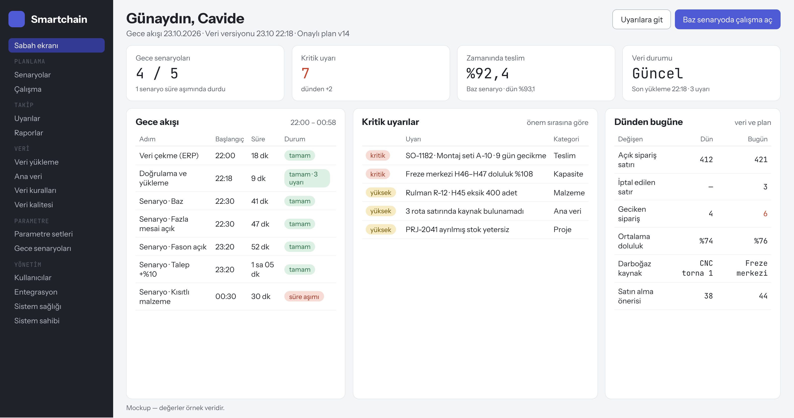

- **Gece akışı özeti:** Veri çekmeden senaryolara kadar her adımın süresi ve durumu tek tabloda.
- **Hata görünür:** Süre aşımı ya da hata veren senaryo kırmızı; kalan senaryolar yine kullanılabilir.
- **Kritik uyarılar:** Önem sırasına göre ilk beş uyarı; tıklayınca uyarı iş listesine gider.
- **Dünden bugüne:** Veride ve planda ne değişti; güne buradan başlanır, sonra çalışma açılır.

### Veri yükleme
24. Ekranlar ve fonksiyonlar · Mockup · 02/25

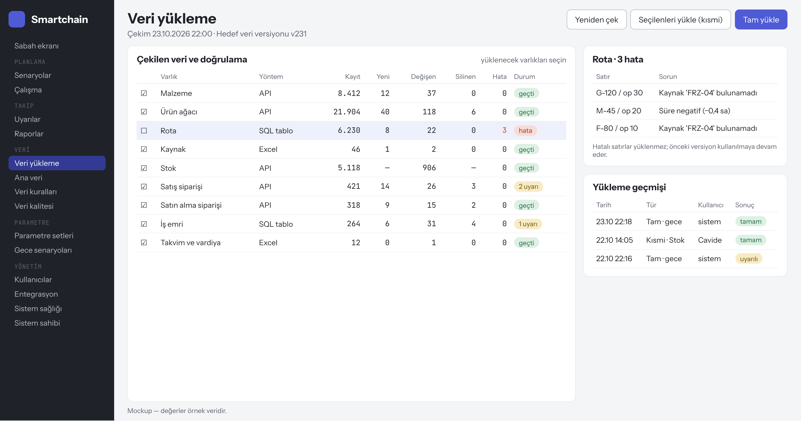

- **Önce doğrula:** Her varlık için yeni, değişen, silinen ve hatalı kayıt sayısı yüklemeden önce görünür.
- **Kısmi yükleme:** Hatalı varlık seçilmeden diğerleri yüklenir; yeni veri versiyonu oluşur.
- **Hata detayı:** Hatalı satır ve nedeni sağda; düzeltme kaynakta ya da elle yapılır.
- **Geçmiş:** Gece ve elle yüklemeler kullanıcı ve sonuçla birlikte saklanır.

### Ana veri ekranları
24. Ekranlar ve fonksiyonlar · Mockup · 03/25

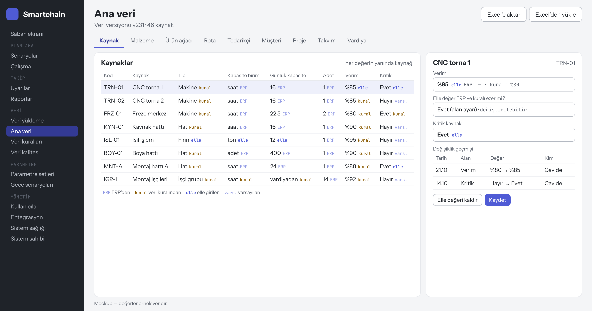

- **Tek ekran, sekmeler:** Kaynak, malzeme, ürün ağacı, rota, takvim ve diğer ana veriler aynı düzende.
- **Değerin kaynağı:** Her hücrede ERP, kural, elle ya da varsayılan etiketi görünür.
- **Elle düzeltme:** Elle değer girilir; alanın ayarına göre ERP ve kuralı ezer ya da ezmez.
- **İz:** Her değişiklik kim, ne zaman, eski ve yeni değerle geçmişte tutulur.

### Veri kuralları
24. Ekranlar ve fonksiyonlar · Mockup · 04/25

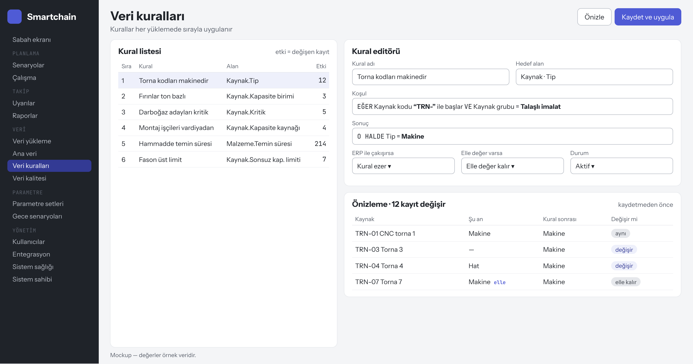

- **Kural listesi:** Kurallar sırayla uygulanır; her kuralın kaç kaydı değiştirdiği görünür.
- **Koşul ve sonuç:** EĞER … O HALDE … kalıbı; kod bilmeden kural yazılır.
- **Öncelik seçenekli:** ERP ile çakışırsa kim ezer, elle değer varsa ne olur: alan bazında seçilir.
- **Önizleme:** Kaydetmeden önce hangi kayıtların nasıl değişeceği listelenir.

### Veri kalitesi
24. Ekranlar ve fonksiyonlar · Mockup · 05/25

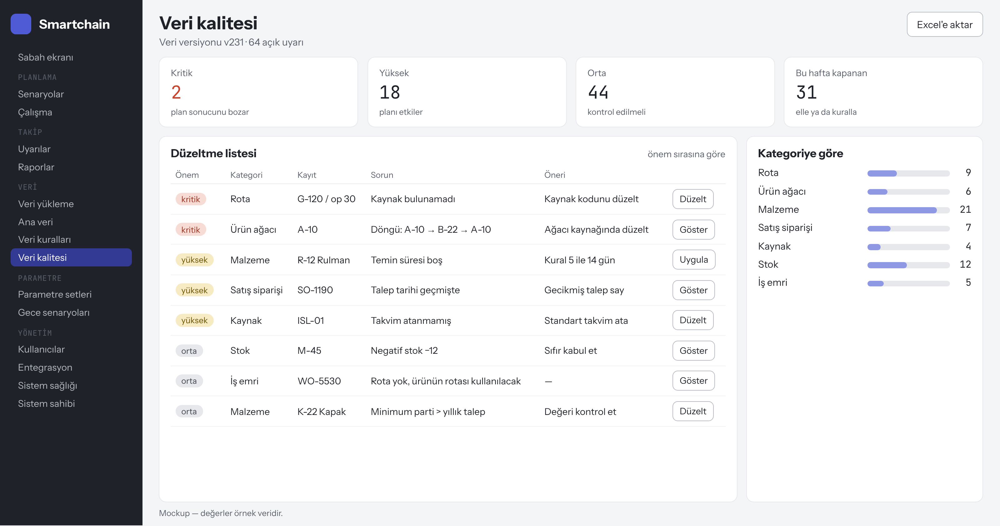

- **Önem sırası:** Plan sonucunu bozan sorunlar en üstte; kritik, yüksek, orta.
- **Ana veri ve işlem verisi:** Rota, ağaç, malzeme hataları ile sipariş ve stok uyarıları aynı listede.
- **Öneri ve aksiyon:** Her satırda önerilen düzeltme; kuralla toplu ya da elle tek tek.
- **Dağılım:** Hangi veri alanında sorun yoğun, sağdaki özetten görülür.

### Parametre setleri
24. Ekranlar ve fonksiyonlar · Mockup · 06/25

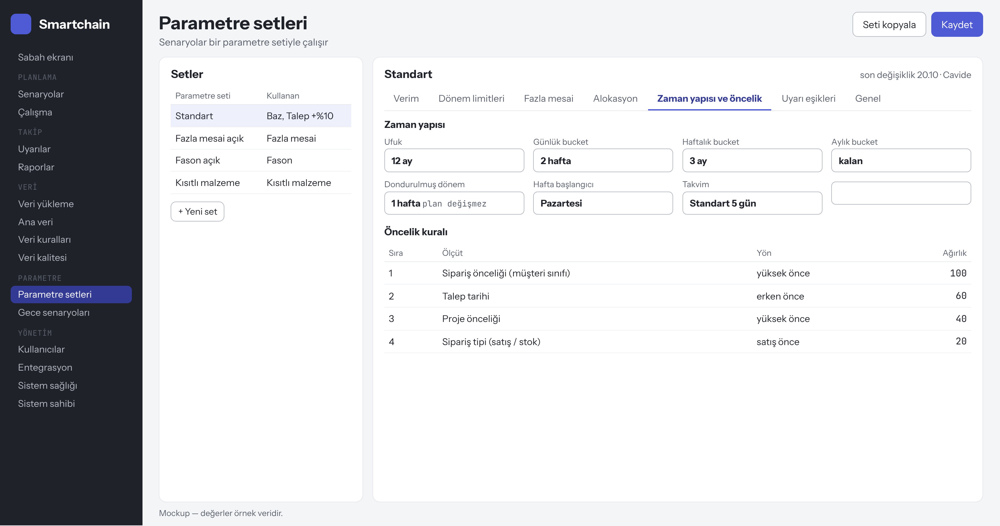

- **Set mantığı:** Parametreler setler halinde tutulur; her senaryo bir set kullanır.
- **Sekmeler:** Verim, dönem limitleri, fazla mesai, alokasyon, öncelik, zaman yapısı, eşikler.
- **Zaman yapısı:** Günlük, haftalık, aylık bucket ve dondurulmuş dönem burada belirlenir.
- **Öncelik tek yerde:** Öncelik kuralı ölçüt, yön ve ağırlıkla tanımlanır; MRP ve model aynı kuralı kullanır.

### Gece senaryo tanımları
24. Ekranlar ve fonksiyonlar · Mockup · 07/25

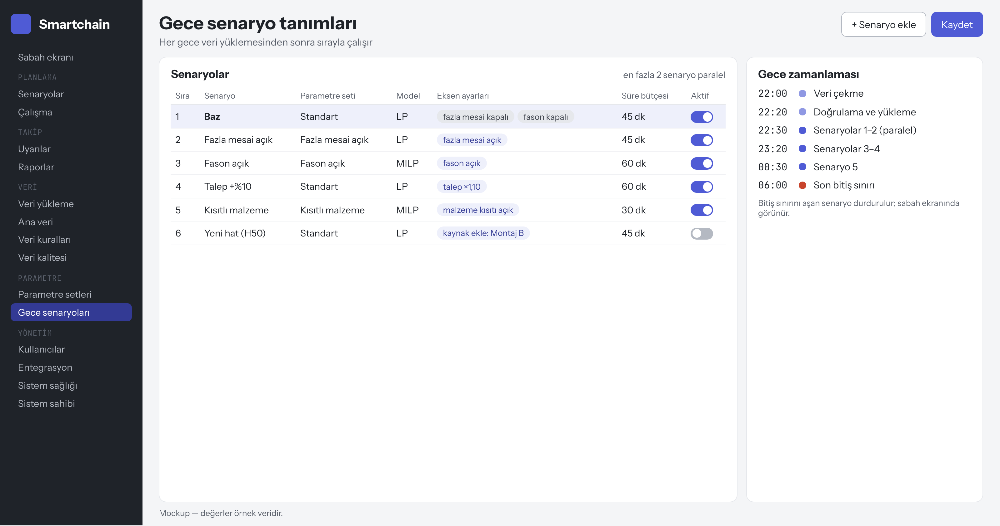

- **Senaryo tanımı:** Her senaryo bir parametre seti, model tipi ve eksen ayarlarıyla tanımlanır.
- **Eksenler:** Fazla mesai, fason, talep çarpanı, malzeme kısıtı gibi ayarlar senaryoya özel.
- **Süre bütçesi:** Her senaryonun süre sınırı var; sıra ve paralellik motor ayarına uyar.
- **Aç / kapat:** Tanım silinmeden bir gece devre dışı bırakılabilir.

### Senaryolar
24. Ekranlar ve fonksiyonlar · Mockup · 08/25

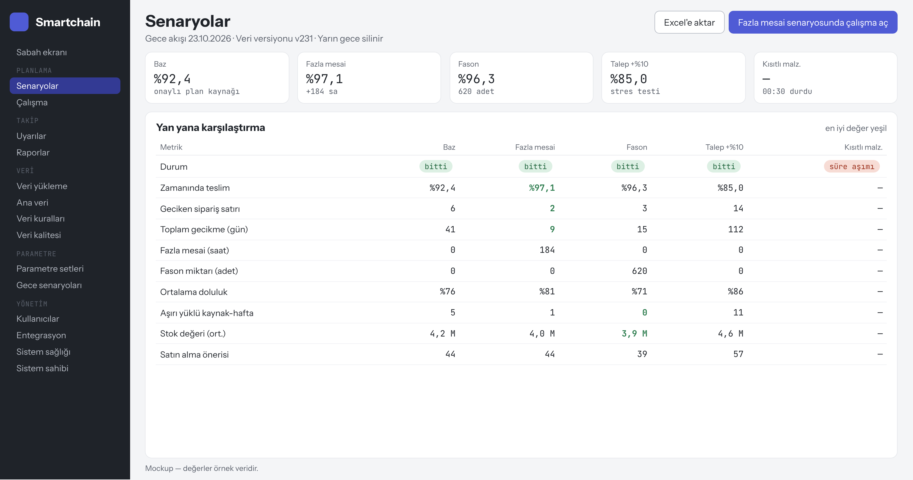

- **Gece sonuçları:** Gece çalışan senaryolar durum ve ana metrikleriyle listelenir.
- **Yan yana karşılaştırma:** Teslim, gecikme, fazla mesai, fason, doluluk ve stok aynı tabloda.
- **Çalışma aç:** Kullanıcı seçtiği senaryo üzerinde çalışma açar; onaylı plan buradan doğar.
- **Geçicidir:** Senaryolar ertesi gece silinir; yalnızca onaylı planlar kalır.

### Çalışma
24. Ekranlar ve fonksiyonlar · Mockup · 09/25

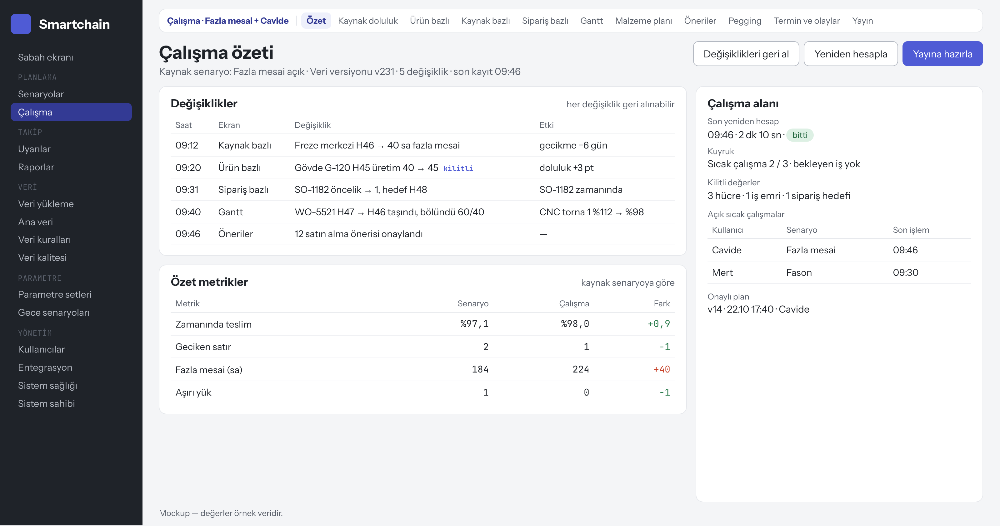

- **Senaryo üzerinde çalışma:** Gece senaryosundan açılır; değişiklikler bu çalışmaya yazılır.
- **Değişiklik izi:** Hangi ekranda ne değişti ve etkisi; tek tek geri alınabilir.
- **Yeniden hesap:** Değişiklikten sonra etkilenen kısım yeniden çözülür; kuyruk durumu görünür.
- **Çalışma çubuğu:** Üstteki çubuk çalışmanın ekranlarını açar: doluluk, manuel planlama, Gantt, yayın…

### Kaynak doluluk raporu
24. Ekranlar ve fonksiyonlar · Mockup · 10/25

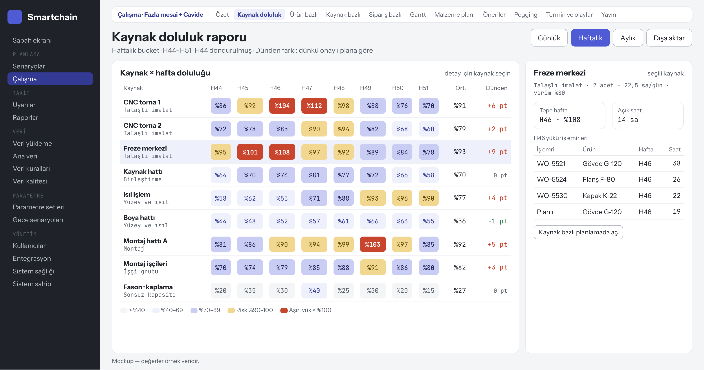

- **Kaynak × dönem:** Her hücre doluluk yüzdesi; bucket seçimi günlük, haftalık, aylık.
- **Renk skalası:** Normal indigo tonlarında, %90–100 hardal, %100 üstü kiremit.
- **Dünden farkı:** Son sütun dünkü onaylı plana göre doluluk değişimini gösterir.
- **Detaya iniş:** Kaynak ve hafta seçilince yükü oluşturan iş emirleri sağda listelenir.

### Ürün bazlı planlama
24. Ekranlar ve fonksiyonlar · Mockup · 11/25

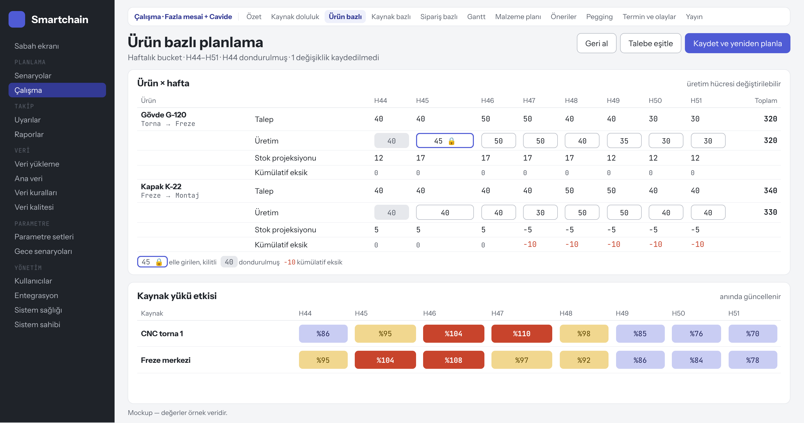

- **Dört satır:** Her ürün için talep, üretim, stok projeksiyonu ve kümülatif eksik.
- **Üretim girilir:** Üretim hücresi değiştirilir; elle değer kilitlenir ve model ona dokunmaz.
- **Dondurulmuş dönem:** İlk bucket gri ve kilitli; değiştirilemez.
- **Anlık etki:** Alttaki kaynak şeridi değişiklikle birlikte güncellenir; kaydedince yeniden çözülür.

### Kaynak bazlı planlama
24. Ekranlar ve fonksiyonlar · Mockup · 12/25

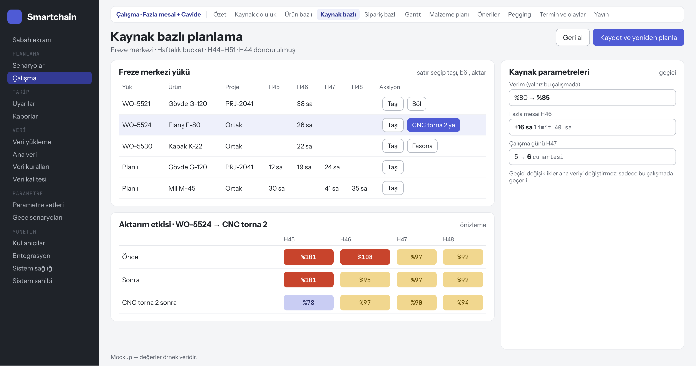

- **Kaynağın yükü:** Seçili kaynağın yükü iş emri ve planlı sipariş bazında haftalara dağılmış görünür.
- **Taşı, böl, aktar:** Yük başka haftaya, alternatif kaynağa ya da fasona aktarılır.
- **Önce / sonra:** Aktarımın iki kaynaktaki etkisi kaydetmeden önce görünür.
- **Geçici parametre:** Verim, fazla mesai, çalışma günü yalnız bu çalışmada değişir.

### Sipariş bazlı planlama
24. Ekranlar ve fonksiyonlar · Mockup · 13/25

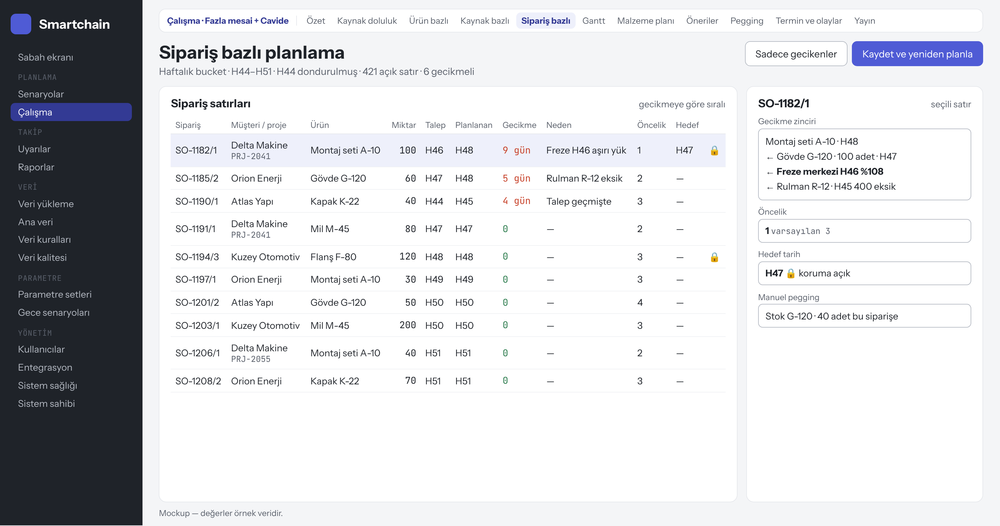

- **Sipariş görünümü:** Her satırda talep ve planlanan tarih, gecikme ve nedeni.
- **Gecikme nedeni:** Kapasite ya da malzeme zinciri sağda adım adım görünür.
- **Öncelik ve hedef:** Öncelik değiştirilir, hedef tarih verilir; koruma ile kilitlenir.
- **Manuel pegging:** Belirli stok ya da arz belirli siparişe elle bağlanabilir.

### Gantt (bucket bazlı)
24. Ekranlar ve fonksiyonlar · Mockup · 14/25

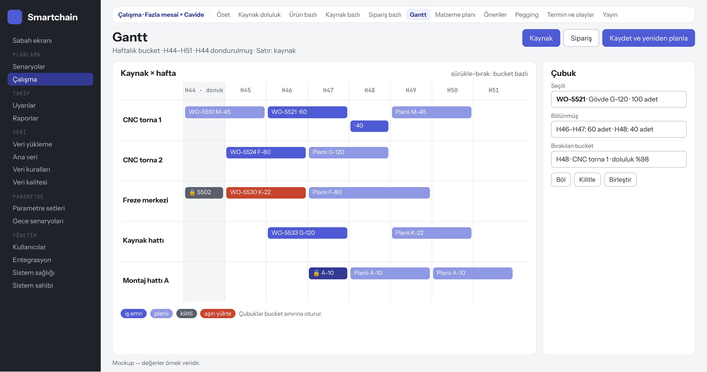

- **Bucket bazlı:** Çubuklar dönem sınırına oturur; saat düzeyinde çizelgeleme yok.
- **Sürükle-bırak:** Çubuk başka haftaya ya da başka kaynağa bırakılır; etki hemen görünür.
- **Böl ve kilitle:** İş emri miktarla bölünür; kilitli çubuğu model taşımaz.
- **İki görünüm:** Satırlar kaynak ya da sipariş olabilir; dört planlama görünümü aynı planı değiştirir.

### Malzeme planı
24. Ekranlar ve fonksiyonlar · Mockup · 15/25

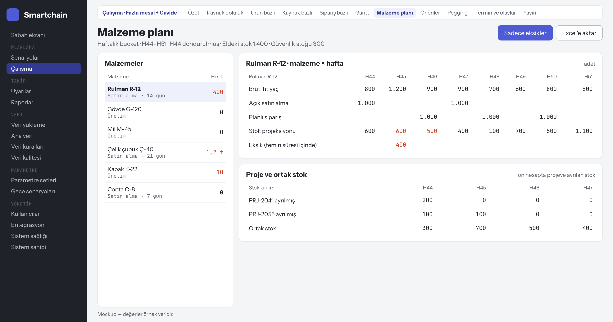

- **Malzeme listesi:** Eksiği olan malzemeler üstte; satın alma ve üretim aynı listede.
- **Malzeme × dönem:** Brüt ihtiyaç, açık arz, planlı sipariş, stok projeksiyonu ve eksik.
- **Temin süresi:** Temin süresi içindeki eksik ayrıca işaretlenir; yeni sipariş yetişmez.
- **Proje kırılımı:** Projeye ayrılan stok ve ortak stok ayrı satırlarda izlenir.

### Öneriler
24. Ekranlar ve fonksiyonlar · Mockup · 16/25

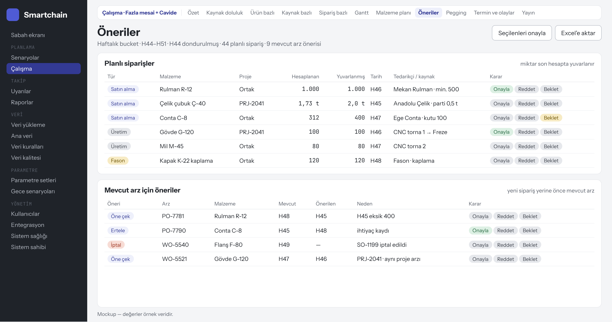

- **Planlı siparişler:** Üretim, satın alma ve fason önerileri tek listede; proje bilgisiyle.
- **Yuvarlama görünür:** Modelin hesapladığı miktar ve parti, minimum, kutu kuralına göre yuvarlanmış miktar.
- **Mevcut arz önce:** Açık sipariş ve iş emri için öne çek, ertele, iptal önerileri.
- **Karar:** Her satır onaylanır, reddedilir ya da bekletilir; yayında dikkate alınır.

### Pegging
24. Ekranlar ve fonksiyonlar · Mockup · 17/25

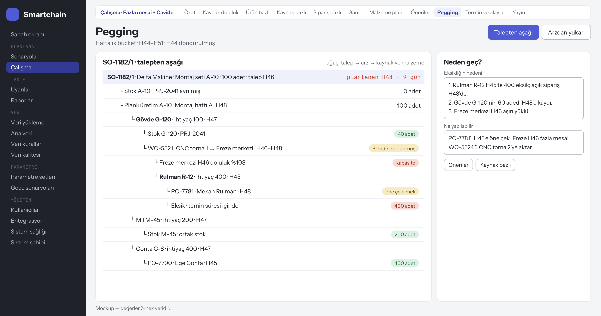

- **İki yön:** Talepten aşağı: talebi hangi arz karşılıyor. Arzdan yukarı: arz hangi talebe gidiyor.
- **Proje bilgisi:** Ayrılmış proje stoğu ve ortak stok ağaçta ayrı görünür.
- **Eksikliğin nedeni:** Kapasite ve malzeme kısıtları ağaçta işaretlenir; sağda sade bir açıklama.
- **Aksiyona geçiş:** Nedenden ilgili ekrana (öneriler, kaynak bazlı) tek tıkla gidilir.

### Termin sorgusu ve olay senaryoları
24. Ekranlar ve fonksiyonlar · Mockup · 18/25

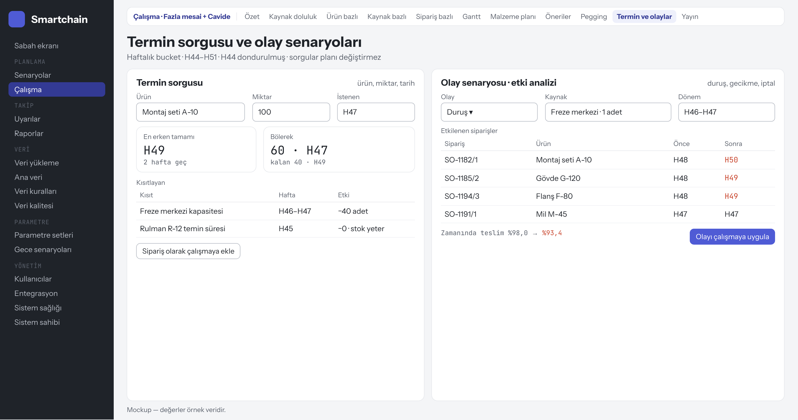

- **Termin sorgusu:** Ürün, miktar ve tarih girilir; en erken tamamı ve bölerek teslim önerilir.
- **Kısıt açıklaması:** Termini kapasite mi malzeme mi kısıtlıyor, hafta ve etkiyle gösterilir.
- **Olay senaryosu:** Duruş, tedarikçi gecikmesi, sipariş iptali gibi olayların etkisi görülür.
- **Uygula ya da bırak:** Sorgu planı değiştirmez; istenirse çalışmaya eklenir.

### Yayın
24. Ekranlar ve fonksiyonlar · Mockup · 19/25

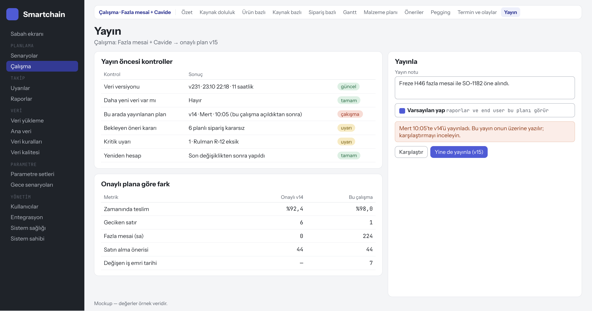

- **Kontrol listesi:** Veri yaşı, yeni veri, bekleyen kararlar ve kritik uyarılar yayından önce kontrol edilir.
- **Çakışma uyarısı:** Çalışma açıldıktan sonra başka yayın yapıldıysa açıkça uyarılır.
- **Fark özeti:** Yayınlanacak planın mevcut onaylı plandan farkı görünür.
- **Varsayılan yap:** Yayınlanan plan istenirse varsayılan olur; raporlar ve end user onu görür.

### Uyarı iş listesi
24. Ekranlar ve fonksiyonlar · Mockup · 20/25

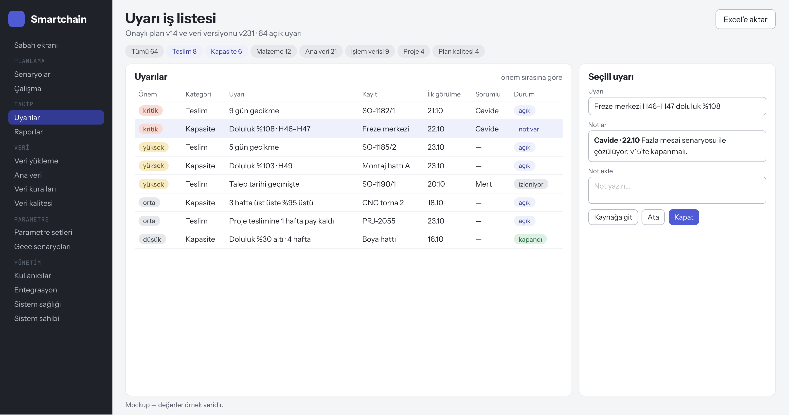

- **Kategori filtresi:** Teslim, kapasite, malzeme, ana veri, işlem verisi, proje ve plan kalitesi.
- **Önem sırası:** Kritik uyarılar üstte; ilk görülme tarihi ve sorumlu görünür.
- **İş listesi:** Uyarıya not yazılır, kişiye atanır, izlenir ya da kapatılır.
- **Kaynağa git:** Uyarıdan ilgili kayda ya da planlama ekranına geçilir.

### Raporlar
24. Ekranlar ve fonksiyonlar · Mockup · 21/25

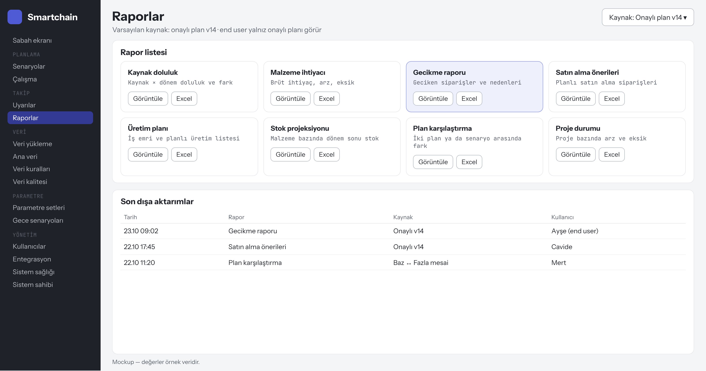

- **Hazır raporlar:** Doluluk, malzeme, gecikme, satın alma, üretim, stok ve proje raporları.
- **Kaynak seçimi:** Rapor onaylı plandan ya da bir senaryodan alınır.
- **Excel’e aktarım:** Her rapor Excel’e indirilir; end user da indirebilir.
- **İz:** Kim hangi raporu hangi plandan aldı, listede görünür.

### Kullanıcılar
24. Ekranlar ve fonksiyonlar · Mockup · 22/25

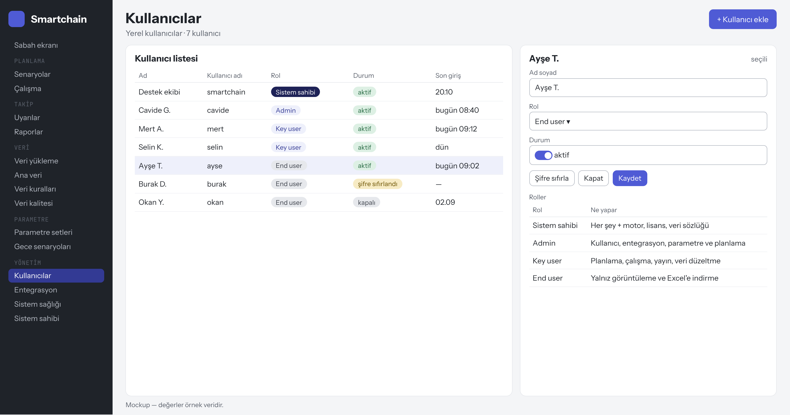

- **Yerel kullanıcı:** Kullanıcılar uygulamada açılır; kapalı ağda dış dizine bağlanmaz.
- **Dört rol:** Sistem sahibi, admin, key user ve end user; yetkiler role bağlı.
- **End user:** Yalnız görüntüler ve Excel’e indirir; hiçbir fonksiyonu çalıştırmaz.
- **Yaşam döngüsü:** Kullanıcı açma, kapatma, rol değiştirme, şifre sıfırlama.

### Entegrasyon ve zamanlanmış işler
24. Ekranlar ve fonksiyonlar · Mockup · 23/25

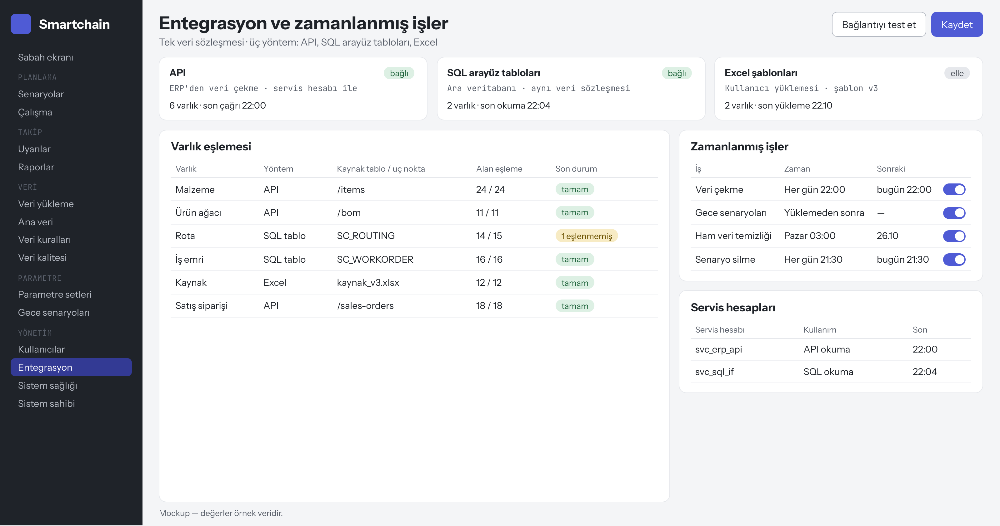

- **Üç yöntem:** API, SQL arayüz tabloları ve Excel; hepsi aynı veri sözleşmesine yazar.
- **Varlık eşlemesi:** Her varlık için yöntem, kaynak ve alan eşleme durumu.
- **Zamanlanmış işler:** Gece veri çekme, senaryolar, ham veri ve senaryo temizliği.
- **Servis hesapları:** Entegrasyon kullanıcıları ayrı tutulur; son kullanım görünür.

### Sistem sağlığı
24. Ekranlar ve fonksiyonlar · Mockup · 24/25

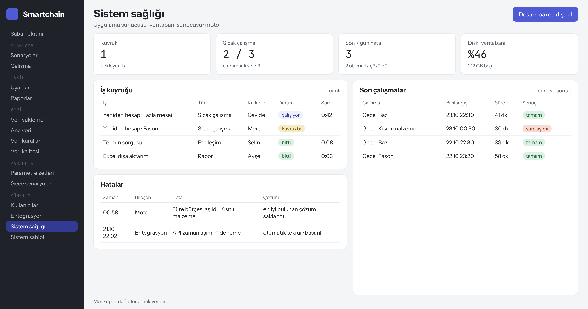

- **Anlık durum:** Kuyruk, sıcak çalışma sayısı, hata ve disk durumu tek bakışta.
- **İş kuyruğu:** Hangi kullanıcının hangi işi çalışıyor ya da bekliyor.
- **Hatalar ve çözüm:** Hata, bileşen ve sistemin nasıl toparladığı listelenir.
- **Destek paketi:** Kapalı ağda uzaktan erişim yok; log ve ayarlar paket olarak dışa alınır.

### Sistem sahibi ayarları
24. Ekranlar ve fonksiyonlar · Mockup · 25/25

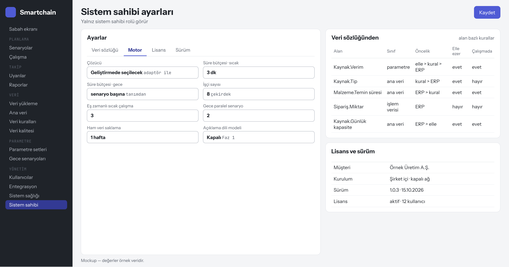

- **Adminin ötesinde:** Bu ekranı yalnız sistem sahibi (bizim hesabımız) görür.
- **Motor ayarları:** Çözücü, süre bütçesi, işçi sayısı, eş zamanlı çalışma sınırı.
- **Veri sözlüğü:** Alan sınıfı, kaynak önceliği, elle ezme ve çalışmada değiştirilebilirlik.
- **Lisans ve sürüm:** Kurulum tipi, sürüm ve lisans bilgisi.
