# Fonksiyonlar (MDD adım 24 · çalışma prensipleri ve mockuplar)

Kaynak: Master Design Document (MDD) 26.10.2026. Bu dosya desteden üretilmiştir; değişiklik önce burada yapılır, deste dilim sonlarında buradan güncellenir (K-54).

### A · Veri alma
24. Ekranlar ve fonksiyonlar · Fonksiyon prensipleri ve mockuplar

- Her fonksiyon için: çalışma prensibi (nasıl çalışır · kurallar ve etkiler, 2 slayt) ve adım adım mockup. Yeniden hesaplanacak alanlar 2. slaytta.
- **01 · Veri çekme:** ERP'deki güncel veriyi entegrasyon tanımlarına göre ham veri tablolarına (Staging) almak ve yüklemeye hazır bir ham veri partisi oluşturmak.
- **02 · Excel şablonu indirme:** Her varlık için veri sözleşmesine birebir uyan, açıklamalı ve örnek satırlı boş Excel şablonu vermek; Excel yolunun hatasız olmasını sağlamak.
- **03 · Excel ile yükleme:** Entegrasyonu olmayan ya da ERP'de tutulmayan varlıkları (kaynak, takvim, vardiya gibi) Excel şablonuyla ham veriye almak; sonrası ERP'den çekilen veriyle aynı yoldan ilerler.
- **04 · Doğrulama:** Ham veri partisini yüklemeden önce yapısal, referans, mantıksal ve tutarlılık kontrollerinden geçirmek; hatalı satırın versiyona girmesini engellemek, uyarılı veriyi görünür kılmak.
- **05 · Tam yükleme:** Doğrulanmış partiyi bütün varlıklarıyla yeni bir veri versiyonuna almak; alan önceliklerini, veri kurallarını ve türetilmiş alanları uygulayıp veriyi plana hazır hale getirmek. Gece akışının standart yolu.
- **06 · Kısmi yükleme:** Partideki yalnız seçilen varlıkları yeni veri versiyonuna almak; hatalı ya da gereksiz varlıkları dışarıda bırakırken diğer varlıklarda önceki versiyonun değerlerini korumak. Gün içi stok ve sipariş tazelemesinin yolu.
- **07 · Veri versiyonlama:** Her yüklemenin dondurulmuş, karşılaştırılabilir bir veri kesiti oluşturması; her plan hesabının hangi veriyle yapıldığının bilinmesi ve onaylı planların verisinin hep saklanması.
- **08 · Yükleme geçmişi:** Çekim, Excel yüklemesi, doğrulama, tam ve kısmi yüklemelerin kim, ne zaman, hangi varlıklar, hangi sonuçla yapıldığını izlenebilir tutmak; sorun olduğunda geriye bakabilmek.
- **09 · Ham veri temizliği:** Ham veri tablolarındaki eski partileri düzenli silerek disk alanını korumak; geçmiş kaydını ve versiyonlanmış veriyi etkilemeden.

### 01 · Veri çekme
24. Ekranlar ve fonksiyonlar · F01 · A Veri alma · Çalışma prensibi 1/2

- ERP'deki güncel veriyi entegrasyon tanımlarına göre ham veri tablolarına (Staging) almak ve yüklemeye hazır bir ham veri partisi oluşturmak. Çekim veri versiyonu açmaz; yükleme ayrı bir adımdır.

#### NASIL ÇALIŞIR

- **KIM VE NEREDEN**
  - Kim: Sistem (gece 22:00, zamanlanmış) · elle: key user ve üstü
  - Nereden: Zamanlanmış iş · Veri yükleme ekranı 'Yeniden çek' · Entegrasyon ekranı 'Bağlantıyı test et' (yalnız test)
- **01:** İş kuyruğuna 'Veri çekme' işi yazılır (Job, gece kanalı). Aynı anda ikinci bir çekim başlatılamaz; gece akışı sırasında elle çekim kapalıdır.
- **02:** Varlıklar tanımlı sırayla okunur: API sayfa sayfa, SQL arayüz tablosu toplu. Kaynağı Excel olan varlıklar atlanır.
- **GIRDI**
  - Entegrasyon tanımları: varlık başına yöntem (API / SQL arayüz tablosu), uç nokta ya da tablo, alan eşlemesi
  - Servis hesabı ve bağlantı bilgileri
  - Varlık sırası: referans verisi (birim, takvim, kaynak, malzeme) → ağaç ve rota → işlem verisi (stok, sipariş, iş emri)
  - Son başarılı çekim zamanı (artımlı çekim destekleyen varlıklar için)
- **03:** Okunan satırlar dönüştürülmeden ham veri tablolarına (Staging_*) yazılır; parti numarası, zaman, yöntem ve satır sayısı ImportBatch'e kaydedilir.
- **04:** Her varlık bitince ilerleme ekrana anlık düşer (WebSocket). Hata alan varlık işaretlenir, sıradaki varlıkla devam edilir.
- **05:** Geçici hatada (zaman aşımı, bağlantı kopması) aralıklı 3 deneme yapılır; kalıcı hatada varlık 'hata' ile kapanır, önceki ham veri korunur.
- **ÇIKTI**
  - Dolu ham veri tabloları (Staging_*) ve ImportBatch kaydı: varlık bazında durum, satır ve hata sayısı
  - Çekim logu (deneme, süre, hata metni) · Entegrasyon ekranında 'son çağrı' bilgisi
  - Sabah ekranında gece akışı satırı; elle çekimde ekranda sonuç özeti
- **06:** Parti tamamlanınca doğrulama (04) otomatik başlar. Gece akışında doğrulama sonrası tam yükleme (05) devam eder.

### 01 · Veri çekme · kurallar ve etkiler
24. Ekranlar ve fonksiyonlar · F01 · A Veri alma · Çalışma prensibi 2/2

- **KURALLAR VE SINIRLAR**
  - Çekim geçerli veriyi değiştirmez; ekranlar ve açık çalışmalar mevcut veri versiyonunu görmeye devam eder.
  - Aynı anda tek çekim; gece akışı sırasında elle çekim engellenir.
  - Alan eşlemesi eksik olan varlık çekilmez, uyarı verilir (Entegrasyon ekranı).
  - Ham veri 1 hafta saklanır (09).
  - Çekim yöntemi varlık bazında tektir: API, SQL ya da Excel; bir varlık iki kaynaktan beslenmez.
- **HATA VE ISTISNA**
  - Bağlantı ya da kimlik hatası: 3 deneme, sonra varlık 'hata'; diğer varlıklar devam eder.
  - Kısmi başarı: çekilen varlıklar doğrulamaya girer; çekilemeyenler bir önceki partide kalır, kullanıcı 'Rota için yeniden dene' ile tek varlığı tekrar çeker.
  - Hiçbir varlık çekilemezse gece akışı 'veri yok' ile durur; senaryolar son veri versiyonuyla çalışır ve 'eski veri' etiketi taşır (parametre, öneri).
  - Şema uyumsuzluğu (ERP'de alan değişmiş): varlık hata, Entegrasyon ekranında 'eşlenmemiş alan' uyarısı.
- **ETKISI VE TETIKLENENLER**
  - Doğrulama (04) otomatik başlar.
  - Sabah ekranı 'gece akışı' ve Entegrasyon ekranı 'son çağrı' güncellenir.
  - Elle tetikleme denetim izine (AuditLog) yazılır.
  - Sistem sağlığı: iş kuyruğu ve süre kaydı.
- **YENİDEN HESAPLANACAK ALANLAR:** Yeniden hesap gerektirmez. Çekim yalnız ham veriyi doldurur; geçerli tablolar, kurallar ve planlar yüklemeyle (05 / 06) etkilenir.
- **ÖRNEK:** 22:00 Malzeme 8.412 satır (4 dk) → 22:04 Ürün ağacı 21.904 satır (9 dk) → Rota 3 denemede zaman aşımı → 22:21 çekim 6/7 varlıkla kapanır, doğrulama başlar.
- **AÇIK KONU:** Çekim başarısız olduğunda gece senaryoları son veri versiyonuyla çalışsın mı, yoksa atlansın mı? Öneri: çalışsın, 'eski veri' etiketiyle.

### 01 · Veri çekme · Başlatma
24. Ekranlar ve fonksiyonlar · F01 · A Veri alma · Mockup 1/3

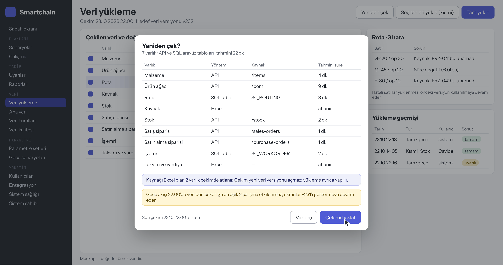

- **Onay penceresi:** Hangi varlıklar hangi yöntemle çekilecek, tahmini süre ve atlanan varlıklar önceden görünür.
- **Etki uyarısı:** Çekimin açık çalışmaları ve ekranları etkilemediği açıkça yazılır.
- **Tek birincil buton:** Vazgeç ve Çekimi başlat; birincil aksiyon indigo.
- **Son çekim bilgisi:** Pencerenin altında son çekim zamanı ve kim yaptığı.

### 01 · Veri çekme · Çekim sürüyor
24. Ekranlar ve fonksiyonlar · F01 · A Veri alma · Mockup 2/3

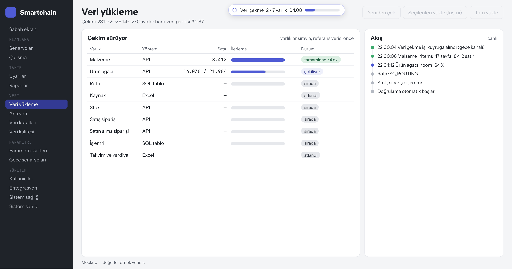

- **Varlık bazında ilerleme:** Her varlık için satır sayısı ve ilerleme çubuğu; sıradakiler gri.
- **Canlı akış:** Sağda zaman damgalı adımlar; WebSocket ile güncellenir.
- **Butonlar kilitli:** Çekim sırasında yükleme butonları pasif; iş durumu üstteki şeritte.
- **Ekranlar etkilenmez:** Alt başlıkta parti numarası; veri versiyonu değişmez.

### 01 · Veri çekme · Sonuç ve hata
24. Ekranlar ve fonksiyonlar · F01 · A Veri alma · Mockup 3/3

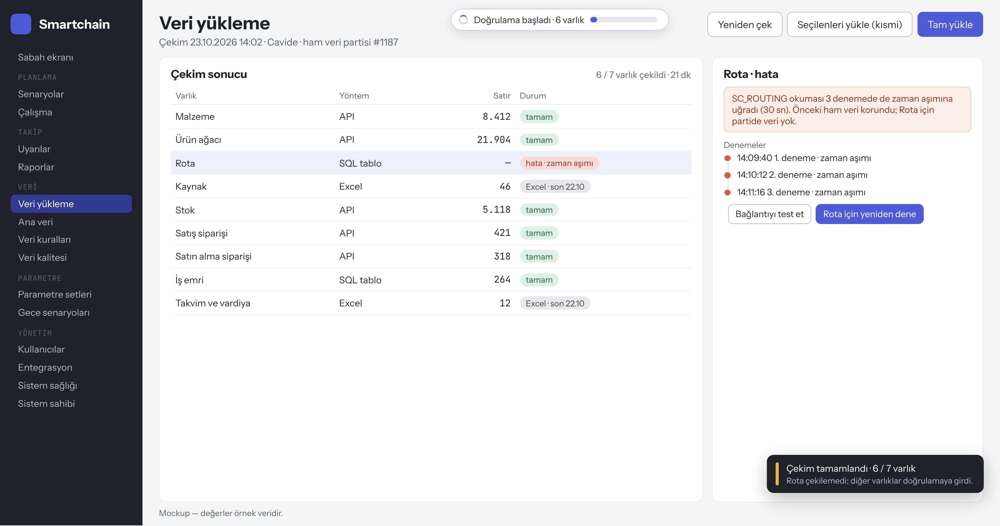

- **Kısmi başarı:** 6 / 7 varlık çekildi; Rota hata ile işaretli, diğerleri doğrulamaya girdi.
- **Hata detayı:** Deneme zamanları ve neden; önceki ham verinin korunduğu belirtilir.
- **Tek varlık tekrar:** Rota için yeniden dene: tüm çekimi baştan başlatmak gerekmez.
- **Bildirim:** Sağ altta uyarı tonunda bildirim; üstte doğrulamanın başladığı görünür.

### 02 · Excel şablonu indirme
24. Ekranlar ve fonksiyonlar · F02 · A Veri alma · Çalışma prensibi 1/2

- Her varlık için veri sözleşmesine birebir uyan, açıklamalı ve örnek satırlı boş Excel şablonu vermek; Excel yolunun hatasız olmasını sağlamak.

#### NASIL ÇALIŞIR

- **KIM VE NEREDEN**
  - Kim: Key user ve üstü
  - Nereden: Veri yükleme ekranı · varlık satırı menüsü 'Şablonu indir' · Entegrasyon ekranı Excel kartı
- **01:** Kullanıcı varlık satırından 'Şablonu indir' seçer.
- **02:** Sistem veri sözlüğünden sütunları üretir: 1. satır alan adı, 2. satır açıklama ve kural (tip, zorunlu, liste), 3. satır örnek kayıt.
- **GIRDI**
  - Varlık seçimi
  - Veri sözlüğü (FieldDefinition): alan, tip, zorunluluk, varsayılan, açıklama
  - Kod listeleri: kaynak tipi, birim, takvim, tedarikçi kodları
- **03:** Kod listesi olan alanlara açılır liste (veri doğrulama) bağlanır; listeler 'Kodlar' sayfasında tutulur.
- **04:** Tarih ve sayı biçimleri sabitlenir; sütun genişlikleri ayarlanır.
- **05:** Şablon sürümü ve varlık adı gizli bir sayfaya yazılır; yüklemede (03) bu bilgiyle tanınır.
- **06:** Dosya 'smartchain_<varlık>_v<sürüm>.xlsx' adıyla indirilir; indirme denetim izine yazılır.
- **ÇIKTI**
  - xlsx dosyası: veri sayfası, Kodlar sayfası, Açıklama sayfası, gizli sürüm bilgisi
  - Denetim izi kaydı (kim, hangi varlık, hangi sürüm)

### 02 · Excel şablonu indirme · kurallar ve etkiler
24. Ekranlar ve fonksiyonlar · F02 · A Veri alma · Çalışma prensibi 2/2

- **KURALLAR VE SINIRLAR**
  - Şablon elle sürdürülmez, her seferinde veri sözlüğünden üretilir.
  - Veri sözlüğü değişince şablon sürümü artar; eski sürümle yükleme uyarı verir (03).
  - Yalnız o varlığın alanları; sistem alanları (Id, versiyon) şablonda yoktur.
  - Şablon dilde Türkçe açıklama, alan adları veri sözlüğündeki teknik adlardır.
- **HATA VE ISTISNA**
  - Veri sözlüğünde tanımsız varlık: menü seçeneği pasif.
  - Dosya üretilemezse hata bildirimi; log kaydı.
  - Tarayıcı indirmeyi engellerse yeniden deneme bağlantısı.
- **ETKISI VE TETIKLENENLER**
  - Yok; yalnız dosya üretir.
  - Denetim izi kaydı.
- **YENİDEN HESAPLANACAK ALANLAR:** Yeniden hesap gerektirmez.
- **ÖRNEK:** Kaynak şablonu v3: 12 sütun, 4 zorunlu (Code, Name, ResourceType, CapacityUnit). ResourceType hücresinde açılır liste: Makine, Hat, Fırın, İşçi grubu, Fason.

### 02 · Excel şablonu indirme · Menüden indirme
24. Ekranlar ve fonksiyonlar · F02 · A Veri alma · Mockup 1/2

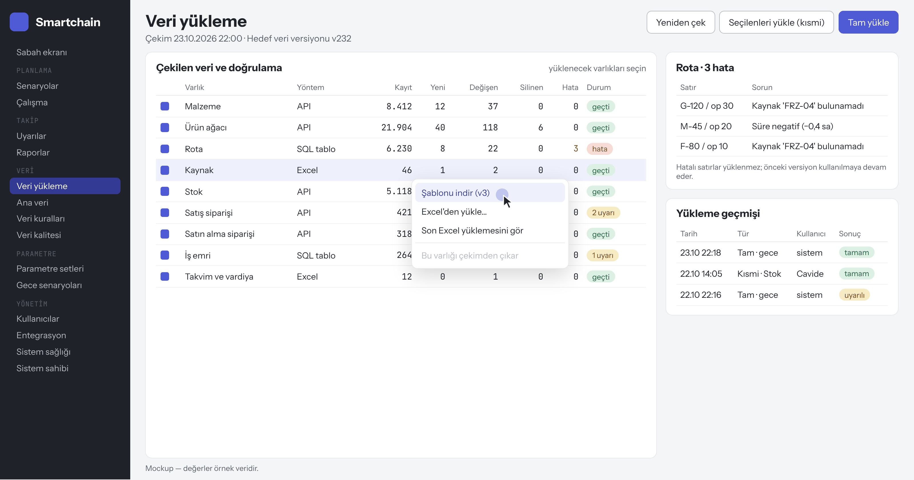

- **Satır menüsü:** Varlık satırındaki menüde şablon, Excel yükleme ve son yükleme bir arada.
- **Sürüm görünür:** Menüde şablon sürümü yazar; kullanıcı elindeki dosyayla karşılaştırabilir.
- **Pasif seçenek:** Yetki ya da bağlam dışı seçenekler gizlenmez, pasif gösterilir.
- **Tek tık:** İndirme için ek pencere yok; önizleme isteğe bağlı.

### 02 · Excel şablonu indirme · Şablon önizleme
24. Ekranlar ve fonksiyonlar · F02 · A Veri alma · Mockup 2/2

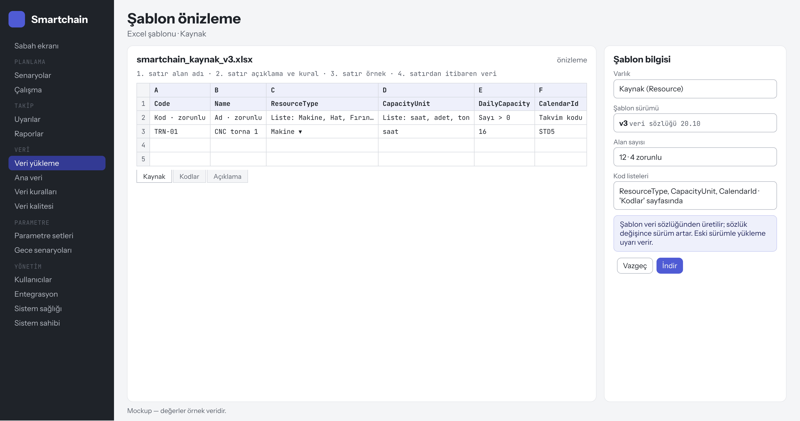

- **Üç başlık satırı:** Alan adı, açıklama ve kural, örnek kayıt; veri 4. satırdan başlar.
- **Açılır listeler:** Kod listesi olan alanlar Excel'de liste olarak gelir; yazım hatası azalır.
- **Kodlar sayfası:** Listeler ayrı sayfada; kullanıcı kodların anlamını görür.
- **Sözlükten üretim:** Şablon bilgisi kartı: sürüm, alan sayısı, zorunlu alanlar.

### 03 · Excel ile yükleme
24. Ekranlar ve fonksiyonlar · F03 · A Veri alma · Çalışma prensibi 1/2

- Entegrasyonu olmayan ya da ERP'de tutulmayan varlıkları (kaynak, takvim, vardiya gibi) Excel şablonuyla ham veriye almak; sonrası ERP'den çekilen veriyle aynı yoldan ilerler.

#### NASIL ÇALIŞIR

- **KIM VE NEREDEN**
  - Kim: Key user ve üstü
  - Nereden: Veri yükleme ekranı · 'Excel'den yükle' · varlık satırı menüsü
- **01:** Dosya sürükle-bırak ya da seçimle alınır; gizli sayfadan varlık ve şablon sürümü tanınır, sütunlar alanlara eşlenir.
- **02:** Yükleme modu seçilir: 'ekle / güncelle' dosyadaki kayıtları işler; 'tam' dosyada olmayan kayıtları silinmiş sayar (uyarı ile).
- **GIRDI**
  - Şablondan üretilmiş xlsx dosyası (tek varlık)
  - Yükleme modu: ekle / güncelle ya da tam
  - Veri sözlüğü (tip, zorunluluk, kod listeleri)
- **03:** Satır bazlı ön kontrol: tip, zorunlu alan, kod listesi, tekrar eden kod. Sonuç sayılarla ve satır listesiyle gösterilir.
- **04:** Kullanıcı hatalı satırları atlayarak devam eder ya da hata raporunu (hata sütunu eklenmiş xlsx) indirip vazgeçer.
- **ÇIKTI**
  - ImportBatch (Excel) ve ham veri satırları
  - Hata raporu xlsx (isteğe bağlı)
  - Yükleme geçmişi kaydı; dosya bir hafta ham veriyle birlikte saklanır
- **05:** Geçerli satırlar ham veri tablosuna yazılır; ImportBatch (yöntem = Excel) oluşur, dosya adı ve kullanıcı kaydedilir.
- **06:** Parti doğrulamaya (04) girer; ardından kullanıcı tam ya da kısmi yükleme (05 / 06) yapar.

### 03 · Excel ile yükleme · kurallar ve etkiler
24. Ekranlar ve fonksiyonlar · F03 · A Veri alma · Çalışma prensibi 2/2

- **KURALLAR VE SINIRLAR**
  - Excel ile yükleme yalnız yöntemi Excel olan varlıklar için; ERP'den gelen varlığı düzeltmek için elle değer / toplu düzeltme (12, 15) kullanılır.
  - Tek dosya tek varlık; en fazla 200.000 satır (parametre).
  - Aynı kodun tekrarı hata; dosyadaki son satır değil, kullanıcı karar verir.
  - Eski şablon sürümüyle yükleme uyarı verir, eşleme adla yapılır; eşlenemeyen sütun bilgi olarak listelenir.
  - Yükleme veri versiyonu açmaz; versiyon 05 / 06 ile oluşur.
- **HATA VE ISTISNA**
  - Dosya tanınmadı (gizli sayfa yok): kullanıcı varlığı elle seçer, sütun eşlemesi gösterilir.
  - Tüm satırlar hatalı: parti oluşturulmaz, rapor indirilir.
  - Dosya bozuk ya da çok büyük: anlaşılır mesaj, limit yazılır.
  - Yükleme sırasında bağlantı koparsa parti 'tamamlanmadı'; yeniden yükleme gerekir.
- **ETKISI VE TETIKLENENLER**
  - Doğrulama (04) başlar.
  - Veri yükleme ekranında varlık satırı 'Excel · bekliyor' olur.
  - Denetim izi: dosya adı, satır sayısı, kullanıcı.
- **YENİDEN HESAPLANACAK ALANLAR:** Yeniden hesap gerektirmez; etkiler yüklemeyle (05 / 06) oluşur.
- **ÖRNEK:** kaynak_v3.xlsx · 46 satır: 3 hata (boş kapasite, kod listesinde olmayan tip, olmayan takvim), 1 uyarı. Kullanıcı 43 satırla devam eder, hata raporunu indirir.

### 03 · Excel ile yükleme · Dosya ve mod
24. Ekranlar ve fonksiyonlar · F03 · A Veri alma · Mockup 1/2

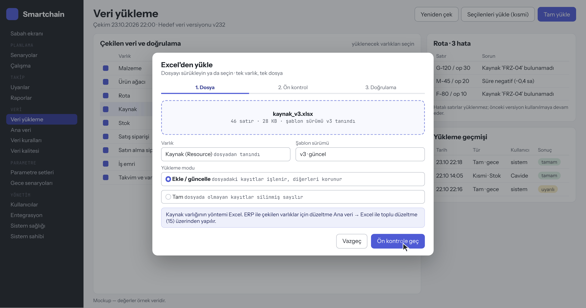

- **Sürükle-bırak:** Dosya alanı; varlık ve şablon sürümü dosyadan otomatik tanınır.
- **Mod seçimi:** Ekle / güncelle varsayılan; 'tam' modun sonucu (silinmiş sayma) açıkça yazılır.
- **Adım göstergesi:** Dosya → ön kontrol → doğrulama; kullanıcı nerede olduğunu görür.
- **Sınır uyarısı:** ERP'den gelen varlıklar için doğru yol bilgi kutusunda gösterilir.

### 03 · Excel ile yükleme · Ön kontrol
24. Ekranlar ve fonksiyonlar · F03 · A Veri alma · Mockup 2/2

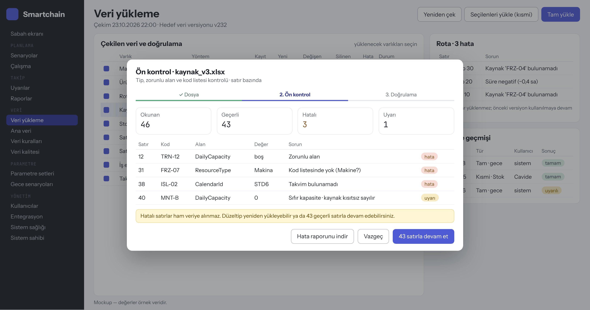

- **Sayılarla özet:** Okunan, geçerli, hatalı, uyarı; karar vermeden önce tek bakış.
- **Satır bazında sorun:** Satır no, kod, alan, değer ve anlaşılır sorun metni; öneri parantezde.
- **İki çıkış yolu:** Hata raporunu indir ve düzelt, ya da geçerli satırlarla devam et.
- **Uyarı yüklenir:** Uyarı seviyesi satır alınır, veri kalitesi listesine düşer.

### 04 · Doğrulama
24. Ekranlar ve fonksiyonlar · F04 · A Veri alma · Çalışma prensibi 1/2

- Ham veri partisini yüklemeden önce yapısal, referans, mantıksal ve tutarlılık kontrollerinden geçirmek; hatalı satırın versiyona girmesini engellemek, uyarılı veriyi görünür kılmak.

#### NASIL ÇALIŞIR

- **KIM VE NEREDEN**
  - Kim: Sistem (çekim ve Excel yüklemesi sonrası otomatik) · elle 'Yeniden doğrula': key user ve üstü
  - Nereden: Çekim (01) ve Excel yüklemesinin (03) sonunda otomatik · Veri yükleme ekranı 'Yeniden doğrula'
- **01:** Yapısal kontrol: zorunlu alan, tip, uzunluk, birim kodu, tekrar eden anahtar.
- **02:** Referans kontrolü: rota → kaynak, ağaç → malzeme, sipariş → müşteri ve malzeme, stok → malzeme. Referans önce aynı partide, sonra geçerli veride aranır.
- **03:** Mantıksal kontrol: negatif miktar ve süre, ürün ağacı döngüsü, başlangıç > bitiş, takvimsiz kaynak, sıfır kapasite, minimum parti > yıllık talep.
- **GIRDI**
  - Ham veri partisi (ImportBatch + Staging)
  - Veri sözlüğü: tip, zorunluluk, kod listeleri
  - Geçerli veri versiyonu (referans ve tutarlılık kontrolleri için)
  - Uyarı tanımları: hangi kontrol hata, hangisi uyarı; hata eşiği (%)
- **04:** Tutarlılık: geçerli versiyonla karşılaştırma; yeni, değişen ve silinen (partide olmayan) kayıtlar sayılır.
- **05:** Her bulgu hata (satır yüklenmez), uyarı (yüklenir, Veri kalitesi listesine düşer) ya da bilgi olarak sınıflanır; sınıf uyarı tanımlarından gelir.
- **ÇIKTI**
  - ImportBatch.Status (geçti / uyarı / hata), ErrorCount ve bulgu listesi (satır, kontrol, sorun, öneri)
  - Veri kalitesi uyarısı adayları (yükleme ile listeye düşer)
  - Doğrulama raporu (xlsx)
- **06:** Varlık bazında özet ve satır listesi ImportBatch'e yazılır; ekran anlık güncellenir. Gece akışında hata eşiği aşılmayan varlıklar hatalı satırlar atlanarak yüklenir.

### 04 · Doğrulama · kurallar ve etkiler
24. Ekranlar ve fonksiyonlar · F04 · A Veri alma · Çalışma prensibi 2/2

- **KURALLAR VE SINIRLAR**
  - Doğrulama yalnız okur; geçerli veriyi ve ham veriyi değiştirmez.
  - Hata satır düzeyindedir; varlık, hata eşiği (varsayılan %5) aşılmadıkça yüklenebilir.
  - Referans eksikse satır hata; kuralla tamamlanabilecek boş alan (temin süresi, takvim) uyarıdır.
  - Hangi kontrolün hata, hangisinin uyarı olduğu uyarı tanımlarıyla parametriktir.
- **HATA VE ISTISNA**
  - Doğrulama çökerse parti 'doğrulanamadı', yükleme butonları kapalı; hata Sistem sağlığında.
  - Hata eşiği aşılan varlık gece akışında yüklenmez, önceki versiyon kalır; sabah ekranına düşer.
  - Elle yüklemede kullanıcı varlığı dışarıda bırakma ya da hatalı satırları atlama kararını verir.
- **ETKISI VE TETIKLENENLER**
  - Gece akışında tam yükleme (05) devam eder.
  - Veri yükleme ekranında varlık durumları ve detay çekmecesi.
  - Sabah ekranında doğrulama satırı (uyarı sayısıyla).
- **YENİDEN HESAPLANACAK ALANLAR:** Yeniden hesap gerektirmez; doğrulama yazmaz.
- **ÖRNEK:** Parti #1187: Rota 6.230 satır, 3 hata (iki eksik kaynak referansı, bir negatif süre), 5 uyarı. Eşik %5, hata oranı %0,05 → Rota hatalı satırlar atlanarak yüklenebilir.

### 04 · Doğrulama · Sonuç özeti
24. Ekranlar ve fonksiyonlar · F04 · A Veri alma · Mockup 1/2

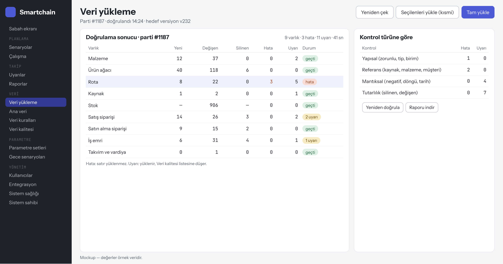

- **Varlık bazında sayılar:** Yeni, değişen, silinen, hata ve uyarı tek tabloda; durum çipi renkli.
- **Kontrol türü kırılımı:** Yapısal, referans, mantıksal, tutarlılık; sorunun kaynağı anlaşılır.
- **Seviye açıklaması:** Altta tek cümle: hata yüklenmez, uyarı yüklenir.
- **Yeniden doğrula:** Kaynakta düzeltme sonrası tekrar; rapor indirilebilir.

### 04 · Doğrulama · Varlık detayı
24. Ekranlar ve fonksiyonlar · F04 · A Veri alma · Mockup 2/2

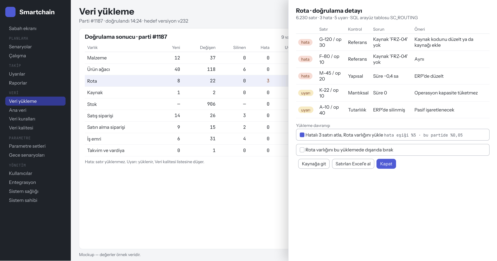

- **Çekmece:** Seçilen varlığın bulguları sağdan açılır; sayfa bağlamı kaybolmaz.
- **Satır, kontrol, sorun, öneri:** Her bulguda ne, nerede, neden ve ne yapılmalı.
- **Yükleme davranışı:** Atla ya da dışarıda bırak; eşik ve bu partideki oran yazılır.
- **Kaynağa git:** Bulgudan ilgili ana veri kaydına ya da Excel'e geçiş.

### 05 · Tam yükleme
24. Ekranlar ve fonksiyonlar · F05 · A Veri alma · Çalışma prensibi 1/3

- Doğrulanmış partiyi bütün varlıklarıyla yeni bir veri versiyonuna almak; alan önceliklerini, veri kurallarını ve türetilmiş alanları uygulayıp veriyi plana hazır hale getirmek. Gece akışının standart yolu.

#### NASIL ÇALIŞIR

- **KIM VE NEREDEN**
  - Kim: Sistem (gece, doğrulama sonrası) · elle: key user ve üstü
  - Nereden: Gece akışı · Veri yükleme ekranı 'Tam yükle'
- **01:** Yeni veri versiyonu açılır (DataVersion: tam, kim, ne zaman). Yükleme tek işlem olarak çalışır; ekranlar bitene kadar önceki versiyonu gösterir.
- **02:** Her varlık için ham veri geçerli tablolara yazılır: yeni kayıt eklenir, değişen kayıt yeni satır olarak versiyonlanır, partide olmayan kayıt pasif (silindi) işaretlenir; fiziksel silme yok.
- **GIRDI**
  - Doğrulanmış ham veri partisi
  - Hata eşiği ve yükleme davranışı (atla / dışarıda bırak)
  - Veri sözlüğü: alan önceliği (ERP, kural, elle, varsayılan), elle ezme ayarı
  - Aktif veri kuralları (sıralı)
- **03:** Alan önceliği uygulanır: ERP değeri FieldValueSource.ErpValue'ya yazılır; elle değer varsa sözlükteki ayara göre korunur ya da ezilir; kaynağı (ERP / kural / elle / varsayılan) kaydedilir.
- **04:** Veri kuralları sırayla çalışır (19); etkilenen kayıtlar ve kaynak etiketi güncellenir.
- **05:** Türetilmiş alanlar hesaplanır: LLC, birim dönüşümleri, boş alanlara varsayılan.
- **ÇIKTI**
  - Yeni veri versiyonu (DataVersion + tüm varlıklar için DataVersionEntity)
  - Güncel ana veri ve işlem verisi; FieldValueSource (değer kaynağı)
  - Veri kalitesi uyarıları; yükleme geçmişi ve denetim izi kaydı
- **06:** Veri kalitesi kontrolü (20) yeni versiyon üzerinde çalışır; uyarılar listeye düşer.
- **07:** Versiyon kapatılır (önceki versiyonun geçerliliği biter); gece akışında senaryolar bu versiyonla başlar. Elle yüklemede sonuç bildirimi ve geçmiş kaydı.

### 05 · Tam yükleme · kurallar ve etkiler
24. Ekranlar ve fonksiyonlar · F05 · A Veri alma · Çalışma prensibi 2/3

- **KURALLAR VE SINIRLAR**
  - Ya hep ya hiç: yükleme ortasında hata olursa geri alınır, önceki versiyon geçerli kalır.
  - Elle değerler (ManualValue) silinmez; sözlükteki 'elle ezer' ayarı korunup korunmayacağını belirler.
  - Açık çalışmalar açıldıkları veri versiyonuna bağlı kalır; yayında (76) 'daha yeni veri var' uyarısı alırlar.
  - Hata eşiğini aşan varlık yüklenmez: gece akışında otomatik dışarıda kalır (yükleme kısmiye döner), elle yüklemede kullanıcıya sorulur.
  - Yükleme sırasında ikinci yükleme ve çekim başlatılamaz.
- **HATA VE ISTISNA**
  - Veritabanı hatası: işlem geri alınır, sabah ekranı ve Sistem sağlığı kaydı; ham veri partisi yeniden kullanılabilir.
  - Kural hatası (ör. bölme sıfıra): kural atlanır, uyarı; yükleme devam eder.
  - Süre aşımı (parametre, öneri 30 dk): işlem geri alınır, destek paketi için log.
  - Yükleme sonrası veri kalitesi kontrolü çökerse yükleme geçerli kalır, kontrol 'tamamlanmadı' işaretlenir.
- **ETKISI VE TETIKLENENLER**
  - Gece akışında senaryolar (40) başlar.
  - Açık çalışmalarda 'yeni veri var' bildirimi.
  - Veri kalitesi listesi ve sabah ekranı 'dünden bugüne' güncellenir.
  - Ana veri ekranları yeni versiyonu gösterir; yükleme geçmişi ve denetim izi.
- **ÖRNEK:** Parti #1187 → v232: 9 varlık, 90 yeni, 1.158 değişen, 15 silinen; Rota'da 3 satır atlandı. Kurallar 14 kaydı değiştirdi, veri kalitesi 3 yeni uyarı üretti. Süre 2 dk 48 sn.

### 05 · Tam yükleme · yeniden hesaplanacak alanlar
24. Ekranlar ve fonksiyonlar · F05 · A Veri alma · Çalışma prensibi 3/3

- **YENİDEN HESAPLANACAK ALANLAR:** Alan Nerede Ne zaman / neden
- **Geçerli değer ve kaynağı:** FieldValueSource Her alan için ERP / kural / elle / varsayılan önceliği yeniden uygulanır
- **Kural sonuçları:** DataRule → hedef alanlar Kurallar yeni veri üzerinde sırayla yeniden çalışır
- **En alt seviye kodu (LLC):** Material Ürün ağacı değiştiyse yeniden hesaplanır
- **Türetilmiş alanlar:** Birim dönüşümü, varsayılanlar Yeni ve değişen kayıtlar için
- **Veri kalitesi uyarıları:** Veri kalitesi listesi Yeni versiyon üzerinde baştan üretilir; kapatılanlar kapalı kalır
- **Dünden bugüne farkı:** Sabah ekranı Önceki versiyonla karşılaştırma
- **Plan:** Senaryolar · çalışmalar Otomatik değil: gece senaryoları yeni versiyonla çalışır, açık çalışma eski versiyonda kalır

### 05 · Tam yükleme · Onay
24. Ekranlar ve fonksiyonlar · F05 · A Veri alma · Mockup 1/3

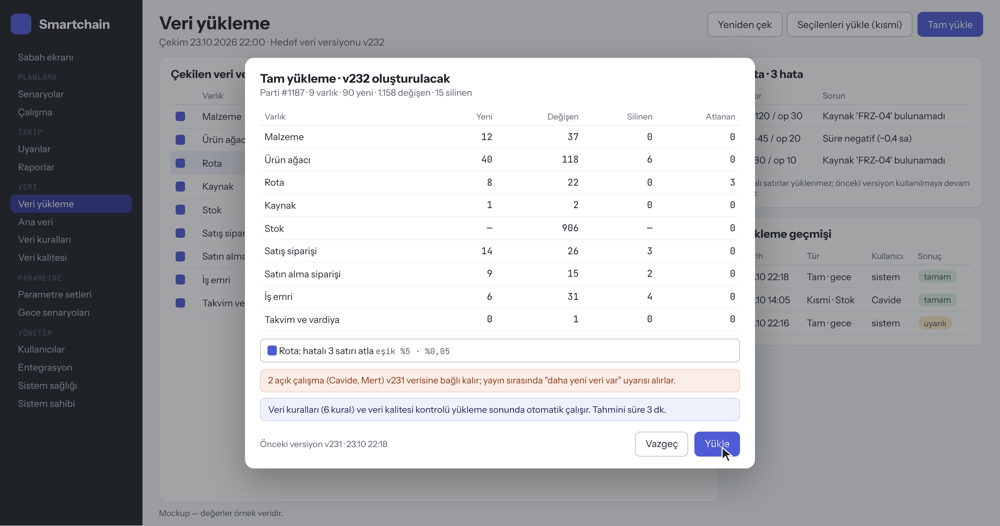

- **Ne olacak:** Varlık bazında yeni, değişen, silinen ve atlanan sayıları onaydan önce görünür.
- **Hatalı satır kararı:** Doğrulamadan gelen davranış seçimi burada da değiştirilebilir.
- **Yan etki uyarısı:** Açık çalışmaların eski versiyonda kalacağı kırmızı kutuda yazar.
- **Otomatik adımlar:** Kurallar ve kalite kontrolünün yükleme sonunda çalışacağı belirtilir.

### 05 · Tam yükleme · Yükleniyor
24. Ekranlar ve fonksiyonlar · F05 · A Veri alma · Mockup 2/3

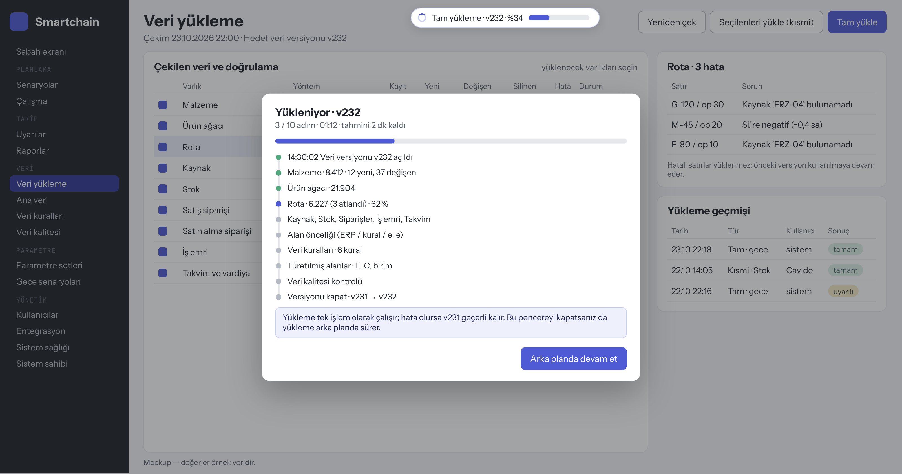

- **Adım adım ilerleme:** Versiyon açma, varlıklar, öncelik, kurallar, türetilmiş alanlar, kalite, kapatma.
- **Arka planda devam:** Pencere kapatılsa da iş sürer; üstteki şerit durumu gösterir.
- **Güvence:** Hata olursa v231'in geçerli kalacağı yazılır.
- **Süre tahmini:** Önceki yüklemelerden tahmin; kullanıcı beklemeyi planlar.

### 05 · Tam yükleme · Sonuç
24. Ekranlar ve fonksiyonlar · F05 · A Veri alma · Mockup 3/3

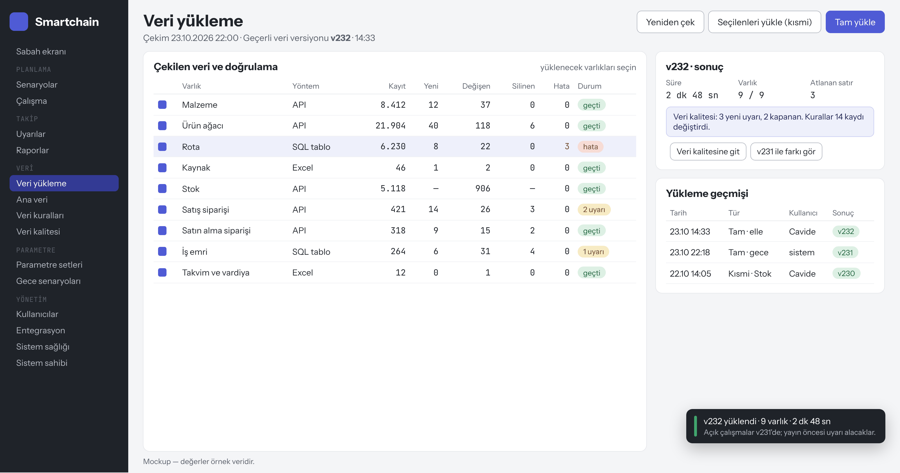

- **Bildirim:** Yeşil bildirim: versiyon, varlık sayısı, süre; yan etki tek satırda.
- **Bağlam güncellendi:** Alt başlıkta geçerli versiyon v232 oldu.
- **Sonraki adım:** Veri kalitesine git ve v231 ile farkı gör bağlantıları.
- **Geçmiş kaydı:** Yükleme geçmişine elle yükleme satırı eklendi.

### 06 · Kısmi yükleme
24. Ekranlar ve fonksiyonlar · F06 · A Veri alma · Çalışma prensibi 1/3

- Partideki yalnız seçilen varlıkları yeni veri versiyonuna almak; hatalı ya da gereksiz varlıkları dışarıda bırakırken diğer varlıklarda önceki versiyonun değerlerini korumak. Gün içi stok ve sipariş tazelemesinin yolu.

#### NASIL ÇALIŞIR

- **KIM VE NEREDEN**
  - Kim: Key user ve üstü · sistem (gece akışında hata eşiği aşılan varlık varsa otomatik)
  - Nereden: Veri yükleme ekranı · varlık seçimi + 'Seçilenleri yükle'
- **01:** Kullanıcı varlıkları işaretler; sistem bağımlılıkları kontrol eder: seçilen varlığın referansları partide ya da geçerli versiyonda var mı? Eksikse bağlı varlığı önerir.
- **02:** Onay penceresinde seçilen varlıkların sayıları ve 'diğer varlıklar v231 değerlerini korur' bilgisi gösterilir.
- **GIRDI**
  - Doğrulanmış parti ve varlık seçimi
  - Bağımlılık matrisi: hangi varlık hangisine referans verir (stok → malzeme, sipariş → müşteri, proje)
  - Veri sözlüğü, kurallar, hata eşiği (05 ile aynı)
- **03:** Yeni veri versiyonu 'kısmi' olarak açılır; DataVersionEntity'ye yüklenen varlıklar yazılır.
- **04:** Seçilen varlıklar 05'teki adımlarla yazılır (yeni, değişen, silinen; alan önceliği).
- **05:** Veri kuralları ve türetilmiş alanlar yalnız yüklenen varlıklar ve onlara bağlı alanlarda çalışır; veri kalitesi kontrolü aynı kapsamda.
- **ÇIKTI**
  - Kısmi veri versiyonu (DataVersion.LoadType = kısmi, DataVersionEntity)
  - Seçilen varlıklarda güncel veri ve değer kaynağı
  - Kapsam dahilinde veri kalitesi uyarıları; yükleme geçmişi kaydı
- **06:** Versiyon kapatılır; yüklenmeyen varlıklar önceki satırları taşır. Sonuç bildirimi, geçmiş ve denetim izi kaydı.

### 06 · Kısmi yükleme · kurallar ve etkiler
24. Ekranlar ve fonksiyonlar · F06 · A Veri alma · Çalışma prensibi 2/3

- **KURALLAR VE SINIRLAR**
  - Bağımlılık eksikse (ör. ürün ağacı seçildi, yeni malzeme kodları partide ama Malzeme seçilmedi) sistem bağlı varlığı önerir; kullanıcı yine de devam ederse eksik referanslı satırlar hata olarak atlanır.
  - Kısmi yükleme de tam yükleme gibi ya hep ya hiç çalışır.
  - Yüklenmeyen varlıklar için ham veri partide kalır; aynı partiden daha sonra ikinci kısmi yükleme yapılabilir.
  - Gece akışında kısmi yükleme yalnız hata eşiği aşılan varlıkları dışarıda bırakmak için otomatik kullanılır.
- **HATA VE ISTISNA**
  - Bağımlılık eksik ve kullanıcı devam etti: eksik referanslı satırlar atlanır, sayı onayda yazılır.
  - Yükleme hatası: geri alınır, önceki versiyon geçerli.
  - Aynı partiden seçilen varlık daha önce yüklendiyse uyarı: 'bu varlık v232 ile zaten yüklendi'.
- **ETKISI VE TETIKLENENLER**
  - Açık çalışmalara 'yeni veri var' bildirimi (seçime bağlı).
  - Veri kalitesi listesi kapsam dahilinde güncellenir.
  - Sabah ekranı 'dünden bugüne' ve ana veri ekranları.
- **ÖRNEK:** Öğleden sonra stok ve siparişler tazelenir: Stok + Satış siparişi seçilir; sistem 2 yeni proje kodu için Proje'yi de önerir. v232 kısmi: 3 varlık partiden, 6 varlık v231'den. 38 sn.

### 06 · Kısmi yükleme · yeniden hesaplanacak alanlar
24. Ekranlar ve fonksiyonlar · F06 · A Veri alma · Çalışma prensibi 3/3

- **YENİDEN HESAPLANACAK ALANLAR:** Alan Nerede Ne zaman / neden
- **Geçerli değer ve kaynağı:** FieldValueSource Yalnız yüklenen varlıkların alanları
- **Kural sonuçları:** DataRule Hedef alanı yüklenen varlıkta olan kurallar
- **Çapraz referanslar:** Stok → Malzeme, Sipariş → Müşteri / Proje Yüklenen varlığın referansları yeniden doğrulanır
- **LLC:** Material Yalnız ürün ağacı ya da malzeme yüklendiyse
- **Veri kalitesi uyarıları:** Veri kalitesi listesi Yüklenen varlıklar için; diğerleri olduğu gibi kalır
- **Plan:** Çalışmalar Otomatik değil; kullanıcı çalışmada 'yeniden hesapla' der

### 06 · Kısmi yükleme · Seçim ve bağımlılık
24. Ekranlar ve fonksiyonlar · F06 · A Veri alma · Mockup 1/3

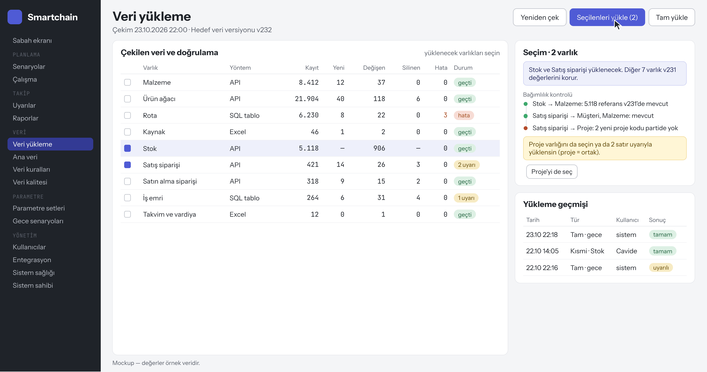

- **Varlık seçimi:** Onay kutuları tabloda; buton etiketi seçilen sayıyı gösterir.
- **Bağımlılık kontrolü:** Seçilen varlığın referansları anında kontrol edilir; eksik olan kırmızı.
- **Öneri:** Sistem bağlı varlığı tek tıkla eklemeyi önerir; kullanıcı yine de devam edebilir.
- **Korunanlar:** Diğer varlıkların önceki versiyondan geleceği açıkça yazar.

### 06 · Kısmi yükleme · Onay
24. Ekranlar ve fonksiyonlar · F06 · A Veri alma · Mockup 2/3

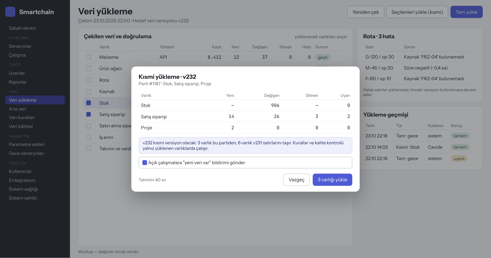

- **Kapsam:** Yüklenecek varlıklar ve sayıları; kısmi versiyonun ne olduğu bir cümleyle.
- **Kural ve kalite kapsamı:** Yalnız yüklenen varlıklarda çalışacağı belirtilir.
- **Bildirim seçeneği:** Açık çalışmalara haber verme kullanıcının elinde.
- **Süre:** Kısmi yükleme kısa sürer; tahmin yazılır.

### 06 · Kısmi yükleme · Sonuç
24. Ekranlar ve fonksiyonlar · F06 · A Veri alma · Mockup 3/3

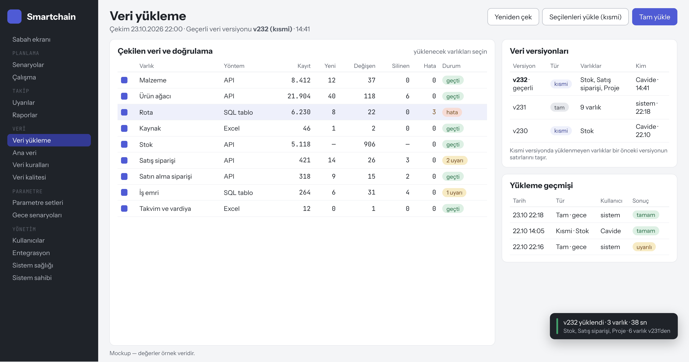

- **Versiyon listesi:** v232 kısmi, hangi varlıklar, kim; önceki versiyonlar altında.
- **Bağlam:** Alt başlıkta 'v232 (kısmi)'; kullanıcı kısmi olduğunu hep görür.
- **Bildirim:** Yeşil bildirimde varlıklar ve v231'den taşınan sayısı.
- **Açıklama:** Kısmi versiyonun taşıma mantığı kartın altında tek cümle.

### 07 · Veri versiyonlama
24. Ekranlar ve fonksiyonlar · F07 · A Veri alma · Çalışma prensibi 1/2

- Her yüklemenin dondurulmuş, karşılaştırılabilir bir veri kesiti oluşturması; her plan hesabının hangi veriyle yapıldığının bilinmesi ve onaylı planların verisinin hep saklanması.

#### NASIL ÇALIŞIR

- **KIM VE NEREDEN**
  - Kim: Sistem (yükleme içinde otomatik) · görüntüleme ve fark: key user ve üstü · sabitleme: admin ve üstü
  - Nereden: Tam ve kısmi yükleme (05 / 06) içinde · Veri yükleme ekranı 'Versiyonlar' çekmecesi
- **01:** Yüklemede DataVersion satırı açılır: tür (tam / kısmi), kim, zaman; kısmi ise DataVersionEntity ile varlıklar.
- **02:** Geçerli tablolarda kayıtlar satır bazında versiyonlanır (VersionFrom / VersionTo): değişen kayıt yeni satır olur, eskisinin VersionTo kapanır; silinen kayıt kapanır, fiziksel silinmez.
- **GIRDI**
  - Yükleme (tam / kısmi) ve yüklenen varlıklar
  - Saklama ayarı (SystemSetting: sıkıştırma süresi, öneri 90 gün)
  - Onaylı plan bağları (PlanVersion → PlanRun → DataVersion)
- **03:** Plan hesapları (PlanRun) DataVersionId ile bağlanır; onaylı plan yayınlanınca bağlı versiyon otomatik 'sabit' olur.
- **04:** Ekranlar geçerli versiyonu okur; geçmiş versiyon salt okunur açılabilir, iki versiyon arasında varlık ve satır bazında fark alınır.
- **05:** Saklama: onaylıya bağlı ve sabitlenmiş versiyonlar hep kalır; diğerleri süre sonunda satır detayı sıkıştırılarak özet bilgiye indirgenir.
- **ÇIKTI**
  - DataVersion / DataVersionEntity kayıtları; satır versiyonları
  - Versiyon listesi ve fark raporu (varlık ve satır bazında, Excel'e aktarılabilir)
  - Çalışma ve plan ekranlarında 'veri versiyonu' bağlam bilgisi
- **06:** Versiyon bilgisi çalışma, yayın ve rapor ekranlarında bağlam olarak gösterilir.

### 07 · Veri versiyonlama · kurallar ve etkiler
24. Ekranlar ve fonksiyonlar · F07 · A Veri alma · Çalışma prensibi 2/2

- **KURALLAR VE SINIRLAR**
  - Versiyon değiştirilemez; yalnız yeni yükleme yeni versiyon açar.
  - Onaylı plana bağlı versiyon silinmez ve sıkıştırılmaz.
  - Kısmi versiyonda yüklenmeyen varlıklar önceki versiyonun satırlarını işaret eder; kopyalanmaz.
  - Çalışma açıldığı versiyonda kalır; versiyon değiştirmek için çalışma yeniden açılır (öneri: 'çalışmayı yeni veriyle yenile' sonraki faz).
  - Elle sabitleme admin ve üstü; sabit versiyon elle çözülebilir (onaylıya bağlı değilse).
- **HATA VE ISTISNA**
  - Yükleme çökerse açık kalan versiyon 'tamamlanmadı' işaretlenir, geçerli sayılmaz; bir sonraki yükleme temizler.
  - Fark raporu büyükse (> 50.000 satır) özet gösterilir, detay Excel'e alınır.
  - Sıkıştırma işi hata verirse versiyon olduğu gibi kalır, Sistem sağlığına düşer.
- **ETKISI VE TETIKLENENLER**
  - Sabah ekranı 'dünden bugüne' karşılaştırması.
  - Yayın kontrolleri: 'daha yeni veri var'.
  - Raporlarda veri versiyonu bilgisi.
  - Disk kullanımı: Sistem sağlığında versiyon sayısı ve boyut.
- **YENİDEN HESAPLANACAK ALANLAR:** Yeniden hesap gerektirmez; versiyon kaydı yazılır. Fark raporu istek üzerine hesaplanır.
- **ÖRNEK:** v231 (tam, gece) onaylı plan v14'e bağlı → sabit. v232 (kısmi, Stok + sipariş) gün içi. v228 hiçbir plana bağlı değil → 90 gün sonra özet bilgiye iner.

### 07 · Veri versiyonlama · Versiyon listesi
24. Ekranlar ve fonksiyonlar · F07 · A Veri alma · Mockup 1/2

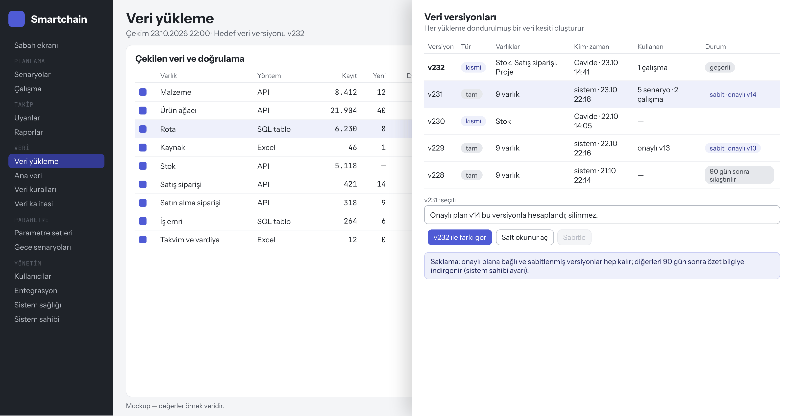

- **Liste:** Versiyon, tür, varlıklar, kim, kimin kullandığı ve saklama durumu.
- **Sabit versiyon:** Onaylı plana bağlı versiyon 'sabit' etiketli; silinemeyeceği yazar.
- **Aksiyonlar:** Fark gör, salt okunur aç, sabitle; yetki yoksa pasif.
- **Saklama kuralı:** Bilgi kutusunda 90 gün kuralı ve kimin değiştirebileceği.

### 07 · Veri versiyonlama · Versiyon farkı
24. Ekranlar ve fonksiyonlar · F07 · A Veri alma · Mockup 2/2

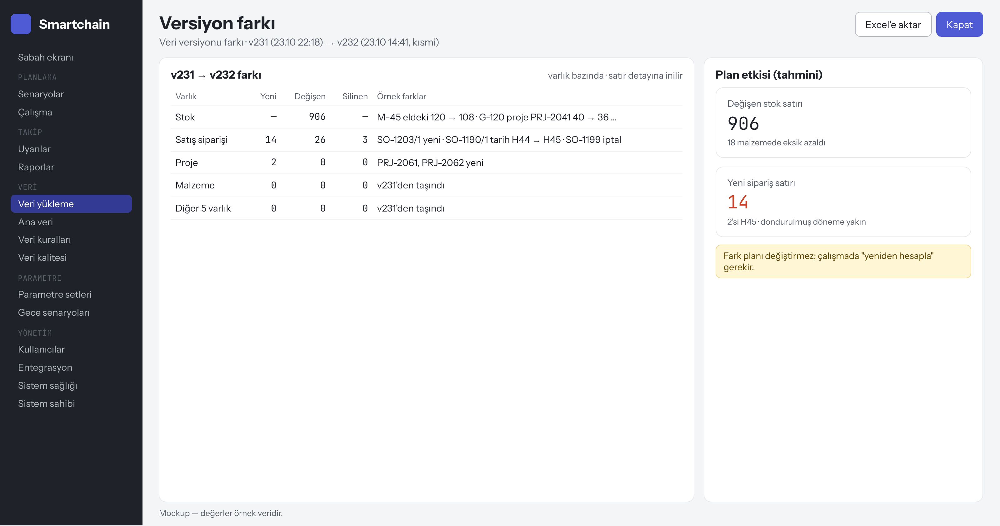

- **Varlık bazında fark:** Yeni, değişen, silinen sayıları ve örnek farklar; satıra inilir.
- **Taşınan varlıklar:** Kısmi versiyonda değişmeyen varlıklar 'taşındı' olarak görünür.
- **Plan etkisi:** Farkın plana olası etkisi tahmini olarak; hesap için çalışma gerekir.
- **Excel'e aktar:** Fark raporu indirilebilir; end user da görebilir.

### 08 · Yükleme geçmişi
24. Ekranlar ve fonksiyonlar · F08 · A Veri alma · Çalışma prensibi 1/2

- Çekim, Excel yüklemesi, doğrulama, tam ve kısmi yüklemelerin kim, ne zaman, hangi varlıklar, hangi sonuçla yapıldığını izlenebilir tutmak; sorun olduğunda geriye bakabilmek.

#### NASIL ÇALIŞIR

- **KIM VE NEREDEN**
  - Kim: Görüntüleme: key user ve üstü (end user görmez) · dışa aktarma: aynı
  - Nereden: Veri yükleme ekranı 'Yükleme geçmişi' kartı → tam liste · Sistem sağlığı bağlantısı
- **01:** Liste zaman sırasına göre açılır; her satırda tür (çekim, Excel, tam, kısmi), kullanıcı, varlıklar, satır ve hata sayısı, süre, oluşan versiyon ve sonuç.
- **02:** Filtreler satırları daraltır; varsayılan son 7 gün.
- **03:** Satır seçilince detay çekmecesi: varlık bazında sayılar, süreler, çalışan kurallar, hata raporu bağlantısı.
- **GIRDI**
  - ImportBatch ve DataVersion kayıtları
  - İş kuyruğu (Job) süre ve hata bilgileri
  - Filtreler: tarih aralığı, tür, kullanıcı, sonuç
- **04:** Çekmeceden hata raporu, ham veri (saklama süresi içindeyse) ve versiyon farkı açılır.
- **05:** Liste Excel'e aktarılabilir.
- **ÇIKTI**
  - Geçmiş listesi ve detay görünümü
  - Hata raporu (xlsx) ve ham veri görünümü bağlantıları
  - Excel dışa aktarımı

### 08 · Yükleme geçmişi · kurallar ve etkiler
24. Ekranlar ve fonksiyonlar · F08 · A Veri alma · Çalışma prensibi 2/2

- **KURALLAR VE SINIRLAR**
  - Geçmiş kaydı silinmez; ham veri silinse de kayıt ve sayıları kalır.
  - Gece ve elle işlemler aynı listede, tür etiketiyle ayrılır.
  - End user veri yükleme alanını görmez.
- **HATA VE ISTISNA**
  - Ham veri temizlenmişse 'Ham veriyi gör' pasif, açıklaması yazar.
  - Hata raporu üretilemezse bildirim; satır listesi çekmecede yine görünür.
- **ETKISI VE TETIKLENENLER**
  - Yok; salt okunur görünüm.
  - Denetim izi: dışa aktarma kaydı.
- **YENİDEN HESAPLANACAK ALANLAR:** Yeniden hesap gerektirmez.

### 08 · Yükleme geçmişi · Liste ve filtre
24. Ekranlar ve fonksiyonlar · F08 · A Veri alma · Mockup 1/2

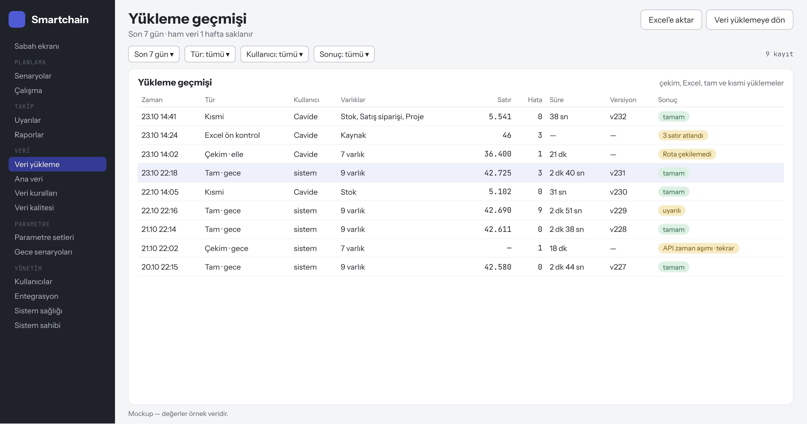

- **Tek liste:** Çekim, Excel ön kontrolü, tam ve kısmi yükleme aynı akışta; tür etiketi ayırır.
- **Sonuç çipi:** Tamam, uyarılı, hata; uyarının nedeni çipte kısa yazar.
- **Filtreler:** Tarih, tür, kullanıcı, sonuç; varsayılan son 7 gün.
- **Versiyon bağlantısı:** Yüklemenin oluşturduğu versiyon sütunda; tıklayınca versiyon listesi.

### 08 · Yükleme geçmişi · Yükleme detayı
24. Ekranlar ve fonksiyonlar · F08 · A Veri alma · Mockup 2/2

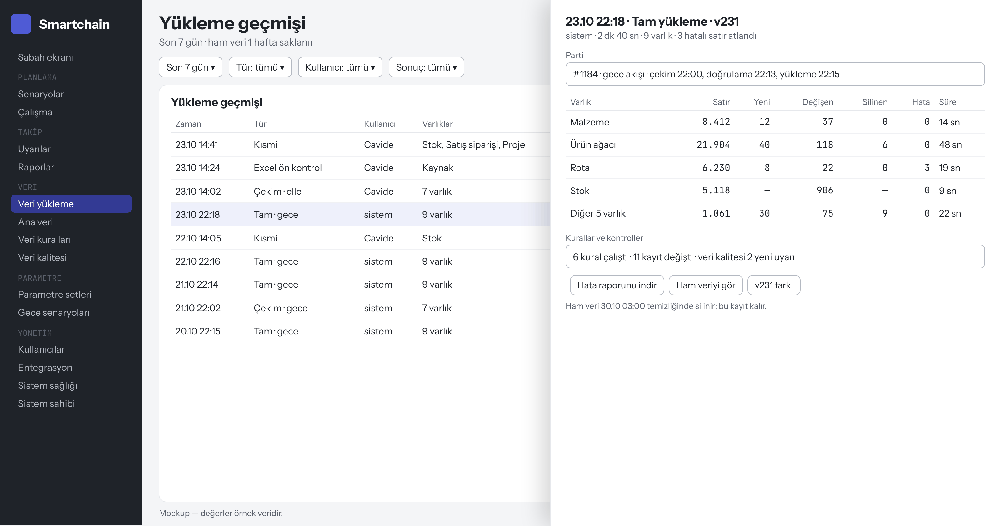

- **Çekmece:** Varlık bazında satır, yeni, değişen, silinen, hata ve süre.
- **Zaman çizgisi:** Çekim, doğrulama ve yükleme saatleri tek satırda.
- **Bağlantılar:** Hata raporu, ham veri, versiyon farkı; ham veri süresi dolmuşsa pasif.
- **Saklama bilgisi:** Ham verinin ne zaman silineceği altta yazar.

### 09 · Ham veri temizliği
24. Ekranlar ve fonksiyonlar · F09 · A Veri alma · Çalışma prensibi 1/2

- Ham veri tablolarındaki eski partileri düzenli silerek disk alanını korumak; geçmiş kaydını ve versiyonlanmış veriyi etkilemeden.

#### NASIL ÇALIŞIR

- **KIM VE NEREDEN**
  - Kim: Sistem (zamanlanmış, Pazar 03:00) · ayar: sistem sahibi · 'Şimdi çalıştır': admin ve üstü
  - Nereden: Entegrasyon ve zamanlanmış işler ekranı · 'Ham veri temizliği' satırı
- **01:** İş kuyruğuna temizlik işi düşer (gece kanalı, düşük öncelik); gece akışıyla çakışırsa akış bitene kadar bekler.
- **02:** Yaşı saklama süresini geçen partiler bulunur; her varlığın son başarılı partisi listeden çıkarılır.
- **GIRDI**
  - Saklama süresi (SystemSetting, varsayılan 7 gün)
  - ImportBatch kayıtları (parti yaşı, varlık, durum)
  - Zamanlama
- **03:** Seçilen partilerin Staging_* satırları ve ekli Excel dosyaları silinir; ImportBatch kaydı 'ham veri silindi' işaretlenir, sayıları kalır.
- **04:** Silinen boyut ve parti sayısı Sistem sağlığına yazılır.
- **05:** Hata olursa iş sonraki hafta yeniden dener; log tutulur.
- **ÇIKTI**
  - Boşalan disk alanı; Sistem sağlığında temizlik kaydı
  - ImportBatch üzerinde 'ham veri silindi' işareti

### 09 · Ham veri temizliği · kurallar ve etkiler
24. Ekranlar ve fonksiyonlar · F09 · A Veri alma · Çalışma prensibi 2/2

- **KURALLAR VE SINIRLAR**
  - Geçmiş kayıtları, veri versiyonları ve geçerli tablolar hiç etkilenmez.
  - Her varlık için son başarılı parti silinmez (yeniden yükleme imkânı).
  - Saklama süresi sistem sahibi ayarıdır; 1–30 gün.
- **HATA VE ISTISNA**
  - Silme sırasında kilit çakışması: iş bekler ve tekrar dener; 3 denemede olmazsa Sistem sağlığına hata.
  - Disk doluysa temizlik yine de çalışır; yükleme ve çekim için eşik uyarısı ayrı (94).
- **ETKISI VE TETIKLENENLER**
  - Yükleme geçmişinde 'Ham veriyi gör' pasifleşir.
  - Sistem sağlığı disk metriği güncellenir.
- **YENİDEN HESAPLANACAK ALANLAR:** Yeniden hesap gerektirmez.

### 09 · Ham veri temizliği · Zamanlanmış iş ayarı
24. Ekranlar ve fonksiyonlar · F09 · A Veri alma · Mockup 1/1

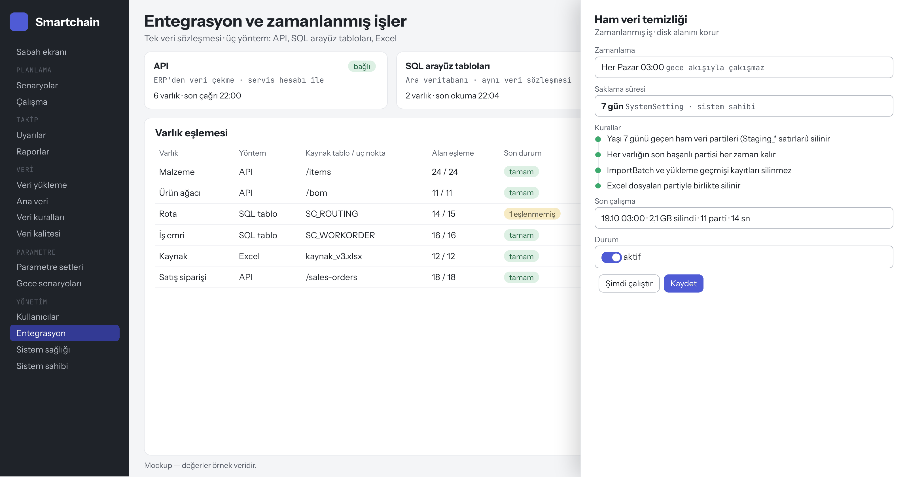

- **Entegrasyon ekranında:** Temizlik, diğer zamanlanmış işlerle aynı listede; çekmeceden ayarlanır.
- **Kurallar görünür:** Ne silinir, ne kalır; kullanıcı güvenle bırakır.
- **Son çalışma:** Ne zaman, ne kadar silindi; sorun varsa burada görünür.
- **Şimdi çalıştır:** Disk sıkışınca elle tetikleme; aç / kapat anahtarı.

### B · Ana veri ve veri kuralları
24. Ekranlar ve fonksiyonlar · Fonksiyon prensipleri ve mockuplar

- **10 · Ana veri görüntüleme:** Kaynak, malzeme, ürün ağacı, rota, tedarikçi, müşteri, proje, takvim ve vardiya ana verisini tek düzende, arama ve filtreyle görüntülemek; her değeri kaynağıyla birlikte göstermek.
- **11 · Değerin kaynağını gösterme:** Her alanın geçerli değerinin nereden geldiğini (ERP, kural, elle, varsayılan) ve ezilmiş değerleri göstermek; kullanıcı veriye güvenirken neyin kimin kararı olduğunu bilir.
- **12 · Elle değer girme:** ERP'de olmayan ya da hatalı bir değeri kullanıcının eliyle düzeltmesi; alanın sözlük ayarına göre ERP ve kuralı ezerek ya da ezmeyerek, izlenebilir ve geri alınabilir biçimde.
- **13 · Elle değeri kaldırma:** Elle girilmiş bir değeri kaldırıp alanı öncelik sırasındaki bir sonraki kaynağa (kural, ERP ya da varsayılan) geri döndürmek; iz bırakarak ve geri alınabilir biçimde.
- **14 · Değişiklik geçmişi:** Bir kaydın alanlarının zaman içinde nasıl değiştiğini tek zaman çizgisinde göstermek: elle girişler, kural sonuçları ve ERP yüklemeleri; kim, ne zaman, eski ve yeni değer.
- **15 · Excel ile toplu düzeltme (öneri):** Çok sayıda kaydı tek tek düzeltmek yerine filtrelenmiş listeyi Excel'e alıp düzeltmek ve değişen hücreleri elle değer olarak geri yüklemek; aynı izlenebilirlik ve geri alma ile.
- **16 · Veri kuralı tanımlama:** ERP'den gelmeyen ya da hatalı alanları, kod bilmeden yazılan koşul–sonuç kurallarıyla tamamlamak; aynı kural her yüklemede tekrar çalışsın, değer kaynağı 'kural' olarak izlensin.
- **17 · Kural önizleme:** Bir kuralı kaydetmeden önce geçerli veri üzerinde deneyip hangi kayıtların nasıl değişeceğini, hangilerinin ERP ya da elle değer nedeniyle atlanacağını göstermek; yanlış kuralın veriyi bozmasını önlemek.
- **18 · Kural sıralama ve aç / kapa:** Kuralların çalışma sırasını belirlemek ve bir kuralı silmeden geçici olarak devre dışı bırakmak; aynı alana yazan kurallarda hangisinin kazanacağını görünür kılmak.
- **19 · Kural uygulama:** Aktif kuralları sırayla geçerli veri üzerinde çalıştırıp alanları doldurmak; alan önceliğine saygı göstererek, her değişikliğin kaynağını 'kural' olarak işaretleyerek.
- **20 · Veri kalitesi kontrolü:** Ana veri ve işlem verisini plan için gerekli tutarlılık kontrollerinden geçirip önem sırasıyla uyarı listesi üretmek; önceki listeyle karşılaştırıp neyin yeni, neyin kapandığını göstermek.
- **21 · Kalite düzeltme aksiyonu:** Veri kalitesi uyarısından doğrudan düzeltmeye geçmek: kayda gidip elle düzeltmek, önerilen kuralı uygulamak, uyarıyı gerekçeyle 'bilerek böyle' kapatmak ya da kişiye atamak; tek tek ya da toplu.

### 10 · Ana veri görüntüleme
24. Ekranlar ve fonksiyonlar · F10 · B Ana veri ve kurallar · Çalışma prensibi 1/2

- Kaynak, malzeme, ürün ağacı, rota, tedarikçi, müşteri, proje, takvim ve vardiya ana verisini tek düzende, arama ve filtreyle görüntülemek; her değeri kaynağıyla birlikte göstermek.

#### NASIL ÇALIŞIR

- **KIM VE NEREDEN**
  - Kim: Tüm roller görüntüler (end user salt okunur) · düzenleme butonları key user ve üstünde
  - Nereden: Ana veri ekranı (menü · Veri) · uyarı ve plan ekranlarından 'kaynağa git' bağlantıları
- **01:** Sekme seçilir (varsayılan Kaynak); liste geçerli veri versiyonundan sayfa sayfa okunur (50 satır, kaydırdıkça devam).
- **02:** Arama kod ve ad üzerinde anında çalışır; filtreler grup, tip, kritik ve değer kaynağına göre daraltır (ör. 'yalnız elle değer olanlar').
- **GIRDI**
  - Geçerli veri versiyonu (ya da seçilen geçmiş versiyon, salt okunur)
  - Sekme (varlık), arama metni, filtreler (grup, tip, kritik, değer kaynağı, pasif kayıtlar)
  - Sütun ve sıralama tercihi (kullanıcı bazında saklanır)
- **03:** Sütunlar veri sözlüğünden gelir; kullanıcı sütun gizleyip sıralama yapar, tercih kullanıcıya kaydedilir.
- **04:** Satır seçilince sağda detay kartı açılır: tüm alanlar ve kaynak etiketi, ilişkili kayıtlar (rota, iş emri, duruş, uyarı), değişiklik geçmişi (14).
- **05:** Versiyon seçiciyle geçmiş bir veri versiyonu salt okunur açılabilir; başlıkta 'salt okunur · v229' uyarısı görünür.
- **ÇIKTI**
  - Liste görünümü (arama, filtre, sıralama) ve detay kartı
  - Excel dışa aktarımı (filtrelenmiş liste, kaynak etiketi sütunuyla)
  - Kullanıcı tercihleri (sütun, sıralama)
- **06:** Filtrelenmiş liste Excel'e aktarılır (end user dahil); dışa aktarma denetim izine yazılır.

### 10 · Ana veri görüntüleme · kurallar ve etkiler
24. Ekranlar ve fonksiyonlar · F10 · B Ana veri ve kurallar · Çalışma prensibi 2/2

- **KURALLAR VE SINIRLAR**
  - Ekran geçerli veri versiyonunu okur; çalışma içinde açılırsa geçici değerler (WorkspaceOverride) 'çalışma' etiketiyle görünür.
  - Pasif (ERP'de silinmiş) kayıtlar varsayılan gizlidir; 'pasifleri göster' ile listelenir.
  - End user düzenleme butonlarını hiç görmez; yetki ekranda değil sunucuda da kontrol edilir.
  - Her sekme aynı düzeni kullanır: liste solda, detay sağda, lejant altta.
- **HATA VE ISTISNA**
  - Liste yüklenemezse hata durumu ve 'yeniden dene'; önceki görünüm korunur.
  - Arama sonucu yoksa boş durum: 'Eşleşen kayıt yok · filtreleri temizle'.
  - Çok büyük varlıkta (ürün ağacı 20.000+) sayfalama; 'tümünü Excel'e al' seçeneği.
- **ETKISI VE TETIKLENENLER**
  - Yok; salt okunur görünüm.
  - Dışa aktarma denetim izine yazılır.
- **YENİDEN HESAPLANACAK ALANLAR:** Yeniden hesap gerektirmez; salt okunur görünüm.
- **ÖRNEK:** 'torna' araması + Tip: Makine + Kaynak etiketi: elle → 46 kaynaktan 2 satır (TRN-01, TRN-02). TRN-01 seçilince sağda 38 rota operasyonu, 6 açık iş emri ve 1 duruş kaydı görünür.

### 10 · Ana veri görüntüleme · Arama ve filtre
24. Ekranlar ve fonksiyonlar · F10 · B Ana veri ve kurallar · Mockup 1/2

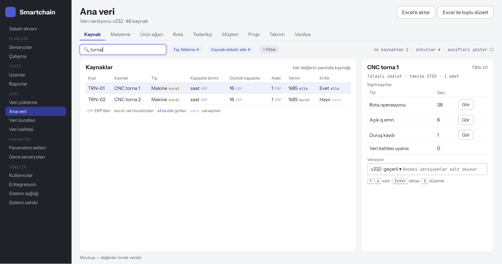

- **Anında arama:** Kod ve ad üzerinde yazdıkça daralır; filtre çipleri tek tıkla kaldırılır.
- **Kaynak etiketine göre filtre:** 'Elle değer olanlar' gibi filtreler veri kalitesi takibini kolaylaştırır.
- **İlişkili kayıtlar:** Detay kartında rota, iş emri, duruş ve uyarı sayıları; tek tıkla gidilir.
- **Klavye:** Ok tuşlarıyla satır, Enter ile detay, E ile düzenleme; altta ipucu.

### 10 · Ana veri görüntüleme · Detay kartı
24. Ekranlar ve fonksiyonlar · F10 · B Ana veri ve kurallar · Mockup 2/2

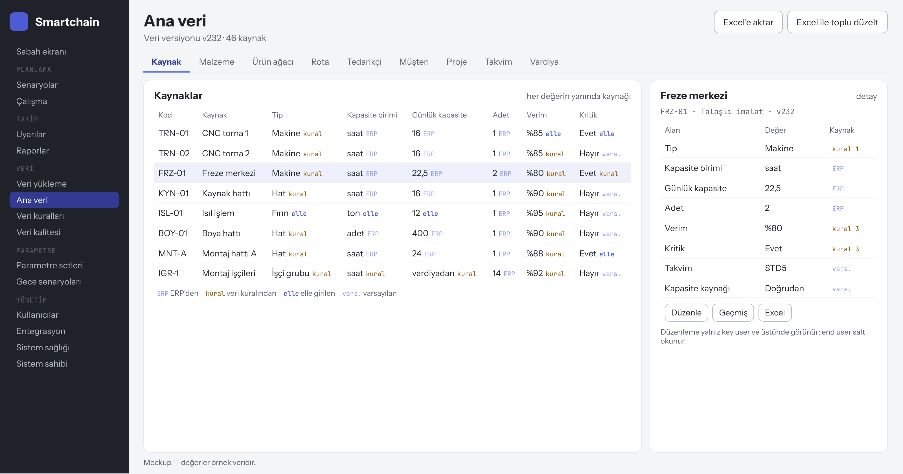

- **Tüm alanlar tek kartta:** Listede görünmeyen alanlar (takvim, kapasite kaynağı) detayda.
- **Kaynak sütunu:** Her alanın yanında ERP, kural (numarasıyla), elle ya da varsayılan.
- **Rol farkı:** Düzenle butonu key user ve üstünde; end user yalnız görüntüler ve Excel alır.
- **Geçmişe geçiş:** Geçmiş butonu değişiklik geçmişini (14) açar.

### 11 · Değerin kaynağını gösterme
24. Ekranlar ve fonksiyonlar · F11 · B Ana veri ve kurallar · Çalışma prensibi 1/2

- Her alanın geçerli değerinin nereden geldiğini (ERP, kural, elle, varsayılan) ve ezilmiş değerleri göstermek; kullanıcı veriye güvenirken neyin kimin kararı olduğunu bilir.

#### NASIL ÇALIŞIR

- **KIM VE NEREDEN**
  - Kim: Tüm roller görür
  - Nereden: Ana veri hücreleri ve detay kartı · hücre ipucu · parametre ve plan ekranlarındaki ana veri alanları
- **01:** Yükleme (05/06), kural uygulama (19) ve elle giriş (12) her alan için kaynak kaydını yazar; ezilen ERP değeri FieldValueSource.ErpValue'da saklanır.
- **02:** Hücrede değerin yanında kısa etiket görünür: ERP, kural, elle, vars. Renk ile birlikte metin kullanılır; renk tek başına anlam taşımaz.
- **GIRDI**
  - FieldValueSource: alan bazında kaynak (Source), kural numarası, saklanan ERP değeri
  - ManualValue: elle değer, kim, ne zaman, geçerlilik
  - FieldDefinition: alanın öncelik sırası ve varsayılanı
- **03:** Hücre üzerine gelince ipucu açılır: geçerli değer, elle giren ve tarih, kuralın adı ve ürettiği değer, ERP değeri, varsayılan ve alanın öncelik sırası.
- **04:** Filtre ile 'kaynağı elle olanlar', 'kuralla değişenler', 'varsayılanda kalanlar' listelenir; sağda dağılım görünür.
- **05:** Lejant tablo altında sabittir; Excel dışa aktarımında her alan için kaynak sütunu eklenir.
- **ÇIKTI**
  - Hücre etiketi ve ipucu
  - Kaynağa göre filtre ve dağılım
  - Excel'de kaynak sütunları

### 11 · Değerin kaynağını gösterme · kurallar ve etkiler
24. Ekranlar ve fonksiyonlar · F11 · B Ana veri ve kurallar · Çalışma prensibi 2/2

- **KURALLAR VE SINIRLAR**
  - Kaynak bilgisi alan bazındadır; aynı kaydın alanları farklı kaynaktan gelebilir.
  - ERP değeri ezilse de saklanır ve ipucunda gösterilir; elle değer kaldırılınca (13) geri döner.
  - Kural kaynaklı değerde kural numarası bağlantıdır; tıklayınca kural editörü (16) açılır.
  - Varsayılan, veri sözlüğündeki DefaultValue'dur; 'varsayılanda kalan' alanlar veri kalitesi için ipucudur.
- **HATA VE ISTISNA**
  - Eski versiyonlardan kalan kayıtta kaynak bilgisi yoksa 'bilinmiyor' etiketi; sonraki yüklemede dolar.
  - İpucu klavyeyle de açılır (hücrede Enter); ekran okuyucu için etiket metni hücre içeriğindedir.
- **ETKISI VE TETIKLENENLER**
  - Yok; görüntüleme.
  - Filtreler Veri kalitesi ekranı ve toplu düzeltme (15) ile paylaşılır.
- **YENİDEN HESAPLANACAK ALANLAR:** Yeniden hesap gerektirmez.
- **ÖRNEK:** CNC torna 1 · Verim: geçerli %85 (elle, Cavide 21.10), kural 3 %80 (ezildi), ERP değeri gelmiyor, varsayılan %100. Öncelik: elle › kural › ERP › varsayılan.

### 11 · Değerin kaynağını gösterme · Hücre ipucu
24. Ekranlar ve fonksiyonlar · F11 · B Ana veri ve kurallar · Mockup 1/2

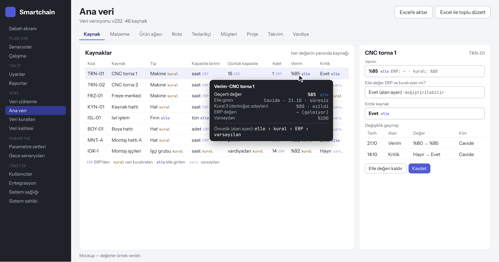

- **Katmanlar tek bakışta:** Geçerli değer, elle giren, kuralın ürettiği, ERP değeri ve varsayılan alt alta.
- **Ezilen değer kaybolmaz:** Kural 3'ün %80 değeri 'ezildi' notuyla görünür; ERP gelmiyorsa bu da yazar.
- **Öncelik sırası:** Alanın sözlükteki öncelik sırası ipucunun altında; kullanıcı neden bu değer anlar.
- **Erişilebilirlik:** Etiket metin olarak var; renk ikincil. İpucu klavyeyle de açılır.

### 11 · Değerin kaynağını gösterme · Kaynağa göre filtre
24. Ekranlar ve fonksiyonlar · F11 · B Ana veri ve kurallar · Mockup 2/2

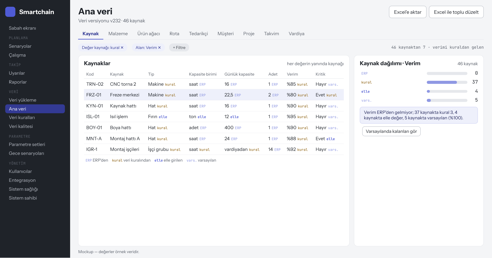

- **Filtre çipleri:** Değer kaynağı: kural ve Alan: Verim; liste 7 satıra iner.
- **Dağılım kartı:** Alanın değerleri hangi kaynaktan geliyor; varsayılanda kalanlar hemen bulunur.
- **Kalite ipucu:** Varsayılanda kalan 5 kaynak için doğrudan liste bağlantısı.
- **Aynı filtre her yerde:** Veri kalitesi ve toplu düzeltme ekranları aynı filtreyi kullanır.

### 12 · Elle değer girme
24. Ekranlar ve fonksiyonlar · F12 · B Ana veri ve kurallar · Çalışma prensibi 1/3

- ERP'de olmayan ya da hatalı bir değeri kullanıcının eliyle düzeltmesi; alanın sözlük ayarına göre ERP ve kuralı ezerek ya da ezmeyerek, izlenebilir ve geri alınabilir biçimde.

#### NASIL ÇALIŞIR

- **KIM VE NEREDEN**
  - Kim: Key user ve üstü
  - Nereden: Ana veri hücresi (çift tık) · detay kartı 'Düzenle' · Veri kalitesi satırı 'Düzelt'
- **01:** Hücre çift tık ya da detay kartta 'Düzenle': alan sözlükte elle değer alamıyorsa düzenleme kapalıdır ve ipucu nedenini yazar.
- **02:** Değer tipine göre giriş alanı açılır (sayı, açılır liste, tarih); aralık, zorunluluk ve birim anında kontrol edilir, hata satır altında kırmızı.
- **GIRDI**
  - Kayıt ve alan; yeni değer (tip: sayı, liste, tarih, evet/hayır)
  - FieldDefinition: ManualOverrides (elle ezer mi), aralık ve zorunluluk, çalışmada değiştirilebilir mi
  - İsteğe bağlı: geçerlilik tarihi (ValidUntil) ve not
- **03:** Yanında davranış kutusu: 'ERP ve kuralı ezer' ya da 'ERP gelince ezilir' (alan ayarından); Enter kaydet, Esc vazgeç.
- **04:** Onay penceresinde etki önizlemesi: eski ve yeni değer, türetilmiş alanlar (ör. haftalık net kapasite), onaylı plandaki tahmini doluluk, kapanabilecek uyarı.
- **05:** Kaydet: ManualValue yazılır, FieldValueSource.Source = elle, ERP ve kural değerleri saklanır; denetim izine kim, ne zaman, eski ve yeni değer.
- **ÇIKTI**
  - ManualValue kaydı ve güncel FieldValueSource
  - Denetim izi (AuditLog) satırı; detay kartında geçmiş
  - Türetilmiş alanlar (kapasite) ve ilgili veri kalitesi uyarılarının durumu
- **06:** Türetilmiş alanlar hemen hesaplanır; veri kalitesi kontrolü bu kayıt için yeniden çalışır; plan otomatik değişmez (çalışmada yeniden hesap).
- **07:** Geçerlilik tarihi verildiyse süre dolunca değer kurala ya da ERP'ye döner, geçmişe 'süresi doldu' kaydı düşer.

### 12 · Elle değer girme · kurallar ve etkiler
24. Ekranlar ve fonksiyonlar · F12 · B Ana veri ve kurallar · Çalışma prensibi 2/3

- **KURALLAR VE SINIRLAR**
  - Yalnız veri sözlüğünde 'elle değer alabilir' alanlar; işlem verisi (sipariş miktarı, stok) elle değiştirilemez, ERP'de düzeltilir.
  - Elle değer veri versiyonu açmaz; geçerli versiyon üzerinde elle katman olarak durur, sonraki yüklemelerde korunur (alan ayarı 'elle ezer' ise).
  - Çalışmadaki geçici değişiklik (55) ayrıdır; ana veriyi değiştirmez. Buradaki değer kalıcıdır.
  - Aynı alanı iki kullanıcı değiştirirse son yazan uyarılır: 'Mert 2 dk önce %82 yaptı, üzerine yazılsın mı?'; sessizce ezme yok.
  - End user hücreyi düzenleyemez; sunucu da reddeder.
- **HATA VE ISTISNA**
  - Validasyon hatası (aralık, tip): kaydet pasif, mesaj satır altında.
  - Çakışma: başka kullanıcının yeni değeri gösterilir; üzerine yaz ya da vazgeç.
  - Türetilmiş hesap hatası: değer kaydedilir, türetilmiş alan 'hesaplanamadı' işaretli, Sistem sağlığına düşer.
- **ETKISI VE TETIKLENENLER**
  - Türetilmiş alanlar (dönem kapasitesi) güncellenir.
  - Veri kalitesi uyarısı kapanabilir ya da yeni uyarı doğabilir.
  - Sabah ekranı 'dünden bugüne' değişiklik sayısı.
  - Plan: çalışmada 'yeniden hesapla' gerekir; gece senaryoları yeni değerle çalışır.
- **ÖRNEK:** Freze merkezi verimi kural 3 ile %80. Ekim ölçümü %85: elle değer girilir, ERP ve kuralı ezer. Haftalık net kapasite 180 → 191 sa; H46 doluluğu tahmini %108 → %101; 'düşük verim' uyarısı kapanır.
- **AÇIK KONU:** Elle değer için varsayılan geçerlilik süresi olmalı mı (ör. 90 gün sonra hatırlatma)? Öneri: süresiz, ama 90 günü geçen elle değerler veri kalitesinde 'gözden geçir' uyarısı alsın.

### 12 · Elle değer girme · yeniden hesaplanacak alanlar
24. Ekranlar ve fonksiyonlar · F12 · B Ana veri ve kurallar · Çalışma prensibi 3/3

- **YENİDEN HESAPLANACAK ALANLAR:** Alan Nerede Ne zaman / neden
- **Geçerli değer ve kaynağı:** FieldValueSource Alan 'elle' olur; ERP ve kural değerleri saklanır
- **Kural sonucu bu kayıtta:** DataRule → hedef alan Elle değer kuralı eziyorsa kural bu kayıtta uygulanmaz
- **Türetilmiş kapasite:** Günlük kapasite × adet × verim → dönem kapasitesi Kaynak kapasite alanlarından biri değiştiyse hemen
- **Veri kalitesi uyarısı:** Veri kalitesi listesi Bu kayıt ve alan için kontrol yeniden çalışır
- **Doluluk ve plan:** CapacityLoad · PlanMetric · PlanWarning Otomatik değil: çalışmada yeniden hesap ya da gece senaryosu

### 12 · Elle değer girme · Hücrede düzenleme
24. Ekranlar ve fonksiyonlar · F12 · B Ana veri ve kurallar · Mockup 1/3

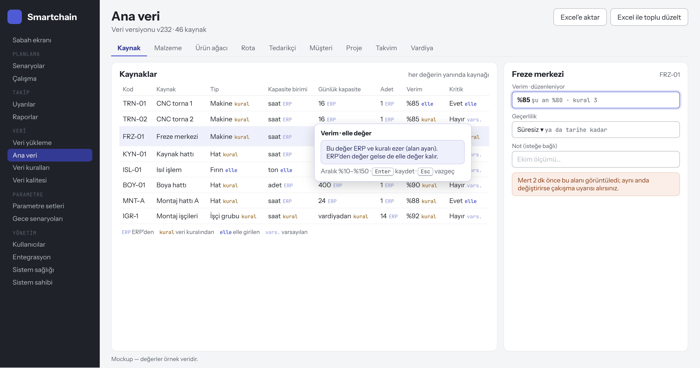

- **Çift tık ile düzenleme:** Hücre giriş alanına dönüşür; imleç ve odak halkası görünür.
- **Davranış kutusu:** Değer ERP ve kuralı ezecek mi, alan ayarından okunup yanında yazar.
- **Anında kontrol:** Aralık ve tip hücrede denetlenir; Enter kaydet, Esc vazgeç.
- **Eşzamanlılık:** Aynı alana bakan başka kullanıcı varsa uyarı; sessiz ezme yok.

### 12 · Elle değer girme · Etki önizlemesi ve onay
24. Ekranlar ve fonksiyonlar · F12 · B Ana veri ve kurallar · Mockup 2/3

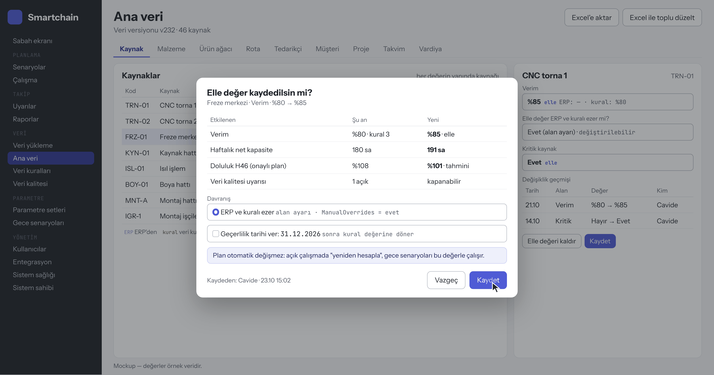

- **Ne değişecek:** Eski ve yeni değer; türetilmiş kapasite ve tahmini doluluk etkisi.
- **Geçerlilik tarihi:** İsteğe bağlı; süre dolunca değer kural ya da ERP'ye döner.
- **Plan uyarısı:** Planın otomatik değişmediği, yeniden hesap gerektiği açıkça yazar.
- **Kim ve ne zaman:** Pencere altında kaydeden ve zaman; denetim izine aynen gider.

### 12 · Elle değer girme · Sonuç
24. Ekranlar ve fonksiyonlar · F12 · B Ana veri ve kurallar · Mockup 3/3

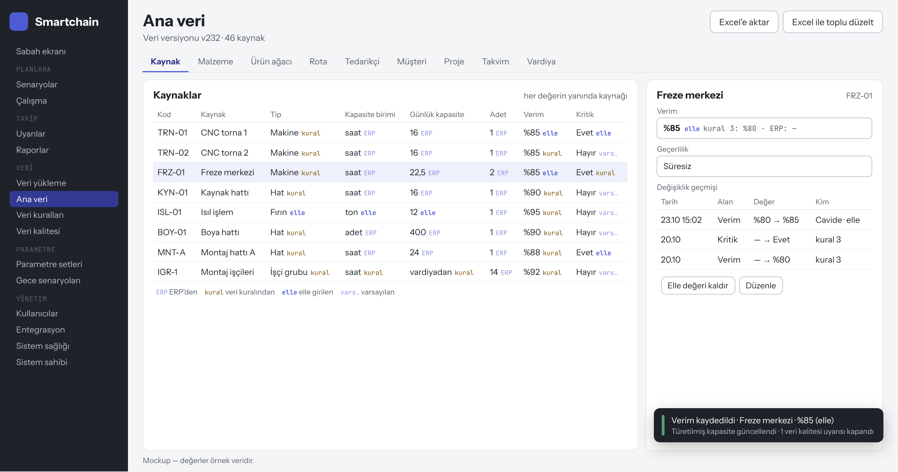

- **Etiket 'elle' oldu:** Hücrede elle etiketi; kural ve ERP değerleri ipucunda saklanır.
- **Geçmiş satırı:** Detay kartında kim, ne zaman, eski ve yeni değer; kural kaynaklı eski satırlar da görünür.
- **Yan etkiler bildirimde:** Türetilmiş kapasite güncellendi, 1 uyarı kapandı.
- **Geri yol:** Elle değeri kaldır butonu (13) her zaman elinizin altında.

### 13 · Elle değeri kaldırma
24. Ekranlar ve fonksiyonlar · F13 · B Ana veri ve kurallar · Çalışma prensibi 1/2

- Elle girilmiş bir değeri kaldırıp alanı öncelik sırasındaki bir sonraki kaynağa (kural, ERP ya da varsayılan) geri döndürmek; iz bırakarak ve geri alınabilir biçimde.

#### NASIL ÇALIŞIR

- **KIM VE NEREDEN**
  - Kim: Key user ve üstü
  - Nereden: Detay kartı 'Elle değeri kaldır' · hücre menüsü · toplu: Excel ile toplu düzeltme (15) ya da elle değer listesi
- **01:** 'Elle değeri kaldır' seçilir; onay penceresi şu anki elle değeri ve geri dönecek değeri kaynağıyla gösterir.
- **02:** Etki önizlemesi: türetilmiş alanlar ve onaylı plandaki tahmini etki (ör. doluluk yükselir).
- **GIRDI**
  - Kayıt, alan ve mevcut ManualValue
  - Öncelik sırasındaki sonraki değer (FieldValueSource: kural sonucu, ERP değeri, varsayılan)
- **03:** Onaylanınca ManualValue kapatılır (ValidUntil = şimdi), silinmez; FieldValueSource yeni kaynağa göre güncellenir.
- **04:** Türetilmiş alanlar ve bu kayıt için veri kalitesi kontrolü yeniden çalışır; denetim izine 'elle değer kaldırıldı' yazılır.
- **05:** Bildirimde 'Geri al' bağlantısı: kaldırılan elle değer tek tıkla yeniden açılır (geçerliliği devam eder).
- **ÇIKTI**
  - Kapatılmış ManualValue kaydı ve güncel FieldValueSource
  - Denetim izi satırı; detay kartında geçmiş
  - Türetilmiş alanlar

### 13 · Elle değeri kaldırma · kurallar ve etkiler
24. Ekranlar ve fonksiyonlar · F13 · B Ana veri ve kurallar · Çalışma prensibi 2/2

- **KURALLAR VE SINIRLAR**
  - Geri dönülecek değer öncelik sırasıyla belirlenir: kural sonucu varsa kural, yoksa ERP, yoksa varsayılan.
  - Kaldırma silme değildir; geçmişte görünür ve geri alınabilir.
  - Süresi dolan elle değerler aynı yolu otomatik izler (12).
  - Çalışmadaki geçici değişiklikler bu işlemden etkilenmez.
- **HATA VE ISTISNA**
  - Geri dönülecek değer yoksa (kural yok, ERP gelmiyor, varsayılan tanımsız): alan boş kalır ve zorunluysa veri kalitesi 'kritik' uyarı üretir; onayda uyarılır.
  - Çakışma: başka kullanıcı az önce değiştirdiyse pencere yenilenir.
- **ETKISI VE TETIKLENENLER**
  - Türetilmiş kapasite güncellenir.
  - Veri kalitesi uyarısı doğabilir ya da kapanabilir.
  - Plan: çalışmada yeniden hesap gerekir.
- **YENİDEN HESAPLANACAK ALANLAR:** Alan Nerede Ne zaman / neden
- **Geçerli değer ve kaynağı:** FieldValueSource Alan kural / ERP / varsayılana döner
- **Türetilmiş kapasite:** Dönem kapasitesi Kapasite alanıysa hemen
- **Veri kalitesi uyarısı:** Veri kalitesi listesi Bu kayıt için kontrol yeniden
- **Doluluk ve plan:** CapacityLoad · PlanMetric Otomatik değil; çalışmada yeniden hesap
- **ÖRNEK:** CNC torna 1 verimi elle %85; kaldırılınca kural 3'ün %80'i geçerli olur. Haftalık net kapasite 136 → 128 sa; H47 doluluğu tahmini %112 → %119. Bildirimden 'Geri al' ile %85'e dönülebilir.

### 13 · Elle değeri kaldırma · Onay ve etki
24. Ekranlar ve fonksiyonlar · F13 · B Ana veri ve kurallar · Mockup 1/2

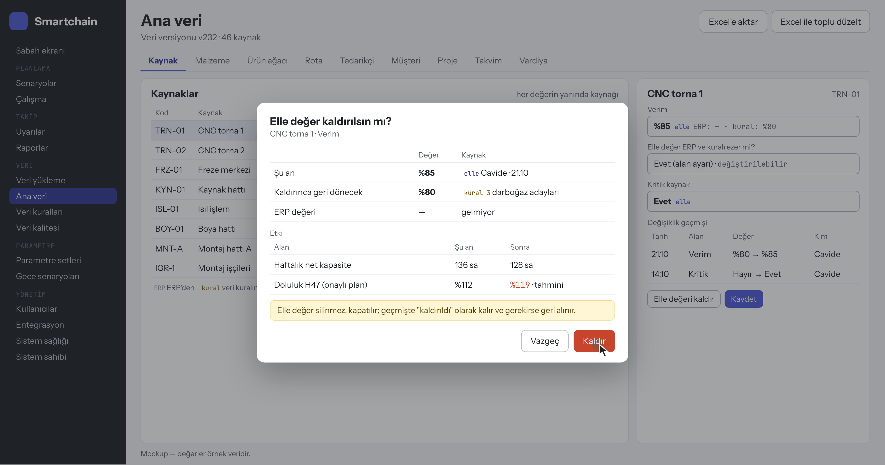

- **Geri dönecek değer:** Kaldırınca hangi değer ve hangi kaynak geçerli olacak, önceden görünür.
- **Etki:** Kapasite ve tahmini doluluk; kullanıcı sonucu bilerek onaylar.
- **Yıkıcı aksiyon rengi:** Kaldır butonu kiremit; vazgeç her zaman solunda.
- **Silme değil kapatma:** Elle değerin geçmişte kalacağı ve geri alınabileceği yazar.

### 13 · Elle değeri kaldırma · Sonuç ve geri al
24. Ekranlar ve fonksiyonlar · F13 · B Ana veri ve kurallar · Mockup 2/2

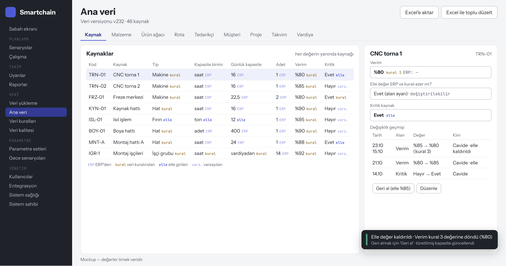

- **Etiket değişti:** Hücrede 'kural' etiketi; değer %80.
- **Geçmişte iz:** 'Elle kaldırıldı' satırı eski ve yeni değerle.
- **Geri al:** Detay kartında ve bildirimde tek tıkla geri alma.
- **Yan etki:** Türetilmiş kapasitenin güncellendiği bildirimde.

### 14 · Değişiklik geçmişi
24. Ekranlar ve fonksiyonlar · F14 · B Ana veri ve kurallar · Çalışma prensibi 1/2

- Bir kaydın alanlarının zaman içinde nasıl değiştiğini tek zaman çizgisinde göstermek: elle girişler, kural sonuçları ve ERP yüklemeleri; kim, ne zaman, eski ve yeni değer.

#### NASIL ÇALIŞIR

- **KIM VE NEREDEN**
  - Kim: Görüntüleme: key user ve üstü · geçmişe dönme: key user ve üstü · tam denetim izi: admin ve üstü
  - Nereden: Detay kartı 'Geçmiş' · hücre ipucundan · Yönetim → denetim izi (98, tüm kayıtlar)
- **01:** Kayıt seçilip 'Geçmiş' açılır; sistem üç kaynağı (denetim izi, elle/kural kayıtları, versiyon farkları) tek zaman çizgisinde birleştirir.
- **02:** Her satırda zaman, alan, eski → yeni değer, kim (kullanıcı, kural numarası ya da sistem + versiyon) ve kaynak türü; not varsa görünür.
- **GIRDI**
  - AuditLog (elle değişiklikler, kaldırmalar)
  - FieldValueSource ve ManualValue geçmişi (kural ve elle)
  - Veri versiyonları arasındaki alan farkları (ERP yüklemeleri)
  - Filtreler: alan, kaynak, kişi, tarih aralığı
- **03:** Filtreler alan, kaynak, kişi ve tarihe göre daraltır; değişmeyen yükleme satırları varsayılan gizlidir.
- **04:** 'Bu değere dön' eski değeri yeni bir elle değer olarak kaydeder (12 ile aynı yol, onaylı); eski kayıt değiştirilmez.
- **05:** Liste Excel'e aktarılır; admin tüm kayıtlar için denetim izi ekranına (98) geçer.
- **ÇIKTI**
  - Zaman çizgisi görünümü (filtreli)
  - Geçmişe dönüş: yeni ManualValue + denetim izi
  - Excel dışa aktarımı

### 14 · Değişiklik geçmişi · kurallar ve etkiler
24. Ekranlar ve fonksiyonlar · F14 · B Ana veri ve kurallar · Çalışma prensibi 2/2

- **KURALLAR VE SINIRLAR**
  - Geçmiş silinmez; ham veri temizliği ve versiyon sıkıştırması geçmişi etkilemez (sayısal özet kalır).
  - Kural kaynaklı değişikliklerde kural numarası bağlantıdır; kural silinmiş değil pasif olabilir.
  - Geçmişe dönüş her zaman elle değer olarak yazılır; alan elle değer alamıyorsa seçenek pasif.
  - End user geçmişi görmez; detay kartında yalnız geçerli değer.
- **HATA VE ISTISNA**
  - Eski versiyonlarda alan bazlı fark yoksa (sıkıştırılmış) satır 'özet' olarak görünür.
  - Birleştirme büyükse (1.000+ satır) sayfalama; Excel tam liste.
- **ETKISI VE TETIKLENENLER**
  - Geçmişe dönüş: 12 ile aynı etkiler (türetilmiş alanlar, veri kalitesi, plan yeniden hesap).
  - Görüntüleme: yok.
- **YENİDEN HESAPLANACAK ALANLAR:** Görüntüleme yeniden hesap gerektirmez. 'Bu değere dön' seçilirse 12 Elle değer girme ile aynı alanlar yeniden hesaplanır (FieldValueSource, türetilmiş kapasite, veri kalitesi; plan çalışmada).
- **ÖRNEK:** CNC torna 1: 01.10 ERP'den oluştu; 02.10 kural 1 ile Tip = Makine; 20.10 kural 3 ile Verim %80 ve Kritik = Evet; 21.10 Cavide elle %85; 23.10 elle kaldırıldı, %80'e döndü. Tek çizgide 8 satır.

### 14 · Değişiklik geçmişi · Zaman çizgisi
24. Ekranlar ve fonksiyonlar · F14 · B Ana veri ve kurallar · Mockup 1/2

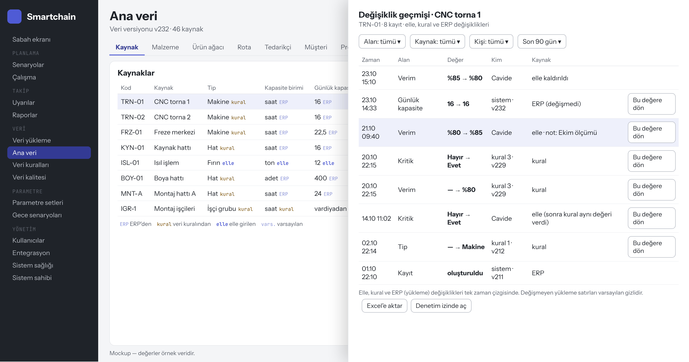

- **Üç kaynak tek çizgide:** Elle, kural ve ERP yüklemesi aynı listede; 'Kim' sütunu kural numarasını ya da versiyonu yazar.
- **Filtreler:** Alan, kaynak, kişi ve tarih; değişmeyen yükleme satırları gizli.
- **Bu değere dön:** Geçmişteki değer tek tıkla geri alınır; elle değer olarak kaydedilir.
- **Dışa aktarma:** Excel'e aktar ve tam denetim izine geçiş (admin).

### 14 · Değişiklik geçmişi · Geçmişe dönüş onayı
24. Ekranlar ve fonksiyonlar · F14 · B Ana veri ve kurallar · Mockup 2/2

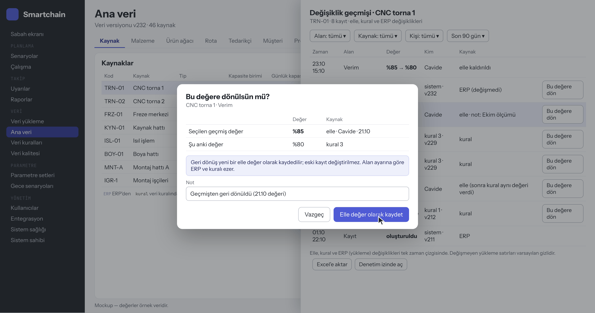

- **Seçilen ve şu anki değer:** Hangi değere dönüleceği ve kaynağı açıkça yazar.
- **Yeni kayıt mantığı:** Eski kayıt değişmez; geri dönüş yeni elle değer olarak eklenir.
- **Otomatik not:** Geçmişten dönüldüğü notu hazır gelir, değiştirilebilir.
- **Aynı yol:** Kaydetme 12'deki onay ve etki kurallarını izler.

### 15 · Excel ile toplu düzeltme (öneri)
24. Ekranlar ve fonksiyonlar · F15 · B Ana veri ve kurallar · Çalışma prensibi 1/2

- Çok sayıda kaydı tek tek düzeltmek yerine filtrelenmiş listeyi Excel'e alıp düzeltmek ve değişen hücreleri elle değer olarak geri yüklemek; aynı izlenebilirlik ve geri alma ile.

#### NASIL ÇALIŞIR

- **KIM VE NEREDEN**
  - Kim: Key user ve üstü
  - Nereden: Ana veri ekranı 'Excel ile toplu düzelt' · Veri kalitesi 'toplu düzelt' (seçili uyarılar)
- **01:** 'Excel'e al': filtrelenmiş liste indirilir; elle değer alabilen alanlar düzenlenebilir, diğerleri gri ve kilitli; her hücrenin kaynak etiketi ve gizli kayıt anahtarı dosyadadır.
- **02:** Kullanıcı Excel'de değerleri değiştirir (liste alanlarında açılır liste).
- **GIRDI**
  - Kapsam: sekme ve filtre (ör. verimi varsayılanda kalan kaynaklar)
  - Veri sözlüğü: hangi alanlar elle değer alabilir (düzenlenebilir), hangileri kilitli
  - Düzeltilmiş xlsx; gizli kayıt anahtarı ve kaynak etiketleri
- **03:** Dosya geri yüklenir; sistem gizli anahtarla kayıtları eşler ve yalnız değişen hücreleri bulur (dosya değeri ≠ geçerli değer).
- **04:** Ön kontrol: tip, aralık, kod listesi; hatalı hücreler listelenir ve atlanır.
- **05:** Önizleme: kayıt, alan, şu an (kaynağıyla) → yeni; 'ERP'yi ezer' gibi dikkat gerektirenler işaretli. Kullanıcı onaylar.
- **06:** Her değişiklik ManualValue olarak yazılır; hepsi tek toplu işlem numarasına bağlanır (denetim izi); türetilmiş alanlar ve veri kalitesi kapsam için yeniden çalışır.
- **ÇIKTI**
  - Toplu işlem kaydı (numara, kullanıcı, dosya, N değişiklik) ve her hücre için ManualValue
  - Hata raporu xlsx
  - Türetilmiş alanlar ve veri kalitesi güncellemesi
- **07:** Sonuç bildirimi ve 'Tümünü geri al': toplu işlemin tüm elle değerleri tek seferde kapatılır.

### 15 · Excel ile toplu düzeltme (öneri) · kurallar ve etkiler
24. Ekranlar ve fonksiyonlar · F15 · B Ana veri ve kurallar · Çalışma prensibi 2/2

- **KURALLAR VE SINIRLAR**
  - Değişmeyen hücreler dokunulmaz; dosyadaki her hücre elle değer olmaz.
  - Kilitli alanlar dosyada değiştirilse bile alınmaz, ön kontrolde 'kilitli alan' uyarısı.
  - Her hücre 12'deki kurallara tabidir (alan ayarı, aralık, çakışma); toplu işlem bu kuralları atlamaz.
  - Bir toplu işlemde en fazla 5.000 değişiklik (parametre); fazlası bölünür.
  - Geri alma toplu işlem bazındadır; tek hücre de ayrıca geri alınabilir (13).
- **HATA VE ISTISNA**
  - Gizli anahtar bozulmuşsa (satır kopyalanmış) kayıt kodla eşlenir; eşleşmeyen satır hatalı.
  - Dosya başka sekmeye aitse reddedilir.
  - Başka kullanıcı aynı hücreyi dosya alındıktan sonra değiştirdiyse önizlemede 'çakışma' işareti; kullanıcı seçer.
- **ETKISI VE TETIKLENENLER**
  - Türetilmiş alanlar (kapasite) kapsam için güncellenir.
  - Veri kalitesi uyarıları kapanabilir.
  - Plan: çalışmada yeniden hesap gerekir.
  - Sabah ekranı değişiklik sayısı.
- **YENİDEN HESAPLANACAK ALANLAR:** Alan Nerede Ne zaman / neden
- **Geçerli değer ve kaynağı:** FieldValueSource Değişen her hücre 'elle' olur
- **Türetilmiş kapasite:** Dönem kapasitesi Kapsamdaki kaynaklar için
- **Veri kalitesi uyarıları:** Veri kalitesi listesi Kapsamdaki kayıtlar için kontrol yeniden
- **Doluluk ve plan:** CapacityLoad · PlanMetric Otomatik değil; çalışmada yeniden hesap
- **ÖRNEK:** Verimi varsayılanda kalan 5 kaynak Excel'e alınır, ölçüm değerleri girilir, geri yüklenir: 6 değişen hücre, 1 hatalı (olmayan takvim) atlanır, 5 elle değer toplu işlem #T-118 olarak kaydedilir.
- **AÇIK KONU:** Bu fonksiyon öneri. Alternatif: yalnız tek tek düzeltme (12) ve kurallar (16). Toplu düzeltme ilk kurulumda (ERP'de olmayan 40+ alan) zaman kazandırır.

### 15 · Excel ile toplu düzeltme (öneri) · Excel'e alma
24. Ekranlar ve fonksiyonlar · F15 · B Ana veri ve kurallar · Mockup 1/3

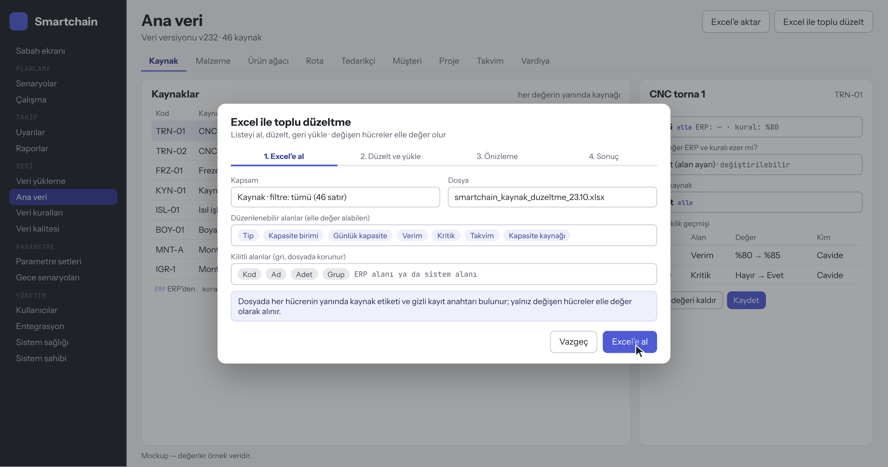

- **Adım göstergesi:** Excel'e al → düzelt ve yükle → önizleme → sonuç.
- **Düzenlenebilir / kilitli:** Hangi alanların elle değer alabildiği çiplerle; kilitliler gri.
- **Gizli anahtar:** Dosya kayıtları güvenle eşler; kaynak etiketleri de dosyada.
- **Kapsam:** Filtre dosyaya yansır; yalnız ilgili satırlar.

### 15 · Excel ile toplu düzeltme (öneri) · Önizleme
24. Ekranlar ve fonksiyonlar · F15 · B Ana veri ve kurallar · Mockup 2/3

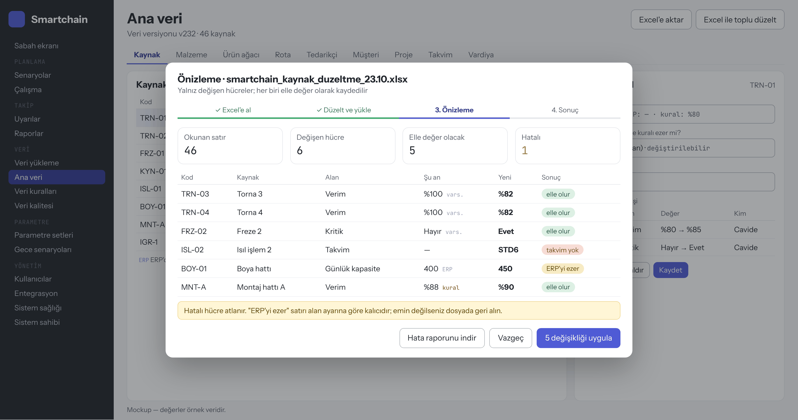

- **Yalnız değişenler:** 46 satırdan 6 değişen hücre; her biri şu an → yeni.
- **Dikkat işaretleri:** 'ERP'yi ezer' ve hatalı satırlar ayrı renkte; kullanıcı bilerek onaylar.
- **Hata raporu:** Atlanan hücreler raporla indirilir.
- **Tek onay:** Uygula butonu değişiklik sayısını yazar.

### 15 · Excel ile toplu düzeltme (öneri) · Sonuç ve geri al
24. Ekranlar ve fonksiyonlar · F15 · B Ana veri ve kurallar · Mockup 3/3

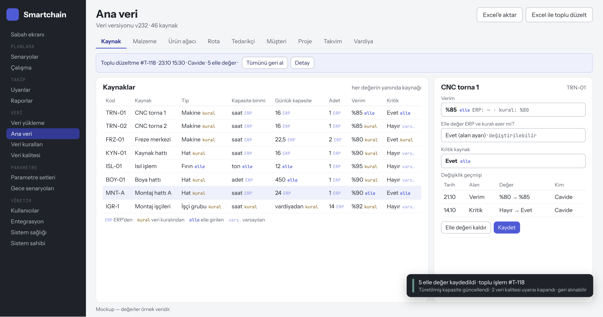

- **Toplu işlem numarası:** Üst şeritte işlem numarası, kim, kaç değer; detay ve geri al.
- **Hücreler 'elle' oldu:** Listede değişen hücreler elle etiketiyle.
- **Yan etkiler:** Bildirimde kapasite ve kapanan uyarı sayısı.
- **Tek seferde geri:** Toplu işlemin tüm elle değerleri birlikte kapatılabilir.

### 16 · Veri kuralı tanımlama
24. Ekranlar ve fonksiyonlar · F16 · B Ana veri ve kurallar · Çalışma prensibi 1/2

- ERP'den gelmeyen ya da hatalı alanları, kod bilmeden yazılan koşul–sonuç kurallarıyla tamamlamak; aynı kural her yüklemede tekrar çalışsın, değer kaynağı 'kural' olarak izlensin.

#### NASIL ÇALIŞIR

- **KIM VE NEREDEN**
  - Kim: Key user ve üstü
  - Nereden: Veri kuralları ekranı '+ Yeni kural' · Veri kalitesi satırından 'kural öner' · hücre ipucunda kural bağlantısı
- **01:** '+ Yeni kural': ad, hedef tablo ve alan seçilir; alan listesinde yalnız kuralla doldurulabilir alanlar vardır, diğerleri nedeniyle pasif.
- **02:** Koşullar satır satır eklenir: alan, operatör, değer; değer alanı hedef tipine göre liste, sayı ya da metin. VE / VEYA grupları iç içe (en fazla 2 seviye).
- **GIRDI**
  - Hedef tablo ve alan (veri sözlüğünde 'kuralla doldurulabilir' olanlar)
  - Koşullar: alan, operatör (=, ≠, başlar, içerir, >, <, boş, listede), değer; VE / VEYA grupları
  - Sonuç: sabit değer ya da başka alandan kopya
  - Çakışma ayarları (alan sözlüğünden varsayılan), geçerlilik tarihleri, açıklama
- **03:** Sonuç: sabit değer ya da başka bir alandan kopya (AssignFromField); tip uyumu anında kontrol edilir.
- **04:** Çakışma ayarları alan sözlüğünden gelir (ERP ile çakışırsa, elle değer varsa) ve kuralda görünür; gerekirse bu kural için değiştirilir.
- **05:** Önizleme (17) zorunludur: kaç kayıt eşleşir, kaçı değişir, kaçı ERP ya da elle nedeniyle atlanır; 'Kaydet' önizleme olmadan pasiftir.
- **06:** 'Kaydet ve uygula' kuralı listenin sonuna (Seq) ekler, DataRule + koşulları yazar ve kuralı hemen uygular (19); 'Yalnız kaydet' pasif bırakır.
- **ÇIKTI**
  - DataRule ve DataRuleCondition kayıtları; sıra numarası
  - Önizleme sonucu; uygulandıysa değişen kayıtlar ve FieldValueSource.Source = kural
  - Denetim izi
- **07:** Denetim izine kural metni (okunur biçimde) ve kim/ne zaman yazılır; kural pasif yapılabilir ama silinmez.

### 16 · Veri kuralı tanımlama · kurallar ve etkiler
24. Ekranlar ve fonksiyonlar · F16 · B Ana veri ve kurallar · Çalışma prensibi 2/2

- **KURALLAR VE SINIRLAR**
  - Bir kuralın tek hedef alanı vardır; aynı alana birden fazla kural olabilir, sıra belirler (18).
  - Döngü yasak: A alanını B'den, B'yi A'dan dolduran kural çifti kaydedilmez.
  - Kural yalnız geçerli veri versiyonu üzerinde çalışır; geçmiş versiyonlara dokunmaz.
  - Kural silinmez; pasif yapılır ve geçmişi kalır (hücre ipuçları kural numarasına bağlıdır).
  - Koşullarda işlem verisi alanları (ör. açık sipariş miktarı) kullanılmaz; kurallar ana veri içindir.
- **HATA VE ISTISNA**
  - Boş değer, tip uyumsuzluğu: satır altında kırmızı mesaj, kaydet pasif.
  - Önizleme 0 kayıt eşleştiriyorsa uyarı: 'Kural hiçbir kayda uymuyor; yine de kaydedilsin mi?'
  - Döngü ya da aynı alanda çelişen kural: kaydetmeden önce açıklamalı engel.
  - Uygulama sırasında hata: kural kaydedilir, 'uygulanamadı' durumu ve Sistem sağlığı kaydı.
- **ETKISI VE TETIKLENENLER**
  - Uygulandıysa 19'un etkileri: değer kaynağı, türetilmiş alanlar, veri kalitesi.
  - Kural listesi ve etki sayıları güncellenir.
  - Hücre ipuçlarında yeni kural numarası görünür.
- **YENİDEN HESAPLANACAK ALANLAR:** Tanımlama tek başına yeniden hesap gerektirmez; 'Kaydet ve uygula' seçilirse 19 Kural uygulama ile aynı alanlar yeniden hesaplanır (FieldValueSource, türetilmiş alanlar, veri kalitesi).
- **ÖRNEK:** EĞER Malzeme grubu = Rulman VE Temin süresi boş O HALDE Temin süresi = 14 gün. Önizleme: 26 eşleşen, 21 değişir, 3'ünde ERP değeri korunur, 2'sinde elle değer kalır.

### 16 · Veri kuralı tanımlama · Kural editörü
24. Ekranlar ve fonksiyonlar · F16 · B Ana veri ve kurallar · Mockup 1/2

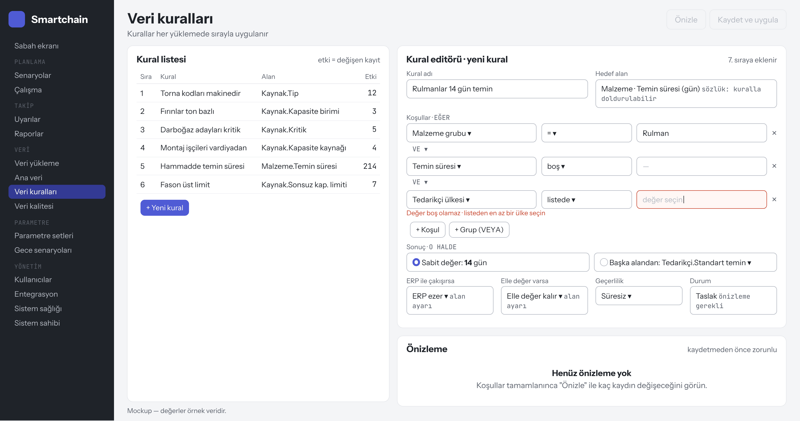

- **Koşul satırları:** Alan, operatör, değer; VE / VEYA ile gruplanır. Kod yok.
- **Anında validasyon:** Boş değer satır altında kırmızı; Önizle ve Kaydet pasif.
- **Sonuç seçenekleri:** Sabit değer ya da başka alandan kopya; tip uyumu kontrol edilir.
- **Çakışma ayarları:** Alan sözlüğünden gelir, kuralda görünür; önizleme olmadan kaydedilmez.

### 16 · Veri kuralı tanımlama · Önizleme ve kaydet
24. Ekranlar ve fonksiyonlar · F16 · B Ana veri ve kurallar · Mockup 2/2

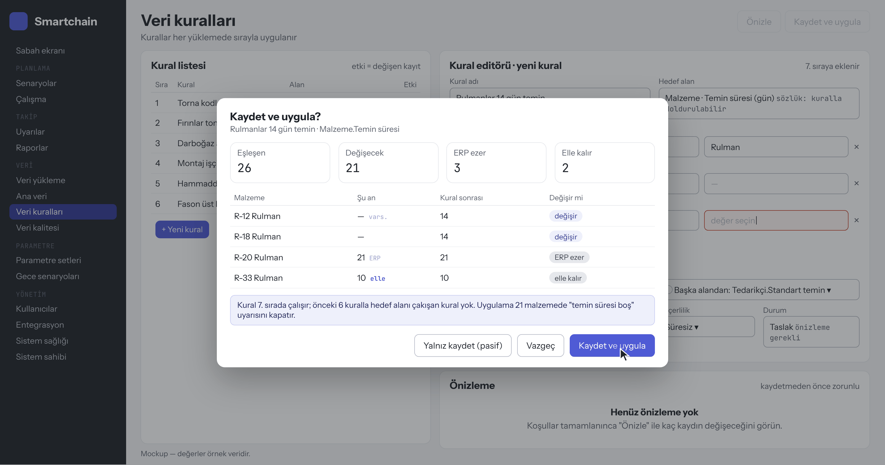

- **Sayılarla özet:** Eşleşen, değişecek, ERP ezer, elle kalır; kullanıcı etkiyi anlar.
- **Satır örnekleri:** Şu an → kural sonrası; atlananların nedeni çipte.
- **Sıra bilgisi:** Kaçıncı sırada çalışacağı ve çakışan kural olmadığı yazar.
- **Üç çıkış:** Yalnız kaydet (pasif), vazgeç, kaydet ve uygula.

### 17 · Kural önizleme
24. Ekranlar ve fonksiyonlar · F17 · B Ana veri ve kurallar · Çalışma prensibi 1/2

- Bir kuralı kaydetmeden önce geçerli veri üzerinde deneyip hangi kayıtların nasıl değişeceğini, hangilerinin ERP ya da elle değer nedeniyle atlanacağını göstermek; yanlış kuralın veriyi bozmasını önlemek.

#### NASIL ÇALIŞIR

- **KIM VE NEREDEN**
  - Kim: Key user ve üstü
  - Nereden: Kural editörü 'Önizle' · kural listesinde satır menüsü 'Önizle' (mevcut kural için yeniden)
- **01:** Koşullar geçerli veri üzerinde salt okunur çalıştırılır; hiçbir tablo yazılmaz.
- **02:** Sonuç sayılarla özetlenir: eşleşen, değişecek, aynı kalacak, ERP ezer nedeniyle atlanacak, elle değer nedeniyle atlanacak.
- **GIRDI**
  - Kural taslağı (koşullar, sonuç, çakışma ayarları)
  - Geçerli veri versiyonu
  - Diğer aktif kurallar ve sıraları (sıra simülasyonu için)
- **03:** Satır listesi: kayıt, şu anki değer (kaynağıyla), kural sonrası değer, sonuç çipi; 'yalnız değişenler' filtresi; ilk 200 satır ekranda, tamamı Excel'e.
- **04:** Sıra simülasyonu: kural mevcut sırasında ve farklı sıralarda çalışsa sonuç değişir mi; aynı hedef alana yazan kurallar listelenir.
- **05:** Önizlemeden doğrudan 'Kaydet ve uygula' ya da editöre dönüp düzeltme; önizleme sonucu kural kaydına özet olarak eklenir.
- **ÇIKTI**
  - Önizleme özeti ve satır listesi (ekran, Excel)
  - Kural kaydında son önizleme özeti (sayılar, tarih)

### 17 · Kural önizleme · kurallar ve etkiler
24. Ekranlar ve fonksiyonlar · F17 · B Ana veri ve kurallar · Çalışma prensibi 2/2

- **KURALLAR VE SINIRLAR**
  - Önizleme yazmaz; geçerli veri değişmez.
  - Önizleme sonucu kaydedildiği anki veriye aittir; veri değişirse 'önizleme eski' uyarısı ve yeniden önizleme istenir.
  - Büyük tablolarda (ürün ağacı) önizleme örneklemle başlar, tam sayım arka planda tamamlanır.
  - Önizleme olmadan kural aktif kaydedilemez.
- **HATA VE ISTISNA**
  - Koşul hatalıysa (tip uyumsuz) önizleme çalışmaz, editörde hata.
  - Süre 10 sn'yi aşarsa arka plana alınır, bitince bildirim.
- **ETKISI VE TETIKLENENLER**
  - Yok; salt okunur.
  - Kural kaydında önizleme özeti.
- **YENİDEN HESAPLANACAK ALANLAR:** Yeniden hesap gerektirmez; önizleme yazmaz.
- **ÖRNEK:** 'Torna kodları makinedir' önizlemesi: 14 eşleşen; 12 değişir (2'sinde ERP değeri kural tarafından ezilir), 1 aynı kalır, 1'inde elle değer korunur. Sıra değişse sonuç aynı.

### 17 · Kural önizleme · Önizleme çekmecesi
24. Ekranlar ve fonksiyonlar · F17 · B Ana veri ve kurallar · Mockup 1/1

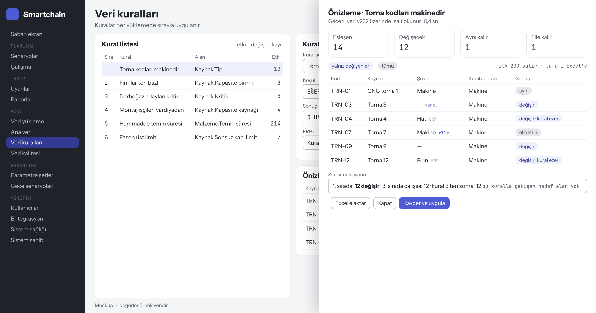

- **Sayılar önce:** Eşleşen, değişecek, aynı kalan, elle kalan; tek bakışta etki.
- **Satır satır:** Şu an (kaynak etiketiyle) → kural sonrası; sonuç çipi nedeni yazar.
- **Sıra simülasyonu:** Kuralın farklı sırada çalışması sonucu değiştirir mi; çakışan alan var mı.
- **Buradan kaydet:** Önizlemeden doğrudan kaydet ve uygula ya da Excel'e al.

### 18 · Kural sıralama ve aç / kapa
24. Ekranlar ve fonksiyonlar · F18 · B Ana veri ve kurallar · Çalışma prensibi 1/2

- Kuralların çalışma sırasını belirlemek ve bir kuralı silmeden geçici olarak devre dışı bırakmak; aynı alana yazan kurallarda hangisinin kazanacağını görünür kılmak.

#### NASIL ÇALIŞIR

- **KIM VE NEREDEN**
  - Kim: Key user ve üstü
  - Nereden: Veri kuralları ekranı · liste (sürükle-bırak, Alt + ok) · satırdaki aç / kapa anahtarı
- **01:** Liste sıra numarasıyla gelir; kural tutulup sürüklenir ya da Alt + ok tuşlarıyla taşınır; hedef konum kesik çizgiyle görünür.
- **02:** Taşıma sırasında aynı hedef alana yazan kurallar vurgulanır ve uyarı yazılır: 'sonra çalışan kazanır, N kayıt etkilenir'.
- **GIRDI**
  - DataRule listesi (Seq, IsActive, hedef alan)
  - Mevcut etki sayıları (son uygulamadan)
  - Aynı hedef alana yazan kurallar
- **03:** Aç / kapa anahtarı: kapatma onay ister; onayda kuralın şu an etkilediği kayıtlar ve kapatınca geri dönecek değerler (ERP, varsayılan) gösterilir, gerekçe istenir.
- **04:** 'Sırayı kaydet ve uygula': Seq ve IsActive yazılır, kurallar yeniden uygulanır (19); vazgeçilirse sıra eski haline döner.
- **ÇIKTI**
  - Güncel Seq ve IsActive
  - Yeniden uygulama sonucu (değişen kayıtlar)
  - Denetim izi
- **05:** Denetim izine eski ve yeni sıra, kapatılan kural ve gerekçe yazılır.

### 18 · Kural sıralama ve aç / kapa · kurallar ve etkiler
24. Ekranlar ve fonksiyonlar · F18 · B Ana veri ve kurallar · Çalışma prensibi 2/2

- **KURALLAR VE SINIRLAR**
  - Pasif kural uygulanmaz ama listede ve geçmişte kalır; hücre ipuçlarında 'kural 3 (pasif)' görünür.
  - Aynı alana yazan kurallarda sonuncu kazanır; sistem bunu uyarır, engellemez.
  - Sıra değişikliği kaydedilmeden uygulanmaz; taslak sıra yalnız ekranda.
  - Kapatılan kuralın yazdığı değerler sonraki uygulamada öncelik sırasındaki kaynağa döner (elle değerler kalır).
- **HATA VE ISTISNA**
  - Kapatma sonrası zorunlu alan boş kalacaksa onayda 'kritik veri kalitesi uyarısı doğar' bilgisi.
  - Aynı anda başka kullanıcı sırayı değiştirdiyse kaydetmede çakışma; liste yenilenir.
- **ETKISI VE TETIKLENENLER**
  - 19 Kural uygulama çalışır: değer kaynakları, türetilmiş alanlar, veri kalitesi.
  - Kritik kaynak, kapasite birimi gibi alanlar değişirse plan için yeniden hesap gerekir.
  - Hücre ipuçları ve kural listesi etki sayıları.
- **YENİDEN HESAPLANACAK ALANLAR:** Alan Nerede Ne zaman / neden
- **Kural sonuçları:** DataRule → hedef alanlar Tüm aktif kurallar yeni sırayla yeniden uygulanır
- **Geçerli değer ve kaynağı:** FieldValueSource Kapatılan kuralın kayıtları öncelik sırasındaki kaynağa döner
- **Türetilmiş kapasite:** Dönem kapasitesi Kapasite alanları etkilendiyse
- **Veri kalitesi uyarıları:** Veri kalitesi listesi Etkilenen kayıtlar için kontrol yeniden
- **Plan:** Senaryolar · çalışmalar Otomatik değil; kritik kaynak ve kapasite alanları değiştiyse yeniden hesap
- **ÖRNEK:** Kural 4 (Montaj işçileri vardiyadan) 3. sıraya taşınır. 5 ve 7 numaralı kurallar aynı alana (Temin süresi) yazıyor; sistem 'sonuncu kazanır: 7' uyarısı verir. Kural 3 kapatılınca kritik kaynak 7 → 2.

### 18 · Kural sıralama ve aç / kapa · Sürükle-bırak sıra
24. Ekranlar ve fonksiyonlar · F18 · B Ana veri ve kurallar · Mockup 1/2

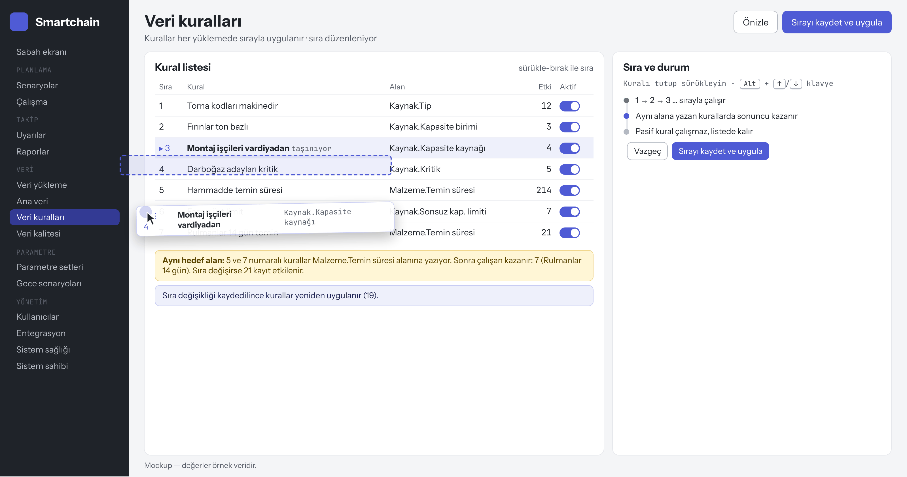

- **Sürükleme durumu:** Taşınan satır gölgeli, hedef konum kesik çizgi; klavye alternatifi yazılı.
- **Çakışma uyarısı:** Aynı alana yazan kurallar ve kimin kazanacağı anında görünür.
- **Kaydetmeden uygulanmaz:** Sıra taslaktır; 'Sırayı kaydet ve uygula' ile kurallar yeniden çalışır.
- **Kurallar kısa özet:** Sağda üç cümle: sırayla, sonuncu kazanır, pasif çalışmaz.

### 18 · Kural sıralama ve aç / kapa · Kapatma onayı
24. Ekranlar ve fonksiyonlar · F18 · B Ana veri ve kurallar · Mockup 2/2

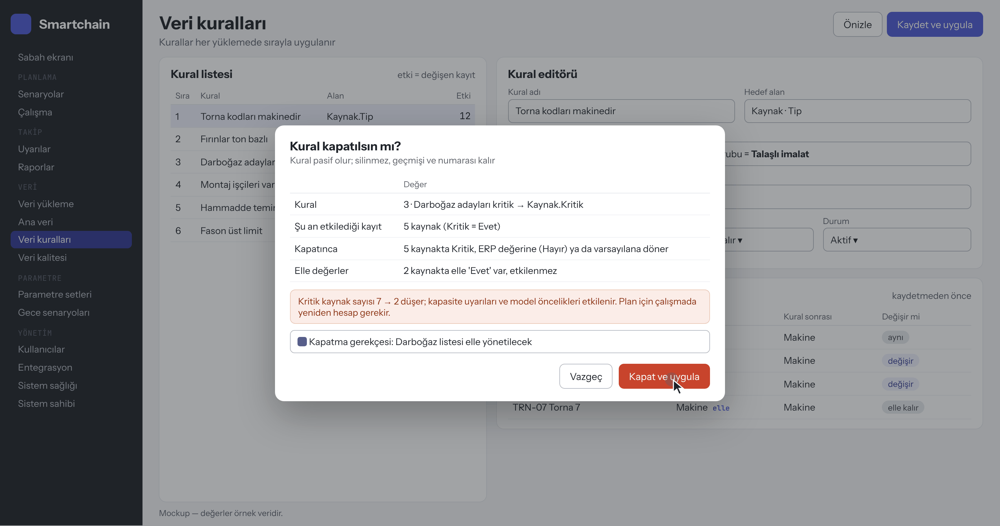

- **Ne olacak:** Etkilenen kayıt sayısı ve geri dönecek değerler; elle değerlerin korunduğu.
- **Etki uyarısı:** Kritik kaynak sayısı düşer; plan etkisi kırmızı kutuda.
- **Gerekçe:** Kapatma gerekçesi denetim izine yazılır.
- **Silme yok:** Kural pasif olur; numarası ve geçmişi kalır.

### 19 · Kural uygulama
24. Ekranlar ve fonksiyonlar · F19 · B Ana veri ve kurallar · Çalışma prensibi 1/2

- Aktif kuralları sırayla geçerli veri üzerinde çalıştırıp alanları doldurmak; alan önceliğine saygı göstererek, her değişikliğin kaynağını 'kural' olarak işaretleyerek.

#### NASIL ÇALIŞIR

- **KIM VE NEREDEN**
  - Kim: Sistem (yükleme sonunda otomatik) · elle: key user ve üstü ('Kaydet ve uygula', 'Tümünü yeniden uygula')
  - Nereden: Tam ve kısmi yükleme (05 / 06) sonunda · Veri kuralları ekranı · kural kaydetme, sıralama ve kapatma işlemleri
- **01:** Tetik gelir (yükleme sonu, kural kaydı, sıra değişikliği, 'Tümünü yeniden uygula'); iş kuyruğuna 'kural uygulama' yazılır; aynı anda ikinci uygulama ve yükleme bekletilir.
- **02:** Kurallar Seq sırasıyla çalışır; her kural için koşullara uyan kayıtlar bulunur, hedef alan için öncelik kontrol edilir: 'ERP ezer' ve ERP değeri varsa atla; elle değer varsa ve 'elle kalır' ise atla.
- **GIRDI**
  - Aktif DataRule listesi (Seq sırasıyla) ve koşulları
  - Geçerli veri versiyonu (kısmi yüklemede yalnız yüklenen varlıklar)
  - FieldDefinition ve FieldValueSource: alan önceliği, ERP değeri, elle değerler
- **03:** Yazılan her alan için FieldValueSource.Source = kural, DataRuleId; önceki kaynak ve ERP değeri saklanır. Kural artık uymayan kayıtlarda önceki kaynağa dönülür.
- **04:** Tek işlem olarak çalışır; hata olursa tamamı geri alınır, veri son tutarlı durumda kalır. Ekranlar bu sırada son durumu gösterir, ilerleme şeritte.
- **05:** Bitince türetilmiş alanlar (kapasite, LLC gerekiyorsa) hesaplanır ve veri kalitesi kontrolü (20) etkilenen kayıtlar için çalışır.
- **ÇIKTI**
  - Güncel alan değerleri ve FieldValueSource (kaynak = kural, kural numarası)
  - Kural uygulama raporu (kural bazında sayılar, değişen kayıt listesi Excel)
  - Türetilmiş alanlar, veri kalitesi güncellemesi, denetim izi
- **06:** Kural bazında rapor yazılır: taranan, değişen, ERP nedeniyle atlanan, elle nedeniyle atlanan; etki sayıları listeye yansır; denetim izine toplu kayıt.

### 19 · Kural uygulama · kurallar ve etkiler
24. Ekranlar ve fonksiyonlar · F19 · B Ana veri ve kurallar · Çalışma prensibi 2/2

- **KURALLAR VE SINIRLAR**
  - Kurallar her zaman tam sırayla çalışır; tek kural tek başına uygulanmaz (sıra etkileşimi için).
  - Elle değer hiçbir zaman silinmez; alan ayarı 'kural ezer' olsa bile elle kayıt kapatılmaz, yalnız geçerli değer olarak kural kazanır ve ipucunda görünür.
  - Kısmi yüklemede yalnız yüklenen varlıkların alanları yeniden değerlendirilir.
  - Uygulama geçerli veri versiyonu içinde yapılır; yeni versiyon açmaz.
  - Süre sınırı (parametre, öneri 10 dk); aşılırsa geri alınır ve Sistem sağlığına düşer.
- **HATA VE ISTISNA**
  - Kural çalışma hatası (ör. tip dönüşümü): o kural atlanır, 'uygulanamadı' işareti; diğerleri devam eder; sabah ekranında uyarı.
  - Kilit çakışması (yükleme sürüyor): uygulama kuyruğa alınır, yükleme bitince çalışır.
  - Geri alma gerekirse tüm işlem geri alınır; rapor 'başarısız' olarak kalır.
- **ETKISI VE TETIKLENENLER**
  - Değer kaynakları ve hücre etiketleri.
  - Türetilmiş kapasite, LLC.
  - Veri kalitesi listesi (kapanan ve yeni uyarılar).
  - Plan: kritik kaynak, kapasite birimi, temin süresi gibi alanlar değiştiyse çalışmada yeniden hesap gerekir.
- **YENİDEN HESAPLANACAK ALANLAR:** Alan Nerede Ne zaman / neden
- **Geçerli değer ve kaynağı:** FieldValueSource Kuralın yazdığı ve artık uymayan tüm kayıtlar
- **Türetilmiş kapasite:** Dönem kapasitesi Günlük kapasite, adet, verim, kapasite birimi değiştiyse
- **En alt seviye kodu (LLC):** Material Ürün ağacı alanlarına yazan kural varsa
- **Veri kalitesi uyarıları:** Veri kalitesi listesi Etkilenen kayıtlar için kontrol yeniden
- **Kural etki sayıları:** Veri kuralları listesi Her uygulamada güncellenir
- **Plan:** Senaryolar · çalışmalar Otomatik değil; gece senaryoları yeni değerlerle çalışır
- **ÖRNEK:** 7 kural, 45 sn: 266 değişiklik, 11 atlanan (6 ERP ezer, 5 elle kalır). Kural 5 ve 7 aynı alana yazar; 7 sonra çalıştığı için rulmanlarda 14 gün kazanır. 21 uyarı kapandı, 2 yeni.

### 19 · Kural uygulama · Uygulama sürüyor
24. Ekranlar ve fonksiyonlar · F19 · B Ana veri ve kurallar · Mockup 1/2

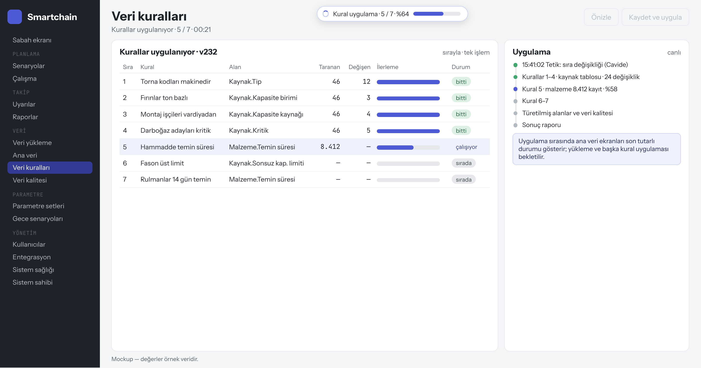

- **Kural bazında ilerleme:** Taranan ve değişen kayıt sayısı kural kural; çalışan satır vurgulu.
- **Tek işlem:** Hata olursa tamamı geri alınır; ekranlar son tutarlı durumu gösterir.
- **Kilitleme:** Uygulama sırasında yükleme ve yeni kural kaydı bekletilir; butonlar pasif.
- **Tetik bilgisi:** Akışta neyin tetiklediği (sıra değişikliği, kim) görünür.

### 19 · Kural uygulama · Uygulama raporu
24. Ekranlar ve fonksiyonlar · F19 · B Ana veri ve kurallar · Mockup 2/2

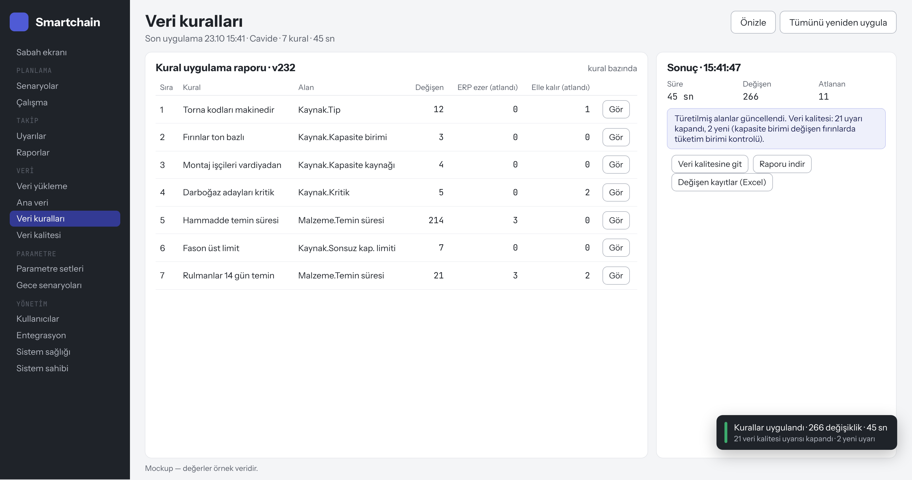

- **Değişen ve atlanan:** Her kural için değişen, ERP nedeniyle atlanan, elle nedeniyle atlanan.
- **Yan etkiler:** Türetilmiş alanlar ve veri kalitesi sonucu özetle; kapanan ve yeni uyarılar.
- **Değişen kayıtlar:** Kural satırından 'Gör' ile liste; Excel'e tam çıktı.
- **Yeniden uygula:** Şüphe varsa tüm kurallar baştan çalıştırılır.

### 20 · Veri kalitesi kontrolü
24. Ekranlar ve fonksiyonlar · F20 · B Ana veri ve kurallar · Çalışma prensibi 1/2

- Ana veri ve işlem verisini plan için gerekli tutarlılık kontrollerinden geçirip önem sırasıyla uyarı listesi üretmek; önceki listeyle karşılaştırıp neyin yeni, neyin kapandığını göstermek.

#### NASIL ÇALIŞIR

- **KIM VE NEREDEN**
  - Kim: Sistem (yükleme ve kural uygulaması sonunda, gece) · elle 'Şimdi kontrol et': key user ve üstü
  - Nereden: Tam ve kısmi yükleme (05 / 06), kural uygulama (19), elle değer (12, kayıt bazında) sonunda · Veri kalitesi ekranı
- **01:** Tetik gelir; kapsam belirlenir: tam kontrol (yükleme, gece) ya da etkilenen kayıtlar (kural, elle değer).
- **02:** Ana veri kontrolleri çalışır: kaynak (takvimsiz, sıfır kapasite, birim uyumsuzluğu), malzeme (temin süresi, min parti, birim dönüşümü), ürün ağacı (döngü, pasif bileşen), rota (kaynak yok, süre 0, kapasite birimi ≠ tüketim birimi).
- **GIRDI**
  - Geçerli veri versiyonu (tüm varlıklar ya da etkilenen kayıtlar)
  - Uyarı tanımları (WarningDefinition): kontrol, eşik, önem, aktif
  - Önceki uyarı listesi ve durumları (açık, kapandı, bilerek böyle, atanmış)
- **03:** İşlem verisi kontrolleri: sipariş (geçmiş tarih, müşteri yok), stok (negatif, lotsuz proje stoğu), iş emri (rotasız, bitiş geçmişte), proje (ayrılmış stok > ihtiyaç).
- **04:** Her bulgu uyarı tanımından önem ve öneri alır; kayıt ve alanla birlikte yazılır.
- **05:** Önceki listeyle eşleştirme: aynı kayıt + kontrol → 'açık' (ilk görülme tarihi korunur), yeni bulgu → 'yeni', artık bulunmayan → 'kapandı'; 'bilerek böyle' işaretliler süresi dolmadıkça yeniden açılmaz.
- **ÇIKTI**
  - Veri kalitesi uyarı listesi (durum, önem, kategori, kayıt, sorun, öneri, ilk görülme)
  - Değişim özeti: yeni, kapanan, açık, bilerek böyle
  - Sabah ekranı ve uyarı iş listesi (20. ekran) için kaynak
- **06:** Özet sayılar (kritik, yüksek, orta), dağılım ve 'dünden bugüne' güncellenir; sabah ekranına yansır; kritik yeni uyarı varsa bildirim.

### 20 · Veri kalitesi kontrolü · kurallar ve etkiler
24. Ekranlar ve fonksiyonlar · F20 · B Ana veri ve kurallar · Çalışma prensibi 2/2

- **KURALLAR VE SINIRLAR**
  - Kontroller ve eşikler uyarı tanımlarıyla parametriktir; kod değişikliği gerektirmez.
  - Kapanan uyarı silinmez; 'kapandı' olarak 90 gün görünür, sonra arşiv.
  - 'Bilerek böyle' işareti gerekçe ve süre ister; süre dolunca uyarı yeniden değerlendirilir.
  - Kritik: plan hesabını bozar (döngü, eksik kaynak); yüksek: planı etkiler; orta: kontrol edilmeli. Sınıf tanımdan gelir.
  - Kontrol yazmaz; yalnız uyarı listesini günceller.
- **HATA VE ISTISNA**
  - Bir kontrol grubu hata verirse diğerleri devam eder; grup 'kontrol edilemedi' işaretlenir, Sistem sağlığına düşer.
  - Süre 2 dk'yı aşarsa (parametre) arka planda sürer, bitince bildirim.
  - Uyarı tanımı pasifse o kontrol atlanır; açık uyarıları 'tanım pasif' notuyla kapanır.
- **ETKISI VE TETIKLENENLER**
  - Sabah ekranı 'kritik uyarılar' ve 'dünden bugüne'.
  - Uyarı iş listesi (83) ana veri ve işlem verisi kategorileri.
  - Kritik yeni uyarıda bildirim (ekran ve sabah ekranı).
- **YENİDEN HESAPLANACAK ALANLAR:** Alan Nerede Ne zaman / neden
- **Uyarı listesi:** Veri kalitesi uyarıları Kapsamdaki kayıtlar için baştan üretilir, eşleştirilir
- **Özet sayılar ve dağılım:** Veri kalitesi ekranı · sabah ekranı Her kontrolde
- **Uyarı iş listesi:** Uyarılar ekranı (ana veri, işlem verisi kategorileri) Yeni ve kapanan uyarılar yansır
- **Plan:** — Kontrol planı değiştirmez; kritik uyarı plan hesabını engelleyebilir (motor kuralı)
- **ÖRNEK:** Kural uygulaması sonrası kontrol 38 sn: 3 yeni (kural 2 fırınları ton yapınca rota tüketim birimi uyumsuz), 23 kapanan (21'i kural 7 ile temin süresi). Açık 44, bilerek böyle 4.

### 20 · Veri kalitesi kontrolü · Kontrol çalışıyor
24. Ekranlar ve fonksiyonlar · F20 · B Ana veri ve kurallar · Mockup 1/2

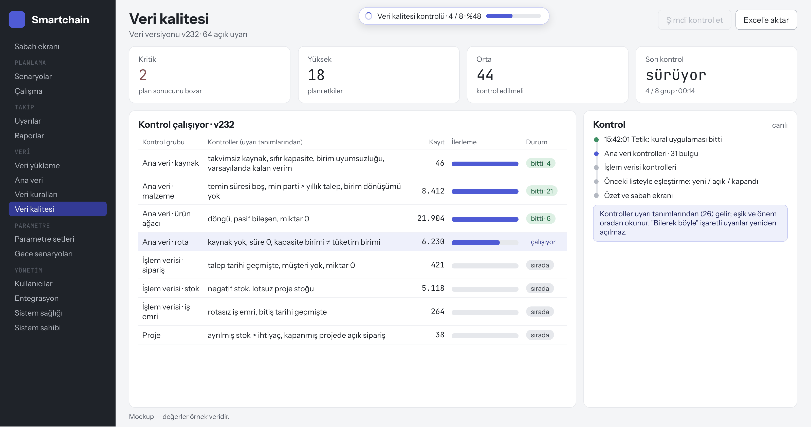

- **Kontrol grupları:** Ana veri ve işlem verisi grupları; her grubun kontrolleri ve kayıt sayısı.
- **İlerleme ve bulgu:** Biten grupta bulgu sayısı; çalışan satır vurgulu, üstte şerit.
- **Tetik ve kapsam:** Neden çalıştığı (kural uygulaması) ve tam / kısmi kapsam akışta.
- **Parametrik:** Kontroller uyarı tanımlarından gelir; bilerek böyle olanlar yeniden açılmaz.

### 20 · Veri kalitesi kontrolü · Değişim özeti
24. Ekranlar ve fonksiyonlar · F20 · B Ana veri ve kurallar · Mockup 2/2

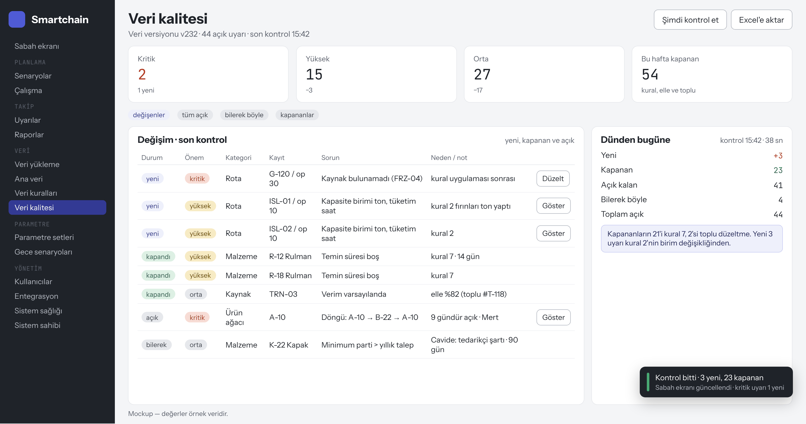

- **Yeni / kapandı / açık:** Durum çipi ilk sütunda; neden sütunu kapanmayı ya da açılmayı açıklar.
- **Dünden bugüne:** Sağda sayılar: yeni, kapanan, açık kalan, bilerek böyle.
- **Bağlantı:** Yeni uyarının nedeni (kural 2) yazar; kullanıcı kök nedene gider.
- **Filtre çipleri:** Değişenler varsayılan; tüm açık, bilerek böyle ve kapananlar ayrı görünüm.

### 21 · Kalite düzeltme aksiyonu
24. Ekranlar ve fonksiyonlar · F21 · B Ana veri ve kurallar · Çalışma prensibi 1/2

- Veri kalitesi uyarısından doğrudan düzeltmeye geçmek: kayda gidip elle düzeltmek, önerilen kuralı uygulamak, uyarıyı gerekçeyle 'bilerek böyle' kapatmak ya da kişiye atamak; tek tek ya da toplu.

#### NASIL ÇALIŞIR

- **KIM VE NEREDEN**
  - Kim: Key user ve üstü (end user listeyi görür, aksiyon alamaz)
  - Nereden: Veri kalitesi ekranı satır aksiyonları · uyarı iş listesi (83) ana veri kategorisi · toplu seçim araç çubuğu
- **01:** Satırdaki aksiyon seçilir. 'Düzelt': ilgili ana veri kaydı detay kartıyla açılır, alan odaklı; kaydedince (12) uyarı için kontrol yeniden çalışır.
- **02:** 'Uygula': önerilen kural (ya da kural ayarı) önizlemeyle gösterilir; onayda kural uygulanır (19) ve etkilenen uyarılar kapanır.
- **GIRDI**
  - Uyarı satırı (kayıt, alan, sorun, öneri)
  - Önerilen aksiyon türü: düzelt, uygula (kural), göster, bilerek böyle, ata
  - Toplu seçim (aynı kontrol türünden uyarılar)
- **03:** 'Göster': kaynağa gider (rota, ağaç, sipariş); ERP'de düzeltilmesi gereken sorunlarda 'ERP'de düzelt' notu ve yükleme sonrası kontrol.
- **04:** 'Bilerek böyle': gerekçe (zorunlu), süre ve sorumlu; uyarı kapanır, süre boyunca yeniden açılmaz; denetim izi.
- **05:** 'Ata': uyarı kişiye atanır, uyarı iş listesinde görünür; not eklenir.
- **ÇIKTI**
  - Kapanan / atanmış / bilerek böyle uyarılar ve durum geçmişi
  - Elle değer, kural uygulaması ya da atama kaydı (ilgili fonksiyonun çıktısı)
  - Denetim izi
- **06:** Toplu: aynı türden uyarılar seçilir (ör. 21 'temin süresi boş'), tek aksiyon uygulanır; sonuçta kapanan sayısı ve geri alma bağlantısı.

### 21 · Kalite düzeltme aksiyonu · kurallar ve etkiler
24. Ekranlar ve fonksiyonlar · F21 · B Ana veri ve kurallar · Çalışma prensibi 2/2

- **KURALLAR VE SINIRLAR**
  - Aksiyon doğrudan veriyi değiştirmez; düzeltme 12, 15 ya da 19 üzerinden yapılır ve onların kurallarına uyar.
  - 'Bilerek böyle' gerekçesiz kapatılamaz; süre en fazla 365 gün.
  - Kritik uyarı 'bilerek böyle' kapatılamaz (plan hesabını bozar); yalnız düzeltilir (öneri).
  - Toplu aksiyon aynı kontrol türüyle sınırlıdır; karışık seçimde buton pasif.
- **HATA VE ISTISNA**
  - Kayıt artık yoksa (ERP'de silinmiş) 'Düzelt' pasif, uyarı sonraki kontrolde kapanır.
  - Kural uygulama hatası: uyarı açık kalır, hata bildirimi.
  - Atanan kullanıcı kapalıysa atama reddedilir.
- **ETKISI VE TETIKLENENLER**
  - 12 / 15 / 19'un etkileri (değer kaynağı, türetilmiş alanlar).
  - Uyarı listesi ve özet sayılar; sabah ekranı.
  - Uyarı iş listesi atama ve not.
- **YENİDEN HESAPLANACAK ALANLAR:** Alan Nerede Ne zaman / neden
- **Uyarı durumu:** Veri kalitesi uyarıları Aksiyon sonrası ilgili kayıt için kontrol yeniden çalışır
- **Geçerli değer ve kaynağı:** FieldValueSource Düzelt ya da uygula seçildiyse (12 / 19)
- **Türetilmiş alanlar:** Kapasite, LLC Düzeltilen alana göre
- **Özet sayılar:** Veri kalitesi · sabah ekranı Her aksiyonda
- **Plan:** Senaryolar · çalışmalar Otomatik değil; düzeltme plan girdisini değiştirdiyse yeniden hesap
- **ÖRNEK:** 'Temin süresi boş' 21 malzeme toplu seçilir, 'Uygula' ile kural 7 doldurur: 21 uyarı kapanır. K-22'de 'minimum parti > talep' tedarikçi şartı: gerekçeyle 90 gün 'bilerek böyle'.

### 21 · Kalite düzeltme aksiyonu · Önerilen kuralı uygula
24. Ekranlar ve fonksiyonlar · F21 · B Ana veri ve kurallar · Mockup 1/3

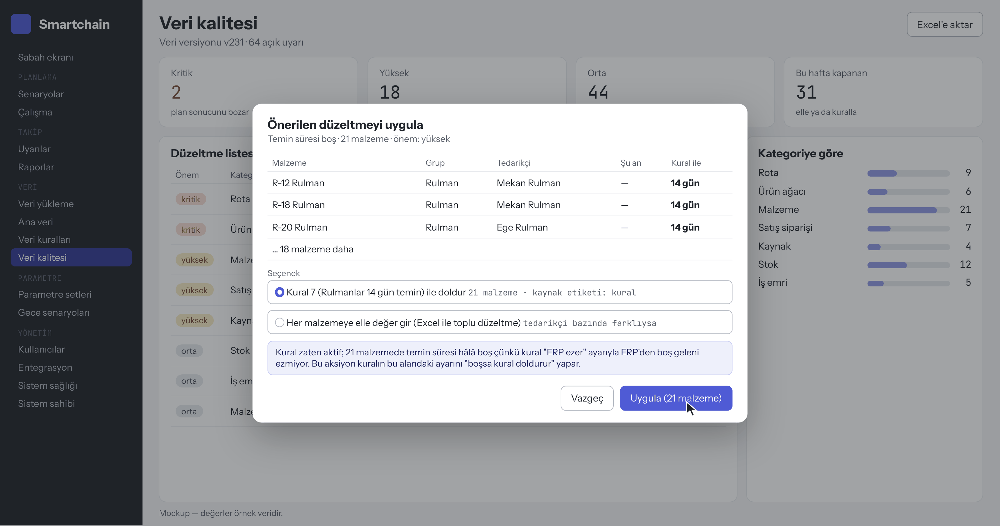

- **Etkilenen kayıtlar:** Kuralın dolduracağı malzemeler ve değer önceden görünür.
- **İki seçenek:** Kuralla toplu ya da Excel ile elle; tedarikçi bazında farklıysa ikincisi.
- **Neden hâlâ boş:** Kuralın neden dolduramadığı (ayar) açıklanır; aksiyon ayarı düzeltir.
- **Sayı butonda:** Uygula butonu kaç kaydı etkileyeceğini yazar.

### 21 · Kalite düzeltme aksiyonu · Bilerek böyle
24. Ekranlar ve fonksiyonlar · F21 · B Ana veri ve kurallar · Mockup 2/3

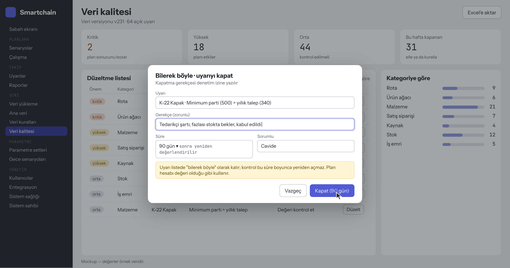

- **Gerekçe zorunlu:** Kapatma gerekçesi yazılmadan buton pasif; denetim izine gider.
- **Süreli:** 90 gün sonra kontrol uyarıyı yeniden değerlendirir.
- **Sorumlu:** Kimin kabul ettiği kayda yazılır.
- **Plan etkisi:** Değerin plan hesabında olduğu gibi kullanılacağı not kutusunda.

### 21 · Kalite düzeltme aksiyonu · Sonuç
24. Ekranlar ve fonksiyonlar · F21 · B Ana veri ve kurallar · Mockup 3/3

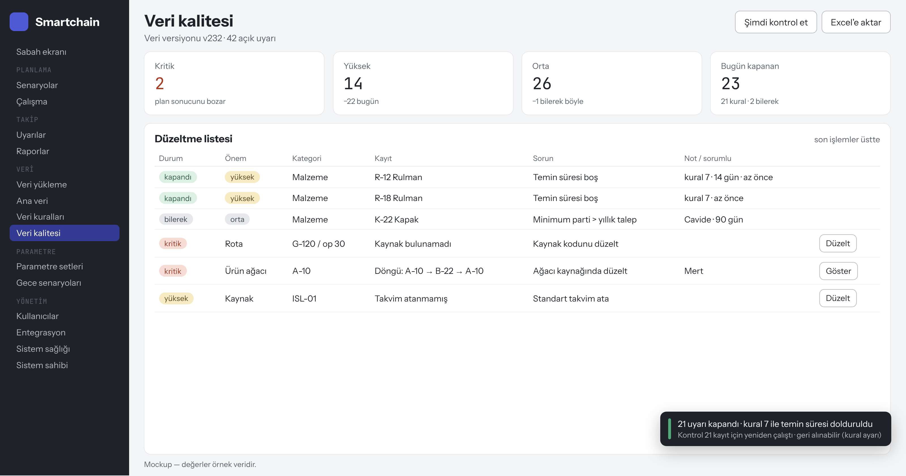

- **Kapanan satırlar üstte:** 21 kapanan ve 1 bilerek böyle, nedeniyle; liste yeniden sıralanır.
- **Sayılar güncel:** Yüksek −22, bugün kapanan 23; sabah ekranı aynı sayıları gösterir.
- **Geri alınabilir:** Bildirimde geri alma bağlantısı (kural ayarı ya da elle değer).
- **Kalanlar:** Kritik 2 uyarı 'bilerek böyle' kapatılamaz; düzeltme bekler.

### C · Parametre
24. Ekranlar ve fonksiyonlar · Fonksiyon prensipleri ve mockuplar

- Her fonksiyon için: çalışma prensibi (nasıl çalışır · kurallar ve etkiler, 2 slayt) ve adım adım mockup. Yeniden hesaplanacak alanlar 2. slaytta.
- **22 · Parametre seti:** Planlama parametrelerini setler halinde tutmak; set oluşturmak, kopyalamak, düzenlemek, pasif yapmak ve silmek.
- **23 · Zaman yapısı:** Planlama ufkunu ve bucket dizisini (günlük, haftalık, aylık), dondurulmuş dönemi, hafta başlangıcını ve takvimi tanımlamak; motorun, raporların ve manuel planlamanın ortak zaman eksenini kurmak.
- **24 · Kapasite parametreleri:** Kaynak kapasitesini etkileyen parametreleri set bazında yönetmek: kaynak × dönem verim, kısıtsız kaynak ve fason için dönem üst limitleri, vardiya × dönem fazla mesai limitleri.
- **25 · Alokasyon ve öncelik kuralı:** Talebin sıralanma kuralını (ölçüt sırası, yön, ağırlık) ve kapasitenin talep sınıflarına dağıtım kuralını (kaynak grubu × dönem × pay) tek yerde tanımlamak; MRP netleştirmesi ve optimizasyon modeli aynı kuralı okur.
- **26 · Uyarı eşikleri:** Yedi kategorideki uyarıların eşiklerini, önem seviyelerini, mesaj şablonlarını ve görünürlüğünü set bazında yönetmek; motorun ve veri kalitesi kontrolünün hangi durumda uyarı üreteceğini parametrik kılmak.
- **27 · Gece senaryo tanımı:** Her gece otomatik çalışacak senaryoları tanımlamak: hangi parametre seti, LP mi MILP mi, hangi eksenler açık (fazla mesai, fason, kaynak ve malzeme kısıtı, alokasyon, talep çarpanı, varsayımsal kaynak), süre bütçesi ve açıklama.
- **28 · Senaryo sırası ve aç / kapa:** Gece senaryolarının çalışma sırasını belirlemek ve bir senaryoyu silmeden geçici olarak gece akışından çıkarmak; sabah hangi sonucun önce hazır olacağını ve gece yükünü yönetmek.

### 22 · Parametre seti
24. Ekranlar ve fonksiyonlar · F22 · C Parametre · Çalışma prensibi 1/2

- Planlama parametrelerini setler halinde tutmak; set oluşturmak, kopyalamak, düzenlemek, pasif yapmak ve silmek. Her gece senaryosu bir setle çalışır; aynı veriyle farklı setler karşılaştırılır.

#### NASIL ÇALIŞIR

- **KIM VE NEREDEN**
  - Kim: Key user ve üstü (silme: admin ve üstü)
  - Nereden: Parametre setleri ekranı · set listesi ve sekmeler · Gece senaryo tanımından 'seti aç'
- **01:** '+ Yeni set' boş ya da 'Kopyala' mevcut setten: ad, açıklama, kopyalanacak sekmeler seçilir; set hemen açılır.
- **02:** Sekmelerde değerler düzenlenir (23–26); değişen alanlar kaydedilmeden işaretli kalır, sekme başlığında sayı görünür.
- **GIRDI**
  - Set adı, açıklama, kaynak set (kopya için)
  - Sekmelerdeki parametreler: verim, dönem limitleri, fazla mesai, alokasyon, zaman yapısı ve öncelik, uyarı eşikleri, genel
  - Seti kullanan senaryolar, açık çalışmalar ve onaylı planlar
- **03:** 'Kaydet': değişiklik özeti (sekme, alan, eski → yeni), etkilenen senaryolar ve açık çalışmalar gösterilir; not istenir; set sürümü artar.
- **04:** Kaydedilen set bir sonraki gece senaryolarında geçerlidir; açık çalışma açıldığı değerlerle sürer, 'yeniden hesapla' deyince yeni değerleri alır ve uyarılır.
- **05:** 'Sil': set bir senaryo, açık çalışma tarafından kullanılıyorsa engellenir ve kullananlar listelenir; alternatif 'pasif yap'. Onaylı plan setin kopyasını taşır, silme planı bozmaz.
- **ÇIKTI**
  - ParameterSet kaydı (ad, açıklama, sürüm, durum) ve sekme tabloları (ResourceEfficiency, ResourcePeriodLimit, OvertimeLimit, AllocationRule, PriorityRule, TimeBucketDefinition, WarningDefinition, PlanningSetting)
  - Değişiklik özeti ve set sürüm geçmişi
  - Denetim izi
- **06:** Her kayıt, kopya, pasif ve silme denetim izine kim, ne zaman, değişiklik özetiyle yazılır.

### 22 · Parametre seti · kurallar ve etkiler
24. Ekranlar ve fonksiyonlar · F22 · C Parametre · Çalışma prensibi 2/2

- **KURALLAR VE SINIRLAR**
  - 'Standart' set silinemez ve pasif yapılamaz; Baz senaryo ona bağlıdır.
  - Set, kullanan senaryo ya da açık çalışma varken silinemez; pasif set yeni senaryoya bağlanamaz.
  - Onaylı plan hesaplandığı anki set değerlerinin kopyasını (PlanRun → set sürümü) taşır; set sonradan değişse plan geçmişi bozulmaz.
  - Açık çalışma açıldığı set sürümüyle çalışır; yeniden hesapta yeni sürüm uygulanır ve değişiklik listesi gösterilir.
  - Kopya bağımsızdır; kaynak set değişince kopya değişmez.
- **HATA VE ISTISNA**
  - Aynı adla set: kaydet pasif, uyarı.
  - Kaydet sırasında başka kullanıcı aynı seti değiştirdiyse çakışma: farklar gösterilir, birleştirme elle.
  - Sekmede validasyon hatası varsa set kaydedilmez; hatalı sekme işaretlenir.
- **ETKISI VE TETIKLENENLER**
  - Gece senaryoları bir sonraki gece yeni değerlerle çalışır.
  - Açık çalışmalara 'parametre seti değişti' bildirimi.
  - Senaryolar ekranında set sürümü görünür.
- **YENİDEN HESAPLANACAK ALANLAR:** Alan Nerede Ne zaman / neden
- **Set sürümü:** ParameterSet Her kayıtta artar; PlanRun hangi sürümle hesaplandığını tutar
- **Senaryo parametreleri:** ScenarioDefinition → ParameterSet Bir sonraki gece akışında okunur
- **Açık çalışma:** Workspace · PlanRun Otomatik değil; 'yeniden hesapla' ile yeni sürüm
- **Plan çıktıları:** CapacityLoad · PlanMetric · PlanWarning Yalnız yeni hesapla; mevcut çıktılar değişmez
- **ÖRNEK:** Standart set kopyalanıp 'Yeni hat · Montaj B' yapılır. Standart'ta 3 değişiklik kaydedilir (sürüm 8 → 9): Baz ve Talep +%10 bu gece yeni değerlerle çalışır; Cavide'nin açık çalışması yeniden hesapta alır.

### 22 · Parametre seti · Set kopyalama
24. Ekranlar ve fonksiyonlar · F22 · C Parametre · Mockup 1/3

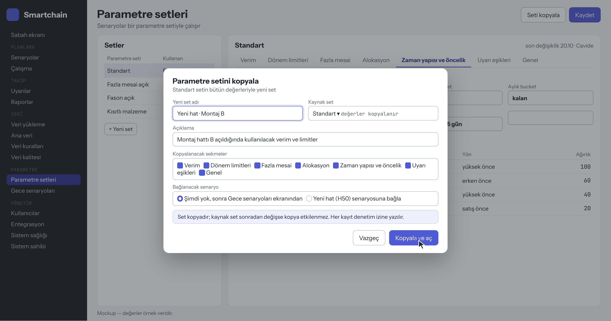

- **Ad ve kaynak:** Yeni set hangi setten kopyalanacak; değerler birebir alınır.
- **Sekme seçimi:** Hangi parametre grupları kopyalanacak; gereksiz olanlar bırakılır.
- **Senaryo bağı:** Hemen bir senaryoya bağlamak ya da sonra; kopya bağımsızdır.
- **İz:** Her kopya denetim izine yazılır; setin kaynağı görünür.

### 22 · Parametre seti · Silme engeli
24. Ekranlar ve fonksiyonlar · F22 · C Parametre · Mockup 2/3

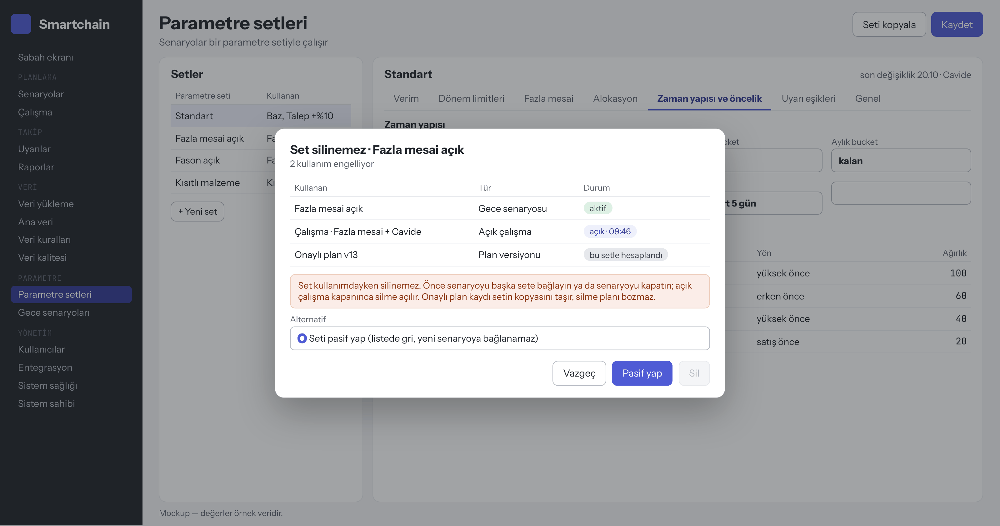

- **Kullananlar listesi:** Senaryo, açık çalışma ve onaylı plan; hangisi silmeyi engelliyor.
- **Neden ve ne yapmalı:** Kırmızı kutuda açıklama: senaryoyu başka sete bağla ya da çalışma kapansın.
- **Alternatif:** Pasif yap seçeneği birincil; Sil pasif kalır.
- **Plan korunur:** Onaylı planın setin kopyasını taşıdığı yazar.

### 22 · Parametre seti · Kaydet ve etki
24. Ekranlar ve fonksiyonlar · F22 · C Parametre · Mockup 3/3

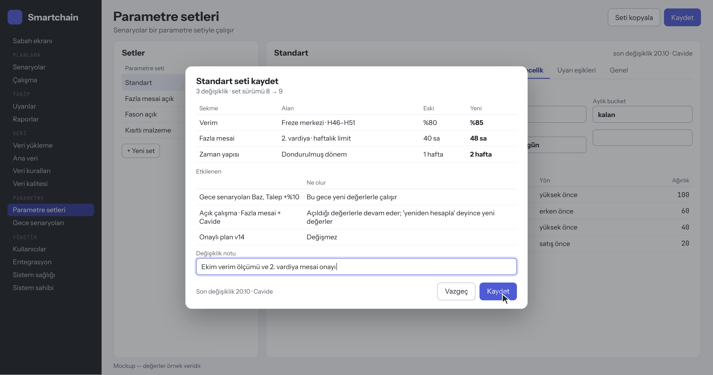

- **Değişiklik özeti:** Sekme, alan, eski → yeni; kullanıcı neyi kaydettiğini görür.
- **Kim etkilenir:** Gece senaryoları, açık çalışma ve onaylı plan için ne olacağı ayrı ayrı.
- **Sürüm ve not:** Set sürümü artar; değişiklik notu zorunlu değil ama istenir.
- **Çalışma davranışı:** Açık çalışmanın eski değerlerle sürdüğü, yeniden hesapta yeni değer aldığı yazar.

### 23 · Zaman yapısı
24. Ekranlar ve fonksiyonlar · F23 · C Parametre · Çalışma prensibi 1/3

- Planlama ufkunu ve bucket dizisini (günlük, haftalık, aylık), dondurulmuş dönemi, hafta başlangıcını ve takvimi tanımlamak; motorun, raporların ve manuel planlamanın ortak zaman eksenini kurmak.

#### NASIL ÇALIŞIR

- **KIM VE NEREDEN**
  - Kim: Key user ve üstü
  - Nereden: Parametre setleri · 'Zaman yapısı ve öncelik' sekmesi
- **01:** Sekme açılır; mevcut yapı ve bucket dizisi önizlemesi (şerit: dondurulmuş, günlük, haftalık, aylık) görünür.
- **02:** Değerler değiştirilir; anında kontrol: günlük + haftalık ≤ ufuk, dondurulmuş dönem günlük bucket içinde, hafta başlangıcı takvimle uyumlu.
- **GIRDI**
  - Ufuk (ay), günlük bucket uzunluğu (hafta), haftalık bucket uzunluğu (ay), aylık: kalan
  - Dondurulmuş dönem (gün ya da hafta), hafta başlangıcı, varsayılan takvim
  - Rota operasyon süreleri (bucket–süre uyumsuzluğu uyarısı için)
- **03:** Önizleme şeridi ve bucket sayısı anında güncellenir; operasyon süresi bucket'tan uzun rota satırları sayılır ve uyarılır.
- **04:** 'Kaydet': eski → yeni alanlar, bucket sayısı ve etkiler (gece senaryoları baştan, açık çalışmalarda yeniden eşleme, bucket bazlı uyarı eşikleri) gösterilir.
- **05:** Kaydedilince TimeBucketDefinition yazılır, set sürümü artar; bir sonraki gece senaryoları yeni yapıyla hesaplanır.
- **ÇIKTI**
  - TimeBucketDefinition (ufuk, dizi, dondurulmuş dönem, hafta başlangıcı, takvim)
  - Bucket dizisi (plan hesabı, raporlar, Gantt ve manuel planlama bunu kullanır)
  - Set sürümü ve denetim izi
- **06:** Açık çalışmalar eski yapıyla sürer; yeniden hesapta yeni yapıya geçer, manuel değişiklikler bucket'lara yeniden eşlenir ve kullanıcıya liste gösterilir.

### 23 · Zaman yapısı · kurallar ve etkiler
24. Ekranlar ve fonksiyonlar · F23 · C Parametre · Çalışma prensibi 2/3

- **KURALLAR VE SINIRLAR**
  - Bucket dizisi günlükten aylığa doğru büyür; ters sıra yok.
  - Dondurulmuş dönem günlük bucket içinde kalır; bu dönemde model iş emri tarihlerini değiştirmez, yalnız uyarır.
  - Ufuk en az 3 ay, en fazla 24 ay (parametre).
  - Operasyon süresi bucket'tan uzunsa operasyon ardışık bucket'lara yayılır; nasıl bölüneceği açık konudur (bucket–süre uyumsuzluğu).
  - Zaman yapısı set bazındadır; farklı setler farklı bucket dizisi kullanabilir (öneri: Faz 1'de tüm setlerde aynı ufuk).
- **HATA VE ISTISNA**
  - Validasyon hatası: Kaydet pasif, alan altında neden.
  - Yeniden eşlemede manuel değişiklik bucket'a sığmazsa 'elle gözden geçir' listesi; değişiklik kilitli kalır ama uyarılı.
  - Takvim yoksa Standart 5 gün varsayılır ve veri kalitesi uyarısı.
- **ETKISI VE TETIKLENENLER**
  - Gece senaryoları yeni bucket dizisiyle hesaplanır.
  - Açık çalışmalar yeniden hesapta yeni yapıya geçer; manuel değişiklikler yeniden eşlenir.
  - Raporlar, Gantt ve manuel planlama ekranları yeni bucket sütunlarını kullanır.
  - Bucket bazlı uyarı eşikleri yeni anlam kazanır.
- **ÖRNEK:** Ufuk 12 ay; günlük 2 hafta → 4 hafta, dondurulmuş 1 → 3 hafta. Bucket sayısı 34 → 44. Isıl işlem 3 günlük operasyonu günlük bucket'ı aşıyor: 4 satır uyarı.
- **AÇIK KONU:** Bucket–süre uyumsuzluğu: operasyon süresi bucket'tan uzunsa yük nasıl bölünür (eşit, başlangıç ağırlıklı, rota sırasına göre)? Henüz karar yok; 18. adımdaki kritik konular listesinde.

### 23 · Zaman yapısı · yeniden hesaplanacak alanlar
24. Ekranlar ve fonksiyonlar · F23 · C Parametre · Çalışma prensibi 3/3

- **YENİDEN HESAPLANACAK ALANLAR:** Alan Nerede Ne zaman / neden
- **Bucket dizisi:** TimeBucketDefinition → tüm plan tabloları Yeni hesapta: talep, kapasite ve arz bucket'lara yeniden dağıtılır
- **Dönem kapasitesi:** CapacityLoad (BucketStart) Takvim × günlük kapasite × verim yeni bucket'lara göre
- **Talep bucket'lama:** DemandFulfillment Sipariş vadesi yeni bucket'a düşer
- **Manuel değişiklikler:** WorkspaceOverride · ManualPlanEntry (öneri) Yeniden hesapta bucket'lara yeniden eşlenir
- **Uyarı eşikleri (bucket bazlı):** WarningDefinition · PlanWarning Yeni bucket anlamıyla değerlendirilir
- **Plan çıktıları:** PlanMetric · PlannedOrder · Pegging Yalnız yeni hesapla

### 23 · Zaman yapısı · Form ve önizleme
24. Ekranlar ve fonksiyonlar · F23 · C Parametre · Mockup 1/2

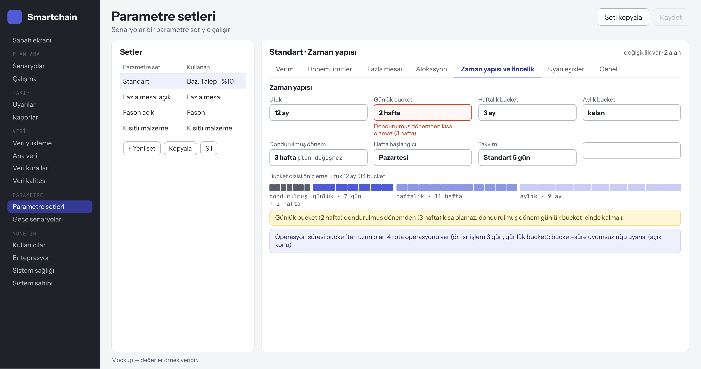

- **Bucket şeridi:** Dondurulmuş, günlük, haftalık, aylık dilimler ve bucket sayısı anında görünür.
- **Anında validasyon:** Dondurulmuş dönem günlük bucket'tan uzun: alan kırmızı, Kaydet pasif.
- **Süre uyumsuzluğu:** Bucket'tan uzun operasyonlar sayılır; açık konu olduğu yazar.
- **Değişiklik sayacı:** Kart başlığında kaç alan değişti; kaydetmeden işaretli kalır.

### 23 · Zaman yapısı · Kaydet ve etkiler
24. Ekranlar ve fonksiyonlar · F23 · C Parametre · Mockup 2/2

- **Eski → yeni:** Değişen alanlar ve bucket sayısı; sürüm artışı başlıkta.
- **Etki listesi:** Gece senaryoları, açık çalışmalar, uyarı eşikleri, dondurulmuş dönem davranışı.
- **Yeniden eşleme uyarısı:** Manuel değişikliklerin bucket eşlemesi gözden geçirilmeli; kırmızı kutu.
- **Geri alınabilir:** Set sürümü ile önceki yapıya dönülebilir (22).

### 24 · Kapasite parametreleri
24. Ekranlar ve fonksiyonlar · F24 · C Parametre · Çalışma prensibi 1/3

- Kaynak kapasitesini etkileyen parametreleri set bazında yönetmek: kaynak × dönem verim, kısıtsız kaynak ve fason için dönem üst limitleri, vardiya × dönem fazla mesai limitleri.

#### NASIL ÇALIŞIR

- **KIM VE NEREDEN**
  - Kim: Key user ve üstü
  - Nereden: Parametre setleri · 'Verim', 'Dönem limitleri', 'Fazla mesai' sekmeleri · Kaynak bazlı planlamadan 'geçici' olmayan kalıcı değişiklik için bağlantı
- **01:** Verim sekmesi: kaynak × dönem matrisi; varsayılan sütunu ana verideki verimdir (kilitli), dönem hücresi istisna girilir; toplu doldurma (değer + dönem aralığı), satırı varsayılana döndürme, Excel'e al / yükle.
- **02:** Dönem limitleri sekmesi: kısıtsız kaynak ve fason kaynaklar için bucket bazında üst limit, kaynağın kendi biriminde (adet, ton, saat); boş = sınırsız.
- **GIRDI**
  - Kaynak listesi ve ana verideki varsayılan verim, günlük kapasite, adet, takvim
  - Bucket dizisi (zaman yapısı)
  - Vardiya tanımları; kısıtsız kaynak ve fason kaynaklar (kapasite birimiyle)
- **03:** Fazla mesai sekmesi: vardiya × günlük / haftalık / aylık limit ve uygulanan kaynak grupları; tutarlılık kontrolü (haftalık ≤ günlük × çalışma günü).
- **04:** Her hücrede anında validasyon (aralık %10–%150, negatif yok); hata varsa Kaydet kapalı, hatalı sekme işaretli.
- **05:** 'Kaydet': değişiklik listesi ve yeniden hesaplanacaklar (dönem kapasitesi farkı, etkilenen senaryolar ve çalışmalar) gösterilir; not istenir; set sürümü artar.
- **ÇIKTI**
  - ResourceEfficiency (kaynak × dönem), ResourcePeriodLimit, OvertimeLimit kayıtları
  - Dönem kapasitesi (GrossCapacity, NetCapacity) hazır tablo
  - Set sürümü ve denetim izi
- **06:** Kaydedilince ResourceEfficiency, ResourcePeriodLimit, OvertimeLimit yazılır; dönem kapasitesi (net) hemen yeniden hesaplanır, doluluk ve uyarılar yeni plan hesabında güncellenir.

### 24 · Kapasite parametreleri · kurallar ve etkiler
24. Ekranlar ve fonksiyonlar · F24 · C Parametre · Çalışma prensibi 2/3

- **KURALLAR VE SINIRLAR**
  - Varsayılan verim ana veridedir (ERP / kural / elle); set yalnız dönem istisnalarını tutar; istisna yoksa varsayılan geçerli.
  - Net kapasite = (çalışma günü × adet − duruş günü × etkilenen adet) × günlük kapasite × verim; verim 0 kapasiteyi sıfırlar (uyarı).
  - Fazla mesai yalnız 'fazla mesai açık' senaryolarda kapasiteye eklenir; limitler model kısıtıdır.
  - Fason ve kısıtsız kaynakta üst limit boşsa sınırsız; model o dönemde istediği kadar yükler (uyarı eşiği ile izlenir).
  - Çalışmadaki geçici değişiklik (55) seti değiştirmez; kalıcı olması için buradan girilir.
- **HATA VE ISTISNA**
  - Aralık dışı değer: hücre kırmızı, Kaydet kapalı.
  - Vardiya limitleri çelişkili: açıklamalı hata (haftalık ≤ günlük × gün).
  - Excel yüklemede eşleşmeyen kaynak / dönem satırı atlanır, raporlanır.
  - Bucket dizisi değişmişse eski dönem istisnaları yeni bucket'lara eşlenir; eşlenemeyen 'gözden geçir' listesinde.
- **ETKISI VE TETIKLENENLER**
  - Dönem kapasitesi hemen; doluluk ve kapasite uyarıları yeni plan hesabında.
  - Gece senaryoları yeni değerlerle.
  - Açık çalışmalarda 'parametre değişti' bildirimi.
  - Kaynak doluluk raporu 'kapasite' satırı yeni hesapta değişir.
- **ÖRNEK:** Freze merkezi H46–H49 verim %80 → %85: net kapasite +11 sa/hafta; Montaj işçileri H48–H49 %92 → %80 (izin). Fason kaplama H47–H48 limiti 300 → 400 adet. 2. vardiya haftalık 15 → 18 sa.

### 24 · Kapasite parametreleri · yeniden hesaplanacak alanlar
24. Ekranlar ve fonksiyonlar · F24 · C Parametre · Çalışma prensibi 3/3

- **YENİDEN HESAPLANACAK ALANLAR:** Alan Nerede Ne zaman / neden
- **Dönem kapasitesi (brüt, net):** CapacityLoad.GrossCapacity / NetCapacity Hemen: verim, limit ya da fazla mesai değişen kaynak × dönem
- **Doluluk oranları:** Kaynak doluluk raporu (Load / NetCapacity) Yeni plan hesabında; mevcut planda 'kapasite değişti' işareti
- **Kapasite uyarıları:** PlanWarning (doluluk, aşırı yük) Yeni hesapta eşiklerle yeniden
- **Model kısıtları:** Fazla mesai ve fason üst limitleri Bir sonraki çözümde
- **Senaryo metrikleri:** PlanMetric Gece senaryoları yeni değerlerle
- **Açık çalışma:** Workspace · PlanRun Otomatik değil; yeniden hesapta

### 24 · Kapasite parametreleri · Verim matrisi
24. Ekranlar ve fonksiyonlar · F24 · C Parametre · Mockup 1/3

- **Kaynak × dönem:** Varsayılan sütunu kilitli (ana veri); dönem istisnaları mavi çerçeveli.
- **Toplu doldurma:** Değer ve dönem aralığı seçilip birden çok hücre doldurulur.
- **Formül görünür:** Net kapasite formülü altta; kullanıcı etkiyi bilir.
- **Excel yolu:** Matris Excel'e alınır ve yüklenir; satır varsayılana döndürülebilir.

### 24 · Kapasite parametreleri · Limitler ve fazla mesai
24. Ekranlar ve fonksiyonlar · F24 · C Parametre · Mockup 2/3

- **Kaynağın birimi:** Fason ve kısıtsız kaynak limitleri adet, ton ya da saat; boş = sınırsız.
- **Vardiya × dönem:** Günlük, haftalık, aylık limit ve uygulanan kaynak grupları.
- **Tutarlılık hatası:** Haftalık limit günlük × gün ile çelişince hücre kırmızı, Kaydet kapalı, neden yazar.
- **Senaryo bağı:** Fazla mesainin yalnız açık senaryolarda eklendiği bilgi kutusunda.

### 24 · Kapasite parametreleri · Kaydet ve yeniden hesap
24. Ekranlar ve fonksiyonlar · F24 · C Parametre · Mockup 3/3

- **Değişiklik listesi:** Sekme, hücre ve eski → yeni; kaç hücre.
- **Yeniden hesaplanacak:** Dönem kapasitesi hemen (sayıyla), doluluk ve uyarılar yeni hesapta.
- **Kim etkilenir:** Gece senaryoları ve açık çalışma ayrı ayrı.
- **Sürüm:** Set sürümü artar; önceki değerlere dönülebilir.

### 25 · Alokasyon ve öncelik kuralı
24. Ekranlar ve fonksiyonlar · F25 · C Parametre · Çalışma prensibi 1/2

- Talebin sıralanma kuralını (ölçüt sırası, yön, ağırlık) ve kapasitenin talep sınıflarına dağıtım kuralını (kaynak grubu × dönem × pay) tek yerde tanımlamak; MRP netleştirmesi ve optimizasyon modeli aynı kuralı okur.

#### NASIL ÇALIŞIR

- **KIM VE NEREDEN**
  - Kim: Key user ve üstü
  - Nereden: Parametre setleri · 'Zaman yapısı ve öncelik' (öncelik kuralı) ve 'Alokasyon' sekmeleri
- **01:** Öncelik kuralı: ölçütler sürükle-bırak ile sıralanır, yön seçilir (yüksek / erken / satış önce), ağırlık girilir, ölçüt aç / kapa.
- **02:** Önizleme: geçerli veriden örnek siparişler yeni kurala göre sıralanır; eski ve yeni sıra yan yana, değişenler oklu.
- **GIRDI**
  - Öncelik ölçütleri: sipariş önceliği (müşteri sınıfı), talep tarihi, proje önceliği, sipariş tipi, sipariş miktarı; yön ve ağırlık
  - Talep sınıfları (müşteri sınıfı, proje, stok siparişi), kaynak grupları, bucket dizisi
  - Örnek sipariş kümesi (önizleme için, geçerli veriden)
- **03:** Alokasyon: satır satır talep sınıfı × kaynak grubu × dönem aralığı için minimum (garanti) ve maksimum (tavan) kapasite payı girilir.
- **04:** Anında kontrol: aynı kaynak grubu ve dönemde minimum paylar toplamı ≤ %100; maksimum ≥ minimum; dönem aralıkları bucket dizisinde.
- **05:** 'Kaydet': PriorityRule ve AllocationRule yazılır; set sürümü artar; etkiler gösterilir (MRP netleştirme sırası, model ağırlıkları, alokasyon kısıtları).
- **ÇIKTI**
  - PriorityRule (ölçüt, sıra, yön, ağırlık, aktif) ve AllocationRule (talep sınıfı, kaynak grubu, dönem, min, max)
  - Önizleme (örnek sıralama)
  - Set sürümü ve denetim izi
- **06:** Bir sonraki plan hesabında MRP ön hesap netleştirmeyi bu sırayla yapar, model gecikme cezalarını ağırlıklarla ölçekler, alokasyon açık senaryoda payları kısıt olarak alır.

### 25 · Alokasyon ve öncelik kuralı · kurallar ve etkiler
24. Ekranlar ve fonksiyonlar · F25 · C Parametre · Çalışma prensibi 2/2

- **KURALLAR VE SINIRLAR**
  - Tek kural, iki kullanım: MRP netleştirme sırası ve model ağırlıkları aynı tanımdan türetilir; ayrı 'MRP önceliği' yoktur.
  - Ölçütler sırayla kırılır (önceki eşitse sonrakine bakılır); ağırlık modelin gecikme cezasını ölçeklendirir.
  - Alokasyon minimum payı garanti, maksimum tavan; kalan kapasite öncelik kuralıyla dağıtılır. Alokasyon yalnız 'alokasyon açık' senaryolarda kısıttır.
  - Sipariş bazlı planlamadaki (56) öncelik değişikliği sipariş düzeyinde istisnadır; kuralı değiştirmez.
  - Pasif ölçüt sıralamada atlanır; ağırlığı yok sayılır.
- **HATA VE ISTISNA**
  - Minimum paylar toplamı > %100: hücre kırmızı, dönem bazlı toplam satırında hangi dönemler aşıyor görünür, Kaydet kapalı.
  - Maksimum < minimum: hata.
  - Ölçüt listesi boş kalamaz; en az bir aktif ölçüt (talep tarihi varsayılan).
  - Önizleme örnek sipariş bulamazsa (veri yok) 'örnek yok' bilgisi.
- **ETKISI VE TETIKLENENLER**
  - MRP ön hesap netleştirme sırası (yeni hesapta).
  - Model amaç fonksiyonu ağırlıkları ve alokasyon kısıtları (yeni çözümde).
  - Sipariş bazlı planlama 'öncelik' sütunu kuraldan hesaplanan sırayı gösterir.
  - Gece senaryoları ve açık çalışmalar (yeniden hesapta).
- **YENİDEN HESAPLANACAK ALANLAR:** Alan Nerede Ne zaman / neden
- **Talep sıralaması:** DemandFulfillment (sıra) Yeni hesapta; sipariş bazlı planlama listesi
- **MRP netleştirme sırası:** Ön hesap · Pegging Kullanılabilir stok ve arz önce kime gider
- **Model gecikme ağırlıkları:** Model kurma (31) Bir sonraki çözümde
- **Alokasyon kısıtları:** Model kısıtları · CapacityLoad payları 'Alokasyon açık' senaryolarda
- **Teslim metrikleri:** PlanMetric · PlanWarning Gece senaryoları ve yeniden hesapta
- **ÖRNEK:** Proje önceliği 3. sıradan 2. sıraya alınınca SO-1206/1 (proje önceliği 2) SO-1185/2'nin (proje yok) önüne geçer. Alokasyon: Talaşlı imalat H45–H48'de A %40 + PRJ-2041 %30 + stok %40 = %110 → hata.

### 25 · Alokasyon ve öncelik kuralı · Öncelik kuralı
24. Ekranlar ve fonksiyonlar · F25 · C Parametre · Mockup 1/2

- **Sürükle-sırala:** Ölçütler tutulup taşınır; yön ve ağırlık satırda; pasif ölçüt gri.
- **Örnek sıralama:** Geçerli veriden 5 sipariş eski ve yeni sırayla; değişenler oklu.
- **Tek kural, iki kullanım:** MRP sırası ve model ağırlıkları aynı tanımdan; bilgi kutusunda.
- **Ağırlık anlamı:** Ağırlığın gecikme cezasını ölçeklediği yazar.

### 25 · Alokasyon ve öncelik kuralı · Alokasyon
24. Ekranlar ve fonksiyonlar · F25 · C Parametre · Mockup 2/2

- **Satır bazlı kural:** Talep sınıfı × kaynak grubu × dönem için min ve max pay.
- **Toplam kontrolü:** Dönem bazlı minimum toplamı; %100'ü aşan dönemler kırmızı, hata metni açıklar.
- **Kaydet kapalı:** Hata varken kaydedilemez; kart başlığında hata sayısı.
- **Senaryo bağı:** Alokasyonun yalnız açık senaryolarda kısıt olduğu bilgi kutusunda.

### 26 · Uyarı eşikleri
24. Ekranlar ve fonksiyonlar · F26 · C Parametre · Çalışma prensibi 1/3

- Yedi kategorideki uyarıların eşiklerini, önem seviyelerini, mesaj şablonlarını ve görünürlüğünü set bazında yönetmek; motorun ve veri kalitesi kontrolünün hangi durumda uyarı üreteceğini parametrik kılmak.

#### NASIL ÇALIŞIR

- **KIM VE NEREDEN**
  - Kim: Key user ve üstü
  - Nereden: Parametre setleri · 'Uyarı eşikleri' sekmesi · uyarı iş listesinden 'tanımı aç'
- **01:** Liste kategoriye göre açılır; her satırda eşik hücresi, önem seçimi ve aktif anahtarı doğrudan düzenlenir; değiştirilen eşikler işaretli.
- **02:** Satır çekmecesi: eşik ayrıntısı (çoklu eşik: bucket sayısı + yüzde), mesaj şablonu ve örnek çıktı, nerede görüneceği (iş listesi, sabah ekranı, planlama satırı, rapor), bildirim davranışı.
- **GIRDI**
  - WarningDefinition listesi: kod, kategori (teslim, kapasite, malzeme, ana veri, işlem verisi, proje, plan kalitesi), eşik(ler), önem, aktif, mesaj şablonu
  - Mevcut plan çıktısı ve veri (önizleme için)
- **03:** Önizleme: yeni eşiklerle mevcut plan çıktısı ve veri üzerinden kaç uyarı olurdu; şu an ile karşılaştırma.
- **04:** 'Kaydet': WarningDefinition yazılır, set sürümü artar; uyarı listesi mevcut plan çıktısı ve veri üzerinden yeniden üretilir (plan hesabı gerekmez).
- **05:** Kapatılmış ve 'bilerek böyle' uyarılar korunur; yeni eşiğe göre doğan uyarılar 'yeni', artık eşik altında kalanlar 'kapandı' olur.
- **ÇIKTI**
  - WarningDefinition kayıtları (eşik, önem, aktif, şablon, görünürlük)
  - Yeniden üretilmiş uyarı listesi (PlanWarning ve veri kalitesi) ve özet sayılar
  - Set sürümü, denetim izi
- **06:** Bir sonraki plan hesabı ve veri kalitesi kontrolü yeni tanımlarla uyarı üretir.

### 26 · Uyarı eşikleri · kurallar ve etkiler
24. Ekranlar ve fonksiyonlar · F26 · C Parametre · Çalışma prensibi 2/3

- **KURALLAR VE SINIRLAR**
  - Eşik ve önem set bazındadır; senaryolar farklı eşiklerle değerlendirilebilir, uyarı iş listesi onaylı planın setini kullanır.
  - Kritik: plan sonucunu bozar ya da teslimi tehdit eder; yüksek: planı etkiler; orta / düşük: izlenir. Sınıf anlamı sabit, hangi uyarının hangi sınıfta olduğu parametrik.
  - Pasif uyarı üretilmez; açık uyarıları 'tanım pasif' notuyla kapanır.
  - Mesaj şablonu alan yer tutucularıyla yazılır; Faz 1'de açıklama metni şablondan, LLM kapalı.
  - Eşik değişikliği plan hesabı gerektirmez; uyarılar mevcut çıktıdan yeniden üretilir.
- **HATA VE ISTISNA**
  - Eşik tip hatası (yüzde yerine metin): hücre kırmızı, Kaydet kapalı.
  - Çelişkili eşik (risk %90 > aşırı yük %85): uyarı, kaydedilebilir ama işaretli.
  - Önizleme büyük planda uzun sürerse arka planda; bitince sayılar güncellenir.
- **ETKISI VE TETIKLENENLER**
  - Uyarı iş listesi, sabah ekranı ve Veri kalitesi sayıları hemen değişir.
  - Planlama ekranlarındaki uyarı işaretleri (sipariş satırı, doluluk hücresi) yeni eşiklerle.
  - Motor ve veri kalitesi kontrolü sonraki çalışmada yeni tanımları kullanır.
- **ÖRNEK:** 'Ard arda yüksek doluluk' eşiği 3 bucket · %95: önizlemede 3 → 5 uyarı. 'Kritik gecikme' 7 → 10 gün: 2 kritik uyarıdan biri yüksek seviyeye iner. Kaydedince liste planı yeniden hesaplamadan güncellenir.

### 26 · Uyarı eşikleri · yeniden hesaplanacak alanlar
24. Ekranlar ve fonksiyonlar · F26 · C Parametre · Çalışma prensibi 3/3

- **YENİDEN HESAPLANACAK ALANLAR:** Alan Nerede Ne zaman / neden
- **Plan uyarıları:** PlanWarning Mevcut plan çıktısı üzerinden yeni eşiklerle hemen yeniden üretilir
- **Veri kalitesi uyarıları:** Veri kalitesi listesi Ana veri ve işlem verisi kategorileri hemen
- **Özet sayılar:** Sabah ekranı · Uyarı iş listesi · Veri kalitesi KPI Hemen
- **Doluluk hücre renkleri:** Kaynak doluluk raporu (risk / aşırı yük eşikleri) Hemen (görüntüleme)
- **Plan sonucu:** PlanMetric · PlannedOrder Değişmez; eşikler planı etkilemez

### 26 · Uyarı eşikleri · Eşik listesi ve önizleme
24. Ekranlar ve fonksiyonlar · F26 · C Parametre · Mockup 1/2

- **Kategoriye göre liste:** Eşik, önem ve aktif satırda düzenlenir; değiştirilenler mavi çerçeveli.
- **Önizleme:** Yeni eşikle kaç uyarı olurdu; şu an ile fark.
- **Plan hesabı gerekmez:** Uyarıların mevcut çıktıdan yeniden üretildiği bilgi kutusunda.
- **Sınıf anlamı:** Kritik, yüksek, orta ne demek altta tek satır.

### 26 · Uyarı eşikleri · Uyarı tanımı çekmecesi
24. Ekranlar ve fonksiyonlar · F26 · C Parametre · Mockup 2/2

- **Eşik ve önem:** Ayrıntılı eşik, önem ve aktiflik; önceki değer notu.
- **Mesaj şablonu:** Yer tutucularla şablon ve gerçek veriyle örnek; LLM kapalı, metin buradan.
- **Nerede görünür:** İş listesi, sabah ekranı, planlama satırı, rapor; seçilebilir.
- **Etki notu:** Bu değişiklikle kaç uyarının seviye değiştireceği.

### 27 · Gece senaryo tanımı
24. Ekranlar ve fonksiyonlar · F27 · C Parametre · Çalışma prensibi 1/2

- Her gece otomatik çalışacak senaryoları tanımlamak: hangi parametre seti, LP mi MILP mi, hangi eksenler açık (fazla mesai, fason, kaynak ve malzeme kısıtı, alokasyon, talep çarpanı, varsayımsal kaynak), süre bütçesi ve açıklama.

#### NASIL ÇALIŞIR

- **KIM VE NEREDEN**
  - Kim: Key user ve üstü
  - Nereden: Gece senaryo tanımları ekranı '+ Senaryo ekle' · satır düzenleme · Senaryolar ekranından 'tanımı aç'
- **01:** '+ Senaryo ekle': ad, parametre seti, model tipi seçilir; model tipi ipucu MILP'in ne zaman gerektiğini anlatır.
- **02:** Eksen ayarları anahtarlarla: fazla mesai, fason, kaynak kısıtı, malzeme kısıtı, alokasyon; talep çarpanı; varsayımsal kaynak ekleme (ad, dönemden itibaren, kapasite).
- **GIRDI**
  - Parametre setleri (aktif olanlar)
  - Model tipi: LP (sürekli) ya da MILP (üretim tarafı tamsayı); satın alma hep sürekli, son hesapta yuvarlanır
  - Eksen ayarları, talep çarpanı, varsayımsal kaynak / dönem, süre bütçesi
  - Gece penceresi ve paralellik (sistem sahibi ayarı)
- **03:** Süre bütçesi girilir; sistem gece penceresi ve paralellikle toplam zamanlamayı hesaplar, sığmıyorsa uyarır.
- **04:** Açıklama yazılır; 'Şimdi dene' (öneri) senaryoyu sıcak kanalda tek seferlik çalıştırıp sonucu Senaryolar ekranına 'deneme' etiketiyle koyar.
- **05:** 'Kaydet': ScenarioDefinition yazılır (set, eksenler, model, bütçe, sıra sona eklenir, aktif); denetim izi.
- **ÇIKTI**
  - ScenarioDefinition kaydı (ParameterSetId, ModelType, ResourceConstraint, MaterialConstraint, eksen ayarları, NightlyPriority, IsActive, süre bütçesi)
  - Zamanlama kontrolü sonucu
  - Denetim izi
- **06:** Yarın geceden itibaren akışta çalışır; sonuçları Senaryolar ekranında (42) diğerleriyle yan yana görünür.

### 27 · Gece senaryo tanımı · kurallar ve etkiler
24. Ekranlar ve fonksiyonlar · F27 · C Parametre · Çalışma prensibi 2/2

- **KURALLAR VE SINIRLAR**
  - Her senaryo tek parametre seti kullanır; aynı setle farklı eksen ayarları ayrı senaryolardır.
  - Model tipi senaryoya özeldir; LP her zaman çözülür, MILP süre bütçesi içinde en iyi bulunan çözümü verir.
  - Toplam süre bütçesi (paralellikle) gece penceresine sığmalı; sığmayan senaryo kaydedilir ama uyarılı; 06:00 sınırını aşan durdurulur.
  - En fazla 10 aktif gece senaryosu (parametre).
  - Varsayımsal kaynak yalnız senaryo içinde var olur; ana veriye yazılmaz.
- **HATA VE ISTISNA**
  - Parametre seti pasifse seçilemez; mevcut senaryo pasif sete bağlıysa listede uyarı.
  - Süre bütçesi 5 dk altı ya da 240 dk üstü: hata.
  - Aynı adla senaryo: uyarı.
  - 'Şimdi dene' sıcak kanal doluysa (3 çalışma) kuyruğa alınır, kullanıcı bilgilendirilir.
- **ETKISI VE TETIKLENENLER**
  - Gece akışı planı (sıra ve zamanlama) güncellenir.
  - Senaryolar ekranında yeni sütun.
  - Sistem sağlığında tahmini gece yükü.
- **YENİDEN HESAPLANACAK ALANLAR:** Alan Nerede Ne zaman / neden
- **Gece akışı zamanlaması:** Job planı (gece kanalı) Senaryo eklenince / bütçe değişince hemen hesaplanır
- **Senaryo sonucu:** Scenario · PlanRun · PlanMetric Bir sonraki gece (ya da 'Şimdi dene' ile hemen)
- **Karşılaştırma tablosu:** Senaryolar ekranı Yeni senaryo sütunu sonuçla birlikte
- **ÖRNEK:** 'Yeni hat (H50)': set Yeni hat · Montaj B, LP, kaynak kısıtı açık, varsayımsal Montaj hattı B H50'den itibaren, 45 dk. Zamanlama: 6 senaryo 2 paralel, bitiş ~01:00; 7. taslak 240 dk ile pencereyi zorlar.
- **AÇIK KONU:** 'Şimdi dene' (gündüz tek seferlik çalıştırma) öneri. Sıcak kanal kapasitesini (3) paylaşır; çalışmaları yavaşlatabilir.

### 27 · Gece senaryo tanımı · Senaryo formu
24. Ekranlar ve fonksiyonlar · F27 · C Parametre · Mockup 1/2

- **Üç temel seçim:** Parametre seti, model tipi (LP / MILP ipucuyla) ve eksen anahtarları.
- **Varsayımsal kaynak:** Senaryoya özel kaynak ve dönem; ana veriye yazılmaz.
- **Süre bütçesi:** Gece penceresi bilgisiyle; sığmazsa zamanlama kontrolü açılır.
- **Şimdi dene:** Gündüz tek seferlik deneme (öneri); sonuç 'deneme' etiketiyle.

### 27 · Gece senaryo tanımı · Zamanlama kontrolü
24. Ekranlar ve fonksiyonlar · F27 · C Parametre · Mockup 2/2

- **Senaryo başına pencere:** Sıra, bütçe ve paralellikle tahmini başlangıç–bitiş.
- **Sığıyor mu:** Toplam bütçe, paralel süre ve tahmini bitiş; sınırı zorlayan satır sarı.
- **06:00 kuralı:** Sınırı aşan senaryonun durdurulup en iyi çözümün saklandığı yazar.
- **İki çıkış:** Bütçeyi düzelt (birincil) ya da yine de kaydet.

### 28 · Senaryo sırası ve aç / kapa
24. Ekranlar ve fonksiyonlar · F28 · C Parametre · Çalışma prensibi 1/2

- Gece senaryolarının çalışma sırasını belirlemek ve bir senaryoyu silmeden geçici olarak gece akışından çıkarmak; sabah hangi sonucun önce hazır olacağını ve gece yükünü yönetmek.

#### NASIL ÇALIŞIR

- **KIM VE NEREDEN**
  - Kim: Key user ve üstü
  - Nereden: Gece senaryo tanımları ekranı · liste (sürükle-bırak, Alt + ok) · satırdaki aktif anahtarı
- **01:** Liste sıra numarasıyla gelir; senaryo tutulup sürüklenir ya da Alt + ok ile taşınır; sağdaki gece zamanlaması anında yeniden hesaplanır (başlangıç, bitiş, paralel çiftler).
- **02:** Aktif anahtarı kapatılınca onay: bu gece ne olur, tanımın korunduğu, gece akışının ne kadar kısalacağı; süre seçimi (yeniden açana kadar / yalnız bu gece) ve gerekçe.
- **GIRDI**
  - ScenarioDefinition listesi (NightlyPriority, IsActive, süre bütçesi, model)
  - Gece penceresi ve paralellik (sistem sahibi ayarı)
- **03:** 'Sırayı kaydet': NightlyPriority ve IsActive yazılır; denetim izine eski ve yeni sıra, kapatılan senaryo ve gerekçe.
- **04:** Bir sonraki gece akışı yeni sıra ve aktiflikle çalışır; Senaryolar ekranında kapalı senaryonun sütunu 'bu gece çalışmadı' olarak görünür.
- **ÇIKTI**
  - Güncel NightlyPriority ve IsActive
  - Gece zamanlaması tahmini
  - Denetim izi
- **05:** 'Yalnız bu gece' kapatılan senaryo ertesi gün otomatik açılır; sabah ekranında not düşer.

### 28 · Senaryo sırası ve aç / kapa · kurallar ve etkiler
24. Ekranlar ve fonksiyonlar · F28 · C Parametre · Çalışma prensibi 2/2

- **KURALLAR VE SINIRLAR**
  - Baz senaryo her zaman 1. sıradadır ve kapatılamaz; onaylı planın kaynağıdır (öneri).
  - En az bir senaryo aktif kalır.
  - Sıra yalnız bitiş zamanını belirler; senaryolar birbirinin sonucunu kullanmaz, hepsi aynı veri versiyonuyla bağımsız çalışır.
  - Kapalı senaryo tanımı, sırası ve ayarları korunur; silme ayrı işlemdir (27 içinde, kullanılmıyorsa).
  - Paralellik sistem sahibi ayarıdır (varsayılan 2); burada değiştirilmez, zamanlamada dikkate alınır.
- **HATA VE ISTISNA**
  - Baz'ı taşıma ya da kapatma denemesi: engel ve açıklama.
  - Sıra kaydedilirken başka kullanıcı değiştirdiyse çakışma; liste yenilenir.
  - Tüm senaryolar kapatılmaya çalışılırsa son aktif senaryo kapatılamaz.
- **ETKISI VE TETIKLENENLER**
  - Gece akışı zamanlaması ve tahmini bitiş.
  - Senaryolar ekranı sütun düzeni ve 'çalışmadı' işareti.
  - Sabah ekranı gece akışı satırları.
- **YENİDEN HESAPLANACAK ALANLAR:** Alan Nerede Ne zaman / neden
- **Gece akışı zamanlaması:** Job planı (gece kanalı) Sıra ve aktiflik değişince hemen
- **Senaryo sonuçları:** Scenario · PlanRun Bir sonraki gece; kapalı senaryo için üretilmez
- **Karşılaştırma tablosu:** Senaryolar ekranı Kapalı senaryo sütunu 'çalışmadı'
- **ÖRNEK:** Kısıtlı malzeme 5. sıradan 2. sıraya: Baz ile paralel çalışır, sabah ilk sonuçlar birlikte hazır; tahmini bitiş 01:15. Fason açık bu hafta kapatılır: gece akışı 60 dk kısalır, tanım korunur.

### 28 · Senaryo sırası ve aç / kapa · Sürükle-sırala
24. Ekranlar ve fonksiyonlar · F28 · C Parametre · Mockup 1/2

- **Sürükleme:** Taşınan satır işaretli; Baz sabit 1. sırada, pasif senaryo gri.
- **Zamanlama anında:** Sağda gece zaman çizgisi yeni sıraya göre; paralel çiftler ve tahmini bitiş.
- **Bağımsızlık notu:** Sıranın yalnız bitiş zamanını belirlediği, senaryoların birbirini kullanmadığı yazar.
- **Kaydet:** Sıra taslaktır; 'Sırayı kaydet' ile geçerli olur.

### 28 · Senaryo sırası ve aç / kapa · Kapatma onayı
24. Ekranlar ve fonksiyonlar · F28 · C Parametre · Mockup 2/2

- **Bu gece ne olur:** Senaryo çalışmaz, sütunu boş kalır, tanım korunur, akış kısalır.
- **Süre seçimi:** Yeniden açana kadar ya da yalnız bu gece (otomatik açılır).
- **Gerekçe:** İsteğe bağlı; denetim izine gider.
- **Baz korunur:** Baz'ın kapatılamadığı ve en az bir senaryonun aktif kaldığı bilgi kutusunda.

### D · Planlama motoru (arka planda)
24. Ekranlar ve fonksiyonlar · Fonksiyon prensipleri ve mockuplar

- **29 · Ön hesap:** Hesaptan önce veriyi modele hazırlamak: zaman yapısı, dönem kapasitesi, talep sırası ve LLC sırasıyla proje bazlı netleştirme.
- **30 · MRP patlatma:** Bağımsız talebi ağaç üzerinden bağımlı talebe çevirmek; dört aşamalı netleştirmeyle net ihtiyaç, sipariş adayları ve pegging iskeleti.
- **31 · Model kurma:** MRP iskeletinden kapasiteli optimizasyon modelini kurmak: değişkenler, kısıtlar, amaç; LP ya da MILP, çözücüden bağımsız.
- **32 · Çözücü adaptörü:** İş modelini seçilen çözücünün biçimine çevirmek, çözdürmek ve sonucu geri okumak; çözücü değişse iş modeli değişmez.
- **33 · Kurallı yerleştirme ve sezgisel:** Model çözüm üretemezse ya da süre dolarsa yedek yol: öncelik sırasıyla kapasiteye yerleştiren kurallı algoritma ve yerel iyileştirme.
- **34 · Süre bütçesi:** Her hesap türüne ayrı süre sınırı; süre dolunca o ana kadar bulunan en iyi uygun çözümü saklamak ve durumu açıkça göstermek.
- **35 · Son hesap:** Model çıktısını kullanıcı diline çevirmek: satın alma yuvarlama, planlı siparişler, pegging ile proje geri yazma, doluluk ve stok.
- **36 · Mevcut arz önerileri:** Yeni sipariş yerine mevcut açık arzı düzeltmeyi önermek: öne çek, ertele, iptal, azalt; her öneri neden ve etkisiyle.
- **37 · Uyarı üretme:** Hesap sonunda yedi kategoride uyarı üretmek; eşik ve önem parametrik; önceki hesaba göre yeni, güncellenen, kapanan işaretli.
- **38 · Metrik hesaplama:** Her hesap için aynı tanımla karşılaştırılabilir metrikler: teslim, gecikme, doluluk, fazla mesai, fason, stok değeri, satın alma.
- **39 · Açıklama üretme:** Gecikme, eksik ve aşırı yükün nedenini kullanıcı diline çevirmek; Faz 1'de LLM kapalı, pegging ve kapasite verisinden şablon cümleler.

### 29 · Ön hesap
24. Ekranlar ve fonksiyonlar · F29 · D Planlama motoru · Çalışma prensibi 1/3

- Hesaptan önce veriyi modele hazırlamak: zaman yapısı, dönem kapasitesi, talep sırası ve LLC sırasıyla proje bazlı netleştirme.

#### NASIL ÇALIŞIR

- **KIM VE NEREDEN**
  - Kim: Sistem (her plan hesabının ilk aşaması) · sonucu görür: key user ve üstü
  - Nereden: Gece senaryosu (40) ve çalışma yeniden hesabı (46) başında otomatik · izi: Pegging ekranı ve Sistem sağlığı hesap kaydı
- **01:** Zaman yapısı kurulur: günlük, haftalık, aylık bucket dizisi ve dondurulmuş dönem. Her kaynak için dönem kapasitesi: (çalışma günü × adet − duruş günü × etkilenen adet) × günlük kapasite × verim → CapacityLoad brüt, duruş kaybı, net.
- **02:** Talep hazırlanır: sipariş satırları, tahmin netleme (sipariş tahmini tüketir), teklifler parametreye göre; öncelik kuralıyla (müşteri sınıfı, tarih, proje, tip) sıralanır.
- **GIRDI**
  - Veri versiyonu: stok (lot, sahip), açık siparişler ve iş emirleri, ağaç, rota, takvim, vardiya, duruş
  - Parametre seti: zaman yapısı, öncelik ve alokasyon kuralı, 'aynı proje arzı varken yeni arz' ayarı
  - Çalışma geçici değişiklikleri ve kilitler (WorkspaceOverride)
- **03:** Sahiplik: stok lotları ve açık arz proje ya da ortak olarak etiketlenir; pasif ve hatalı kayıtlar dışarıda kalır.
- **04:** LLC sırasıyla proje bazlı netleştirme: her malzemede önce aynı projenin stoğu ve kesin arzı, sonra ortak stok ve ortak arz; grup içi paylaşım proje grubu kuralına göre.
- **05:** Aynı projenin kesin arzı (iş emri, satın alma) ihtiyacı karşılıyorsa yeni arz ihtiyacı doğmaz; tarih uymuyorsa öne çek / ertele adayı olarak işaretlenir (36).
- **ÇIKTI**
  - CapacityLoad brüt / duruş / net kapasite satırları (kaynak × bucket)
  - Kullanılabilir stok ve kesin arz (tek havuz) + proje kırılımı (pegging için saklanır)
  - Model girdi paketi ve ön uyarılar (PlanWarning adayı)
- **06:** Çalışma geçici değişiklikleri uygulanır: verim, duruş, fazla mesai limiti; kilitli hücreler sabit değer olarak model girdisine girer.
- **07:** Model girdi paketi üretilir: talep × bucket, kaynak × bucket net kapasite, ağaç katsayıları, kısıt sabitleri. Tutarsızlık (döngü, eksik rota) uyarıyla kaydedilir.

### 29 · Ön hesap · kurallar ve etkiler
24. Ekranlar ve fonksiyonlar · F29 · D Planlama motoru · Çalışma prensibi 2/3

- **KURALLAR VE SINIRLAR**
  - Netleştirme her zaman LLC sırasıyla ve öncelik kuralıyla; proje stoğu başka projeye verilmez (proje grubu kuralı hariç).
  - Model proje görmez: tek havuz. Proje kırılımı yalnız ön ve son hesaptadır.
  - 'Aynı projenin kesin arzı varken yeni arz üretilsin mi' parametresi varsayılan hayır.
  - Dondurulmuş dönemdeki iş emirleri olduğu gibi alınır; kapasiteden düşülür.
  - Faz 1: set-up, kalıp, fırın ve raf ömrü ön hesapta yoktur (raf ömrü yalnız uyarı).
- **HATA VE ISTISNA**
  - Ürün ağacı döngüsü: malzeme ve bağlı talep hesaptan çıkarılır, kritik uyarı; hesap devam eder.
  - Rota yok: ürün kapasite tüketmeden planlanır ('rota yoksa' parametresi), uyarı.
  - Takvimsiz kaynak: standart takvim varsayılır, uyarı.
  - Negatif stok: sıfır kabul edilir (parametre), uyarı.
- **ETKISI VE TETIKLENENLER**
  - MRP patlatma (30) ve model kurma (31) bu paketi kullanır.
  - Pegging ekranında proje / ortak kırılımı ve netleştirme izi görünür.
  - Sistem sağlığında aşama süreleri.
- **ÖRNEK:** Ağaç A → B → C (2 adet) → D. X projesi için A talebi 100 (H46). D stoğu: X'e ayrılmış 60, ortak 50. LLC sırasıyla ihtiyaç D = 200: 60 proje stoğu + 50 ortak, 90 eksik. Model tek havuzda 90 D kararı verir; son hesap bu 90'ı pegging ile X projesine yazar.
- **AÇIK KONU:** Proje grubu içinde paylaşım sırası (önce hangi projeden) parametre mi, sabit kural mı?

### 29 · Ön hesap · yeniden hesaplanacak alanlar
24. Ekranlar ve fonksiyonlar · F29 · D Planlama motoru · Çalışma prensibi 3/3

- **YENİDEN HESAPLANACAK ALANLAR:** Alan Nerede Ne zaman / neden
- **Dönem kapasitesi:** CapacityLoad · GrossCapacity, DowntimeLoss, NetCapacity Her hesapta; takvim, vardiya, duruş, verim ya da adet değişince
- **Kullanılabilir stok:** Ön hesap ara tablosu (proje / ortak) Stok, açık arz ya da sahiplik değişince
- **Net talep (bucket bazlı):** Model girdisi Sipariş, tahmin, teklif ya da öncelik kuralı değişince
- **Kesin arz etiketi:** WorkOrder, PurchaseOrderLine → girdi 'Aynı proje arzı' kuralı ve tarih farkına göre
- **LLC:** Material Yalnız ürün ağacı değiştiyse
- **Kilit ve geçici değer sabitleri:** WorkspaceOverride → girdi Her manuel değişiklikte

### 29 · Ön hesap · Netleştirme izi
24. Ekranlar ve fonksiyonlar · F29 · D Planlama motoru · Mockup 1/2

- **Sahiplik görünür:** Stok lotları ve açık arz proje ya da ortak etiketiyle; netleştirmenin ham maddesi.
- **Öncelik sırası:** İhtiyaçlar öncelik kuralıyla sıralı; her satırda nasıl karşılandığı yazılır.
- **Tek havuz sonucu:** Modele giden sayılar tek cümlede: stok, kesin arz, net ihtiyaç.
- **Pegging'den erişim:** İz, Pegging ekranından çekmece olarak açılır; ayrı ekran değil.

### 29 · Ön hesap · Hesap aşamaları
24. Ekranlar ve fonksiyonlar · F29 · D Planlama motoru · Mockup 2/2

- **Sistem sağlığında:** Her hesabın aşamaları ve süreleri; ön hesap ilk aşama.
- **Sayılarla özet:** Bucket, kapasite satırı, talep ve stok sayıları; beklenmedik sayı hemen fark edilir.
- **Kesin arz eşlemesi:** Aynı projenin arzıyla karşılanan ihtiyaç sayısı; yeni sipariş açılmadı.
- **Varsayımlar:** Takvimsiz kaynak ve negatif stok gibi varsayımlar uyarı olarak altta.

### 30 · MRP patlatma
24. Ekranlar ve fonksiyonlar · F30 · D Planlama motoru · Çalışma prensibi 1/2

- Bağımsız talebi ağaç üzerinden bağımlı talebe çevirmek; dört aşamalı netleştirmeyle net ihtiyaç, sipariş adayları ve pegging iskeleti.

#### NASIL ÇALIŞIR

- **KIM VE NEREDEN**
  - Kim: Sistem (ön hesaptan sonra, her plan hesabında)
  - Nereden: Plan hesabı aşaması · izi: Pegging ekranı çekmecesi ve Malzeme planı 'MRP adayları' görünümü
- **01:** Hazırlık: talepler öncelik sırasında; malzemeler LLC sırasına dizilir (0 = son ürün). Aynı seviyedeki ihtiyaçlar öncelik kuralıyla işlenir.
- **02:** Sahip belirleme: her ihtiyaç proje ya da ortak etiketini taşır; sahipli ihtiyaç önce sahipli arzla eşleşir.
- **GIRDI**
  - Ön hesap paketi: net talep, kullanılabilir stok, kesin arz, sahiplik
  - Malzeme ana verisi: tedarik tipi, temin süresi, güvenlik stoğu, fire; ürün ağacı katsayıları
  - Parametreler: öncelik kuralı, netleştirme sırası, 'negatif stok', 'rota yoksa', patlatma derinliği
- **03:** Dört aşamalı netleştirme, bucket sırasıyla: (1) proje stoğu, (2) projenin kesin arzı, (3) ortak stok, (4) ortak kesin arz. Kalan = net ihtiyaç.
- **04:** Planlı sipariş adayı: net ihtiyaç için temin süresi geriye sayılarak başlangıç bucket'ı; tür (üretim, satın alma, fason) malzeme ana verisinden.
- **05:** Bağımlı talep: üretim adayı × ağaç katsayısı (fire dahil) alt malzemelere ihtiyaç olarak iner; zamanlama operasyon süreleriyle bucket bazında ofsetlenir.
- **ÇIKTI**
  - Net ihtiyaç (malzeme × bucket) ve bağımlı talep
  - Planlı sipariş adayları (tür, miktar, başlangıç, bitiş)
  - Pegging iskeleti ve zamanlama uyarıları (temin süresi, dondurulmuş dönem)
- **06:** Pegging iskeleti: her arz–talep eşleşmesi ve her bağımlı talebin üst kaynağı kaydedilir.
- **07:** Son işlemler: temin süresi içinde kalan eksikler ve dondurulmuş döneme düşen adaylar işaretlenir; model için 'sabit' (kesin arz, kilit) ve 'karar' (aday) ayrımı yapılır.

### 30 · MRP patlatma · kurallar ve etkiler
24. Ekranlar ve fonksiyonlar · F30 · D Planlama motoru · Çalışma prensibi 2/2

- **KURALLAR VE SINIRLAR**
  - Netleştirme sırası ve öncelik kuralı parametriktir (PriorityRule, PlanningSetting); varsayılan: proje stoğu → proje arzı → ortak stok → ortak arz.
  - Aynı projenin kesin arzı varsa yeni aday açılmaz; tarih farkı 36'ya gider.
  - Dondurulmuş döneme düşen aday açılmaz, ihtiyaç ilk açık bucket'a kayar ve uyarı üretir.
  - Tahmin, siparişle tüketilir; kalan tahmin bağımsız talep sayılır (parametre).
  - Patlatma derinliği sınırı (varsayılan 20 seviye); aşılırsa döngü şüphesiyle durur.
- **HATA VE ISTISNA**
  - Ağaç döngüsü: malzeme ve altı atlanır, kritik uyarı.
  - Temin süresi boş: kural ya da varsayılan (14 gün) kullanılır, uyarı.
  - Katsayı sıfır ya da negatif: satır atlanır, ana veri uyarısı.
  - Aday sayısı limiti (parametre) aşılırsa hesap durur; büyük veri uyarısı Sistem sağlığına.
- **ETKISI VE TETIKLENENLER**
  - Model kurma (31) adayları karar değişkeni olarak alır.
  - Malzeme planı 'MRP adayları' görünümü ve Pegging çekmecesi.
  - Uyarı üretme (37) temin süresi ve dondurulmuş dönem uyarılarını kullanır.
- **YENİDEN HESAPLANACAK ALANLAR:** Alan Nerede Ne zaman / neden
- **Net ihtiyaç:** Malzeme × bucket ara tablosu Talep, stok, arz ya da ağaç değişince
- **Bağımlı talep:** Alt malzeme ihtiyaçları Üst seviye adayı ya da katsayı değişince
- **Planlı sipariş adayları:** PlannedOrder (taslak) Net ihtiyaç ya da temin süresi değişince
- **Pegging iskeleti:** Pegging (aday) Her hesapta baştan
- **Temin süresi uyarıları:** PlanWarning adayı Başlangıç bucket'ı geçmişe ya da dondurulmuş döneme düşünce
- **Stok projeksiyonu (ön):** Malzeme planı Net ihtiyaç ve adaylardan
- **ÖRNEK:** A → B → C (2) → D; A talebi 100 (H46). Temin: A ve B 1 hafta, C 1 hafta, D satın alma 2 hafta. A üretimi H45–H46 → B ihtiyacı 100 H45 → B üretimi H44 (dondurulmuş: H45'e kayar, uyarı) → C 200 H44 → D 200 H43: başlangıç H41 geçmişte → 'temin süresi içinde eksik' uyarısı.
- **AÇIK KONU:** Tahmin tüketim penceresi (geriye / ileriye kaç bucket) parametre seti içinde mi tutulsun?

### 30 · MRP patlatma · Dört aşamalı netleştirme
24. Ekranlar ve fonksiyonlar · F30 · D Planlama motoru · Mockup 1/2

- **Seviye seviye:** LLC sırasıyla her malzemede ihtiyaç, bucket ve dört aşamanın sonucu.
- **Net ihtiyaç kırmızı:** Karşılanamayan miktar son sütunda; aday sipariş buradan doğar.
- **Aday listesi:** Tür, miktar, başlangıç ve bitiş; dondurulmuş döneme düşen uyarılı.
- **Sınır açık:** Adayların son halinin modelden geleceği yazılır.

### 30 · MRP patlatma · MRP adayları görünümü
24. Ekranlar ve fonksiyonlar · F30 · D Planlama motoru · Mockup 2/2

- **Malzeme planında sekme:** Malzeme × hafta görünümünün yanında MRP adayları listesi.
- **Zamanlama etiketi:** Temin süresi içinde, dondurulmuş dönem, uygun; renkle ve metinle.
- **Pegging sütunu:** Adayın hangi siparişlere hizmet ettiği görünür.
- **Sayı özeti:** Kart başlığında aday ve uyarı sayısı.

### 31 · Model kurma
24. Ekranlar ve fonksiyonlar · F31 · D Planlama motoru · Çalışma prensibi 1/2

- MRP iskeletinden kapasiteli optimizasyon modelini kurmak: değişkenler, kısıtlar, amaç; LP ya da MILP, çözücüden bağımsız.

#### NASIL ÇALIŞIR

- **KIM VE NEREDEN**
  - Kim: Sistem (her plan hesabında) · model tipi ve ağırlıklar: admin ve üstü (senaryo tanımı, parametre seti)
  - Nereden: Plan hesabı aşaması · ayarları: Gece senaryo tanımı 'Model ayarları' · izi: Sistem sağlığı hesap kaydı
- **01:** Model tipi senaryo tanımından okunur: LP ya da MILP. Her zaman MILP çalışmaz; tip parametriktir.
- **02:** Karar değişkenleri: üretim P[malzeme, kaynak, bucket], satın alma Q (her zaman sürekli), stok I, geç karşılama B, fazla mesai O, fason S. MILP'de yalnız üretim tarafı tamsayı (parti / iş emri sayısı).
- **GIRDI**
  - Ön hesap paketi ve MRP adayları (30)
  - Senaryo tanımı: model tipi, eksen ayarları (fazla mesai, fason, talep çarpanı, malzeme kısıtı)
  - Parametre seti: amaç ağırlıkları, limitler, alokasyon; çalışma kilitleri
- **03:** Kısıtlar: malzeme dengesi (stok akışı + ağaç katsayıları), kapasite (Σ tüketim ≤ net kapasite + fazla mesai), fazla mesai ve dönem üst limitleri, alokasyon payları, dondurulmuş ve kilitli değerler eşitlik olarak.
- **04:** Amaç: ağırlıklı toplam — gecikme × öncelik, fazla mesai, fason, stok taşıma, erken üretim; ağırlıklar parametre setinden.
- **05:** Boyut kontrolü: talebi olmayan malzeme–bucket değişkenleri elenir; değişken ve kısıt sayısı sınırla karşılaştırılır (bucket birleştirme önerisi).
- **ÇIKTI**
  - Model nesnesi (iş modeli katmanı, çözücüden bağımsız)
  - Model özeti: tip, değişken ve kısıt sayısı, elenen değişken, gevşetilen kısıt
  - Plan kalitesi uyarı adayları (gevşetme, boyut)
- **06:** Olursuzluk önlemi: kapasite ve kilit kısıtlarına ağır cezalı gevşetme değişkeni eklenir; gevşeme olursa plan kalitesi uyarısı üretilir.
- **07:** Model nesnesi ve özeti (boyut, gevşetme) adaptöre (32) verilir; özet SolverLog'a yazılır.

### 31 · Model kurma · kurallar ve etkiler
24. Ekranlar ve fonksiyonlar · F31 · D Planlama motoru · Çalışma prensibi 2/2

- **KURALLAR VE SINIRLAR**
  - Satın alma değişkeni hiçbir zaman tamsayı değildir; yuvarlama son hesapta (35).
  - Kilitli ve dondurulmuş değerler eşitlik kısıtıdır; model onlara dokunmaz.
  - Faz 1 dışı: set-up, kalıp, fırın, raf ömrü; model bunları içermez.
  - Eksen ayarı kapalıysa ilgili değişken (fazla mesai, fason) üst sınırı sıfırdır; değişken silinmez, böylece senaryolar aynı yapıdadır.
  - Amaç ağırlıkları parametre setindedir; senaryolar farklı ağırlıkla çalışabilir.
- **HATA VE ISTISNA**
  - Çelişen kilitler (aynı kaynakta kapasiteyi aşan iki kilit): gevşetme devreye girer, uyarı 'kısıt gevşetildi: …'.
  - Boyut sınırı aşımı: hesap durur, 'bucket yapısını kabalaştır' önerisi; sistem sahibi sınırı değiştirebilir.
  - Eksik katsayı (rota tüketimi boş): operasyon kapasite tüketmez, ana veri uyarısı.
  - Model kurulamazsa kurallı yerleştirme (33) devreye girer, plan 'kurallı' etiketi taşır.
- **ETKISI VE TETIKLENENLER**
  - Çözücü adaptörü (32) modeli alır.
  - Gevşetme ve boyut uyarıları Uyarı listesine (plan kalitesi).
  - Sistem sağlığında model özeti.
- **YENİDEN HESAPLANACAK ALANLAR:** Alan Nerede Ne zaman / neden
- **Karar değişkeni seti:** Model nesnesi Talep, stok ya da kapasite satırları değişince (her hesapta baştan kurulur)
- **Kısıt katsayıları:** Kapasite ve malzeme dengesi Verim, duruş, ağaç ya da rota değişince
- **Amaç ağırlıkları:** Parametre seti → model Set değişince
- **Kilit ve dondurma sabitleri:** WorkspaceOverride → eşitlik kısıtı Her manuel değişiklikte
- **Model özeti:** SolverLog Her kurulumda
- **ÖRNEK:** 8 kaynak × 46 bucket × 120 malzeme: 14.820 değişken, 9.140 kısıt. LP 40 sn, aynı model MILP 6 dk. Fazla mesai kapalı senaryoda O değişkenlerinin üst sınırı 0; model yapısı aynı kalır.
- **AÇIK KONU:** Amaç ağırlıklarının birimi (para mı, puan mı) ve müşteriye nasıl anlatılacağı. Çözücü seçimi geliştirmede.

### 31 · Model kurma · Model ayarları
24. Ekranlar ve fonksiyonlar · F31 · D Planlama motoru · Mockup 1/2

- **Senaryo tanımında:** Model tipi ve amaç ağırlıkları senaryo tanımının çekmecesinde.
- **LP / MILP seçimi:** İki seçenek, her birinin ne demek olduğu bir satırla; satın alma sürekli notu.
- **Ağırlık tablosu:** Bileşen, ağırlık, birim; parametre setinden gelir, burada görülür ve değiştirilir.
- **Faz 1 dışı:** Modelde olmayanlar açıkça yazılı; beklenti yönetimi.

### 31 · Model kurma · Model özeti
24. Ekranlar ve fonksiyonlar · F31 · D Planlama motoru · Mockup 2/2

- **Boyut bilgisi:** Değişken ve kısıt sayıları türlerine göre; büyüme izlenir.
- **Elenen değişken:** Talebi olmayan malzeme–bucket çiftleri; neden hızlı olduğu anlaşılır.
- **Gevşetilen kısıt:** Hangi kısıt, ne kadar, neden; uyarıya tek tıkla.
- **Sistem sağlığından:** Hesap kaydının içinde; kullanıcıyı ayrı ekrana göndermez.

### 32 · Çözücü adaptörü
24. Ekranlar ve fonksiyonlar · F32 · D Planlama motoru · Çalışma prensibi 1/2

- İş modelini seçilen çözücünün biçimine çevirmek, çözdürmek ve sonucu geri okumak; çözücü değişse iş modeli değişmez.

#### NASIL ÇALIŞIR

- **KIM VE NEREDEN**
  - Kim: Sistem · çözücü ve parametreleri: sistem sahibi
  - Nereden: Plan hesabı aşaması · ayarları: Sistem sahibi ayarları → Motor · izi: Sistem sağlığı çözüm kaydı
- **01:** Adaptör arayüzü sabittir: kur (değişken sınırları, kısıt matrisi, amaç), çöz (zaman limiti, gap, iş parçacığı), oku (değerler, durum, gölge fiyatlar).
- **02:** Model nesnesi seçilen çözücünün biçimine çevrilir; ölçekleme (katsayı aralığı) kontrol edilir, gerekirse otomatik ölçeklenir.
- **GIRDI**
  - Model nesnesi (31)
  - Sistem ayarları: çözücü, MIP gap eşiği, iş parçacığı sayısı, süre bütçeleri
  - Hesap bağlamı: kanal (gece / etkileşim), süre bütçesi (34)
- **03:** Çözüm başlatılır; ilerleme (süre, gap, en iyi uygun çözüm) Job.Progress'e yazılır ve ekrana düşer.
- **04:** Durum okunur: optimal, uygun (süre bütçesi doldu), olursuz, sınırsız, hata.
- **05:** Değişken değerleri iş modeline geri yazılır; LP'de kapasite kısıtlarının gölge fiyatları darboğaz açıklaması (39) için saklanır.
- **ÇIKTI**
  - Çözüm: değişken değerleri ve durum (iş modelinde)
  - SolverLog kaydı; isteğe bağlı model dosyası
  - Job ilerleme bilgisi
- **06:** SolverLog: çözücü, sürüm, süre, durum, gap, iterasyon, amaç değeri; model isteğe bağlı dosya olarak (.lp) saklanır.

### 32 · Çözücü adaptörü · kurallar ve etkiler
24. Ekranlar ve fonksiyonlar · F32 · D Planlama motoru · Çalışma prensibi 2/2

- **KURALLAR VE SINIRLAR**
  - Adaptör arayüzü dışında çözücüye özel kod yoktur; yeni çözücü yeni adaptör demektir.
  - Çözücü ve parametreleri yalnız sistem sahibi değiştirir; değişiklik denetim izine yazılır.
  - Adaptör testi: aynı küçük model iki çözücüde çözülüp amaç değeri karşılaştırılır (kurulum ve sürüm sonrası).
  - Çözücü kapalı ağda kurulum paketiyle gelir; lisanslı çözücü lisans dosyasıyla.
- **HATA VE ISTISNA**
  - Çözücü çökmesi: bir kez tekrar; yine olmazsa kurallı yerleştirme (33), plan 'kurallı' etiketi, Sistem sağlığına hata.
  - Sayısal sorun (ölçekleme uyarısı): yeniden ölçekleme ve tekrar; log.
  - Olursuz: gevşetme analizi sonucu uyarı; kilit çelişkisi kullanıcıya adıyla söylenir.
  - Süre bütçesi doldu ve uygun çözüm yok: 33 devreye girer.
- **ETKISI VE TETIKLENENLER**
  - Son hesap (35) değerleri kullanır.
  - Sistem sağlığı çözüm kaydı; süre ve gap metrikleri.
  - Plan kalitesi uyarıları (durum optimal değilse).
- **YENİDEN HESAPLANACAK ALANLAR:** Alan Nerede Ne zaman / neden
- **Çözüm değerleri:** İş modeli (P, Q, I, B, O, S) Her çözümde; ekran alanlarını son hesap (35) doldurur
- **Gölge fiyatlar:** İş modeli · kapasite kısıtları LP çözümünde; açıklama (39) için
- **Çözüm kaydı:** SolverLog Her çözümde
- **İlerleme:** Job.Progress Çözüm sırasında sürekli
- **ÖRNEK:** Aynı model: HiGHS 41 sn optimal, CBC 1 dk 50 sn optimal, amaç değeri aynı (1.284.300). Adaptör testi iki sonucu karşılaştırır ve farkı 0 olarak raporlar.
- **AÇIK KONU:** Çözücü seçimi geliştirme aşamasında (HiGHS aday). MILP için performans testi gerçek müşteri boyutunda yapılacak.

### 32 · Çözücü adaptörü · Çözücü ayarı
24. Ekranlar ve fonksiyonlar · F32 · D Planlama motoru · Mockup 1/2

- **Sistem sahibi ekranı:** Çözücü listesi, gap eşiği, iş parçacığı ve süre bütçeleri Motor sekmesinde.
- **Seçenekler:** Açık kaynak çözücüler seçilebilir; ticari çözücü lisans olmadan pasif.
- **Adaptör testi:** Aynı model iki çözücüde; amaç değeri farkı sağdaki kartta.
- **Kapalı ağ notu:** Çözücünün kurulum paketiyle geldiği bilgi kutusunda.

### 32 · Çözücü adaptörü · Çözüm kaydı
24. Ekranlar ve fonksiyonlar · F32 · D Planlama motoru · Mockup 2/2

- **Durum ve süre:** Optimal mı, süre bütçesi mi; süre ve iterasyon.
- **Geri okuma adımları:** Değerler, gölge fiyatlar, son hesaba devir; hangi aşamada olduğu.
- **Log ve model dosyası:** Destek için çözücü logu ve model dosyası indirilebilir.
- **Sistem sağlığında:** Hesap kaydının altında; planlamacı ayrı araç kullanmaz.

### 33 · Kurallı yerleştirme ve sezgisel
24. Ekranlar ve fonksiyonlar · F33 · D Planlama motoru · Çalışma prensibi 1/2

- Model çözüm üretemezse ya da süre dolarsa yedek yol: öncelik sırasıyla kapasiteye yerleştiren kurallı algoritma ve yerel iyileştirme.

#### NASIL ÇALIŞIR

- **KIM VE NEREDEN**
  - Kim: Sistem (otomatik yedek) · senaryo tanımında 'kurallı' seçilebilir: admin ve üstü
  - Nereden: Model olursuz / hata / süre bütçesi dolup uygun çözüm yoksa otomatik · Senaryo tanımı 'yöntem' ayarı
- **01:** Tetik: model olursuz ya da hata verdi, süre bütçesi doldu ve uygun çözüm yok, ya da senaryo tanımında yöntem 'kurallı' seçildi.
- **02:** Talepler öncelik kuralıyla sıralanır (müşteri sınıfı, tarih, proje, tip); kilitli ve dondurulmuş yükler önce kapasiteye yazılır.
- **GIRDI**
  - Ön hesap paketi ve MRP adayları
  - Öncelik kuralı, alternatif kaynak sırası (rota), fazla mesai ve fason limitleri
  - Kilitler ve dondurulmuş dönem; süre bütçesinin kalan kısmı
- **03:** Her talep için ağaç üzerinden geriye doğru operasyonlar en erken uygun bucket'a yerleştirilir; alternatif kaynaklar rota sırasıyla denenir; kalan kapasite güncellenir.
- **04:** Kapasite yetmezse sırayla: fazla mesai (limit içinde), fason (senaryoda açıksa), erteleme (gecikme). Malzeme temin süresi içindeki eksik → erteleme.
- **05:** Sonuç modelle aynı çıktı yapısına yazılır (PlannedOrder, CapacityLoad, DemandFulfillment); plan 'yöntem: kurallı' etiketi taşır.
- **ÇIKTI**
  - Uygun plan (modelle aynı tablolar) ve 'kurallı' etiketi
  - Yerleştirme izi: hangi talep neden ertelendi
  - Plan kalitesi uyarısı: 'model çözüm bulamadı, kurallı yerleştirme kullanıldı'
- **06:** Sezgisel iyileştirme (parametre, varsayılan açık): kalan süre bütçesinde yerel arama ile gecikmeleri azaltma; her adım uygunluğu korur.
- **07:** Metrikler ve uyarılar aynı tanımla üretilir; senaryo karşılaştırmasında kurallı plan işaretli görünür.

### 33 · Kurallı yerleştirme ve sezgisel · kurallar ve etkiler
24. Ekranlar ve fonksiyonlar · F33 · D Planlama motoru · Çalışma prensibi 2/2

- **KURALLAR VE SINIRLAR**
  - Kurallı yerleştirme kilit, dondurulmuş dönem ve limit kurallarına modelle aynı şekilde uyar.
  - Sonuç her zaman uygundur; kapasite aşımı yoktur, eksik gecikme olarak görünür.
  - Kurallı plan yayınlanabilir; yayın öncesi kontrolde yöntem bilgisi gösterilir.
  - Sezgisel iyileştirme süre bütçesini aşamaz; her ara sonuç saklanır.
- **HATA VE ISTISNA**
  - Kurallı yerleştirme de başarısız olursa (veri hatası): hesap 'hata' durumunda biter, önceki plan geçerli, Sistem sağlığına kayıt.
  - Alternatif kaynak tanımsız ve kapasite yoksa talep ertelenir; neden metni 'kapasite yok'.
  - Sonsuz döngü koruması: adım sayısı sınırı.
- **ETKISI VE TETIKLENENLER**
  - Senaryo karşılaştırmasında 'kurallı' etiketi.
  - Uyarı listesi: plan kalitesi uyarısı.
  - Sistem sağlığı: yöntem ve süre.
- **YENİDEN HESAPLANACAK ALANLAR:** Alan Nerede Ne zaman / neden
- **Planlı siparişler:** PlannedOrder Modelin yerine kurallı sonuç yazılır
- **Kaynak yükü:** CapacityLoad · Load, Overtime Yerleştirme sırasında bucket bucket
- **Teslim ve gecikme:** DemandFulfillment Her talep yerleştikçe
- **Metrikler:** PlanMetric Aynı tanımla; EngineUsed = kurallı
- **Plan kalitesi uyarısı:** PlanWarning Yöntem kurallıysa
- **ÖRNEK:** Kısıtlı malzeme senaryosu: MILP 30 dk'da uygun çözüm bulamadı. Kurallı yerleştirme 50 sn'de plan üretti (gecikme 112 gün), yerel iyileştirme 4 dk'da 96 güne indirdi. Senaryo 'kurallı' etiketiyle sabah ekranında.
- **AÇIK KONU:** Sezgisel iyileştirmenin kapsamı (yalnız gecikme mi, fazla mesai de mi) ve varsayılan açık olup olmayacağı (öneri: açık).

### 33 · Kurallı yerleştirme ve sezgisel · Kurallı senaryo
24. Ekranlar ve fonksiyonlar · F33 · D Planlama motoru · Mockup 1/1

- **Etiket:** Senaryo kartında 'kurallı yerleştirme' sarı etiket; diğerleri LP / MILP.
- **Neden kurallı:** Sarı kutuda model durumu ve karşılaştırmanın yine geçerli olduğu.
- **Yerleştirme izi:** Adımlar ve sayıları: sıralama, yerleştirme, fazla mesai, erteleme, iyileştirme.
- **Çıkış yolları:** Modeli daha uzun bütçeyle yeniden dene ya da bu planla çalışma aç.

### 34 · Süre bütçesi
24. Ekranlar ve fonksiyonlar · F34 · D Planlama motoru · Çalışma prensibi 1/2

- Her hesap türüne ayrı süre sınırı; süre dolunca o ana kadar bulunan en iyi uygun çözümü saklamak ve durumu açıkça göstermek.

#### NASIL ÇALIŞIR

- **KIM VE NEREDEN**
  - Kim: Sistem · bütçeler: senaryo tanımı (admin ve üstü), sistem ayarı (sistem sahibi)
  - Nereden: Her plan hesabında · ayarlar: Gece senaryo tanımı, Sistem sahibi → Motor · görünüm: çalışma şeridi, Senaryolar
- **01:** Bütçe belirlenir: gece senaryosunda tanımdan, sıcak çalışmada ve termin sorgusunda sistem ayarından.
- **02:** Aşamalara pay verilir: ön hesap + MRP için küçük pay (ör. %15), kalan model ve son hesaba; aşama payını aşan hesap uyarı yazar.
- **GIRDI**
  - Senaryo tanımı süre bütçesi (gece), sistem ayarı (sıcak 3 dk, termin sorgusu 30 sn)
  - Gece bitiş sınırı (06:00)
  - Gap eşiği (optimal sayma sınırı)
- **03:** Çözücüye zaman limiti ve 'en iyi uygun çözümü sakla' parametresi geçilir; ilerleme (süre, gap) ekrana düşer.
- **04:** Süre dolunca: uygun çözüm varsa durum 'süre bütçesi · gap %x' ile plan yazılır; yoksa kurallı yerleştirme (33).
- **05:** Gece bitiş sınırı ayrıdır: 06:00'ı aşan senaryo durdurulur, en iyi çözüm saklanır, sabah ekranında 'süre aşımı' görünür.
- **ÇIKTI**
  - PlanRun.Status: optimal / süre bütçesi / kurallı / hata
  - Çalışma şeridinde süre ve gap; gece senaryosunda etiket
  - Plan kalitesi uyarısı (gap eşiği aşıldıysa)
- **06:** Planlanan ve gerçek süre, gap ve durum SolverLog ve PlanRun'a yazılır; Sistem sağlığında izlenir.

### 34 · Süre bütçesi · kurallar ve etkiler
24. Ekranlar ve fonksiyonlar · F34 · D Planlama motoru · Çalışma prensibi 2/2

- **KURALLAR VE SINIRLAR**
  - Sıcak çalışmada kullanıcı en fazla bütçe kadar bekler; bütçe ekran süresini de kapsar.
  - Gap eşiği altı optimal sayılır (varsayılan %1).
  - Kullanıcı sıcak hesabı erken durdurup en iyi çözümü alabilir.
  - Bütçe hesap türü bazında; aynı çalışmada tekrar hesap aynı bütçeyle.
- **HATA VE ISTISNA**
  - Bütçe dolmadan çözücü hata verirse 32 kuralları (tekrar, kurallı).
  - Gece bitiş sınırında birden fazla senaryo durursa sabah ekranı hepsini listeler; 41 ile gündüz yeniden çalıştırılır.
  - Çok kısa bütçe (model kurulumu bile sığmıyor): hesap 'bütçe yetersiz' ile durur, sistem sahibine uyarı.
- **ETKISI VE TETIKLENENLER**
  - Senaryolar ve çalışma özeti durum etiketi.
  - Uyarı listesi: plan kalitesi.
  - Sistem sağlığı: süre istatistikleri.
- **YENİDEN HESAPLANACAK ALANLAR:** Yeniden hesap gerektirmez. Süre bütçesi hesabı sınırlar; sonuç alanlarını son hesap (35) yazar. PlanRun.Status ve SolverLog güncellenir.
- **ÖRNEK:** Sıcak çalışma: 3 dk bütçe; 2:41'de gap %1,8. Süre dolunca en iyi uygun çözüm kullanılır, 'gap %1,8' etiketi ve plan kalitesi uyarısı yazılır. Gece: Kısıtlı malzeme 30 dk bütçeyi 00:58'de aştı, en iyi çözüm saklandı.

### 34 · Süre bütçesi · Hesap sırasında
24. Ekranlar ve fonksiyonlar · F34 · D Planlama motoru · Mockup 1/2

- **Şeritte süre ve gap:** Üstteki şeritte geçen süre, bütçe ve gap; kullanıcı ne kadar bekleyeceğini bilir.
- **Çekmecede ayrıntı:** Kanal, bütçe, aşama payı ve ne olacağı.
- **Erken durdurma:** Kullanıcı 'şimdi durdur ve en iyiyi kullan' diyebilir.
- **Gece farkı:** Gece bütçesi ve bitiş sınırı notta.

### 34 · Süre bütçesi · Bütçe dolunca
24. Ekranlar ve fonksiyonlar · F34 · D Planlama motoru · Mockup 2/2

- **Uyarı tonunda bildirim:** Hesap bitti ama optimal değil; sarı bildirim, gap yazılı.
- **Plan yine kullanılabilir:** En iyi uygun çözüm plana yazıldı; kullanıcı devam edebilir.
- **Uyarı kaydı:** Plan kalitesi uyarısı iş listesine düştü; yayın kontrolünde görünür.
- **Tekrar seçeneği:** Yeniden hesap aynı bütçeyle; daha uzun bütçe sistem sahibinde.

### 35 · Son hesap
24. Ekranlar ve fonksiyonlar · F35 · D Planlama motoru · Çalışma prensibi 1/2

- Model çıktısını kullanıcı diline çevirmek: satın alma yuvarlama, planlı siparişler, pegging ile proje geri yazma, doluluk ve stok.

#### NASIL ÇALIŞIR

- **KIM VE NEREDEN**
  - Kim: Sistem (çözümden sonra, her plan hesabında)
  - Nereden: Plan hesabı aşaması · izi: Öneriler ekranı (hesaplanan / yuvarlanmış), Pegging ekranı
- **01:** Değişken değerleri okunur: üretim, satın alma, stok, geç karşılama, fazla mesai, fason.
- **02:** Satın alma yuvarlanır: minimum, parti katı ve kutu kuralıyla (yön parametre, varsayılan yukarı); tedarikçi atanır; tarih temin süresinden geriye. PlannedOrder'a hesaplanan ve yuvarlanmış miktar ayrı yazılır.
- **GIRDI**
  - Çözüm değerleri (32) ya da kurallı sonuç (33)
  - Malzeme–tedarikçi parametreleri: minimum, parti katı, kutu, yuvarlama yönü
  - Ön hesap proje kırılımı ve pegging iskeleti (29, 30)
- **03:** Üretim ve fason planlı siparişleri oluşturulur: bucket, kaynak, miktar. MILP'de miktar zaten tamsayı; LP'de parti kuralı uyumsuzluğu uyarı olarak işaretlenir.
- **04:** Pegging kurulur: arz–talep bağları; proje stoğu ve arzı önce aynı projeye, modelin tek havuz kararı öncelik sırasıyla projelere dağıtılır ve proje numarası geri yazılır.
- **05:** DemandFulfillment: her talep için planlanan tarih, eksik miktar, gecikme günü.
- **ÇIKTI**
  - PlannedOrder (hesaplanan ve yuvarlanmış miktar, tarihler, proje)
  - Pegging, DemandFulfillment, CapacityLoad.Load / Overtime
  - Stok projeksiyonu ve son hesap uyarı adayları
- **06:** CapacityLoad.Load ve Overtime doldurulur; doluluk yüzdesi (yük / net kapasite) hesaplanır.
- **07:** Stok projeksiyonu bucket bazında; yuvarlama farkı stok projeksiyonuna eklenir, 'fazla stok' eşiği uyarı adayı olur.

### 35 · Son hesap · kurallar ve etkiler
24. Ekranlar ve fonksiyonlar · F35 · D Planlama motoru · Çalışma prensibi 2/2

- **KURALLAR VE SINIRLAR**
  - Satın alma yuvarlaması yalnız son hesapta; model sürekli karar verir.
  - Yuvarlama farkı kapasiteyi değiştirmez; üretimde yuvarlama yapılmaz (LP'de yalnız uyarı).
  - Pegging deterministiktir: aynı girdi aynı bağ; proje arzı başka projeye bağlanmaz.
  - Dondurulmuş dönemdeki kesin arz olduğu gibi bağlanır, yeni planlı sipariş yazılmaz.
- **HATA VE ISTISNA**
  - Tedarikçi parametresi eksik: yuvarlama yapılmaz, uyarı 'parti kuralı yok'.
  - Pegging kapanmayan bağ (arz > talep): fazla arz stok projeksiyonuna, bilgi uyarısı.
  - Doluluk > %100 (gevşetme ya da kilit): aşırı yük uyarısı, kaynak kırmızı.
  - Son hesap hatası: plan yazılmaz, önceki plan geçerli, Sistem sağlığı.
- **ETKISI VE TETIKLENENLER**
  - Tüm planlama ekranları bu tabloları gösterir.
  - Mevcut arz önerileri (36), uyarı (37), metrik (38), açıklama (39) son hesaptan beslenir.
  - Çalışmada 'değişiklik etkisi' metrik farkı buradan.
- **YENİDEN HESAPLANACAK ALANLAR:** Alan Nerede Ne zaman / neden
- **Planlı siparişler:** PlannedOrder · Quantity, RoundedQty, tarihler Her hesapta; model kararı değişince
- **Arz–talep bağı ve proje:** Pegging Her hesapta baştan; proje numaraları geri yazılır
- **Teslim ve gecikme:** DemandFulfillment · PlannedDate, ShortQty, DelayDays Her hesapta
- **Kaynak yükü ve doluluk:** CapacityLoad · Load, Overtime Her hesapta; kapasite ya da plan değişince
- **Stok projeksiyonu:** Malzeme planı Planlı sipariş ve yuvarlama farkından
- **Fazla stok, parti uyarıları:** PlanWarning adayı Yuvarlama farkı eşiği aşınca
- **ÖRNEK:** Rulman R-12: model 912,4 adet (H46). Minimum 500, kutu 100, yön yukarı → 1.000. Pegging: 400 PRJ-2041 (SO-1182), 512 ortak (SO-1185, M-45), 88 yuvarlama farkı ortak stok. Doluluk: Freze H46 yük 243 sa / net 225 sa = %108.

### 35 · Son hesap · Yuvarlama ve pegging
24. Ekranlar ve fonksiyonlar · F35 · D Planlama motoru · Mockup 1/2

- **Hesaplanan ve yuvarlanmış:** Modelin sürekli kararı ile kurallardan sonraki miktar yan yana; kural adımları görünür.
- **Proje geri yazma:** Yuvarlanmış miktarın proje ve ortak dağılımı; yuvarlama farkı ayrı satır.
- **Kapasite notu:** Satın alma yuvarlaması kapasiteyi etkilemez; fazla stok eşiği uyarısı.
- **Öneriler ekranından:** Satır seçilince çekmece; kullanıcı 'neden 1.000' sorusuna yanıt bulur.

### 35 · Son hesap · Arzdan yukarı pegging
24. Ekranlar ve fonksiyonlar · F35 · D Planlama motoru · Mockup 2/2

- **Arzdan yukarı ağaç:** Bir satın alma siparişinin hangi projeye ve siparişe gittiği.
- **Proje etiketi:** Son hesapta geri yazılan proje numarası ağaçta çip olarak.
- **Son hesap özeti:** Planlı sipariş, yuvarlama, pegging bağı ve doluluk satırı sayıları.
- **Öne çek bağlantısı:** Arzın önerilen tarihi başlıkta; 36 ile bağ.

### 36 · Mevcut arz önerileri
24. Ekranlar ve fonksiyonlar · F36 · D Planlama motoru · Çalışma prensibi 1/2

- Yeni sipariş yerine mevcut açık arzı düzeltmeyi önermek: öne çek, ertele, iptal, azalt; her öneri neden ve etkisiyle.

#### NASIL ÇALIŞIR

- **KIM VE NEREDEN**
  - Kim: Sistem (son hesaptan sonra) · karar: key user ve üstü (68)
  - Nereden: Plan hesabı aşaması · görünüm: Öneriler ekranı 'Mevcut arz için öneriler'
- **01:** Her kesin arz için pegging'den ihtiyaç tarihi ve miktarı alınır.
- **02:** Tarih farkı hesaplanır: ihtiyaç arzdan önceyse 'öne çek', sonraysa 'ertele'; bağı olmayan arz 'iptal' (ya da kısmi bağ: 'azalt').
- **GIRDI**
  - Kesin arz listesi ve pegging bağları (35)
  - İhtiyaç tarihleri (DemandFulfillment) ve dondurulmuş dönem
  - Parametreler: en küçük fark eşiği (gün / bucket), öne çekme uygunluğu (temin süresi, kapasite), öneri türleri
- **03:** Uygunluk kontrolü: öne çekmede tedarikçi temin süresi ya da iş emrinde kapasite; dondurulmuş dönemdeki arz dokunulmaz; fark eşiğin altındaysa öneri üretilmez.
- **04:** Etki hesaplanır: öneri uygulanırsa hangi siparişlerin gecikmesi ne kadar azalır (what-if, pegging üzerinden); etki puanı.
- **05:** SupplyRecommendation yazılır: tür, mevcut tarih, önerilen tarih, önerilen miktar, neden metni (39).
- **ÇIKTI**
  - SupplyRecommendation kayıtları (tür, tarih, miktar, neden, etki)
  - Öneriler ekranı 'mevcut arz' listesi
  - Karar alanları (68) için taslak
- **06:** Öneriler ekranında listelenir; karar (onay, ret, beklet) yayınla birlikte dışa aktarılır (Faz 1: Excel; ERP'ye geri yazma yok).

### 36 · Mevcut arz önerileri · kurallar ve etkiler
24. Ekranlar ve fonksiyonlar · F36 · D Planlama motoru · Çalışma prensibi 2/2

- **KURALLAR VE SINIRLAR**
  - Aynı projenin kesin arzı varken yeni arz açılmaz; düzeltme önerisi üretilir (ön hesap kuralı).
  - Dondurulmuş dönemdeki arz için öneri yok.
  - Fark eşiği parametre (varsayılan 1 bucket); daha küçük fark öneri değildir.
  - İptal önerisi yalnız bağı olmayan arz için; kısmi bağda 'azalt'.
  - Öneri ERP'yi değiştirmez; kullanıcı kararı Excel'e çıkar (Faz 1).
- **HATA VE ISTISNA**
  - Temin süresi bilinmiyor: öne çek uygunluğu 'bilinmiyor', öneri uyarılı.
  - Çelişen öneriler (aynı arz için iki talep): tek öneri, etki puanı yüksek olan; diğer talep notta.
  - Pegging kapanmadıysa (fazla arz): iptal yerine 'azalt' ve bilgi uyarısı.
- **ETKISI VE TETIKLENENLER**
  - Öneriler ekranı; karar fonksiyonları (66, 68).
  - Açıklama metinleri (39) 'ne yapılabilir' bölümünde.
  - Yayın: kararlar dışa aktarım dosyasına.
- **YENİDEN HESAPLANACAK ALANLAR:** Alan Nerede Ne zaman / neden
- **Öneri listesi:** SupplyRecommendation Her hesapta baştan; kesin arz ya da ihtiyaç tarihi değişince
- **Etki (what-if):** DemandFulfillment (geçici) Öneri bazında pegging üzerinden
- **Öneri neden metni:** SupplyRecommendation.Reason (39) Her hesapta
- **Karar durumu:** Kullanıcı kararı Hesap değişince karar korunur, öneri değiştiyse 'yeniden gözden geçir' işareti
- **ÖRNEK:** PO-7781 (1.000 R-12, H48): ihtiyaç H45. Temin 14 gün, bugün H44 → H45 mümkün. Öneri: öne çek H45; etki: SO-1182 gecikme 9 → 2 gün, SO-1185 5 → 0; puan 87. Yeni sipariş açılmadı.
- **AÇIK KONU:** Öneri kararlarının ERP'ye otomatik yazılması Faz 1'de yok; Faz 2 için API gereksinimi.

### 36 · Mevcut arz önerileri · Öneri detayı
24. Ekranlar ve fonksiyonlar · F36 · D Planlama motoru · Mockup 1/1

- **Neden ve etki:** İhtiyaç tarihi, fark, uygunluk ve etkilenen siparişler tek çekmecede.
- **Etki puanı:** Öneriler puanla sıralanır; önce en çok işe yarayan.
- **Yeni sipariş yok notu:** Aynı projenin arzı olduğu için yeni sipariş açılmadığı yazılır.
- **Karar butonları:** Onayla, reddet, beklet; onay yayınla Excel'e çıkar.

### 37 · Uyarı üretme
24. Ekranlar ve fonksiyonlar · F37 · D Planlama motoru · Çalışma prensibi 1/2

- Hesap sonunda yedi kategoride uyarı üretmek; eşik ve önem parametrik; önceki hesaba göre yeni, güncellenen, kapanan işaretli.

#### NASIL ÇALIŞIR

- **KIM VE NEREDEN**
  - Kim: Sistem (her plan hesabının sonunda) · eşikler: admin ve üstü (parametre seti)
  - Nereden: Plan hesabı aşaması · görünüm: Uyarı iş listesi (20), Sabah ekranı, çalışma özeti
- **01:** Uyarı tanımları okunur; kapalı tanımlar atlanır.
- **02:** Teslim: gecikme > eşik; kapasite: doluluk > %100, ardışık bucket > %95, %30 altı; malzeme: temin süresi içinde eksik, güvenlik stoğu altı, fazla stok; raf ömrü yalnız uyarı.
- **03:** Ana veri ve işlem verisi: hesapta tespit edilen varsayımlar (rota yok, takvimsiz kaynak, negatif stok, parti kuralı yok); proje: ayrılmış stok yetersiz; plan kalitesi: gevşetme, süre bütçesi, kurallı yöntem, LP parti uyumsuzluğu.
- **GIRDI**
  - Son hesap tabloları: DemandFulfillment, CapacityLoad, stok projeksiyonu, PlannedOrder
  - Uyarı tanımları (WarningDefinition): kod, kategori, eşik, önem
  - Ön hesap ve model notları: varsayımlar, gevşetme, süre bütçesi, yöntem
- **04:** Her uyarı PlanWarning'e yazılır: kod, nesne, değer, eşik, şablon mesaj (39).
- **05:** Önceki hesapla (çalışmada bir önceki hesap, senaryoda dünkü senaryo) eşlenir: aynı nesne + kod → güncellendi; yoksa yeni; artık yok → kapandı.
- **06:** Onaylı plan yayınlanınca uyarılar iş listesine (20) taşınır; mevcut açık kayıtlarla eşlenir, notlar ve atamalar korunur.
- **ÇIKTI**
  - PlanWarning kayıtları (kategori, önem, nesne, değer, mesaj)
  - Yeni / güncellenen / kapanan işaretleri
  - Sabah ekranı ve çalışma özeti sayıları

### 37 · Uyarı üretme · kurallar ve etkiler
24. Ekranlar ve fonksiyonlar · F37 · D Planlama motoru · Çalışma prensibi 2/2

- **KURALLAR VE SINIRLAR**
  - Eşik ve önem yalnız uyarı tanımlarından gelir; kodda sabit eşik yoktur.
  - Aynı nesne için aynı koddan tek uyarı; değer güncellenir.
  - Senaryo uyarıları senaryo ile silinir; onaylı plan uyarıları iş listesinde yaşar.
  - Raf ömrü Faz 1'de yalnız uyarı üretir; plan kararına girmez.
- **HATA VE ISTISNA**
  - Uyarı tanımı hatalı (eşik boş): tanım atlanır, sistem uyarısı.
  - Çok sayıda uyarı (> 5.000): kategori bazında özetlenir, detay Excel'e.
  - Eşleme belirsiz (nesne anahtarı değişti): uyarı yeni sayılır, eskisi kapanır.
- **ETKISI VE TETIKLENENLER**
  - Uyarı iş listesi (20), sabah ekranı kritikler.
  - Yayın öncesi kontrol (76) kritik uyarı sayısı.
  - Çalışma özeti 'değişiklik etkisi' uyarı farkı.
- **YENİDEN HESAPLANACAK ALANLAR:** Alan Nerede Ne zaman / neden
- **Plan uyarıları:** PlanWarning Her hesapta baştan üretilir
- **Yeni / güncellenen / kapanan:** PlanWarning karşılaştırma Önceki hesaba göre
- **İş listesi kayıtları:** Uyarı iş listesi Yalnız yayında; notlar ve atamalar korunur
- **Sabah ekranı sayıları:** Sabah ekranı Gece senaryoları bitince
- **ÖRNEK:** Freze merkezi H46 doluluk %108 → kapasite, kritik (eşik %100), 'güncellendi: 104 → 108'. Rulman R-12 H45 400 eksik, temin 14 gün → malzeme, yüksek, 'yeni'. Boya hattı 4 hafta %28 → kapandı (bu hesapta %32).

### 37 · Uyarı üretme · Hesap sonu uyarıları
24. Ekranlar ve fonksiyonlar · F37 · D Planlama motoru · Mockup 1/1

- **Fark çipleri:** Yeni, güncellenen, kapanan: önceki hesaba göre fark çipleri; kullanıcı yalnız değişeni okur.
- **Değer ve eşik:** Her satırda ölçülen değer ve eşik yan yana; neden uyarı olduğu belli.
- **Yedi kategori:** Teslim, kapasite, malzeme, ana veri, işlem verisi, proje, plan kalitesi.
- **Eşikler görünür:** Sağda parametre setindeki eşikler; raf ömrü yalnız uyarı notu.

### 38 · Metrik hesaplama
24. Ekranlar ve fonksiyonlar · F38 · D Planlama motoru · Çalışma prensibi 1/2

- Her hesap için aynı tanımla karşılaştırılabilir metrikler: teslim, gecikme, doluluk, fazla mesai, fason, stok değeri, satın alma.

#### NASIL ÇALIŞIR

- **KIM VE NEREDEN**
  - Kim: Sistem (her plan hesabının sonunda) · metrik seti ve ağırlıklar: admin ve üstü
  - Nereden: Plan hesabı aşaması · görünüm: Senaryolar (karşılaştırma), Çalışma özeti, Sabah ekranı
- **01:** Metrik tanımları okunur (sabit küme + parametreler); her metrik için kaynak tablo ve formül bellidir.
- **02:** Teslim metrikleri DemandFulfillment'tan: zamanında oran, geciken satır, toplam gecikme (gün, isteğe bağlı miktar ağırlıklı).
- **GIRDI**
  - Son hesap tabloları: DemandFulfillment, CapacityLoad, PlannedOrder, stok projeksiyonu
  - Metrik tanımları ve parametreler (gecikme ağırlığı, birim maliyet kaynağı, kısıtlı kaynak filtresi)
  - Karşılaştırma referansı: kaynak senaryo, önceki hesap, onaylı plan, dünkü senaryo
- **03:** Kapasite metrikleri CapacityLoad'dan: ortalama doluluk (kısıtlı kaynaklar), aşırı yüklü kaynak-bucket sayısı, fazla mesai saati; fason miktarı PlannedOrder'dan.
- **04:** Stok değeri: dönem sonu stok × birim maliyet (malzeme ana verisinden; yoksa adet olarak).
- **05:** PlanMetric'e yazılır; referansa göre fark hesaplanır (senaryo, önceki hesap, onaylı plan). En iyi değer yönü (yüksek iyi / düşük iyi) tanımda.
- **06:** Çalışmada her hesabın metrik farkı son değişikliklere bağlanır ('değişiklik etkisi'). Senaryo silinse de metrik özeti 30 gün saklanır.
- **ÇIKTI**
  - PlanMetric kayıtları (hesap × metrik)
  - Fark hesapları (kaynak senaryo, önceki hesap, onaylı plan, dün)
  - Değişiklik etkisi satırları (44)

### 38 · Metrik hesaplama · kurallar ve etkiler
24. Ekranlar ve fonksiyonlar · F38 · D Planlama motoru · Çalışma prensibi 2/2

- **KURALLAR VE SINIRLAR**
  - Metrik tanımı tüm hesap türlerinde aynıdır; yöntem (LP, MILP, kurallı) metriği değiştirmez.
  - Ortalama doluluk yalnız kısıtlı kaynaklar üzerinden; kısıtsız ve fason dahil değildir.
  - Birim maliyet yoksa stok değeri adet olarak gösterilir ve 'maliyet yok' etiketi taşır.
  - Metrik özeti senaryo silinse de 30 gün kalır (dünden bugüne için).
- **HATA VE ISTISNA**
  - Kaynak tablo boş (hesap yarım): metrik 'hesaplanamadı', karşılaştırmada '—'.
  - Maliyet verisi kısmen boş: stok değeri 'eksik maliyet' uyarısıyla.
  - Referans hesap silinmiş: fark '—', bilgi.
- **ETKISI VE TETIKLENENLER**
  - Senaryo karşılaştırma (42), çalışma özeti, sabah ekranı 'dünden bugüne'.
  - Yayın öncesi fark tablosu (80).
  - Değişiklik izi etki sütunu (44).
- **YENİDEN HESAPLANACAK ALANLAR:** Alan Nerede Ne zaman / neden
- **Metrik değerleri:** PlanMetric Her hesapta baştan
- **Fark sütunları:** Senaryo karşılaştırma, çalışma özeti Referans değişince ya da yeni hesapta
- **Değişiklik etkisi:** Değişiklik izi Değişiklikten sonraki hesapta
- **Dünden bugüne:** Sabah ekranı Gece senaryoları bitince, dünkü özetle
- **ÖRNEK:** Fazla mesai senaryosu: zamanında teslim 402/421 = %95,5… Çalışmada WO-5521 taşındıktan sonra hesap: gecikme 9 → 2 gün, fazla mesai 200 → 224 sa; etki satırı değişikliğe bağlanır.

### 38 · Metrik hesaplama · Metrik tanımları
24. Ekranlar ve fonksiyonlar · F38 · D Planlama motoru · Mockup 1/2

- **Tanım ve kaynak:** Her metrik için formül ve kaynak tablo; planlamacı neyi karşılaştırdığını bilir.
- **Aynı tanım:** Model, MILP ve kurallı planlar aynı metrikle karşılaştırılır notu.
- **Senaryolardan erişim:** Karşılaştırma ekranında çekmece; ayrı ekran değil.
- **Saklama:** Metrik özeti senaryo silinse de kalır.

### 38 · Metrik hesaplama · Çalışma özeti farkları
24. Ekranlar ve fonksiyonlar · F38 · D Planlama motoru · Mockup 2/2

- **Üç referans:** Kaynak senaryo, önceki hesap, bu hesap; fark renkli.
- **Değişiklik etkisi:** Her değişikliğin metrik farkı; neyin işe yaradığı görünür.
- **Kötüleşen de görünür:** Fazla mesai artışı kırmızı; takas açık.
- **Çalışma çubuğu:** Özet sekmesi; yeniden hesap ve yayın buradan.

### 39 · Açıklama üretme
24. Ekranlar ve fonksiyonlar · F39 · D Planlama motoru · Çalışma prensibi 1/2

- Gecikme, eksik ve aşırı yükün nedenini kullanıcı diline çevirmek; Faz 1'de LLM kapalı, pegging ve kapasite verisinden şablon cümleler.

#### NASIL ÇALIŞIR

- **KIM VE NEREDEN**
  - Kim: Sistem (her plan hesabının sonunda) · şablonlar: sistem sahibi
  - Nereden: Plan hesabı aşaması · görünüm: Pegging 'Neden geç?', Sipariş bazlı 'neden' sütunu, uyarı mesajları, öneri nedenleri
- **01:** Her geciken ya da eksik talep için pegging zinciri talepten aşağı taranır; ilk darboğazlar bulunur: doluluk > %100 kaynak, temin süresi içinde eksik malzeme, kayan arz.
- **02:** Nedenler etkiye göre sıralanır (en fazla 3): malzeme eksiği, arz kayması, kapasite; LP gölge fiyatı sıralamaya yardım eder.
- **03:** Her neden için şablon seçilir ve değişkenler doldurulur: '{malzeme} {bucket}'te {eksik} eksik; açık sipariş {arz_tarihi}'de.'
- **GIRDI**
  - Pegging zinciri ve DemandFulfillment
  - CapacityLoad (doluluk, gölge fiyat), SupplyRecommendation
  - Açıklama şablonları (değişkenli cümleler) ve veri sözlüğü adları
- **04:** 'Ne yapılabilir' kuralla üretilir: ilgili mevcut arz önerisi varsa (36), fazla mesai limit içinde kalıyorsa, rotada alternatif kaynak varsa.
- **05:** Metinler DemandFulfillment, PlanWarning ve SupplyRecommendation mesaj alanlarına yazılır; ekranlar oradan okur.
- **ÇIKTI**
  - Neden metinleri (en fazla 3) ve 'ne yapılabilir' önerileri
  - Uyarı ve öneri mesajları
  - Pegging ağacında neden numaraları
- **06:** Dil modeli açıldığında (sonraki faz) aynı veri ve nedenler serbest metne çevrilir; şablon yolu yedek kalır.

### 39 · Açıklama üretme · kurallar ve etkiler
24. Ekranlar ve fonksiyonlar · F39 · D Planlama motoru · Çalışma prensibi 2/2

- **KURALLAR VE SINIRLAR**
  - Faz 1'de LLM kapalı; yalnız şablon.
  - Her metin veriye dayanır: her cümlenin kaynağı (tablo, alan) saklanır ve ekranda gösterilebilir.
  - Şablonlar Türkçe ve sade; değişken adları veri sözlüğünden; sistem sahibi düzenler, sürümlenir.
  - En fazla 3 neden; kalanlar ağaçta görünür.
- **HATA VE ISTISNA**
  - Şablon değişkeni boş (ör. arz tarihi yok): cümle kısa biçimiyle yazılır ('açık sipariş yok').
  - Zincir çok uzun (> 20 seviye): ilk 3 neden ve 'devamı ağaçta'.
  - Şablon hatası (sözlükte olmayan değişken): varsayılan şablon kullanılır, sistem uyarısı.
- **ETKISI VE TETIKLENENLER**
  - Pegging, Sipariş bazlı, Uyarılar, Öneriler ekranlarındaki metinler.
  - Yayın notuna otomatik özet (isteğe bağlı).
  - Sabah ekranı kritik uyarı metinleri.
- **YENİDEN HESAPLANACAK ALANLAR:** Alan Nerede Ne zaman / neden
- **Neden metinleri:** DemandFulfillment (açıklama) Her hesapta; pegging ya da doluluk değişince
- **Ne yapılabilir:** Öneri bağlantıları SupplyRecommendation ve limitler değişince
- **Uyarı mesajları:** PlanWarning.Message Her hesapta
- **Öneri nedenleri:** SupplyRecommendation.Reason Her hesapta
- **ÖRNEK:** SO-1182/1 için: (1) Rulman R-12 H45'te 400 eksik; açık sipariş H48'de. (2) Gövde G-120'nin 60 adedi H48'e kaydı. (3) Freze merkezi H46 doluluk %108. Ne yapılabilir: PO-7781'i H45'e öne çek · Freze H46 +16 sa fazla mesai · WO-5524'ü CNC torna 2'ye aktar.
- **AÇIK KONU:** LLM açıldığında (sonraki faz) kapalı ağda yerel model gereksinimi ve donanımı.

### 39 · Açıklama üretme · Şablon yönetimi
24. Ekranlar ve fonksiyonlar · F39 · D Planlama motoru · Mockup 1/2

- **LLM kapalı:** Faz 1'de dil modeli kapalı; şablon yolu açıkça yazılı.
- **Şablon tablosu:** Her neden türü için cümle kalıbı ve kaynak tablolar.
- **Değişken adları:** Veri sözlüğünden; yanlış ad yazılamaz.
- **Sistem sahibi:** Şablonlar yalnız sistem sahibi ekranından düzenlenir.

### 39 · Açıklama üretme · Neden metni ekranda
24. Ekranlar ve fonksiyonlar · F39 · D Planlama motoru · Mockup 2/2

- **Numaralı nedenler:** En fazla 3 neden; ağaçta aynı numaralarla işaretli.
- **Ne yapılabilir:** Kurallardan üretilen öneriler; öneri puanı ve limitler yazılı.
- **Kaynak satırı:** Her metnin hangi veriden geldiği altta; güven verir.
- **Aksiyona geçiş:** Öneriler ve Kaynak bazlı ekranlara tek tık.

### E · Senaryo ve çalışma
24. Ekranlar ve fonksiyonlar · Fonksiyon prensipleri ve mockuplar

- Her fonksiyon için: çalışma prensibi (nasıl çalışır · kurallar ve etkiler, 2 slayt) ve adım adım mockup. Yeniden hesaplanacak alanlar 2. slaytta.
- **40 · Gece akışı:** Her gece aynı sırayla: senaryo temizliği, veri çekme, doğrulama, tam yükleme, senaryoların sırayla ve paralel çalışması.
- **41 · Senaryoyu yeniden çalıştırma (öneri):** Hata veren ya da süre bütçesini aşan gece senaryosunu gündüz yeniden başlatmak; ya da tanım değişikliğinden sonra bir senaryoyu yeniden üretmek.
- **42 · Senaryo karşılaştırma:** Gece senaryolarını aynı metriklerle yan yana görmek, en iyi değeri işaretlemek ve farkın hangi siparişlerden, kaynaklardan geldiğine inmek; çalışma açma kararı buradan verilir.
- **43 · Çalışma açma:** Bir gece senaryosu üzerinde kullanıcının kendi çalışma alanını açmak; değişiklikler bu alana yazılır, yeniden hesap ve yayın buradan yapılır.
- **44 · Değişiklik izi:** Çalışmadaki her manuel değişikliği (ekran, kayıt, eski ve yeni değer, kilit, etki) kaydetmek; geri alma, yayın notu ve denetim için tek kaynak.
- **45 · Değişikliği geri alma:** Çalışmadaki tek bir değişikliği ya da tümünü geri almak; bağımlı değişiklikleri önceden göstermek; iz bütünlüğünü korumak.
- **46 · Yeniden hesap:** Çalışmadaki değişikliklerden sonra planı yeniden çözmek; varsayılan olarak yalnız etkilenen kısmı (kaynak, malzeme, bucket komşuluğu) çözerek süreyi kısaltmak.
- **47 · Eş zamanlı çalışma sınırı:** Sunucuyu korumak: aynı anda en fazla 3 sıcak hesap (etkileşim kanalı); fazlası sırada bekler ve sırası görünür.
- **48 · İş bitti bildirimi:** Uzun süren işlerin (yeniden hesap, yükleme, senaryo, sıradaki işin başlaması) bittiğini kullanıcıya anında, ekranı yenilemeden bildirmek ve ilgili ekranı tazelemek.
- **49 · Çalışma kapatma:** Yayınlanmayan çalışmayı kullanıcının kapatması ya da gece temizliğinde silinmesi; slotun boşalması.

### 40 · Gece akışı
24. Ekranlar ve fonksiyonlar · F40 · E Senaryo ve çalışma · Çalışma prensibi 1/2

- Her gece aynı sırayla: senaryo temizliği, veri çekme, doğrulama, tam yükleme, senaryoların sırayla ve paralel çalışması. Sabaha karşılaştırılabilir senaryolar hazır olur.

#### NASIL ÇALIŞIR

- **KIM VE NEREDEN**
  - Kim: Sistem (zamanlanmış) · zamanlama ve senaryo tanımları: admin ve üstü
  - Nereden: Zamanlanmış iş (21:30 silme, 22:00 çekim) · görünüm: Sabah ekranı, Gece senaryoları, Sistem sağlığı
- **01:** 21:30 temizlik: önceki gecenin senaryoları ve yayınlanmamış çalışmalar silinir; onaylı planlar ve bağlı veri versiyonları kalır (49).
- **02:** 22:00 veri çekme (01) → doğrulama (04) → tam yükleme (05): yeni veri versiyonu. Hata eşiği aşan varlık dışarıda kalır (kısmiye döner).
- **GIRDI**
  - Zamanlanmış iş tanımları (saatler), aktif senaryo tanımları ve öncelik sırası
  - Sistem ayarları: paralel senaryo sayısı (2), gece bitiş sınırı (06:00), 'yükleme başarısızsa' davranışı
  - Veri çekme ve yükleme fonksiyonları (01, 04, 05)
- **03:** Aktif senaryo tanımları öncelik sırasıyla iş kuyruğuna (Job, gece kanalı) yazılır; aynı anda en fazla 2 senaryo (sistem ayarı) çalışır.
- **04:** Her senaryo bir plan hesabıdır: ön hesap (29) → MRP (30) → model (31–32) → son hesap (35) → öneri, uyarı, metrik, açıklama (36–39).
- **05:** Süre bütçesi senaryo tanımından; 06:00 bitiş sınırını aşan senaryo durdurulur, en iyi çözüm saklanır (34).
- **ÇIKTI**
  - Yeni veri versiyonu ve 4–6 senaryo (Scenario + PlanRun ve bağlı tablolar)
  - Sabah ekranı özeti ve Sistem sağlığı kayıtları
  - Kritik uyarılar ve 'dünden bugüne' karşılaştırması
- **06:** Akış bitince sabah ekranı özeti hazırlanır: adımlar, süreler, hatalar, kritik uyarılar, dünden bugüne (82). Bildirim uygulama içidir (kapalı ağ).

### 40 · Gece akışı · kurallar ve etkiler
24. Ekranlar ve fonksiyonlar · F40 · E Senaryo ve çalışma · Çalışma prensibi 2/2

- **KURALLAR VE SINIRLAR**
  - Gece kanalı etkileşim kanalından ayrıdır; gece akışı sıcak çalışmaları engellemez, kaynak paylaşımı sistem ayarıyla (işçi sayısı).
  - Yükleme başarısızsa senaryolar son veri versiyonuyla çalışır ve 'eski veri' etiketi taşır (parametre, öneri).
  - Gece akışı sırasında elle çekim ve yükleme kapalıdır.
  - Senaryolar yalnız bir gün yaşar; onaylı plan bir çalışmadan yayınlanır (77).
  - Akış saatleri ve paralellik admin ayarıdır; bitiş sınırı sistem sahibi ayarıdır.
- **HATA VE ISTISNA**
  - Veri çekme başarısız: 01 kuralları; senaryolar son versiyonla ya da atlanır (parametre).
  - Bir senaryo hata verirse diğerleri devam eder; hata sabah ekranında kırmızı.
  - Sunucu yeniden başlarsa yarım kalan işler kuyruktan yeniden alınır (heartbeat); tamamlanan adımlar tekrarlanmaz.
  - 06:00'a yetişmeyen senaryo durdurulur; gündüz yeniden çalıştırılabilir (41).
- **ETKISI VE TETIKLENENLER**
  - Sabah ekranı (82) ve Senaryolar (42).
  - Veri kalitesi listesi ve uyarılar (yayınla).
  - Sistem sağlığı: süreler, hatalar, kuyruk.
- **YENİDEN HESAPLANACAK ALANLAR:** Alan Nerede Ne zaman / neden
- **Veri versiyonu ve türetilmiş alanlar:** DataVersion, FieldValueSource, LLC Tam yükleme ile (05)
- **Senaryo plan çıktıları:** PlanRun → CapacityLoad, PlannedOrder, Pegging, DemandFulfillment Her senaryoda baştan
- **Uyarı ve metrik:** PlanWarning, PlanMetric Her senaryoda
- **Dünden bugüne:** Sabah ekranı Dünkü senaryo özetiyle
- **Silinen senaryolar:** Scenario, Workspace 21:30 temizlikte
- **ÖRNEK:** 21:30 silme → 22:00 çekim 21 dk → 22:18 yükleme v231 → 22:30 Baz ve Fazla mesai paralel (41 / 47 dk) → 23:20 Fason ve Talep +%10 → 00:30 Kısıtlı malzeme 30 dk bütçeyi aştı → 00:58 akış bitti, 4/5 senaryo tamam.
- **AÇIK KONU:** Yükleme başarısız olduğunda senaryoların eski veriyle çalışması (öneri) kararı. Paralel senaryo sayısı sunucu boyutuna göre belirlenecek.

### 40 · Gece akışı · Gece zaman çizelgesi
24. Ekranlar ve fonksiyonlar · F40 · E Senaryo ve çalışma · Mockup 1/2

- **Tek çizelge:** Silme, çekim, yükleme ve senaryolar saat ekseninde; paralellik görünür.
- **Canlı durum:** Şu an çizgisi ve çalışan senaryo kırmızı; bitiş sınırı sağda.
- **Sıra ve paralellik:** Öncelik sırası ve en fazla 2 paralel senaryo altta yazılı.
- **Yönetim erişimi:** Zamanlamayı düzenleme ve sabah ekranına geçiş butonları.

### 40 · Gece akışı · Sabah özeti çekmecesi
24. Ekranlar ve fonksiyonlar · F40 · E Senaryo ve çalışma · Mockup 2/2

- **Adım adım sonuç:** Her adımın başlangıcı, süresi ve durumu; hata kırmızı.
- **Hata açıklaması:** Süre aşımında ne olduğu ve planın nasıl üretildiği.
- **Gece ayarları:** Paralel sayı, bitiş sınırı ve yükleme başarısızsa davranışı.
- **Sonraki adım:** Hatalı senaryoyu yeniden çalıştır ya da senaryolara git.

### 41 · Senaryoyu yeniden çalıştırma (öneri)
24. Ekranlar ve fonksiyonlar · F41 · E Senaryo ve çalışma · Çalışma prensibi 1/2

- Hata veren ya da süre bütçesini aşan gece senaryosunu gündüz yeniden başlatmak; ya da tanım değişikliğinden sonra bir senaryoyu yeniden üretmek. Sıcak çalışmaları bekletmez.

#### NASIL ÇALIŞIR

- **KIM VE NEREDEN**
  - Kim: Key user ve üstü
  - Nereden: Senaryolar ekranı · senaryo kartı menüsü 'Yeniden çalıştır' · Sabah ekranı hata satırı
- **01:** Kullanıcı senaryo kartından 'Yeniden çalıştır' seçer; pencere senaryonun dünkü durumunu (hata, süre aşımı, kurallı) özetler.
- **02:** Veri versiyonu seçilir: gece versiyonu (karşılaştırma bozulmaz) ya da güncel versiyon (gün içi yükleme varsa, uyarıyla).
- **GIRDI**
  - Senaryo tanımı (parametre seti, model tipi, eksenler)
  - Veri versiyonu seçimi: gece versiyonu ya da güncel
  - Bu çalıştırmaya özel süre bütçesi (isteğe bağlı)
- **03:** Süre bütçesi bu çalıştırma için değiştirilebilir (ör. 30 → 60 dk); kanal gece, öncelik düşük: sıcak çalışmalar beklemez.
- **04:** Yeni PlanRun kuyruğa girer; mevcut senaryo sonucu bitene kadar görünür kalır, kartta 'yeniden · süre' etiketi ve üst şeritte ilerleme.
- **ÇIKTI**
  - Yeni PlanRun ve senaryo sonucu (eskisinin yerine)
  - Senaryo kartında 'yeniden çalıştırıldı · kim · saat' bilgisi
  - Bildirim ve denetim izi
- **05:** Hesap bitince yeni sonuç eskisinin yerine geçer; bildirim (48) gelir. Bu senaryodan açılmış çalışmalar eski PlanRun'a bağlı kalır ve uyarı alır.
- **06:** Sabah ekranı ve senaryo karşılaştırması güncellenir; işlem denetim izine yazılır.

### 41 · Senaryoyu yeniden çalıştırma (öneri) · kurallar ve etkiler
24. Ekranlar ve fonksiyonlar · F41 · E Senaryo ve çalışma · Çalışma prensibi 2/2

- **KURALLAR VE SINIRLAR**
  - Aynı anda tek senaryo yeniden çalıştırılır; ikinci istek kuyrukta bekler.
  - Gece kanalı düşük öncelik: etkileşim kanalındaki sıcak hesaplar önce.
  - Güncel veri versiyonu seçilirse kartta 'v232' etiketi; karşılaştırma ekranı farklı versiyonu uyarır.
  - Senaryo yine gece silinir; sonuç kalıcı değildir.
  - End user bu işlemi göremez.
- **HATA VE ISTISNA**
  - Yeniden çalıştırma da süre aşarsa: en iyi çözüm, 'süre bütçesi' etiketi; kurallı plana düşerse yine 'kurallı'.
  - Senaryo tanımı bu arada silindiyse: işlem reddedilir, açıklama.
  - Gece akışı başladıysa (21:30 sonrası) gündüz yeniden çalıştırma kapalıdır.
- **ETKISI VE TETIKLENENLER**
  - Senaryolar ve sabah ekranı güncellenir.
  - Bağlı açık çalışmalara 'kaynak senaryo yenilendi' uyarısı.
  - Sistem sağlığı: iş kaydı.
- **YENİDEN HESAPLANACAK ALANLAR:** Alan Nerede Ne zaman / neden
- **Senaryo plan çıktıları:** PlanRun ve bağlı tablolar Yeni hesapta baştan; eskisi bitince değiştirilir
- **Metrik ve karşılaştırma:** PlanMetric Yeni hesapta
- **Sabah ekranı satırı:** Sabah ekranı Hesap bitince
- **Bağlı çalışma uyarısı:** Workspace Kaynak senaryo yenilendi işareti
- **ÖRNEK:** Kısıtlı malzeme gece 30 dk'da süre aştı (kurallı plan). 09:50'de Cavide 60 dk bütçeyle, v231 ile yeniden başlattı; 10:38'de MILP gap %0,9 ile bitti, kart güncellendi, bildirim geldi.
- **AÇIK KONU:** Öneri fonksiyon; kabul edilirse Senaryolar ekranına menü ve sabah ekranına kısayol eklenir.

### 41 · Senaryoyu yeniden çalıştırma (öneri) · Menüden başlatma
24. Ekranlar ve fonksiyonlar · F41 · E Senaryo ve çalışma · Mockup 1/3

- **Kart menüsü:** Senaryo kartında menü: yeniden çalıştır, çalışma aç, Excel, tanıma git.
- **Hatalı senaryo:** Süre aşan senaryo kartı farklı renkte; menü aynı yerde.
- **Yetki:** End user menüyü görmez; key user ve üstü.
- **Sabah ekranı kısayolu:** Hata satırından da aynı pencere açılır.

### 41 · Senaryoyu yeniden çalıştırma (öneri) · Seçenekler ve onay
24. Ekranlar ve fonksiyonlar · F41 · E Senaryo ve çalışma · Mockup 2/3

- **Veri versiyonu seçimi:** Gece versiyonu (karşılaştırılabilir) ya da güncel; sonucu yazılı.
- **Süre bütçesi:** Bu çalıştırmaya özel bütçe; tanım değişmez.
- **Kanal bilgisi:** Gece kanalı, düşük öncelik; sıcak çalışmalar beklemez.
- **Eski sonuç kalır:** Bitene kadar eski sonuç görünür; bağlı çalışma uyarısı.

### 41 · Senaryoyu yeniden çalıştırma (öneri) · Hesap sürüyor
24. Ekranlar ve fonksiyonlar · F41 · E Senaryo ve çalışma · Mockup 3/3

- **Kart etiketi:** Senaryo kartında 'yeniden · 14 / 60 dk' çipi.
- **Üst şerit:** İlerleme, süre ve gap; kullanıcı başka işine devam eder.
- **Karşılaştırma korunur:** Mevcut sonuç tabloda kalır; bitince yenisiyle değişir.
- **Bildirim:** Bitince iş bitti bildirimi (48) gelir.

### 42 · Senaryo karşılaştırma
24. Ekranlar ve fonksiyonlar · F42 · E Senaryo ve çalışma · Çalışma prensibi 1/2

- Gece senaryolarını aynı metriklerle yan yana görmek, en iyi değeri işaretlemek ve farkın hangi siparişlerden, kaynaklardan geldiğine inmek; çalışma açma kararı buradan verilir.

#### NASIL ÇALIŞIR

- **KIM VE NEREDEN**
  - Kim: Key user ve üstü · end user onaylı plan raporunda görür, senaryoları görmez
  - Nereden: Senaryolar ekranı (8) · Çalışma özeti 'kaynak senaryoya göre' sütunu
- **01:** Gece senaryoları kartlar halinde listelenir: durum, ana metrik, yöntem etiketi (LP / MILP / kurallı), veri versiyonu.
- **02:** Karşılaştırma tablosu metrik × senaryo; her metrik için en iyi değer yönüne göre yeşil işaretlenir; baz senaryoya göre fark sütunu isteğe bağlı.
- **GIRDI**
  - PlanMetric satırları (senaryo × metrik) (38)
  - Kullanıcı tercihi: metrik seti, baz senaryo, fark gösterimi
  - Detay için DemandFulfillment ve CapacityLoad (iki senaryo)
- **03:** Metrik seti ve baz senaryo kullanıcı tercihinde saklanır (varsayılan 8 metrik).
- **04:** Metrik hücresi tıklanınca fark çekmecesi: iki senaryo arasında farkı yaratan siparişler ya da kaynaklar ve fark nedeni (39 metinleri).
- **05:** Farklı veri versiyonuyla hesaplanmış senaryo varsa tabloda uyarı etiketi; karşılaştırma yine gösterilir.
- **ÇIKTI**
  - Karşılaştırma tablosu ve fark çekmecesi
  - Excel dışa aktarımı
  - Çalışma açma geçişi
- **06:** Tablo Excel'e aktarılır; seçilen senaryoda çalışma açılır (43).

### 42 · Senaryo karşılaştırma · kurallar ve etkiler
24. Ekranlar ve fonksiyonlar · F42 · E Senaryo ve çalışma · Çalışma prensibi 2/2

- **KURALLAR VE SINIRLAR**
  - Karşılaştırma yalnız okur; senaryoyu değiştirmez.
  - Yöntem farkı (kurallı) tabloda görünür; metrik tanımı aynı olduğu için karşılaştırma geçerlidir.
  - Senaryo silinse de metrik özeti 30 gün kalır; detay çekmecesi silinmiş senaryoda açılmaz.
  - Kullanıcı tercihi kullanıcı başına saklanır.
- **HATA VE ISTISNA**
  - Senaryo hata ile bittiyse sütun '—' ve kırmızı durum; detay yok.
  - Veri versiyonu farkı: uyarı etiketi, tablo yine gösterilir.
  - Çok sayıda senaryo (> 8): yatay kaydırma, sabit metrik sütunu.
- **ETKISI VE TETIKLENENLER**
  - Çalışma açma (43).
  - Excel raporu (86).
  - Kullanıcı tercih kaydı.
- **YENİDEN HESAPLANACAK ALANLAR:** Yeniden hesap gerektirmez; PlanMetric okunur. Fark çekmecesi iki senaryonun DemandFulfillment ve CapacityLoad tablolarından istek üzerine hesaplanır.
- **ÖRNEK:** Geciken satır: Baz 6, Fazla mesai 2. Fark çekmecesi: SO-1182, SO-1185, SO-1194, SO-1197 fazla mesaiyle zamanında; SO-1190 ve SO-1201 her ikisinde geç (geçmiş talep, R-12 eksik). Bedel +184 sa fazla mesai.

### 42 · Senaryo karşılaştırma · Metrik farkı çekmecesi
24. Ekranlar ve fonksiyonlar · F42 · E Senaryo ve çalışma · Mockup 1/2

- **Hücreden detaya:** Metrik hücresi tıklanınca farkı yaratan siparişler listelenir.
- **İki senaryo yan yana:** Her sipariş için iki senaryodaki tarih ve gecikme; renkli.
- **Fark nedeni:** Şablon açıklama (39): hangi kaynak, kaç saat fazla mesai.
- **Bedel özeti:** Kazancın bedeli (fazla mesai saati) tek cümlede; çalışma aç butonu.

### 42 · Senaryo karşılaştırma · Karşılaştırma ayarları
24. Ekranlar ve fonksiyonlar · F42 · E Senaryo ve çalışma · Mockup 2/2

- **Metrik seti:** Gösterilecek metrikler çiplerle seçilir; kullanıcıya özel saklanır.
- **Baz senaryo:** Fark sütunları seçilen baza göre; mutlak ya da yüzde.
- **En iyi değer:** Yeşil işaret ve sıralama isteğe bağlı.
- **Varsayılana dön:** Tek tıkla 8 metrik varsayılanı.

### 43 · Çalışma açma
24. Ekranlar ve fonksiyonlar · F43 · E Senaryo ve çalışma · Çalışma prensibi 1/2

- Bir gece senaryosu üzerinde kullanıcının kendi çalışma alanını açmak; değişiklikler bu alana yazılır, yeniden hesap ve yayın buradan yapılır. Senaryo olduğu gibi kalır.

#### NASIL ÇALIŞIR

- **KIM VE NEREDEN**
  - Kim: Key user ve üstü · end user açamaz
  - Nereden: Senaryolar ekranı 'Çalışma aç' · senaryo kartı menüsü · Sabah ekranı 'Baz senaryoda çalışma aç'
- **01:** Kullanıcı senaryo seçer, 'Çalışma aç' der; pencere senaryo bilgisini, açık çalışmaları ve slot durumunu gösterir.
- **02:** Sınır kontrolü: 3 aktif sıcak çalışma varsa açılmaz; kullanıcı sıraya girer ya da kendi çalışmasını kapatır (47, 49).
- **GIRDI**
  - Kaynak senaryo (PlanRun, veri versiyonu, parametre seti)
  - Çalışma adı (varsayılan senaryo + kullanıcı)
  - Eş zamanlı sınır ve açık çalışma listesi (47)
- **03:** Workspace kaydı: sahip, senaryo, durum = açık, CurrentPlanRunId = senaryonun hesabı. Veri kopyalanmaz; değişiklikler WorkspaceOverride'da tutulur.
- **04:** Çalışma çubuğu açılır (özet, doluluk, manuel planlama görünümleri, malzeme, öneriler, pegging, termin, yayın); çalışma veri versiyonuna bağlı kalır.
- **ÇIKTI**
  - Workspace kaydı ve çalışma çubuğu
  - Bildirim: çalışma açıldı
  - Denetim izi kaydı
- **05:** Başkaları çalışmayı yalnız sahibi izin verirse salt okunur görür; aynı çalışmada iki kişi değişiklik yapamaz.
- **06:** Açılış denetim izine yazılır; kullanıcı bir sonraki girişte açık çalışmasına döner.

### 43 · Çalışma açma · kurallar ve etkiler
24. Ekranlar ve fonksiyonlar · F43 · E Senaryo ve çalışma · Çalışma prensibi 2/2

- **KURALLAR VE SINIRLAR**
  - Kullanıcı başına en fazla 1 açık çalışma (öneri); yeni açmak için eskisi kapatılır ya da yayınlanır.
  - Çalışma veri versiyonunu değiştirmez; yeni veri için yeni çalışma açılır.
  - Yayınlanmayan çalışma gece silinir (49).
  - Salt okunur paylaşım isteğe bağlı; değişiklik yalnız sahibi.
  - Admin başka kullanıcının çalışmasını kapatabilir, değiştiremez.
- **HATA VE ISTISNA**
  - Sınır dolu: pencere nedenini ve açık çalışmaları gösterir; sıraya girme seçeneği.
  - Senaryo bu arada silindiyse (gece akışı başladı): açma reddedilir.
  - Kullanıcının zaten açık çalışması varsa: ona dönme ya da kapatıp yeni açma seçeneği.
- **ETKISI VE TETIKLENENLER**
  - Sıcak çalışma sayacı (47) artar.
  - Çalışma özeti ve planlama ekranları bu bağlamda açılır.
  - Sistem sağlığı: açık çalışmalar.
- **YENİDEN HESAPLANACAK ALANLAR:** Yeniden hesap gerektirmez; çalışma senaryonun hesabına bağlanır. İlk yeniden hesap (46) kullanıcı değişiklik yapınca çalışır.
- **ÖRNEK:** 09:05 Cavide 'Fazla mesai açık' senaryosunda çalışma açar (slot 3/3). Değişiklik yapmadan özet senaryoyla aynıdır. Mert'in çalışması salt okunur paylaşılmadığı için görünmez.
- **AÇIK KONU:** Kullanıcı başına tek açık çalışma kuralı (öneri). Salt okunur paylaşımın varsayılanı.

### 43 · Çalışma açma · Açma penceresi
24. Ekranlar ve fonksiyonlar · F43 · E Senaryo ve çalışma · Mockup 1/3

- **Senaryo bilgisi:** Kaynak senaryo, yöntem, veri versiyonu ve saat tek satırda.
- **Slot durumu:** Açık çalışmalar ve 2 / 3 bilgisi; kullanıcı sınırı önceden görür.
- **Ad ve paylaşım:** Ad otomatik; salt okunur paylaşım isteğe bağlı, varsayılan kapalı.
- **Ne olacak:** Değişikliklerin ayrı tutulduğu ve gece silineceği bilgi kutusunda.

### 43 · Çalışma açma · Çalışma açıldı
24. Ekranlar ve fonksiyonlar · F43 · E Senaryo ve çalışma · Mockup 2/3

- **Çalışma çubuğu:** Üstte çalışma adı ve sekmeler; planlama ekranları bu bağlamda.
- **Bildirim:** Yeşil bildirim: kaynak senaryo ve değişiklik yok.
- **Özet aynı:** Değişiklik yapılmadan metrikler senaryoyla aynı.
- **Geri dönüş:** Sonraki girişte kullanıcı açık çalışmasına döner.

### 43 · Çalışma açma · Sınır dolu
24. Ekranlar ve fonksiyonlar · F43 · E Senaryo ve çalışma · Mockup 3/3

- **Açık neden:** 3 / 3 slot kimde, ne zamandır; boşta kalan işaretli.
- **Üç seçenek:** Kendi çalışmanı kapat, sıraya gir, adminden kapatmasını iste.
- **Sıraya gir:** Slot boşalınca bildirim; kullanıcı beklemek zorunda değil.
- **Admin yetkisi:** Boşta kalan çalışmayı admin kapatabilir (49).

### 44 · Değişiklik izi
24. Ekranlar ve fonksiyonlar · F44 · E Senaryo ve çalışma · Çalışma prensibi 1/2

- Çalışmadaki her manuel değişikliği (ekran, kayıt, eski ve yeni değer, kilit, etki) kaydetmek; geri alma, yayın notu ve denetim için tek kaynak.

#### NASIL ÇALIŞIR

- **KIM VE NEREDEN**
  - Kim: Sistem (her manuel değişiklikte) · görüntüleme: çalışma sahibi, admin ve üstü
  - Nereden: Çalışma özeti 'Değişiklikler' kartı → tam liste · her değişikliğin çekmecesi
- **01:** Her manuel değişiklik WorkspaceOverride'a yazılır: tablo, kayıt, alan, eski değer, yeni değer, kilit, kullanıcı, zaman; aynı anda AuditLog.
- **02:** Tek işlemle birden fazla hücre değişiyorsa (sürükle-bırak, bölme) tek değişiklik grubu olarak numaralanır.
- **GIRDI**
  - Manuel planlama ve öneri kararları (50–68) tarafından yapılan değişiklikler
  - WorkspaceOverride kayıtları; hesap sonrası metrikler (38)
  - Kullanıcı ve zaman bilgisi
- **03:** Yeniden hesap (46) bitince metrik farkı son değişikliklere bağlanır ve 'etki' sütununa yazılır.
- **04:** Liste: numara, saat, ekran, kayıt, eski → yeni, kilit, etki, durum (aktif / geri alındı); filtre ve Excel.
- **05:** Çekmece: değişikliğin ayrıntısı, etkilediği metrikler ve ona dayanan sonraki değişiklikler (bağımlılık).
- **ÇIKTI**
  - WorkspaceOverride ve AuditLog kayıtları
  - Değişiklik listesi ve çekmecesi; Excel dışa aktarımı
  - Yayın notu ekleri
- **06:** Yayında (77) aktif değişiklikler yayın notuna eklenir; çalışma silinse de yayınlanan çalışmanın izi onaylı planla kalır.

### 44 · Değişiklik izi · kurallar ve etkiler
24. Ekranlar ve fonksiyonlar · F44 · E Senaryo ve çalışma · Çalışma prensibi 2/2

- **KURALLAR VE SINIRLAR**
  - Hiçbir değişiklik silinmez; geri alınan 'geri alındı' işaretiyle kalır.
  - Etki, değişiklikten sonraki hesabın metrik farkıdır; iki değişiklik arasında hesap yoksa etki birlikte yazılır.
  - End user değişiklik izini görmez.
  - Yayınlanmayan çalışma gece silinince WorkspaceOverride gider, AuditLog kalır.
- **HATA VE ISTISNA**
  - Hesap yapılmadan yayın denenirse: 'etki hesaplanmadı' uyarısı, yayın kontrolü (76) durdurur.
  - Kayıt bu arada veri versiyonunda değiştiyse (yeni çalışma): değişiklik 'kaynak değişti' etiketiyle görünür.
  - Çok sayıda değişiklik (> 500): sayfalama ve filtre; Excel.
- **ETKISI VE TETIKLENENLER**
  - Geri alma (45) ve yayın notu (79).
  - Çalışma özeti kartı ve değişiklik etkisi (38).
  - Denetim izi (98).
- **YENİDEN HESAPLANACAK ALANLAR:** Yeniden hesap gerektirmez; iz yazılır. 'Etki' sütunu yeniden hesap (46) sonrasında doldurulur.
- **ÖRNEK:** #4 Gantt: WO-5521 H47 → H46 60 + H48 40, kilitli. Hesap #4822 sonrası etki: CNC torna 1 H47 %112 → %98, SO-1182 gecikme 9 → 2 gün, fazla mesai +24 sa. #5 (12 onay) bu hesaba dayanır.

### 44 · Değişiklik izi · Değişiklik çekmecesi
24. Ekranlar ve fonksiyonlar · F44 · E Senaryo ve çalışma · Mockup 1/2

- **Eski ve yeni:** Kayıt, eski değer, yeni değer, kilit ve hangi hesapla işlendiği.
- **Etki tablosu:** Hesap sonrası metrik farkı; neyi değiştirdiği sayıyla.
- **Bağımlı değişiklikler:** Bu hesaba dayanan sonraki kararlar; geri almadan önce görünür.
- **Geri al butonu:** Kırmızı; onay penceresi 45'te.

### 44 · Değişiklik izi · Tam liste
24. Ekranlar ve fonksiyonlar · F44 · E Senaryo ve çalışma · Mockup 2/2

- **Filtre ve sayaç:** Ekran, kullanıcı, durum; aktif ve geri alınan sayısı.
- **Geri alınan kalır:** Geri alınan satır gri, silinmez; iz bütünlüğü.
- **Kilit sütunu:** Hangi değişikliklerin modeli bağladığı görünür.
- **Yayın notu:** Aktif liste yayın notuna eklenir; Excel'e alınır.

### 45 · Değişikliği geri alma
24. Ekranlar ve fonksiyonlar · F45 · E Senaryo ve çalışma · Çalışma prensibi 1/2

- Çalışmadaki tek bir değişikliği ya da tümünü geri almak; bağımlı değişiklikleri önceden göstermek; iz bütünlüğünü korumak.

#### NASIL ÇALIŞIR

- **KIM VE NEREDEN**
  - Kim: Çalışma sahibi · admin (başkasının çalışmasında yalnız tümünü geri alma, slot kurtarma için)
  - Nereden: Çalışma özeti değişiklik listesi 'Geri al' · değişiklik çekmecesi · 'Tümünü geri al'
- **01:** Kullanıcı listeden ya da çekmeceden 'Geri al' seçer; tümü için 'Tümünü geri al'.
- **02:** Bağımlılık kontrolü: aynı kaydı sonradan değiştiren ya da bu hesaba dayanan kararlar (öneri onayları) listelenir; uyarı.
- **03:** Onay penceresi: ne geri alınacak (yeni → eski), kilidin kalkacağı, planın 'yeniden hesap gerekli' durumuna geçeceği.
- **GIRDI**
  - WorkspaceOverride kayıtları ve bağımlılık bilgisi (44)
  - Mevcut hesap durumu (son hesap, kaydedilmemiş değişiklik)
  - Kullanıcı seçimi: tek değişiklik ya da tümü
- **04:** WorkspaceOverride satırı silinmez, 'geri alındı' işaretlenir (kim, ne zaman); AuditLog kaydı.
- **05:** Değer kaynak senaryo değerine döner; ekranlarda hücre normal görünüme geçer, kilit kalkar; kaynak yükü önizlemesi güncellenir.
- **ÇIKTI**
  - Güncellenmiş değişiklik listesi (geri alındı işaretli)
  - Plan durumu: yeniden hesap gerekli (tekil) ya da senaryoya dönüş (tümü)
  - Denetim izi kaydı
- **06:** Tümü geri alınırsa çalışma kaynak senaryo hesabına döner (yeni hesap gerekmez); öneri kararları korunur ve 'yeniden gözden geçir' işareti alır.

### 45 · Değişikliği geri alma · kurallar ve etkiler
24. Ekranlar ve fonksiyonlar · F45 · E Senaryo ve çalışma · Çalışma prensibi 2/2

- **KURALLAR VE SINIRLAR**
  - Geri alma silmez; iz kalır.
  - Geri alınan değişikliğe dayanan öneri kararları silinmez, işaretlenir.
  - Yeniden hesap sırasında geri alma yapılamaz; hesap bitince.
  - Tümünü geri alma çalışmayı senaryo hesabına bağlar; yeniden hesap gerekmez.
  - Yayınlanmış çalışmada geri alma yoktur; yeni çalışma açılır.
- **HATA VE ISTISNA**
  - Kaynak değer artık geçerli değilse (senaryo yeniden çalıştırıldı): kullanıcıya bildirilir, güncel senaryo değeri kullanılır.
  - Bağımlı değişiklik zinciri uzunsa (> 10): özetlenir, tam liste çekmecede.
  - Hesap sürüyorken istek: 'hesap bitince' uyarısı, buton pasif.
- **ETKISI VE TETIKLENENLER**
  - Plan durumu ve çalışma özeti.
  - Manuel planlama ekranlarında hücre ve kilit görünümü.
  - Yeniden hesap (46) gerekliliği.
- **YENİDEN HESAPLANACAK ALANLAR:** Alan Nerede Ne zaman / neden
- **Etkilenen hücre değerleri:** Manuel planlama görünümleri Kaynak senaryo değerine döner; model kararına açılır
- **Kaynak yükü önizlemesi:** CapacityLoad (geçici) Anında; kesin değer yeniden hesapta
- **Kilit sabitleri:** WorkspaceOverride → model girdisi Kilit kalkar
- **Plan durumu:** Workspace 'Yeniden hesap gerekli' ya da senaryoya dönüş
- **Öneri kararı işaretleri:** SupplyRecommendation / PlannedOrder karar Hesaba dayanan kararlar 'yeniden gözden geçir'
- **ÖRNEK:** #4 (WO-5521 bölme) geri alınır: WO-5521 H47 100'e döner, kilit kalkar, plan 'yeniden hesap gerekli'. #5'teki 12 onay korunur; yeni hesaptan sonra 3 öneri değiştiği için 'yeniden gözden geçir' işareti alır.

### 45 · Değişikliği geri alma · Tek değişiklik onayı
24. Ekranlar ve fonksiyonlar · F45 · E Senaryo ve çalışma · Mockup 1/2

- **Yeni → eski:** Ne geri alınacağı ve kilidin kalkacağı tabloda.
- **Bağımlılık uyarısı:** Bu hesaba dayanan onaylar; korunur ama işaretlenir.
- **Plan durumu:** Yeniden hesap gerekeceği bilgi kutusunda.
- **Kırmızı buton:** Geri alma tehlikeli aksiyon; kiremit birincil buton.

### 45 · Değişikliği geri alma · Tümünü geri alma
24. Ekranlar ve fonksiyonlar · F45 · E Senaryo ve çalışma · Mockup 2/2

- **Kapsam listesi:** Tüm aktif değişiklikler; korunacak olanlar işaretli.
- **Senaryoya dönüş:** Çalışma başlangıç hesabına döner; yeni hesap gerekmez.
- **Kilitler kalkar:** Kırmızı kutuda sonuçlar: kilit, öneri kararları.
- **Onay kutusu:** Yeniden hesap seçeneği; burada gerekmediği yazılı.

### 46 · Yeniden hesap
24. Ekranlar ve fonksiyonlar · F46 · E Senaryo ve çalışma · Çalışma prensibi 1/2

- Çalışmadaki değişikliklerden sonra planı yeniden çözmek; varsayılan olarak yalnız etkilenen kısmı (kaynak, malzeme, bucket komşuluğu) çözerek süreyi kısaltmak. Ekran kilitlenmez; sonuç bildirimle gelir.

#### NASIL ÇALIŞIR

- **KIM VE NEREDEN**
  - Kim: Çalışma sahibi (key user ve üstü)
  - Nereden: Manuel planlama ekranlarında 'Kaydet ve yeniden planla' · Çalışma özeti 'Yeniden hesapla'
- **01:** Kullanıcı 'Kaydet ve yeniden planla' der; pencere son hesaptan beri değişiklikleri ve kapsamı gösterir.
- **02:** Etki alanı belirlenir: değişen hücrelerin kaynak, malzeme (ağaç yukarı ve aşağı) ve bucket komşuluğu; kapsam dışı değişkenler önceki değerlerinde sabitlenir. 'Tüm plan' seçilebilir.
- **GIRDI**
  - Son hesaptan beri değişiklikler (WorkspaceOverride) ve kilitler
  - Kapsam seçimi: etkilenen kısım (varsayılan) ya da tüm plan
  - Süre bütçesi (sıcak, 3 dk) ve kuyruk durumu (47)
- **03:** Job (etkileşim kanalı, yüksek öncelik) kuyruğa girer; 3 sınırı doluysa sıra ve tahmini süre gösterilir (47).
- **04:** Hesap aşamaları çalışır (29–39, kapsam içinde); ilerleme üst şeritte; ekran kullanılabilir, yeni değişiklik 'hesap bitince tekrar gerekecek' uyarısıyla yapılabilir.
- **ÇIKTI**
  - Yeni PlanRun ve bağlı tablolar (kapsam içinde güncel)
  - Değişen hücre ve sipariş vurguları; değişiklik etkisi
  - Bildirim; Sistem sağlığı iş kaydı
- **05:** Bitince yeni PlanRun çalışmanın geçerli hesabı olur; önceki hesap karşılaştırma için kısa süre saklanır; bildirim (48) ve ekran tazeleme.
- **06:** Değişen hücreler ve siparişler ekranlarda vurgulanır (eski değer altında); değişiklik etkisi (44) yazılır.

### 46 · Yeniden hesap · kurallar ve etkiler
24. Ekranlar ve fonksiyonlar · F46 · E Senaryo ve çalışma · Çalışma prensibi 2/2

- **KURALLAR VE SINIRLAR**
  - Kilitli değerler ve dondurulmuş dönem sabittir.
  - Etkilenen kısım varsayılan; sonuç tüm planla aynı olmayabilir, kullanıcı isterse tüm planı çözer (öneri).
  - Süre bütçesi 3 dk (sistem ayarı); dolarsa en iyi çözüm (34).
  - Hesap sırasında geri alma ve yayın kapalı; değişiklik yapılabilir.
  - Aynı çalışmada aynı anda tek hesap.
- **HATA VE ISTISNA**
  - Olursuzluk (kilit çelişkisi): gevşetme ve uyarı; çelişen kilitler adıyla listelenir.
  - Süre bütçesi doldu: en iyi çözüm, uyarı tonunda bildirim.
  - Kuyruk dolu: sıraya alınır, tahmini bekleme; kullanıcı iptal edebilir.
  - Hesap çökmesi: önceki hesap geçerli kalır, hata bildirimi, Sistem sağlığı.
- **ETKISI VE TETIKLENENLER**
  - Tüm planlama ekranları yeni hesabı gösterir.
  - Değişiklik izi etki sütunu (44), uyarılar (37), metrikler (38).
  - Yayın kontrolü 'son değişiklikten sonra hesap yapıldı' (76).
- **YENİDEN HESAPLANACAK ALANLAR:** Alan Nerede Ne zaman / neden
- **Kaynak yükü ve doluluk:** CapacityLoad · Load, Overtime Kapsam içindeki kaynak × bucket
- **Planlı siparişler ve öneriler:** PlannedOrder, SupplyRecommendation Kapsam içindeki malzemeler
- **Pegging:** Pegging Kapsam içinde baştan; dışı korunur
- **Teslim ve gecikme:** DemandFulfillment Kapsamdaki talepler
- **Uyarı ve metrik:** PlanWarning, PlanMetric Tüm plan için yeniden (hızlı)
- **Açıklama metinleri:** DemandFulfillment, PlanWarning Değişen talepler için
- **Değişiklik etkisi:** Değişiklik izi Son değişikliklere bağlanır
- **ÖRNEK:** WO-5521 bölündü (kilitli). Etkilenen kısım: CNC torna 1, Freze, Montaj A; G-120, A-10, K-22 ve altı; H45–H51. Hesap 58 sn: CNC torna 1 H47 %112 → %98, Freze H46 %108 → %95, SO-1182 9 → 2 gün.
- **AÇIK KONU:** Etkilenen kısım çözümünün tüm plan çözümünden sapma payı; kullanıcıya 'tam çözüm öner' eşiği (öneri).

### 46 · Yeniden hesap · Kapsam ve başlatma
24. Ekranlar ve fonksiyonlar · F46 · E Senaryo ve çalışma · Mockup 1/3

- **Değişiklik özeti:** Son hesaptan beri ne değişti; neyin hesaplanacağı belli.
- **Etkilenen kısım:** Kaynak, malzeme ve bucket kapsamı ve tahmini süre; tüm plan seçeneği.
- **Sabitler:** Kilit ve dondurulmuş dönemin korunacağı yazılı.
- **Kuyruk bilgisi:** Hemen başlayıp başlamayacağı pencerede.

### 46 · Yeniden hesap · Hesap sürüyor
24. Ekranlar ve fonksiyonlar · F46 · E Senaryo ve çalışma · Mockup 2/3

- **Şerit:** Aşama, süre ve gap üstte; ekran kilitlenmez.
- **Uyarı bildirimi:** Yeni değişiklik yapılırsa tekrar hesap gerekeceği söylenir.
- **Serbest gezinme:** Kullanıcı başka sekmeye geçebilir; bildirim takip eder.
- **Kuyruk durumu:** Sırada bekliyorsa sıra ve tahmini süre şeritte.

### 46 · Yeniden hesap · Sonuç ve değişenler
24. Ekranlar ve fonksiyonlar · F46 · E Senaryo ve çalışma · Mockup 3/3

- **Değişen hücreler:** Mavi çerçeveli hücreler; eski değer altında ok ile.
- **Yeşil bildirim:** Süre, durum ve kaç hücre / sipariş değişti.
- **Değişenleri göster:** Filtre ile yalnız değişen satırlar.
- **Etki yazıldı:** Değişiklik izi etki sütunu doldu; özet metrikler güncel.

### 47 · Eş zamanlı çalışma sınırı
24. Ekranlar ve fonksiyonlar · F47 · E Senaryo ve çalışma · Çalışma prensibi 1/2

- Sunucuyu korumak: aynı anda en fazla 3 sıcak hesap (etkileşim kanalı); fazlası sırada bekler ve sırası görünür. Gece kanalı ayrı; kısa işler için küçük kota.

#### NASIL ÇALIŞIR

- **KIM VE NEREDEN**
  - Kim: Sistem · sınır: sistem sahibi · takılan işi iptal: admin ve üstü
  - Nereden: Her sıcak hesapta (46, termin sorgusu) · görünüm: hesap penceresi, üst şerit, Sistem sağlığı
- **01:** Sıcak hesap isteği Job tablosuna 'etkileşim' kanalıyla yazılır; aktif sayısı sorgulanır (satır kilidiyle, yarış önlenir).
- **02:** Sınır doluysa iş 'sırada' olur; kullanıcıya sıra numarası ve tahmini bekleme (sürüyor işlerin kalan süresinden) gösterilir; iptal edebilir.
- **GIRDI**
  - Sistem ayarı: eş zamanlı sıcak hesap (3), kısa iş kotası (1, öneri), kalp atışı eşiği
  - Job tablosu: kanal, durum, kalp atışı, süre
  - İstek: kullanıcı, iş türü, tahmini süre
- **03:** Kısa işler (termin sorgusu ≤ 30 sn) ayrı küçük kotadan çalışır; uzun hesapları beklemez (öneri).
- **04:** Çalışan iş kalp atışı yazar; 2 × süre bütçesi boyunca kalp atışı yoksa 'takıldı' sayılır, admin iptal eder ya da sistem otomatik kapatır (parametre); slot boşalır.
- **05:** Slot boşalınca sıradaki iş otomatik başlar; kullanıcıya bildirim (48).
- **ÇIKTI**
  - Job durumu (çalışıyor, sırada, takıldı, bitti, iptal)
  - Kullanıcıya sıra ve tahmini bekleme
  - Sistem sağlığı kuyruk görünümü
- **06:** Sistem sağlığı kuyruğu canlı gösterir: kanal, kullanıcı, durum, süre, kalp atışı.

### 47 · Eş zamanlı çalışma sınırı · kurallar ve etkiler
24. Ekranlar ve fonksiyonlar · F47 · E Senaryo ve çalışma · Çalışma prensibi 2/2

- **KURALLAR VE SINIRLAR**
  - Sınır sistem sahibi ayarıdır (sunucu boyutuna göre); gece kanalı sınıra dahil değildir ama işçi sayısını paylaşır.
  - Aynı çalışmada aynı anda tek hesap.
  - Sıradaki iş kullanıcı tarafından iptal edilebilir; başkasının işi yalnız admin tarafından (takıldıysa).
  - Sunucu yeniden başlarsa 'çalışıyor' işler 'yeniden başlatıldı' olarak kuyruğa döner.
- **HATA VE ISTISNA**
  - Takılan iş: kalp atışı yok → admin iptal / otomatik kapatma; kullanıcıya 'hesap iptal edildi, yeniden deneyin'.
  - Kuyruk çok uzun (> 5): uyarı; sistem sahibine sınır önerisi.
  - Job tablosu erişilemez: hesap başlatılamaz, anlaşılır hata, Sistem sağlığı.
- **ETKISI VE TETIKLENENLER**
  - Yeniden hesap (46) ve termin sorgusu başlama zamanı.
  - Sistem sağlığı (94) kuyruk ve sınır metrikleri.
  - Bildirimler (48).
- **YENİDEN HESAPLANACAK ALANLAR:** Yeniden hesap gerektirmez; kuyruk yönetimidir. Job.Status, Progress ve HeartbeatAt güncellenir.
- **ÖRNEK:** 09:46 Cavide hesap ister; Mert, Selin ve Ayşe'nin işleri sürüyor (3/3). İş 1. sıraya girer, tahmini 1 dk 20 sn; Ayşe'nin termin sorgusu kısa kotada bittiği için slot etkilenmez; Mert'in işi bitince Cavide'nin hesabı başlar.
- **AÇIK KONU:** Kısa iş kotası (öneri) ve takılan iş için otomatik kapatma süresi.

### 47 · Eş zamanlı çalışma sınırı · Sıraya alındı
24. Ekranlar ve fonksiyonlar · F47 · E Senaryo ve çalışma · Mockup 1/2

- **Açık neden:** 3 / 3 kimde, ne kadar kaldı; tahmini bekleme süresi.
- **Beklerken devam:** Kullanıcı ekranı kullanmaya devam eder; şeritte sıra.
- **Kısa iş kotası:** Termin sorgusunun ayrı kotadan çalıştığı bilgi kutusunda (öneri).
- **İptal:** Sıradaki istek iptal edilebilir.

### 47 · Eş zamanlı çalışma sınırı · Kuyruk yönetimi
24. Ekranlar ve fonksiyonlar · F47 · E Senaryo ve çalışma · Mockup 2/2

- **Canlı kuyruk:** Kanal, kullanıcı, durum, süre, kalp atışı; takılan iş kırmızı.
- **Takılan işi iptal:** Admin kırmızı butonla slot kurtarır.
- **Sayaçlar:** Sıcak hesap, sırada, kısa iş kotası, gece kanalı ayrı.
- **Sınır ayarı:** Sistem sahibi sınırı buradan değiştirir.

### 48 · İş bitti bildirimi
24. Ekranlar ve fonksiyonlar · F48 · E Senaryo ve çalışma · Çalışma prensibi 1/2

- Uzun süren işlerin (yeniden hesap, yükleme, senaryo, sıradaki işin başlaması) bittiğini kullanıcıya anında, ekranı yenilemeden bildirmek ve ilgili ekranı tazelemek.

#### NASIL ÇALIŞIR

- **KIM VE NEREDEN**
  - Kim: Sistem · her kullanıcı kendi işlerinin bildirimini alır; admin sistem olaylarını
  - Nereden: WebSocket kanalı · bildirim merkezi (çan) · ekran içi bildirim
- **01:** Job durumu değişince sunucu ilgili kullanıcılara WebSocket mesajı yayınlar (iş sahibi; sistem olaylarında admin).
- **02:** İstemci bildirimi sağ altta gösterir (ton: yeşil tamam, sarı süre bütçesi, kırmızı hata) ve bildirim merkezine yazar (son 20).
- **GIRDI**
  - Job durum değişiklikleri (bitti, hata, süre bütçesi, sırada → çalışıyor)
  - Kullanıcı tercihleri (bildirim türleri, ses)
  - Bağlantı durumu
- **03:** Kullanıcı ilgili çalışma ekranındaysa ekran tazelenir ve değişen hücreler vurgulanır; başka ekrandaysa bildirimden tek tıkla gider.
- **04:** Bağlantı koparsa istemci 10 sn'de yeniden bağlanır ve son durumu sorgular (yedek: 30 sn'de bir sorgu); kaçan bildirim merkeze düşer.
- **05:** Gece işleri bildirim merkezi yerine sabah ekranına yazılır (gece kimse bağlı değildir).
- **ÇIKTI**
  - Ekran bildirimi ve bildirim merkezi kaydı
  - Ekran tazeleme ve değişen hücre vurguları
  - Bağlantı durumu göstergesi
- **06:** Kapalı ağda e-posta ve SMS yoktur; bildirim uygulama içidir.

### 48 · İş bitti bildirimi · kurallar ve etkiler
24. Ekranlar ve fonksiyonlar · F48 · E Senaryo ve çalışma · Çalışma prensibi 2/2

- **KURALLAR VE SINIRLAR**
  - Bildirim yalnız iş sahibine; paylaşılan çalışmada salt okunur izleyenlere de (isteğe bağlı).
  - Bildirimler saklanmaz; son 20 oturum boyunca, sabah ekranı gece için.
  - Ekran tazeleme kullanıcının kaydedilmemiş girişini silmez; önce uyarır.
  - Kapalı ağ: uygulama içi bildirim dışında kanal yok.
- **HATA VE ISTISNA**
  - WebSocket bağlanamıyor (proxy, port): yedek sorgu devreye girer, göstergede 'yedek mod'.
  - Bildirim kaçtı: merkezde görünür; ekran tazelenmemişse 'yenile' uyarısı.
  - Kullanıcı çıkış yaptıysa: bir sonraki girişte 'siz yokken' listesi.
- **ETKISI VE TETIKLENENLER**
  - Çalışma ekranları tazelenir.
  - Kuyruk (47) sıradaki iş başladı bildirimi.
  - Sabah ekranı (gece işleri).
- **YENİDEN HESAPLANACAK ALANLAR:** Yeniden hesap gerektirmez; bildirim ve ekran tazeleme. Değişen hücre vurguları hesabın (46) kendi çıktısından okunur.
- **ÖRNEK:** 09:46 Cavide Sipariş bazlı ekranındayken hesap biter: yeşil bildirim, tablo tazelenir, SO-1182 planlanan H48 → H46 vurgulanır. Mert başka ekranda; bildirimden tek tıkla doluluk ekranına gider.

### 48 · İş bitti bildirimi · Ekran içi bildirim
24. Ekranlar ve fonksiyonlar · F48 · E Senaryo ve çalışma · Mockup 1/2

- **Sağ altta bildirim:** Süre, durum ve ne değiştiği; ekranı kapatmaz.
- **Otomatik tazeleme:** Açık ekran yeni hesapla yenilenir; kaydedilmemiş giriş varsa önce uyarır.
- **Ton:** Yeşil tamam, sarı bütçe, kırmızı hata.
- **Tek tık:** Başka ekrandan ilgili ekrana geçiş.

### 48 · İş bitti bildirimi · Bildirim merkezi
24. Ekranlar ve fonksiyonlar · F48 · E Senaryo ve çalışma · Mockup 2/2

- **Son 20:** Oturum boyunca bildirimler; renk çubuğu türü gösterir.
- **Bağlantı durumu:** WebSocket bağlı mı, yedek sorgu modu açık mı.
- **Tercihler:** Hangi bildirimler, ses; başkalarının yayınları isteğe bağlı.
- **Kapalı ağ:** E-posta yok; yalnız uygulama içi.

### 49 · Çalışma kapatma
24. Ekranlar ve fonksiyonlar · F49 · E Senaryo ve çalışma · Çalışma prensibi 1/2

- Yayınlanmayan çalışmayı kullanıcının kapatması ya da gece temizliğinde silinmesi; slotun boşalması. Yayınlanmış çalışmanın izi onaylı planla kalır.

#### NASIL ÇALIŞIR

- **KIM VE NEREDEN**
  - Kim: Çalışma sahibi · admin (işlem yapılmayan çalışmayı kapatma) · sistem (gece 21:30)
  - Nereden: Çalışma çubuğu 'Çalışmayı kapat' · Sistem sağlığı açık çalışmalar · gece akışı temizliği
- **01:** Kullanıcı 'Çalışmayı kapat' der; pencere kaydedilmemiş değişiklik, yayın durumu ve sonuçları gösterir; 'önce yayınla' seçeneği sunulur.
- **02:** Onayla: Workspace durumu = kapalı, slot boşalır (47), sıradaki iş başlar; kaydedilmemiş değişiklik atılır, kayıtlı değişiklikler iz olarak kalır.
- **GIRDI**
  - Workspace durumu, kaydedilmemiş değişiklikler, yayın durumu
  - Son işlem zamanı (boşta kalma)
  - Gece temizlik zamanı ve saklama kuralları
- **03:** Kapatılan çalışma aynı gün 'devam et' ile yeniden açılabilir (öneri); gece silinince açılamaz.
- **04:** Admin, Sistem sağlığından işlem yapılmayan (eşik: 1 sa, parametre) çalışmayı kapatabilir; sahibine bildirim.
- **05:** Gece 21:30: yayınlanmayan çalışmalar silinir (WorkspaceOverride gider, AuditLog kalır); yayınlanmış çalışmanın hesabı ve izi onaylı planla saklanır.
- **ÇIKTI**
  - Workspace durumu (kapalı / silindi), boşalan slot
  - Sahibine bildirim (admin kapatmasında)
  - Denetim izi
- **06:** Kapatma ve silme denetim izine yazılır.

### 49 · Çalışma kapatma · kurallar ve etkiler
24. Ekranlar ve fonksiyonlar · F49 · E Senaryo ve çalışma · Çalışma prensibi 2/2

- **KURALLAR VE SINIRLAR**
  - Yayınlanmış çalışma silinmez; hesap ve değişiklik izi onaylı plana bağlıdır.
  - Admin kapatır ama çalışmayı değiştiremez ve yayınlayamaz.
  - Kapatma geri alınamaz; aynı gün 'devam et' (öneri) dışında.
  - Gece temizliği onaylı planları ve veri versiyonlarını etkilemez.
- **HATA VE ISTISNA**
  - Hesap sürerken kapatma: hesap iptal edilir, sonra kapanır (uyarı).
  - Kapatma sırasında yayın başladıysa: yayın öncelikli, kapatma beklemeye alınır.
  - Gece temizliğinde kilitli kayıt: tekrar denenir, sabah ekranına not.
- **ETKISI VE TETIKLENENLER**
  - Eş zamanlı sınır (47) slot boşalır.
  - Senaryolar ekranı 'çalışma aç' yeniden mümkün.
  - Sistem sağlığı açık çalışma listesi.
- **YENİDEN HESAPLANACAK ALANLAR:** Yeniden hesap gerektirmez. Workspace.Status güncellenir; silmede WorkspaceOverride ve PlanRun (yayınlanmamışsa) temizlenir.
- **ÖRNEK:** Selin 08:05'te çalışma açtı, 1 sa 50 dk işlem yapmadı; slot 3/3 dolu. Admin Sistem sağlığından kapatır, Selin'e bildirim gider, Cavide'nin sıradaki hesabı başlar. 21:30'da yayınlanmayan 2 çalışma silinir.
- **AÇIK KONU:** Aynı gün 'devam et' ile yeniden açma (öneri) ve boşta kalma eşiği (1 sa).

### 49 · Çalışma kapatma · Kapatma onayı
24. Ekranlar ve fonksiyonlar · F49 · E Senaryo ve çalışma · Mockup 1/2

- **Kaydedilmemiş uyarı:** Kaybolacak değişiklik adıyla; kullanıcı bilerek kapatır.
- **Önce yayınla:** Üç seçenek: vazgeç, önce yayınla, kapat; kapat kırmızı.
- **Ne kalır ne gider:** İz kalır, çalışma gece silinir; bilgi kutusunda.
- **Devam et:** Aynı gün yeniden açma (öneri).

### 49 · Çalışma kapatma · Admin kapatması
24. Ekranlar ve fonksiyonlar · F49 · E Senaryo ve çalışma · Mockup 2/2

- **Boşta kalan çalışma:** İşlem yapılmayan çalışma sarı; admin kapatma butonu.
- **Sahibine bildirim:** Kapatılan kullanıcıya bildirim, değişiklikler iz olarak kalır.
- **Gece temizliği kuralı:** Ne silinir, ne kalır; sağdaki kartta.
- **Slot kurtarma:** Kapatınca sıradaki hesap başlar.

### F · Manuel planlama
24. Ekranlar ve fonksiyonlar · Fonksiyon prensipleri ve mockuplar

- **50 · Ürün bazlı · üretim miktarı girme:** Ürün × dönem tablosunda üretim miktarını elle belirlemek; değer kilitlenir, model planın kalanını etrafında çözer.
- **51 · Ürün bazlı · talebe eşitle:** Bir ürünün üretim satırını dönem dönem talebe ya da net talebe eşitlemek; bilinen bir başlangıç noktası kurmak.
- **52 · Kaynak bazlı · yük taşıma:** Kaynak bazlı görünümde bir yükü (iş emri ya da planlı sipariş) başka döneme taşımak; taşınan yük kilitlenir.
- **53 · Kaynak bazlı · alternatif kaynağa aktarma:** Bir yükü rotadaki alternatif kaynağa aktarmak; süre çarpanı ve birimle yük yeniden hesaplanır, iki kaynak birlikte görülür.
- **54 · Kaynak bazlı · fasona aktarma:** Bir yükü iç kaynaktan fason kaynağa aktarmak; temin süresine göre teslim hesaplanır, planlı fason siparişi oluşur.
- **55 · Geçici kaynak parametresi:** Verim, fazla mesai, çalışma günü ve duruşu yalnız bu çalışmada geçici değiştirmek; kapasite ve doluluk anında yeniden.
- **56 · Sipariş bazlı · öncelik değiştirme:** Sipariş satırının modeldeki önceliğini değiştirmek; sipariş kapasite ve malzeme paylaşımında öne ya da arkaya geçer.
- **57 · Sipariş bazlı · hedef tarih ve koruma:** Siparişe hedef dönem vermek ve korumak; koruma açıkken model siparişi en geç bu dönemde karşılamak zorundadır.
- **58 · Manuel pegging:** Belirli bir stok lotunu ya da arzı belirli bir siparişe elle bağlamak; model bu bağı sabit alır.
- **59 · Gantt · sürükle-bırak:** Gantt'ta çubuğu başka döneme ya da kaynak satırına taşımak; çubuk bucket sınırına oturur, saat düzeyi yoktur.
- **60 · Gantt · bölme ve birleştirme:** Bir iş emri ya da planlı sipariş çubuğunu miktarla parçalara bölmek ve parçaları yeniden tek çubukta birleştirmek.
- **61 · Kilitleme ve kilit kaldırma:** Hücre, çubuk, sipariş hedefi ya da pegging bağını kilitleyip modelin dokunmamasını sağlamak; kilit kaldırınca model karar verir.
- **62 · Anlık etki önizlemesi:** Her manuel değişiklikte, model çalışmadan, kaynak yükü, stok projeksiyonu ve teslim tahmininin ekranda hemen güncellenmesi.
- **63 · Dondurulmuş dönem koruması:** Dondurulmuş dönemdeki plan değerlerinin hiçbir görünümde değişmemesi ve modelin dokunmaması; üretim ERP iş emirleriyle yürür.

### 50 · Ürün bazlı · üretim miktarı girme
24. Ekranlar ve fonksiyonlar · F50 · F Manuel planlama · Çalışma prensibi 1/3

- Ürün × dönem tablosunda üretim miktarını elle belirlemek; değer kilitlenir, model planın kalanını etrafında çözer.

#### NASIL ÇALIŞIR

- **KIM VE NEREDEN**
  - Kim: Key user ve üstü (çalışmanın sahibi)
  - Nereden: Çalışma → Ürün bazlı planlama ekranı · üretim satırındaki hücre
- **01:** Hücreye tıklanır ya da F2 ile düzenleme açılır; mevcut değer seçili gelir. Enter kaydeder, Esc vazgeçer, ok tuşları hücreler arasında gezer.
- **02:** Girilen değer anında doğrulanır: boş ya da negatif kabul edilmez; dondurulmuş dönem hücresi açılmaz; minimum parti ve kat kuralına uymayan değer uyarı alır (parametreye göre engel).
- **GIRDI**
  - Ürün, dönem (bucket) ve yeni üretim miktarı
  - Rota (kaynak tüketimi) ve ürün ağacı: anlık etki ve bağımlı talep için
  - Parametreler: dondurulmuş dönem, parti kuralları (minimum parti, kat), doluluk eşikleri
- **03:** Hücre 'elle, kilitli' görünümüne geçer (indigo çerçeve, kilit); değişiklik taslak listesine düşer ve başlıkta 'n değişiklik kaydedilmedi' görünür.
- **04:** Anlık etki (62) çalışır: aynı satırda stok projeksiyonu ve kümülatif eksik, altta rotadaki kaynakların doluluğu o dönem için tahmini olarak güncellenir; eşik aşımı sarı/kırmızı ve metinle gösterilir.
- **ÇIKTI**
  - Çalışmaya bağlı elle plan kaydı (ManualPlanEntry, öneri): ürün, dönem, miktar, kilit, kim, zaman
  - Değişiklik izi satırı (ekran, değişiklik, tahmini ve gerçekleşen etki)
  - Yeniden hesap işi (Job) ve yeni plan hesabı (PlanRun) çıktıları
- **05:** 'Kaydet ve yeniden planla' ile değer çalışmaya yazılır (ManualPlanEntry, öneri), değişiklik izine girer ve yeniden hesap işi etkileşim kanalına alınır.
- **06:** Model kilitli değeri sabit alır; aynı ürünün diğer dönemlerini, bağımlı talebi ve etkilenen kaynakları yeniden çözer. Sonuç dört görünüme birden düşer; değişiklik izinde tahmini ve gerçekleşen etki yan yana yazılır.
- **07:** Kilit kaldırılırsa (61) değer bir sonraki yeniden hesapta tekrar modelin kararına bırakılır.

### 50 · Ürün bazlı · üretim miktarı girme · kurallar ve etkiler
24. Ekranlar ve fonksiyonlar · F50 · F Manuel planlama · Çalışma prensibi 2/3

- **KURALLAR VE SINIRLAR**
  - Dondurulmuş dönem hücresi değiştirilemez (63).
  - Elle değer varsayılan olarak kilitlidir; model ona dokunmaz (A-14 önerisi, açık).
  - Kapasite üstü değer engellenmez, uyarı verir; karar kullanıcınındır. Negatif ve boş değer engellenir.
  - Bir çalışmayı aynı anda yalnız sahibi düzenler; başka kullanıcı salt okunur açar.
  - Değişiklik kaydedilene kadar yalnız taslaktır; sayfa kapanırsa taslak tarayıcıda saklanır ve geri dönüşte sorulur (öneri).
- **HATA VE ISTISNA**
  - Geçersiz değer: hücre kırmızı, altında mesaj; Enter kabul etmez.
  - Yeniden hesap hata ya da süre aşımı: son geçerli plan kalır, değişiklik izinde 'uygulanamadı' işareti ve neden; kullanıcı değeri değiştirip tekrar dener.
  - Model kilitli değerlerle çözüm bulamazsa (kapasite kesinlikle yetmez): çözüm en yakın uygun plana yumuşatılır, 'karşılanamayan kilit' uyarısı üretilir.
  - Bağlantı koparsa taslak kaybolmaz; yeniden bağlanınca 'kaydedilmemiş değişiklik var' uyarısı.
- **ETKISI VE TETIKLENENLER**
  - Anlık etki önizlemesi (62) ve değişiklik izi (44).
  - Yeniden hesap (46) etkileşim kanalında; bitince WebSocket bildirimi (48).
  - Kaynak doluluk, sipariş bazlı ve Gantt görünümleri aynı değeri gösterir; uyarılar ve metrikler güncellenir.
- **ÖRNEK:** G-120 H45 üretimi 40 → 45: stok projeksiyonu H45'ten itibaren +5; CNC torna 1 H45 %92 → %95, Freze merkezi %101 → %104 (aşırı yük uyarısı). Kaydedince model H46 üretimini 50 → 45'e çeker, Freze H46 %108 → %103 olur, SO-1185 gecikmesi 5 → 3 gün.
- **AÇIK KONU:** A-14: elle girilen değer varsayılan olarak kilitli mi (model dokunmaz) yoksa öneri mi (model değiştirebilir)? Öneri: kilitli; kullanıcı isterse kilidi kaldırır.

### 50 · Ürün bazlı · üretim miktarı girme · yeniden hesaplanacak alanlar
24. Ekranlar ve fonksiyonlar · F50 · F Manuel planlama · Çalışma prensibi 3/3

- **YENİDEN HESAPLANACAK ALANLAR:** Alan Nerede Ne zaman / neden
- **Stok projeksiyonu, kümülatif eksik:** Ürün bazlı ekran (anlık) Aynı ürün satırı, girilen dönem ve sonrası; kaydetmeden
- **Kaynak yükü ve doluluk %:** CapacityLoad.Load (anlık tahmin → model) Rotadaki kaynaklar, ilgili dönem; rota tüketimi × miktar
- **Bağımlı talep (alt seviye brüt ihtiyaç):** Ön hesap / MRP Yeniden hesapta, ürün ağacı üzerinden
- **Planlı siparişler:** PlannedOrder Yeniden hesapta; elle miktar modele sabit girer, komşu dönemler yeniden dağıtılır
- **Planlanan tarih ve gecikme:** DemandFulfillment Bu ürünü bekleyen siparişler
- **Arz–talep bağı:** Pegging Yeniden hesapta
- **Uyarılar ve metrikler:** PlanWarning, PlanMetric Yeniden hesap sonrası; anlık uyarı sayacı ekranda

### 50 · Ürün bazlı · üretim miktarı girme · Hücre düzenleme
24. Ekranlar ve fonksiyonlar · F50 · F Manuel planlama · Mockup 1/3

- **Odaklı hücre:** Tıklanan hücre indigo çerçeve ve imleçle düzenleme modunda; eski değer seçili gelir.
- **Klavye:** Enter kaydet, Esc vazgeç, ok tuşları hücre gezer; ipucu tablonun altında.
- **Dondurulmuş kolon:** H44 gri ve kilitli; tıklanınca açılmaz, açıklama ipucu çıkar (63).
- **Kaydetmeden:** Değer taslaktır; üstte 'kaydedilmedi' sayacı ve Geri al butonu.

### 50 · Ürün bazlı · üretim miktarı girme · Anlık etki
24. Ekranlar ve fonksiyonlar · F50 · F Manuel planlama · Mockup 2/3

- **Kilitli değer:** Girilen 45 kilit ikonuyla; sarı zemin anlık güncellenen hücreleri gösterir.
- **Satır içi etki:** Stok projeksiyonu ve kümülatif eksik H45'ten itibaren yeniden hesaplandı.
- **Kaynak şeridi:** Rotadaki kaynaklarda eski → yeni doluluk ve fark; 'tahmini' etiketi.
- **Eşik uyarısı:** Freze merkezi %104: renk değişti ve metinle açıklandı; karar kullanıcıda.

### 50 · Ürün bazlı · üretim miktarı girme · Yeniden hesap sonucu
24. Ekranlar ve fonksiyonlar · F50 · F Manuel planlama · Mockup 3/3

- **Model sonucu:** Kilitli 45 aynen; model H46 ve H49'u yeniden dağıttı (sarı hücreler).
- **Tahmin ve gerçek:** Değişiklik izinde tahmini etki ile model sonucu yan yana.
- **Dört görünüm:** Sonuç kaynak doluluk, sipariş ve Gantt görünümlerine de yansır.
- **Bildirim:** Yeniden hesap bitince sağ altta süreyle birlikte bildirim.

### 51 · Ürün bazlı · talebe eşitle
24. Ekranlar ve fonksiyonlar · F51 · F Manuel planlama · Çalışma prensibi 1/2

- Bir ürünün üretim satırını dönem dönem talebe ya da net talebe eşitlemek; bilinen bir başlangıç noktası kurmak.

#### NASIL ÇALIŞIR

- **KIM VE NEREDEN**
  - Kim: Key user ve üstü
  - Nereden: Ürün bazlı planlama ekranı · satır sonundaki 'Talebe eşitle' ya da üst buton (seçili ürünler)
- **01:** Satırdan ya da üst butondan açılan pencerede kapsam (seçili ürün / tüm ürünler), eşitleme türü (talep / net talep) ve seçenekler belirlenir; kaç hücrenin değişeceği yazılır.
- **02:** Sistem dondurulmuş dönemi atlar, her açık dönem için üretim = talep (ya da talep − stok projeksiyonu, negatifse 0) yazar.
- **GIRDI**
  - Ürün(ler) ve açık dönemler
  - Talep satırı; net talep seçeneğinde stok projeksiyonu
  - Seçenekler: elle değerleri ez, sonucu kilitle, parti kurallarına yuvarla
- **03:** 'Parti kurallarına yuvarla' açıksa minimum parti ve kat uygulanır (öneri); 'sonucu kilitle' açıksa hücreler elle-kilitli olur, kapalıysa modelin başlangıç değeri olarak işaretlenir.
- **04:** Anlık etki (62): stok projeksiyonu düzleşir, kaynak şeridi yeniden hesaplanır; değişen hücreler sarı.
- **05:** İşlem tek bir değişiklik olarak taslağa ve değişiklik izine girer; 'Geri al' tümünü birden geri alır.
- **ÇIKTI**
  - Dönem başına elle plan kayıtları (ManualPlanEntry, öneri) · tek işlem kimliğiyle gruplanmış
  - Değişiklik izi satırı (kapsam, hücre sayısı, seçenekler)
  - Yeniden hesap işi
- **06:** 'Kaydet ve yeniden planla' ile değerler çalışmaya yazılır; model kilitli değerleri sabit, kilitsizleri başlangıç olarak kullanır.

### 51 · Ürün bazlı · talebe eşitle · kurallar ve etkiler
24. Ekranlar ve fonksiyonlar · F51 · F Manuel planlama · Çalışma prensibi 2/2

- **KURALLAR VE SINIRLAR**
  - Dondurulmuş dönem atlanır.
  - Mevcut elle değerler yalnız 'ez' seçeneği açıksa değişir; aksi halde korunur ve sayısı yazılır.
  - Net talep eşitlemesi stok projeksiyonunu sıfıra çeker; güvenlik stoğu parametresi varsa onu hedefler (öneri).
  - Toplu kapsamda (tüm ürünler) işlem sayısı ve süre yazılır; 50 üründen fazlası için onay ikinci kez istenir.
- **HATA VE ISTISNA**
  - Talep satırı boş ürün: atlanır, bilgi mesajı.
  - Parti yuvarlama sonucu talebi aşan toplam: uyarı, kullanıcı görür.
  - Yeniden hesap hatası: 50 ile aynı; işlem grup olarak 'uygulanamadı' işaretlenir.
- **ETKISI VE TETIKLENENLER**
  - Anlık etki (62), değişiklik izi (44), yeniden hesap (46).
  - Kaynak doluluk ve sipariş görünümleri; uyarılar.
- **YENİDEN HESAPLANACAK ALANLAR:** Alan Nerede Ne zaman / neden
- **Üretim hücreleri (satır):** ManualPlanEntry (öneri) Açık dönemler; tek işlem grubu
- **Stok projeksiyonu, kümülatif eksik:** Ürün bazlı ekran (anlık) Tüm satır
- **Kaynak yükü ve doluluk:** CapacityLoad (anlık → model) Rotadaki kaynaklar, tüm açık dönemler
- **Bağımlı talep, planlı siparişler:** MRP, PlannedOrder Yeniden hesapta
- **Teslim ve gecikme, pegging:** DemandFulfillment, Pegging Yeniden hesapta
- **Uyarılar ve metrikler:** PlanWarning, PlanMetric Yeniden hesap sonrası
- **ÖRNEK:** K-22: üretim [40, 40, 30, 50, 50, 40, 40] → talep [40, 40, 40, 50, 50, 40, 40]; yalnız H47 değişti (30 → 40), stok projeksiyonu −5 → 5, kümülatif eksik kapandı; Freze H47 %97 → %102.

### 51 · Ürün bazlı · talebe eşitle · Seçenekler
24. Ekranlar ve fonksiyonlar · F51 · F Manuel planlama · Mockup 1/2

- **Kapsam ve tür:** Seçili ürün ya da tüm ürünler; talep ya da net talep (öneri).
- **Elle değer kararı:** Mevcut elle değerlerin ezilip ezilmeyeceği ve sayısı açıkça sorulur.
- **Kilit seçeneği:** Sonuç kilitli ya da modelin başlangıç noktası olarak işaretlenir.
- **Etki sayısı:** Kaç hücrenin değişeceği ve tek işlemde geri alınabileceği yazılır.

### 51 · Ürün bazlı · talebe eşitle · Sonuç ve geri al
24. Ekranlar ve fonksiyonlar · F51 · F Manuel planlama · Mockup 2/2

- **Satır eşitlendi:** 7 hücre kilitli; yalnız değişen H47 sarı, kümülatif eksik kapandı.
- **Tek işlem:** Geri al butonu 7 hücreyi birden eski haline döndürür.
- **Kaynak etkisi:** Freze merkezi H47 %97 → %102; eşik aşımı renk ve metinle.
- **Kaydedilmedi sayacı:** 7 değişiklik taslakta; kaydedince yeniden hesap başlar.

### 52 · Kaynak bazlı · yük taşıma
24. Ekranlar ve fonksiyonlar · F52 · F Manuel planlama · Çalışma prensibi 1/2

- Kaynak bazlı görünümde bir yükü (iş emri ya da planlı sipariş) başka döneme taşımak; taşınan yük kilitlenir.

#### NASIL ÇALIŞIR

- **KIM VE NEREDEN**
  - Kim: Key user ve üstü
  - Nereden: Çalışma → Kaynak bazlı planlama ekranı · yük satırı 'Taşı' (Gantt'ta sürükle-bırak 59 aynı işi yapar)
- **01:** Yük satırında 'Taşı' seçilir; hedef dönem listesi her dönemin doluluğuyla açılır. Dondurulmuş dönem seçilemez; talep tarihinden geç dönemler 'gecikme' notuyla gösterilir.
- **02:** Hedef seçilince önizleme penceresi: kaynağın önce / sonra doluluğu (eski ve yeni dönem), etkilenen siparişlerin tahmini teslim tarihi, bağlı operasyon ve malzeme tarihlerinin kayması.
- **GIRDI**
  - Yük: iş emri ya da planlı sipariş, mevcut dönem, süre (kaynağın biriminde)
  - Hedef dönem
  - Kaynağın dönem kapasitesi ve doluluğu; yükü bekleyen siparişlerin talep tarihi; bağlı operasyonlar ve malzeme ihtiyaç tarihleri
- **03:** Doğrulama: operasyon sırası korunur (op 20 op 10'dan önceye gidemez), malzeme temin tarihinden önceye taşınırsa uyarı; aşırı yük uyarı olarak gösterilir, engellenmez.
- **04:** Onay ile yük yeni dönemde elle-kilitli işaretlenir, taslağa ve değişiklik izine düşer; anlık etki şeridi güncellenir. 'Geri al' tek tıkla eski dönemi getirir.
- **05:** 'Kaydet ve yeniden planla': model yükü sabit alır; aynı iş emrinin diğer operasyonlarını, bileşen ihtiyaçlarını ve bu yükü bekleyen siparişleri yeniden çözer.
- **ÇIKTI**
  - Elle plan kaydı (ManualPlanEntry, öneri): yük, yeni dönem, kilit
  - Değişiklik izi satırı; iş emri için SupplyRecommendation (ertele / öne çek)
  - Yeniden hesap işi ve güncel plan çıktıları
- **06:** Sonuçta değişiklik izine gerçekleşen etki yazılır; iş emri ERP'de olduğundan taşınma ERP'ye geri yazılmaz, 'ertele / öne çek' önerisi olarak Öneriler ekranına düşer.

### 52 · Kaynak bazlı · yük taşıma · kurallar ve etkiler
24. Ekranlar ve fonksiyonlar · F52 · F Manuel planlama · Çalışma prensibi 2/2

- **KURALLAR VE SINIRLAR**
  - Hedef dondurulmuş dönem olamaz; kilitli yük önce açılmalıdır (61).
  - Çok dönemli yük bütün olarak taşınır; parçalamak için 'Böl' (60).
  - Bağlı operasyon sırası bozulamaz: engellenir, nedeni yazılır.
  - Taşınan yük iş emriyse ERP'deki tarih değişmez; plan içinde kilitli kabul edilir ve öneri üretilir.
- **HATA VE ISTISNA**
  - Hedefte malzeme tarihi yetişmiyor: uyarı, kullanıcı taşıyabilir; model malzemeyi öne çekmeyi dener, olmazsa 'malzeme eksik' uyarısı.
  - Yeniden hesapta çözüm bulunamazsa kilit yumuşatılır, uyarı üretilir (50 ile aynı).
  - Aynı iş emrinde ikinci taşıma: önceki taslak güncellenir, iz tek satırda tutulur.
- **ETKISI VE TETIKLENENLER**
  - Anlık etki (62), değişiklik izi (44), yeniden hesap (46).
  - Gantt ve ürün bazlı görünümler aynı değişikliği gösterir.
  - Öneriler ekranına ertele / öne çek satırı (iş emri için).
- **YENİDEN HESAPLANACAK ALANLAR:** Alan Nerede Ne zaman / neden
- **Kaynak yükü ve doluluk:** CapacityLoad.Load (anlık → model) Aynı kaynak, eski ve yeni dönem
- **Etkilenen siparişlerin tarihi:** DemandFulfillment.PlannedDate, DelayDays Anlık tahmin; yeniden hesapta kesinleşir
- **Bağlı operasyon tarihleri:** WorkOrderOperation / PlannedOrder Yeniden hesapta; sonraki operasyonlar kayar
- **Bileşen ihtiyaç tarihleri:** MRP / Pegging Yeniden hesapta; malzeme planı ve öneriler güncellenir
- **Mevcut arz önerileri:** SupplyRecommendation İş emri için ertele / öne çek satırı
- **Uyarılar ve metrikler:** PlanWarning, PlanMetric Aşırı yük, gecikme; yeniden hesap sonrası
- **ÖRNEK:** WO-5530 (Kapak K-22, 22 sa) H46 → H47: Freze H46 %108 → %96, H47 %97 → %109. SO-1190/1 gecikmesi 4 → 11 gün tahmini; sistem H48 alternatifini önerir.

### 52 · Kaynak bazlı · yük taşıma · Hedef dönem seçimi
24. Ekranlar ve fonksiyonlar · F52 · F Manuel planlama · Mockup 1/3

- **Dönem listesi:** Her dönemin doluluğu yanında; dondurulmuş dönem pasif.
- **Gecikme notu:** Talep tarihinden geç dönemler notla işaretli; seçilebilir ama uyarılı.
- **Gantt bağlantısı:** Aynı iş sürükle-bırakla da yapılabilir; menüden geçiş.
- **Satır bağlamı:** Seçili yük vurgulu; Taşı, Aktar, Böl aynı yerde.

### 52 · Kaynak bazlı · yük taşıma · Önizleme ve onay
24. Ekranlar ve fonksiyonlar · F52 · F Manuel planlama · Mockup 2/3

- **Önce / sonra:** Kaynağın dört dönemdeki doluluğu; H47 aşırı yüke geçiyor, metinle uyarı.
- **Etkilenen işler:** Sipariş, bağlı operasyon ve malzeme tarihleri tahmini olarak listelenir.
- **Alternatif:** Sistem H48'i dene seçeneği sunar; kullanıcı yine de taşıyabilir.
- **Kaydetmeden:** Pencere taslak oluşturur; yeniden hesap kaydedince başlar.

### 52 · Kaynak bazlı · yük taşıma · Taşındı · taslak
24. Ekranlar ve fonksiyonlar · F52 · F Manuel planlama · Mockup 3/3

- **Kilitli yük:** WO-5530 H47'de kilit ikonuyla; model bu yükü taşımaz.
- **Etki şeridi:** Önce / sonra doluluğu ekranda kaldı; tahmini etiketi.
- **Değişiklik izi:** Kim, ne zaman, ne; tek tıkla geri al.
- **Kaydedilmedi:** Başlıkta sayaç; Kaydet ve yeniden planla ile model çözer.

### 53 · Kaynak bazlı · alternatif kaynağa aktarma
24. Ekranlar ve fonksiyonlar · F53 · F Manuel planlama · Çalışma prensibi 1/3

- Bir yükü rotadaki alternatif kaynağa aktarmak; süre çarpanı ve birimle yük yeniden hesaplanır, iki kaynak birlikte görülür.

#### NASIL ÇALIŞIR

- **KIM VE NEREDEN**
  - Kim: Key user ve üstü
  - Nereden: Kaynak bazlı planlama ekranı · yük satırı 'Aktar' · Gantt'ta çubuğu başka kaynak satırına bırakma (59)
- **01:** 'Aktar' ile alternatif listesi açılır: yalnız rotada tanımlı alternatifler; her biri için birim, süre çarpanı, bu yükün yeni süresi ve hedef dönemdeki önce → sonra doluluğu.
- **02:** Miktar seçilir: tamamı ya da bir kısmı (kısmi aktarım bölme (60) ile iki parça oluşturur).
- **GIRDI**
  - Yük (iş emri / planlı sipariş, operasyon, süre)
  - Rotadaki alternatif kaynaklar: süre çarpanı, kapasite birimi, işçi grubu bağı
  - Alternatiflerin dönem doluluğu ve limitleri
- **03:** Önizleme: iki kaynağın önce / sonra doluluğu, işçi grubu yükü, kapasite birimi uyumu; aşırı yük uyarı olarak gösterilir.
- **04:** Onay ile yükün kaynak ataması elle-kilitli olarak taslağa yazılır; anlık etki şeridi iki kaynağı birden günceller.
- **05:** 'Kaydet ve yeniden planla': model yükü yeni kaynakta sabit alır; süreyi çarpanla hesaplar, işçi grubu ve bağlı operasyonları yeniden çözer.
- **ÇIKTI**
  - Elle plan kaydı (ManualPlanEntry, öneri): yük, yeni kaynak, süre, kilit
  - Değişiklik izi; iş emri için SupplyRecommendation 'kaynak değiştir' (öneri)
  - Yeniden hesap işi ve güncel plan çıktıları
- **06:** İş emri ERP'de başka kaynağa atanmışsa aktarım ERP'ye yazılmaz; Öneriler ekranına 'kaynak değiştir' önerisi düşer (öneri).

### 53 · Kaynak bazlı · alternatif kaynağa aktarma · kurallar ve etkiler
24. Ekranlar ve fonksiyonlar · F53 · F Manuel planlama · Çalışma prensibi 2/3

- **KURALLAR VE SINIRLAR**
  - Yalnız rotada tanımlı alternatifler; rota dışı kaynak için ana veride rota düzeltilir (12).
  - Kapasite birimi farklıysa ve dönüşüm yoksa aktarım engellenir, nedeni yazılır.
  - Süre çarpanı rotadan gelir; kullanıcı çarpanı burada değiştiremez (geçici parametre değil).
  - Alternatif kaynak kritik değilse (kısıtsız) doluluk gösterilmez, dönem üst limiti kontrol edilir.
- **HATA VE ISTISNA**
  - Alternatifte işçi grubu kapasitesi aşılıyor: uyarı; model yeniden hesapta işçi kısıtını uygular.
  - Alternatif yok: buton pasif, ipucu 'rotada alternatif tanımlı değil'.
  - Yeniden hesapta çözümsüzlük: kilit yumuşatılır, uyarı (50 ile aynı).
- **ETKISI VE TETIKLENENLER**
  - Anlık etki iki kaynakta (62); değişiklik izi (44); yeniden hesap (46).
  - Gantt'ta çubuk satır değiştirir; kaynak doluluk raporu iki kaynakta güncellenir.
  - Öneriler ekranına 'kaynak değiştir' satırı (öneri).
- **ÖRNEK:** WO-5521 (G-120, 38 sa) Freze merkezi → CNC torna 2 (çarpan 1,15 → 44 sa): Freze H46 %108 → %87, CNC torna 2 H46 %85 → %97; işçi grubu %79 → %83. Aşırı yük kalmadı, risk bandı var.

### 53 · Kaynak bazlı · alternatif kaynağa aktarma · yeniden hesaplanacak alanlar
24. Ekranlar ve fonksiyonlar · F53 · F Manuel planlama · Çalışma prensibi 3/3

- **YENİDEN HESAPLANACAK ALANLAR:** Alan Nerede Ne zaman / neden
- **Yük süresi (alternatif birim ve çarpan):** Hesap (anlık) Aktarımda; 38 sa × 1,15 = 44 sa
- **Kaynak yükü ve doluluk · iki kaynak:** CapacityLoad.Load (anlık → model) Kaynak ve hedef kaynak, ilgili dönem
- **İşçi grubu yükü:** CapacityLoad (işçi grubu kaynağı) Alternatifin bağlı işçi grubu; anlık tahmin
- **Operasyon kaynak ataması:** WorkOrderOperation / PlannedOrder.ResourceId Yeniden hesapta sabit; bağlı operasyonlar yeniden
- **Teslim ve gecikme, pegging:** DemandFulfillment, Pegging Yeniden hesapta
- **Mevcut arz önerileri:** SupplyRecommendation İş emri için 'kaynak değiştir' (öneri)
- **Uyarılar ve metrikler:** PlanWarning, PlanMetric Yeniden hesap sonrası

### 53 · Kaynak bazlı · alternatif kaynağa aktarma · Alternatif seçimi
24. Ekranlar ve fonksiyonlar · F53 · F Manuel planlama · Mockup 1/3

- **Rotadan gelen liste:** Yalnız rotadaki alternatifler; birim, süre çarpanı, yeni süre ve doluluk.
- **Önce → sonra:** Her alternatifin hedef dönemdeki doluluğu seçmeden görünür.
- **İşçi grubu:** Alternatifin bağlı işçi grubu yükü de listede.
- **Kısmi aktarım:** Bir kısmı seçilirse bölme (60) devreye girer.

### 53 · Kaynak bazlı · alternatif kaynağa aktarma · Önizleme
24. Ekranlar ve fonksiyonlar · F53 · F Manuel planlama · Mockup 2/3

- **İki kaynak birlikte:** Boşalan ve dolan kaynağın dört dönemi yan yana.
- **Kontrol listesi:** Birim uyumu, eşik, işçi grubu; Faz 1 dışı kısıtlar gri.
- **ERP notu:** İş emri ERP'de; aktarım planda kilitli, ERP için öneri üretilir.
- **Tahmini etiketi:** Önizleme model değildir; yeniden hesap kesinleştirir.

### 53 · Kaynak bazlı · alternatif kaynağa aktarma · Aktarıldı · taslak
24. Ekranlar ve fonksiyonlar · F53 · F Manuel planlama · Mockup 3/3

- **Satırda yeni kaynak:** WO-5521 satırında CNC torna 2 ve yeni süre kilitli.
- **Etki şeridi:** İki kaynağın H46 doluluğu eski → yeni ve fark.
- **Bildirim:** Taslak oluştu; öneri satırının ekleneceği belirtilir.
- **Geri al:** Tek tıkla eski kaynağa döner; kaydedilmedi sayacı üstte.

### 54 · Kaynak bazlı · fasona aktarma
24. Ekranlar ve fonksiyonlar · F54 · F Manuel planlama · Çalışma prensibi 1/3

- Bir yükü iç kaynaktan fason kaynağa aktarmak; temin süresine göre teslim hesaplanır, planlı fason siparişi oluşur.

#### NASIL ÇALIŞIR

- **KIM VE NEREDEN**
  - Kim: Key user ve üstü
  - Nereden: Kaynak bazlı planlama ekranı · yük satırı 'Aktar' → fason · Öneriler ekranındaki fason önerisinden
- **01:** 'Aktar → Fason' ile uygun fason kaynaklar listelenir: yalnız bu malzeme ve operasyon için tanımlı tedarikçiler; temin süresi, dönem limiti, kalan kapasite ve hesaplanan teslim dönemi.
- **02:** Miktar (tamamı / bir kısmı) ve gönderim dönemi seçilir; sistem teslimi hesaplar: gönderim + sabit gün + miktar × birim başına gün → bucket'a oturtulur.
- **GIRDI**
  - Yük ve miktar
  - Fason kaynaklar: tedarikçi, temin süresi (sabit + birim başına), dönem üst limiti, mevcut kullanım
  - Malzeme–tedarikçi ilişkisi (bu operasyon için tanımlı fasoncular)
- **03:** Kontroller: dönem üst limiti (ResourcePeriodLimit) aşılırsa uyarı ya da engel (parametre); fasona gidecek yarı mamul ve bileşenin hazır olma tarihi kontrol edilir.
- **04:** Önizleme: iç kaynağın boşalan yükü, fason limit kullanımı, etkilenen siparişlerin teslim tarihi.
- **05:** Onay ile planlı fason siparişi (PlannedOrder, tür = fason) elle-kilitli oluşturulur; iş emriyse Öneriler ekranına 'fasona çevir' önerisi düşer.
- **ÇIKTI**
  - Planlı fason siparişi (PlannedOrder: tür fason, tedarikçi, miktar, gönderim ve teslim tarihi, kilit)
  - Değişiklik izi; iş emri için SupplyRecommendation 'fasona çevir'
  - Yeniden hesap işi ve güncel plan çıktıları
- **06:** 'Kaydet ve yeniden planla': model fason siparişini sabit alır; bileşen ihtiyaçlarını gönderim tarihine, ürün arzını teslim tarihine göre yeniden çözer.

### 54 · Kaynak bazlı · fasona aktarma · kurallar ve etkiler
24. Ekranlar ve fonksiyonlar · F54 · F Manuel planlama · Çalışma prensibi 2/3

- **KURALLAR VE SINIRLAR**
  - Yalnız tanımlı fasoncular; fason kaynak sonsuz kapasitelidir, dönem üst limiti ve temin süresiyle sınırlanır.
  - Fason teslim tarihi bucket'a oturur; saat düzeyi yok.
  - Maliyet karşılaştırması Faz 1'de yok; karar kullanıcınındır.
  - Fasona giden yarı mamul hazır değilse gönderim dönemi ileri alınır, uyarı verilir.
- **HATA VE ISTISNA**
  - Dönem limiti aşımı: uyarı; parametre 'limit aşılamaz' ise engel ve alternatif dönem önerisi.
  - Fasoncu tanımlı değil: seçenek pasif, ipucu 'malzeme–tedarikçi ilişkisi yok'.
  - Temin süresiyle teslim talep tarihini geçiyor: gecikme uyarısı, kullanıcı karar verir.
- **ETKISI VE TETIKLENENLER**
  - Anlık etki (62): iç kaynak boşalır, fason limit kullanımı artar.
  - Malzeme planı: bileşen ihtiyaç tarihi gönderim dönemine kayar.
  - Öneriler ekranı: planlı fason siparişi ve 'fasona çevir' satırı.
- **ÖRNEK:** WO-5521 100 adet → Mert Makine: temin 3 + 100 × 0,1 = 13 gün, gönderim H46 başı → teslim H48. Freze H46 %108 → %87; fason H46 limit kullanımı 56 → 156 sa (limit 200).

### 54 · Kaynak bazlı · fasona aktarma · yeniden hesaplanacak alanlar
24. Ekranlar ve fonksiyonlar · F54 · F Manuel planlama · Çalışma prensibi 3/3

- **YENİDEN HESAPLANACAK ALANLAR:** Alan Nerede Ne zaman / neden
- **İç kaynak yükü ve doluluk:** CapacityLoad.Load (anlık → model) Boşalan kaynak ve dönem
- **Fason dönem limiti kullanımı:** CapacityLoad (fason kaynağı) / ResourcePeriodLimit Gönderim dönemi
- **Fason teslim tarihi:** PlannedOrder.DueDate (hesap) Gönderim + sabit + miktar × birim gün
- **Bileşen ihtiyaç tarihleri:** MRP / Pegging Yeniden hesapta; gönderim dönemine kayar
- **Teslim ve gecikme:** DemandFulfillment Bu yükü bekleyen siparişler
- **Mevcut arz önerileri:** SupplyRecommendation İş emri için 'fasona çevir'
- **Uyarılar ve metrikler:** PlanWarning, PlanMetric (fason miktarı) Yeniden hesap sonrası

### 54 · Kaynak bazlı · fasona aktarma · Fasoncu seçimi
24. Ekranlar ve fonksiyonlar · F54 · F Manuel planlama · Mockup 1/2

- **Uygun fasoncular:** Yalnız bu operasyon için tanımlı tedarikçiler; temin, limit, kullanım, teslim.
- **Teslim hesabı:** Sabit + birim başına gün formülü ve sonucu bilgi kutusunda.
- **Limit çubuğu:** Dönem üst limitinin ne kadarının dolu olduğu görsel.
- **Miktar ve gönderim:** Tamamı ya da bir kısmı; gönderim dönemi bileşen hazırlığına bağlı.

### 54 · Kaynak bazlı · fasona aktarma · Aktarıldı · taslak
24. Ekranlar ve fonksiyonlar · F54 · F Manuel planlama · Mockup 2/2

- **Satırda fason:** WO-5521 fasona kilitli; teslim dönemi yazılı.
- **İki etki:** İç kaynak boşaldı, fason limit kullanımı arttı; ikisi de şeritte.
- **Etkilenenler:** Sipariş teslimi, planlı fason siparişi ve öneri satırı.
- **Geri al:** Taslak; kaydedilmedi sayacı ve geri al.

### 55 · Geçici kaynak parametresi
24. Ekranlar ve fonksiyonlar · F55 · F Manuel planlama · Çalışma prensibi 1/3

- Verim, fazla mesai, çalışma günü ve duruşu yalnız bu çalışmada geçici değiştirmek; kapasite ve doluluk anında yeniden.

#### NASIL ÇALIŞIR

- **KIM VE NEREDEN**
  - Kim: Key user ve üstü
  - Nereden: Kaynak bazlı planlama ekranı · 'Kaynak parametreleri' kartı (yalnız veri sözlüğünde 'çalışmada değiştirilebilir' işaretli alanlar)
- **01:** Kartta alan seçilir; mevcut değer ve kaynağı (ERP / kural / elle) görünür. Yeni değer girilir; duruş için tarih aralığı, etkilenen adet ve tür.
- **02:** Dönem kapasitesi anında formülle yeniden hesaplanır: (çalışma günü × adet − duruş günü × etkilenen adet) × günlük kapasite × verim, artı fazla mesai; sonuç kartta ve şeritte 'önce / sonra' olarak gösterilir.
- **GIRDI**
  - Kaynak ve değiştirilecek alan: verim, fazla mesai (dönem), çalışma günü (dönem), duruş (tarih aralığı, etkilenen adet, tür), günlük kapasite
  - Kapasite formülü girdileri: takvim, adet, günlük kapasite
  - Limitler: fazla mesai üst limiti (OvertimeLimit), verim aralığı
- **03:** Doluluk % yeni kapasiteye göre güncellenir; fazla mesai limiti ve verim aralığı kontrol edilir, aşım uyarı ya da engel (parametre).
- **04:** 'Uygula (bu çalışmada)' ile değer WorkspaceOverride'a (tablo, kayıt, alan, değer) ve değişiklik izine yazılır; kartta 'çalışma' etiketi görünür.
- **05:** 'Kaydet ve yeniden planla': model yeni kapasiteyle çözer, yük dağılımı değişebilir; sonuç şeride ve metriklere düşer.
- **ÇIKTI**
  - WorkspaceOverride kayıtları (kaynak, alan, değer, kim, zaman)
  - Değişiklik izi; anında hesaplanan dönem kapasitesi (CapacityLoad Gross / Downtime / Net)
  - Yeniden hesap işi ve plan çıktıları; yayında override'lar plan versiyonuyla saklanır
- **06:** Kalıcı olması istenirse 'Ana veriye taşı' ile değer elle değer (12) olarak ana veriye yazılır (öneri); aksi halde çalışma silinince override da gider, yayınlanan planla birlikte saklanır.

### 55 · Geçici kaynak parametresi · kurallar ve etkiler
24. Ekranlar ve fonksiyonlar · F55 · F Manuel planlama · Çalışma prensibi 2/3

- **KURALLAR VE SINIRLAR**
  - Yalnız veri sözlüğünde 'çalışmada değiştirilebilir' alanlar; diğerleri salt okunur, ipucu ile ana veriye yönlendirir.
  - Geçici değer ana veriyi ve diğer kullanıcıların çalışmalarını etkilemez; çalışma silinince kaybolur.
  - Fazla mesai üst limiti aşılamaz (engel); verim %30–%120 aralığı (parametre).
  - Duruş kapasiteden düşülür: tam gün ve etkilenen adet bazında; saat düzeyi Faz 1'de yok.
  - Yayınlanan planın override'ları plan versiyonuyla saklanır, böylece plan yeniden üretilebilir.
- **HATA VE ISTISNA**
  - Limit aşımı: alan kırmızı, mesaj; uygulanmaz.
  - Duruş aralığı dondurulmuş döneme denk geliyorsa uyarı: dondurulmuş plan değişmez, yalnız doluluk raporu etkilenir.
  - Yeniden hesapta çözümsüzlük (kapasite çok düştü): en yakın plan, 'karşılanamayan talep' uyarısı.
- **ETKISI VE TETIKLENENLER**
  - Dönem kapasitesi ve doluluk anında (62); değişiklik izi (44); yeniden hesap (46).
  - Kaynak doluluk raporu, Gantt ve sipariş görünümleri; fazla mesai metriği.
  - Yayın: override'lar onaylı plana bağlanır (76).
- **ÖRNEK:** Freze merkezi 2 adet, 22,5 sa/gün, verim %80: H46 kapasite 5 × 2 × 22,5 × 0,8 = 180 sa. 2 gün 1 adet bakım: (10 − 2) × 22,5 × 0,8 = 144 sa; yük 194 sa → %108'den %135'e. +32 sa fazla mesai ile 176 sa, %110.

### 55 · Geçici kaynak parametresi · yeniden hesaplanacak alanlar
24. Ekranlar ve fonksiyonlar · F55 · F Manuel planlama · Çalışma prensibi 3/3

- **YENİDEN HESAPLANACAK ALANLAR:** Alan Nerede Ne zaman / neden
- **Brüt kapasite, duruş kaybı, net kapasite:** CapacityLoad.GrossCapacity / DowntimeLoss / NetCapacity Anında, formülle; etkilenen dönemler
- **Doluluk %:** Kaynak bazlı ve doluluk ekranı (anlık) Yük / yeni net kapasite
- **Fazla mesai kullanımı ve limit:** CapacityLoad.Overtime, OvertimeLimit Anında; limit kontrolü
- **Kaynak yükü (dağılım):** CapacityLoad.Load Yeniden hesapta; model yükü yeni kapasiteye göre dağıtır
- **Teslim ve gecikme:** DemandFulfillment Yeniden hesapta
- **Uyarılar ve metrikler:** PlanWarning (aşırı yük, limit), PlanMetric (fazla mesai sa) Anlık uyarı; metrik yeniden hesapta
- **Geçici değer kaydı:** WorkspaceOverride Uygulandığında; yayınla PlanVersion'a bağlanır

### 55 · Geçici kaynak parametresi · Duruş girişi
24. Ekranlar ve fonksiyonlar · F55 · F Manuel planlama · Mockup 1/3

- **Form:** Tarih aralığı, etkilenen adet, tür ve not; alanlar kartın içinde.
- **Formül görünür:** Kapasite hesabı sayılarla yazılır: 144 sa, %135.
- **Önce / sonra:** Kapasite ve doluluk satırları şeritte; H46 kiremit.
- **Yalnız bu çalışmada:** Buton etiketi kapsamı söyler; ana veri değişmez.

### 55 · Geçici kaynak parametresi · Üç geçici değişiklik
24. Ekranlar ve fonksiyonlar · F55 · F Manuel planlama · Mockup 2/3

- **Çalışma etiketi:** Geçici değerler 'çalışma' etiketiyle; ana veri değeri parantezde.
- **Birleşik etki:** Duruş, fazla mesai ve 6. gün birlikte: H46 %110, H47 %81.
- **Ana veriye taşı:** Kalıcı olması istenirse elle değer olarak ana veriye (öneri).
- **Tümünü geri al:** Üç değişiklik tek tıkla geri alınır; iz kalır.

### 55 · Geçici kaynak parametresi · Yeniden hesap sonucu
24. Ekranlar ve fonksiyonlar · F55 · F Manuel planlama · Mockup 3/3

- **Model sonucu:** Yeni kapasiteyle yük yeniden dağıldı: H46 %99, H47 %86.
- **Metrik farkı:** Zamanında teslim, fazla mesai, aşırı yük önce / sonra.
- **Saklama:** Yayınlanırsa geçici parametreler planla birlikte saklanır.
- **Bildirim:** Süreyle birlikte; rapora geçiş bağlantısı.

### 56 · Sipariş bazlı · öncelik değiştirme
24. Ekranlar ve fonksiyonlar · F56 · F Manuel planlama · Çalışma prensibi 1/2

- Sipariş satırının modeldeki önceliğini değiştirmek; sipariş kapasite ve malzeme paylaşımında öne ya da arkaya geçer.

#### NASIL ÇALIŞIR

- **KIM VE NEREDEN**
  - Kim: Key user ve üstü
  - Nereden: Sipariş bazlı planlama ekranı · öncelik hücresi ya da satır menüsü · çoklu seçimle toplu
- **01:** Öncelik hücresine tıklanır; liste anlamlarıyla açılır (1 kritik … 5 düşük), varsayılan değer ve kaynağı gösterilir.
- **02:** Yeni değer seçilir, neden notu girilir (zorunlu, öneri); değişiklik taslağa düşer. Anlık etki yoktur: ekranda 'yeniden hesap gerekir' notu.
- **GIRDI**
  - Sipariş satırı ve yeni öncelik (1–5)
  - Varsayılan öncelik: müşteri sınıfı / proje / sipariş tipinden türeyen (öncelik kuralı, 25)
  - Neden notu (zorunlu, öneri)
- **03:** 'Kaydet ve yeniden planla': öncelik çalışmaya (WorkspaceOverride · SalesOrderLine.Priority) ve değişiklik izine yazılır; yeniden hesap başlar.
- **04:** Model öncelik kuralını (PriorityRule) yeni değerle uygular; kapasite ve kısıtlı malzeme öncelik sırasına göre dağıtılır.
- **05:** Sonuç: bu siparişin ve yer değiştiren siparişlerin planlanan tarihi ve gecikmesi; 'önceliğin etkisi' çekmecesinde önce / sonra listelenir.
- **ÇIKTI**
  - WorkspaceOverride (sipariş, öncelik, neden, kim, zaman)
  - Değişiklik izi; etki listesi (önce / sonra, etkilenen siparişler)
  - Yeniden hesap işi ve güncel DemandFulfillment
- **06:** Öncelik kilitli görünür; geri alınırsa varsayılana döner ve yeniden hesap gerekir.

### 56 · Sipariş bazlı · öncelik değiştirme · kurallar ve etkiler
24. Ekranlar ve fonksiyonlar · F56 · F Manuel planlama · Çalışma prensibi 2/2

- **KURALLAR VE SINIRLAR**
  - Öncelik çalışmaya özeldir; ERP'deki sipariş değişmez. Yayınlanan planla birlikte saklanır.
  - Öncelik modelin kararını belirlemez, sıralamayı belirler; koruma (57) kesin kısıttır.
  - Toplu değişiklikte neden notu tek girilir, tüm satırlara yazılır.
  - Öncelik 1 sayısı sınırlanabilir (parametre, öneri): 'en fazla 10 kritik sipariş', aksi halde sıralama anlamını yitirir.
- **HATA VE ISTISNA**
  - Neden boşsa kaydedilmez (zorunluysa).
  - Yeniden hesap sonrası sipariş yine gecikiyorsa 'öncelik yetmedi' uyarısı ve neden (malzeme / kapasite); hedef tarih ve koruma (57) önerilir.
  - Çok sayıda siparişte öncelik 1: uyarı, sıralama etkisi azalır.
- **ETKISI VE TETIKLENENLER**
  - Değişiklik izi (44), yeniden hesap (46).
  - Sipariş bazlı, Gantt ve malzeme planı görünümleri; öneriler (öne çek) güncellenir.
  - Uyarılar: geriye kayan siparişler için gecikme uyarısı.
- **YENİDEN HESAPLANACAK ALANLAR:** Alan Nerede Ne zaman / neden
- **Öncelik sırası:** PriorityRule sıralaması (anlık) Siparişin listedeki sırası; model girdisi
- **Planlanan tarih ve gecikme:** DemandFulfillment Bu sipariş ve kapasite / malzeme paylaşan diğer siparişler
- **Arz–talep bağı:** Pegging Kısıtlı arz öncelikli siparişe bağlanır
- **Kaynak yükü dağılımı:** CapacityLoad.Load Yeniden hesapta; dönemler arası kayma
- **Planlı sipariş tarihleri:** PlannedOrder Bileşen üretim / satın alma öne çekilebilir
- **Mevcut arz önerileri:** SupplyRecommendation Öne çek / ertele önerileri
- **Uyarılar ve metrikler:** PlanWarning, PlanMetric Yeniden hesap sonrası
- **ÖRNEK:** SO-1185/2 (Orion Enerji, G-120) öncelik 3 → 1: model siparişi H48'den H47'ye alır; aynı ürünü bekleyen SO-1201/2 (öncelik 4) H50 → H51'e kayar. Rulman R-12 için öne çek önerisi üretilir.

### 56 · Sipariş bazlı · öncelik değiştirme · Öncelik seçimi
24. Ekranlar ve fonksiyonlar · F56 · F Manuel planlama · Mockup 1/2

- **Anlamlı liste:** 1–5 sayıları açıklamalarıyla; varsayılan ve kaynağı belirtilir.
- **Neden notu:** Zorunlu açıklama alanı (öneri); denetim izinde görünür.
- **Anlık etki yok:** Önceliğin ancak yeniden hesapla uygulanacağı açıkça yazılır.
- **Kural görünür:** Öncelik kuralının sırası sağ kartta; parametreye bağlantı.

### 56 · Sipariş bazlı · öncelik değiştirme · Önceliğin etkisi
24. Ekranlar ve fonksiyonlar · F56 · F Manuel planlama · Mockup 2/2

- **Önce / sonra:** Öne geçen ve geriye kayan siparişler aynı listede; renkli çip.
- **Kilitli öncelik:** Satırda öncelik 1 ve kilit; varsayılan ve kim yaptığı yanında.
- **Geriye kayan:** SO-1201/2 vurgulu; neden sütununda 'SO-1185 öne geçti'.
- **Öneri bağlantısı:** Malzeme öne çek önerisine tek tıkla geçiş.

### 57 · Sipariş bazlı · hedef tarih ve koruma
24. Ekranlar ve fonksiyonlar · F57 · F Manuel planlama · Çalışma prensibi 1/2

- Siparişe hedef dönem vermek ve korumak; koruma açıkken model siparişi en geç bu dönemde karşılamak zorundadır.

#### NASIL ÇALIŞIR

- **KIM VE NEREDEN**
  - Kim: Key user ve üstü
  - Nereden: Sipariş bazlı planlama ekranı · hedef hücresi / seçili satır kartı · termin sorgusundan (72) 'sipariş olarak ekle'
- **01:** Hedef dönem seçicide dönemler doluluk tonuyla listelenir; dondurulmuş dönem seçilemez. Talep tarihinden geç hedef için 'müşteriyle teyitli' onay kutusu işaretlenir (öneri).
- **02:** Koruma modu seçilir: açık = kesin kısıt (model geçemez), kapalı = tercih (ceza ile; mümkünse uyar).
- **GIRDI**
  - Sipariş satırı, hedef dönem (bucket), koruma modu (kesin / tercih)
  - Talep tarihi; talepten geç hedefte 'müşteriyle teyitli' onayı (öneri)
  - Fizibilite ön kontrolü için malzeme temin süreleri ve kritik kaynak doluluğu
- **03:** Fizibilite ön kontrolü (termin sorgusu mantığı, 72): malzeme temin süresi ve kritik kaynak kapasitesi hedefe yetişir mi; yetişmiyorsa neden listelenir.
- **04:** 'Hedefi uygula' ile hedef ve koruma taslağa ve değişiklik izine yazılır; satırda kilit ikonu.
- **05:** 'Kaydet ve yeniden planla': model korumayı kısıt olarak uygular; bileşen üretim ve satın almayı öne çeker, kapasiteyi düşük öncelikli siparişlerden alır.
- **06:** Sonuç çekmecesi: hedefin bedeli (kayan siparişler, fazla mesai, öne çek önerileri). Çözüm yoksa koruma otomatik 'tercih'e yumuşatılır ve 'karşılanamayan hedef' uyarısı üretilir.
- **ÇIKTI**
  - WorkspaceOverride (sipariş, hedef dönem, koruma modu, teyit, kim)
  - Değişiklik izi ve etki listesi
  - Yeniden hesap işi; DemandFulfillment, SupplyRecommendation (öne çek) güncel

### 57 · Sipariş bazlı · hedef tarih ve koruma · kurallar ve etkiler
24. Ekranlar ve fonksiyonlar · F57 · F Manuel planlama · Çalışma prensibi 2/2

- **KURALLAR VE SINIRLAR**
  - Hedef dondurulmuş döneme konamaz.
  - Koruma kesin kısıttır; çözümsüzlükte sistem yumuşatır ve uyarır, sessizce geçmez.
  - Talepten geç hedef müşteri teyidi ister (öneri); teyitsiz hedef 'gecikme' olarak raporlanır.
  - Çok sayıda korumalı sipariş model esnekliğini düşürür; 'n korumalı sipariş' uyarısı (parametre).
- **HATA VE ISTISNA**
  - Fizibilite ön kontrolü 'mümkün değil' derse hedef yine uygulanabilir; sonuç 'karşılanamayan hedef' uyarısıyla döner.
  - Malzeme temin süresi hedefe yetişmiyor: öne çek önerisi; tedarikçi teyidi gerekir, planda uyarı kalır.
  - Yeniden hesap çözümsüz: koruma 'tercih'e alınır, kullanıcı bilgilendirilir.
- **ETKISI VE TETIKLENENLER**
  - Değişiklik izi (44), yeniden hesap (46).
  - Öneriler: öne çek satırları; malzeme planı ihtiyaç tarihleri.
  - Diğer siparişlerde gecikme uyarıları; metrikler.
- **YENİDEN HESAPLANACAK ALANLAR:** Alan Nerede Ne zaman / neden
- **Fizibilite ön kontrolü:** Termin sorgusu mantığı (anlık) Hedef seçildiğinde; malzeme ve kritik kaynak
- **Planlanan tarih ve gecikme:** DemandFulfillment Bu sipariş (kısıt) ve kapasite / malzeme kaybeden siparişler
- **Bileşen üretim ve satın alma tarihleri:** PlannedOrder Hedefe göre geriye doğru öne çekilir
- **Mevcut arz önerileri:** SupplyRecommendation Öne çek önerileri (PO, WO)
- **Kaynak yükü, fazla mesai:** CapacityLoad.Load / Overtime Yeniden hesapta
- **Arz–talep bağı:** Pegging Korumalı sipariş önce bağlanır
- **Uyarılar ve metrikler:** PlanWarning (karşılanamayan hedef), PlanMetric Yeniden hesap sonrası
- **ÖRNEK:** SO-1182/1 talep H46, plan H48 (9 gün). Hedef H47 korumalı: model Rulman R-12 satın almasını H45'e çekmeyi önerir, Freze H46'ya +16 sa fazla mesai yazar; SO-1194/3 H48 → H49'a kayar.

### 57 · Sipariş bazlı · hedef tarih ve koruma · Hedef ve koruma
24. Ekranlar ve fonksiyonlar · F57 · F Manuel planlama · Mockup 1/2

- **Dönem seçici:** Dönemler doluluk tonuyla; dondurulmuş gri; seçili H47 çerçeveli.
- **Koruma modu:** Kesin kısıt ya da tercih; farkı tek cümleyle yazılı.
- **Fizibilite:** Malzeme ve kaynak kontrolleri hedeften önce; neden ve çözüm.
- **Teyit:** Talepten geç hedefte müşteri teyidi onay kutusu (öneri).

### 57 · Sipariş bazlı · hedef tarih ve koruma · Hedefin etkisi
24. Ekranlar ve fonksiyonlar · F57 · F Manuel planlama · Mockup 2/2

- **Bedel görünür:** Korumanın kimden ne aldığı: kayan sipariş, fazla mesai, öne çek.
- **Kilitli hedef:** Satırda H47 ve kilit; neden sütununda 'hedef · teyitli'.
- **Yumuşatma seçeneği:** Bedel kabul edilmezse koruma tercih moduna alınabilir.
- **Öneri bağlantısı:** Öne çek önerilerine geçiş.

### 58 · Manuel pegging
24. Ekranlar ve fonksiyonlar · F58 · F Manuel planlama · Çalışma prensibi 1/2

- Belirli bir stok lotunu ya da arzı belirli bir siparişe elle bağlamak; model bu bağı sabit alır.

#### NASIL ÇALIŞIR

- **KIM VE NEREDEN**
  - Kim: Key user ve üstü
  - Nereden: Sipariş bazlı planlama ekranı · seçili satır 'Arz bağla' · Pegging ekranından (70) arz düğümünde 'bu siparişe bağla'
- **01:** 'Arz bağla' ile ihtiyaç satırı için uygun arzlar listelenir; her arz için sahip, tarih, toplam ve kullanılabilir miktar (başka siparişe bağlı kısım düşülmüş).
- **02:** Arz seçilir, miktar girilir (kullanılabilir ile sınırlı); kısmi bağ mümkün; not eklenir.
- **GIRDI**
  - Sipariş satırı ve bağlanacak ürün / bileşen ihtiyacı
  - Uygun arz listesi: stok lotları (sahip: proje / ortak), açık iş emri, satın alma, planlı sipariş; tarih ve kullanılabilir miktar
  - Proje stoğu paylaşım kuralı (parametre); miktar
- **03:** Doğrulama: başka projeye ayrılmış stok bağlanamaz (paylaşım kuralı izin vermiyorsa); arz tarihi ihtiyaç tarihinden geçse gecikme uyarısı; miktar aşımı engel.
- **04:** 'Bağla' ile pegging kaydı 'manuel' işaretli olarak taslağa ve değişiklik izine yazılır; satır kartında bağ ve kilit görünür.
- **05:** 'Kaydet ve yeniden planla': model manuel bağı sabit alır, kalan ihtiyacı ve arzı kaybeden diğer siparişleri yeniden çözer.
- **ÇIKTI**
  - Pegging kaydı (IsManual, öneri): arz, talep, miktar, kim, zaman, not
  - Değişiklik izi; sipariş kartında bağ bilgisi
  - Yeniden hesap işi; güncel Pegging ve DemandFulfillment
- **06:** Bağ kaldırılabilir; kaldırınca bir sonraki yeniden hesapta model bağı yeniden kurar.

### 58 · Manuel pegging · kurallar ve etkiler
24. Ekranlar ve fonksiyonlar · F58 · F Manuel planlama · Çalışma prensibi 2/2

- **KURALLAR VE SINIRLAR**
  - Manuel bağ sabittir; model onu değiştirmez, yalnız kalanı planlar.
  - Proje stoğu paylaşım kuralı (parametre): yalnız kendi projesi / grup içi / ortak.
  - Bağlanan miktar kullanılabilir miktarı aşamaz; aynı arz birden fazla siparişe kısmi bağlanabilir.
  - Bağ çalışmaya aittir; yayınlanan planla saklanır, gece senaryolarına taşınıp taşınmayacağı parametre (öneri, açık).
- **HATA VE ISTISNA**
  - Arz ERP'de kaybolursa (stok tüketildi, iş emri iptal): bağ 'geçersiz' işaretlenir, uyarı, model serbest çözer.
  - Proje stoğu kısıtı: seçenek pasif, neden ipucu.
  - Arz tarihi talebi karşılamıyor: uyarı, bağ yine kurulabilir; gecikme raporlanır.
- **ETKISI VE TETIKLENENLER**
  - Değişiklik izi (44), yeniden hesap (46).
  - Pegging ekranı: manuel bağ etiketli; arzı kaybeden siparişlerde yeni bağlar.
  - Malzeme planı ve öneriler: kalan ihtiyaç için planlı sipariş çıkabilir.
- **YENİDEN HESAPLANACAK ALANLAR:** Alan Nerede Ne zaman / neden
- **Arz–talep bağı:** Pegging Manuel bağ sabit; diğer bağlar yeniden kurulur
- **Kullanılabilir stok / proje netleştirme:** Ön hesap Bağlanan miktar kullanılabilirden düşülür
- **Planlanan tarih ve gecikme:** DemandFulfillment Bu sipariş ve arzı kaybeden siparişler
- **Planlı siparişler:** PlannedOrder Kalan ihtiyaç için yeni ihtiyaç çıkabilir
- **Mevcut arz önerileri:** SupplyRecommendation Yeniden hesapta
- **Uyarılar ve metrikler:** PlanWarning, PlanMetric Yeniden hesap sonrası
- **ÖRNEK:** SO-1182/1 için G-120 ihtiyacı 100: lot L-2291 (PRJ-2041, 40 adet) elle bağlanır; model kalan 60'ı WO-5521'den verir. Daha önce bu lotu alan SO-1185/2 artık L-2302 (24) + WO-5521 (36) ile karşılanır.

### 58 · Manuel pegging · Arz seçimi
24. Ekranlar ve fonksiyonlar · F58 · F Manuel planlama · Mockup 1/2

- **Uygun arzlar:** Stok lotları, iş emri, satın alma, planlı sipariş; sahip ve kullanılabilir miktar.
- **Kısıtlı satır:** Başka projeye ayrılmış lot pasif; nedeni yanında.
- **Miktar girişi:** Kullanılabilirle sınırlı; kısmi bağ; not alanı.
- **Bağ kalıcılığı:** Bağın sabit olduğu bilgi kutusunda açıklanır.

### 58 · Manuel pegging · Bağ ve etkisi
24. Ekranlar ve fonksiyonlar · F58 · F Manuel planlama · Mockup 2/2

- **Manuel etiketi:** Pegging ağacında elle bağ 'manuel' ve kilitle; model bağları gri.
- **Kalan model:** Bağlanmayan 60 adedi model başka arzdan verdi.
- **Diğer siparişler:** Arzı kaybeden SO-1185/2 nereden karşılandı, önce / sonra.
- **Bağı kaldır:** Tek tıkla; sonraki yeniden hesapta model yeniden kurar.

### 59 · Gantt · sürükle-bırak
24. Ekranlar ve fonksiyonlar · F59 · F Manuel planlama · Çalışma prensibi 1/3

- Gantt'ta çubuğu başka döneme ya da kaynak satırına taşımak; çubuk bucket sınırına oturur, saat düzeyi yoktur.

#### NASIL ÇALIŞIR

- **KIM VE NEREDEN**
  - Kim: Key user ve üstü
  - Nereden: Çalışma → Gantt ekranı (satır: kaynak ya da sipariş) · fare ile sürükleme ya da klavye (Alt + ok)
- **01:** Çubuk tutulur (fare ya da klavye seçimi); sürükleme hayaleti görünür, geçerli hedefler aydınlanır, geçersizler (dondurulmuş dönem, kilitli çubuk üstü, rota dışı kaynak) gri ve engelli imleçle gösterilir.
- **02:** Sürüklerken hedef hücrede ipucu balonu: hedef dönemlerin önce → sonra doluluğu ve etkilenen siparişin tahmini gecikmesi (anlık etki, 62).
- **GIRDI**
  - Çubuk: iş emri / planlı sipariş, kaynak, dönem aralığı, süre
  - Hedef dönem ve (satır değişiyorsa) hedef kaynak
  - Kısıtlar: dondurulmuş dönem, kilitler, operasyon sırası, rota alternatifleri
- **03:** Bırakınca çubuk hedef bucket'ın başına oturur; dönem sayısı korunur. Başka kaynak satırına bırakıldıysa alternatif kaynak kontrolleri (53) çalışır ve süre çarpanla yeniden hesaplanır.
- **04:** Doğrulama: aynı iş emrinin operasyon sırası bozulamaz; malzeme hazır tarihinden önceye taşınırsa uyarı; aşırı yük uyarı, engel değil.
- **ÇIKTI**
  - Elle plan kaydı (ManualPlanEntry, öneri): yük, yeni dönem / kaynak, kilit
  - Değişiklik izi ve anlık etki; iş emri için ertele / öne çek / kaynak değiştir önerisi
  - Yeniden hesap işi ve güncel plan çıktıları
- **05:** Çubuk elle-kilitli görünümüne geçer; taslağa ve değişiklik izine düşer; sağ kartta önce / sonra etkisi ve 'Geri al'.
- **06:** 'Kaydet ve yeniden planla': model çubuğu sabit alır, bağlı operasyonları, malzemeyi ve bekleyen siparişleri yeniden çözer. Klavye: Alt + ← → dönem, Shift + ↑ ↓ satır; Ctrl + Z geri al.

### 59 · Gantt · sürükle-bırak · kurallar ve etkiler
24. Ekranlar ve fonksiyonlar · F59 · F Manuel planlama · Çalışma prensibi 2/3

- **KURALLAR VE SINIRLAR**
  - Çubuk bucket sınırına oturur; saat düzeyi yok.
  - Dondurulmuş döneme bırakılamaz; kilitli çubuk sürüklenemez (önce kilit kaldır, 61).
  - Çok dönemli çubuk bütün taşınır; parçalamak için böl (60).
  - Satır değiştirme yalnız rota alternatifine; Shift ile açılır, yanlışlıkla satır kaymasını önler.
  - Sürükle-bırak fare dışı erişim için klavye eşdeğerine sahiptir.
- **HATA VE ISTISNA**
  - Geçersiz hedefe bırakma: çubuk eski yerine döner, kırmızı ipucu nedenini yazar.
  - Operasyon sırası ihlali: engel ve neden ('op 20, op 10'dan önce olamaz').
  - Anlık etki 1 sn içinde gelmezse balon 'hesaplanıyor' gösterir; bırakma yine mümkündür.
  - Yeniden hesapta çözümsüzlük: kilit yumuşatılır, uyarı (50 ile aynı).
- **ETKISI VE TETIKLENENLER**
  - Anlık etki (62), değişiklik izi (44), yeniden hesap (46).
  - Kaynak bazlı ve ürün bazlı görünümler aynı taşınmayı gösterir.
  - Öneriler ekranına iş emri için öneri satırı.
- **ÖRNEK:** WO-5530 (Freze, H45–H46) H47–H48'e sürüklenir: balon 'Freze %97 → %109, %92 → %103'. Bırakınca çubuk H47 başına oturur, kilitlenir; SO-1190/1 gecikmesi 4 → 11 gün tahmini. Geri al tek tık.

### 59 · Gantt · sürükle-bırak · yeniden hesaplanacak alanlar
24. Ekranlar ve fonksiyonlar · F59 · F Manuel planlama · Çalışma prensibi 3/3

- **YENİDEN HESAPLANACAK ALANLAR:** Alan Nerede Ne zaman / neden
- **Kaynak yükü ve doluluk:** CapacityLoad.Load (anlık → model) Eski ve yeni dönem; satır değiştiyse iki kaynak
- **Etkilenen siparişlerin tarihi:** DemandFulfillment Anlık tahmin balonda; yeniden hesapta kesinleşir
- **Bağlı operasyon tarihleri:** WorkOrderOperation / PlannedOrder Yeniden hesapta; sonraki operasyonlar kayar
- **Bileşen ihtiyaç tarihleri:** MRP / Pegging Yeniden hesapta
- **Süre (satır değiştiyse):** Hesap (anlık) Alternatif kaynak çarpanı ve birimi
- **Mevcut arz önerileri:** SupplyRecommendation İş emri için ertele / öne çek / kaynak değiştir
- **Uyarılar ve metrikler:** PlanWarning, PlanMetric Yeniden hesap sonrası

### 59 · Gantt · sürükle-bırak · Sürükleme anı
24. Ekranlar ve fonksiyonlar · F59 · F Manuel planlama · Mockup 1/3

- **Hayalet ve balon:** Hedefte kesikli hayalet; balonda önce → sonra doluluk ve 'tahmini'.
- **Geçerli / geçersiz:** Sağ kartta geçerli hedefler ve geçersiz alanlar yazılı.
- **Klavye eşdeğeri:** Esc, Alt + ok, Shift; fare dışı erişim.
- **Bucket oturma:** Çubuk ancak bucket başına bırakılabilir; saat yok.

### 59 · Gantt · sürükle-bırak · Bırakıldı · taslak
24. Ekranlar ve fonksiyonlar · F59 · F Manuel planlama · Mockup 2/3

- **Kilitli çubuk:** Yeni yerinde koyu çerçeve ve kilit; model taşımaz.
- **Etki tablosu:** Dört dönemde eski → yeni doluluk ve fark; sarı / kiremit.
- **Gecikme tahmini:** Etkilenen siparişin yeni gecikmesi notta.
- **Geri al, böl, kilit:** Sonraki adımlar aynı kartta.

### 59 · Gantt · sürükle-bırak · Satır değiştirme
24. Ekranlar ve fonksiyonlar · F59 · F Manuel planlama · Mockup 3/3

- **Shift ile satır:** Başka kaynak satırına bırakma yalnız Shift basılıyken; yanlış kaymayı önler.
- **Alternatif kontrolü:** Rota alternatifi mi, süre çarpanı ne; balonda yazar.
- **Aynı kurallar:** Satır değiştirme 53 ile aynı kontrolleri yapar.
- **Süre yeniden:** Yeni kaynakta süre çarpanla hesaplanır (44 sa).

### 60 · Gantt · bölme ve birleştirme
24. Ekranlar ve fonksiyonlar · F60 · F Manuel planlama · Çalışma prensibi 1/3

- Bir iş emri ya da planlı sipariş çubuğunu miktarla parçalara bölmek ve parçaları yeniden tek çubukta birleştirmek.

#### NASIL ÇALIŞIR

- **KIM VE NEREDEN**
  - Kim: Key user ve üstü
  - Nereden: Gantt ekranı · çubuk seçili 'Böl' / 'Birleştir' · Kaynak bazlı ekranda 'Böl' · kısmi aktarım (53, 54) içinden
- **01:** 'Böl' penceresinde miktar kaydırıcıyla ya da sayıyla ayrılır; her parçanın süresi orantıyla hesaplanır (set-up Faz 1'de yok, ek süre gelmez).
- **02:** Parti kuralları kontrol edilir: minimum parti altına inen parça uyarı alır (parametre: engel).
- **GIRDI**
  - Çubuk (iş emri / planlı sipariş), miktar, süre, dönem aralığı
  - Parça miktarı (kaydırıcı ya da sayı); parti kuralları (minimum parti, kat)
  - 2. parçanın yeri: sonraki dönem ya da sürükleyerek
- **03:** 2. parça varsayılan olarak sonraki döneme, aynı kaynağa konur; kullanıcı sonra sürükleyebilir (59) ya da alternatif / fasona aktarabilir (53, 54).
- **04:** Parçalar aynı iş emrine bağlı kalır ('1/2', '2/2'); yeni parça elle-kilitli, taslağa ve değişiklik izine düşer; anlık etki şeridi güncellenir.
- **05:** 'Birleştir': aynı işin parçaları seçilir, en erken başlangıca tek çubuk; süre toplanır.
- **ÇIKTI**
  - Parça kayıtları (ManualPlanEntry, öneri): iş referansı, parça no, miktar, dönem, kaynak, kilit
  - Değişiklik izi; iş emri için SupplyRecommendation 'böl' (öneri)
  - Yeniden hesap işi; parça bazlı DemandFulfillment ve Pegging
- **06:** 'Kaydet ve yeniden planla': model parçaları ayrı yükler olarak sabit alır; teslim parça bazında (kısmi sevkiyat parametresi) hesaplanır. İş emri ERP'de tekse bölme 'bölme önerisi' olarak Öneriler ekranına düşer (öneri).

### 60 · Gantt · bölme ve birleştirme · kurallar ve etkiler
24. Ekranlar ve fonksiyonlar · F60 · F Manuel planlama · Çalışma prensibi 2/3

- **KURALLAR VE SINIRLAR**
  - Parça miktarları toplamı değişmez; miktar sıfır olamaz.
  - Minimum parti ve kat kuralı: uyarı ya da engel (parametre).
  - Set-up ve kalıp kısıtı Faz 1 dışında; bölme ek süre ya da maliyet getirmez.
  - Birleştirme yalnız aynı iş emrinin parçaları için; farklı işler birleşmez.
  - Kısmi teslim parametresi kapalıysa teslim son parçanın tarihidir.
- **HATA VE ISTISNA**
  - Minimum parti ihlali: alan kırmızı, neden; parametre engelse buton pasif.
  - Parçalardan biri dondurulmuş döneme denk gelirse engel.
  - Yeniden hesap: parçalar sabit; çözümsüzlükte kilit yumuşatılır (50 ile aynı).
- **ETKISI VE TETIKLENENLER**
  - Anlık etki (62), değişiklik izi (44), yeniden hesap (46).
  - Kaynak bazlı ve sipariş bazlı görünümlerde parça satırları; pegging parça bazında.
  - Öneriler ekranı: iş emri için bölme önerisi (öneri).
- **ÖRNEK:** WO-5521 100 adet (38 sa, H46–H47) → 60 (23 sa, H46–H47) + 40 (15 sa, H48): CNC torna 1 H47 %112 → %100, H48 %98 → %108. SO-1182/1 teslimi 60 adet H47, 40 adet H48 (kısmi sevkiyat açık).

### 60 · Gantt · bölme ve birleştirme · yeniden hesaplanacak alanlar
24. Ekranlar ve fonksiyonlar · F60 · F Manuel planlama · Çalışma prensibi 3/3

- **YENİDEN HESAPLANACAK ALANLAR:** Alan Nerede Ne zaman / neden
- **Parça süreleri:** Hesap (anlık) Miktar oranıyla; set-up yok
- **Kaynak yükü ve doluluk:** CapacityLoad.Load (anlık → model) Parçaların dönemleri
- **Teslim (parça bazında):** DemandFulfillment Kısmi sevkiyat parametresine göre; yeniden hesapta
- **Arz–talep bağı:** Pegging Parça bazında yeniden kurulur
- **Bileşen ihtiyaç tarihleri:** MRP Parça başlangıçlarına göre
- **Mevcut arz önerileri:** SupplyRecommendation İş emri için 'böl' (öneri)
- **Uyarılar ve metrikler:** PlanWarning, PlanMetric Yeniden hesap sonrası

### 60 · Gantt · bölme ve birleştirme · Bölme penceresi
24. Ekranlar ve fonksiyonlar · F60 · F Manuel planlama · Mockup 1/2

- **Kaydırıcı:** Miktar kaydırıcıyla ya da sayıyla; parçaların süresi anında.
- **Parti kuralı:** Minimum parti ve kat bilgisi kaydırıcının altında.
- **2. parça yeri:** Sonraki dönem varsayılan; sürükleyerek seçme seçeneği.
- **Faz 1 notu:** Set-up modellenmediği, parçaların aynı işe bağlı kaldığı yazılı.

### 60 · Gantt · bölme ve birleştirme · Bölündü · taslak
24. Ekranlar ve fonksiyonlar · F60 · F Manuel planlama · Mockup 2/2

- **İki çubuk:** 1/2 ve 2/2 etiketli; yeni parça kilitli ve koyu çerçeveli.
- **Etki:** CNC torna 1 üç dönemde eski → yeni doluluk.
- **Kısmi teslim:** Siparişin iki tarihte teslimi; parametre notu.
- **Birleştir / geri al:** Parçalar tek çubuğa dönebilir; taslak geri alınır.

### 61 · Kilitleme ve kilit kaldırma
24. Ekranlar ve fonksiyonlar · F61 · F Manuel planlama · Çalışma prensibi 1/2

- Hücre, çubuk, sipariş hedefi ya da pegging bağını kilitleyip modelin dokunmamasını sağlamak; kilit kaldırınca model karar verir.

#### NASIL ÇALIŞIR

- **KIM VE NEREDEN**
  - Kim: Key user ve üstü
  - Nereden: Tüm planlama görünümleri: kilit ikonu, sağ tık menüsü, L kısayolu; çalışma özetindeki 'Kilitli değerler' listesi
- **01:** Öğe seçilir; kilit ikonu, sağ tık 'Kilitle' ya da L ile kilitlenir. Çoklu seçimle toplu kilit ('bu kaynaktaki tüm çubuklar').
- **02:** Kapsam seçilir (öneri): miktar, dönem, kaynak; varsayılan miktar + dönem. Elle değişiklikler zaten kilitli gelir (A-14 önerisi).
- **GIRDI**
  - Öğe: üretim hücresi, Gantt çubuğu, yük satırı, sipariş (öncelik / hedef), pegging bağı
  - Kilit kapsamı (öneri): miktar, dönem, kaynak ayrı ayrı
  - Kilit eşiği parametresi (uyarı sınırı)
- **03:** Kilitli öğe koyu çerçeve ve kilit ikonuyla gösterilir; çalışma özetinde 'Kilitli değerler' sayacı artar.
- **04:** Kilit kaldırılınca öğe modele döner; 'bir sonraki yeniden hesapta değişebilir' uyarısı; dondurulmuş dönem kilidi kaldırılamaz.
- **05:** 'Kaydet ve yeniden planla': kilitler elle plan kayıtlarında (ManualPlanEntry, öneri) ve override'larda IsLocked olarak tutulur; model kilitli öğeleri sabit alır.
- **ÇIKTI**
  - Kilit kayıtları (öğe, kapsam, kim, zaman) · ManualPlanEntry / WorkspaceOverride (öneri)
  - Kilitli değerler listesi (çalışma özeti); değişiklik izi
  - Yeniden hesapta sabit kısıtlar
- **06:** Yayınlanan planla kilitler saklanır; gece senaryolarına taşınıp taşınmayacağı parametre (öneri, açık konu).

### 61 · Kilitleme ve kilit kaldırma · kurallar ve etkiler
24. Ekranlar ve fonksiyonlar · F61 · F Manuel planlama · Çalışma prensibi 2/2

- **KURALLAR VE SINIRLAR**
  - Dondurulmuş dönem sistem kilididir, kaldırılamaz.
  - Kilitli öğe sürüklenemez, düzenlenemez; önce açılır.
  - Kilitler çalışmaya aittir; yayınla birlikte saklanır.
  - Kilit sayısı eşiği aşınca uyarı; çözümsüzlükte kilitler en yeni'den eskiye yumuşatılır ve hangi kilidin gevşediği yazılır.
- **HATA VE ISTISNA**
  - Çözümsüzlük: model kilitleri sırayla gevşetir, 'karşılanamayan kilit' uyarısı ve liste.
  - Öğe ERP'de kaybolduysa (iş emri kapandı) kilit 'geçersiz', listede işaretli.
  - Yetkisiz kullanıcı (end user) kilit ikonlarını görür ama değiştiremez.
- **ETKISI VE TETIKLENENLER**
  - Yeniden hesap (46): kilitli öğeler kısıt.
  - Çalışma özeti kilit sayacı; değişiklik izi.
  - Yayın: kilitler plan versiyonuyla saklanır (76).
- **YENİDEN HESAPLANACAK ALANLAR:** Alan Nerede Ne zaman / neden
- **Kilitli öğe:** ManualPlanEntry / WorkspaceOverride.IsLocked (öneri) Model karar değişkeni → sabit; yeniden hesapta değişmez
- **Diğer plan çıktıları:** PlannedOrder, CapacityLoad, DemandFulfillment, Pegging Yeniden hesapta kilitlerin etrafında yeniden çözülür
- **Kilit kaldırılınca:** Aynı tablolar Öğe serbest; bir sonraki yeniden hesapta değişebilir
- **Kilit sayacı:** Çalışma özeti (anlık) Her kilit / açma
- **Uyarılar:** PlanWarning (karşılanamayan kilit, kilit eşiği) Anlık eşik; yeniden hesap sonrası çözümsüzlük
- **ÖRNEK:** Modelin H46–H47'ye koyduğu WO-5521 'böyle kalsın' diye kilitlenir (miktar + dönem). Sonraki yeniden hesapta CNC torna 1 aşırı yüklenirse model WO-5521'i değil diğer yükleri taşır; çözüm yoksa en yeni kilit gevşetilir ve uyarı yazılır.
- **AÇIK KONU:** Onaylı plandaki kilitler ve manuel bağlar bir sonraki gece senaryolarına taşınsın mı? Öneri: parametre, varsayılan taşınır; ertesi gün hâlâ geçerli olanlar işaretlenir.

### 61 · Kilitleme ve kilit kaldırma · Sağ tık menüsü
24. Ekranlar ve fonksiyonlar · F61 · F Manuel planlama · Mockup 1/2

- **Kilitle:** Menüde kilit, kapsam, böl, fasona aktar; klavye kısayolu L.
- **Kapsam alt menüsü:** Miktar, dönem, kaynak ayrı ayrı kilitlenebilir (öneri).
- **Model kararını kilitle:** Elle değişmeyen çubuk da 'böyle kalsın' diye kilitlenir.
- **Toplu kilit:** Kaynak satırındaki tüm çubuklar tek seçenekle.

### 61 · Kilitleme ve kilit kaldırma · Kilitli değerler listesi
24. Ekranlar ve fonksiyonlar · F61 · F Manuel planlama · Mockup 2/2

- **Tek liste:** Dört görünümdeki tüm kilitler: öğe, kapsam, kaynak, kim.
- **Sistem kilidi:** Dondurulmuş dönem kilidi listede ama açılamaz.
- **Eşik uyarısı:** 7 / 40; esneklik ve yumuşatma kuralı notta.
- **Toplu aç:** Seçilenleri aç; Excel'e aktar.

### 62 · Anlık etki önizlemesi
24. Ekranlar ve fonksiyonlar · F62 · F Manuel planlama · Çalışma prensibi 1/2

- Her manuel değişiklikte, model çalışmadan, kaynak yükü, stok projeksiyonu ve teslim tahmininin ekranda hemen güncellenmesi.

#### NASIL ÇALIŞIR

- **KIM VE NEREDEN**
  - Kim: Sistem (otomatik, her taslak değişiklikte) · gören: çalışmanın sahibi
  - Nereden: Ürün bazlı, kaynak bazlı, sipariş bazlı ve Gantt görünümlerinde etki şeridi, balon ve 'Taslak değişiklikler' çekmecesi
- **01:** Değişiklik taslağa düşer (henüz kaydedilmedi); 'hızlı etki' servisi tetiklenir, hedef < 1 sn.
- **02:** Doğrudan etki hesaplanır: rota tüketimi × miktar → kaynak × dönem yük ve doluluk; stok projeksiyonu = önceki + üretim − talep; bu yükü bekleyen siparişlerin teslim dönemi basit kuralla.
- **03:** Fark gösterimi: değişen hücreler sarı; eski → yeni ve fark (pt / gün); eşik aşımı renk + metin ('aşırı yük'). Her yerde 'tahmini' etiketi.
- **GIRDI**
  - Taslak değişiklikler (değer, konum, tür)
  - Rota tüketimi, kapasite formülü girdileri, ürün ağacı (tek seviye)
  - Doluluk eşikleri, kısmi teslim parametresi
- **04:** Birden fazla taslak değişiklik birikir; çekmecede her birinin tahmini etkisi ve toplam etki (aşırı yüklü kaynak-hafta, gecikme); her satır ayrı geri alınır.
- **05:** 'Kaydet ve yeniden planla' ile gerçek sonuç gelir; değişiklik izinde tahmini etki ile gerçekleşen etki yan yana yazılır (öneri).
- **ÇIKTI**
  - Ekranda fark şeridi / balon / çekmece (kalıcı kayıt yok)
  - Taslak değişiklik listesi ve birikmiş tahmini etki
  - Değişiklik izinde 'tahmini etki' alanı (kaydedildiğinde)
- **06:** Servis 1 sn içinde yanıt vermezse 'hesaplanıyor' gösterilir; önizleme hiçbir zaman kaydedilmez.

### 62 · Anlık etki önizlemesi · kurallar ve etkiler
24. Ekranlar ve fonksiyonlar · F62 · F Manuel planlama · Çalışma prensibi 2/2

- **KURALLAR VE SINIRLAR**
  - Önizleme modelin yerine geçmez: bağımlı talep (alt seviyeler), yeniden dağılım ve öncelik etkisi hesaplanmaz; yalnız doğrudan etki.
  - 'Tahmini' etiketi her zaman görünür; renkler modelin sonucuyla aynı skalada.
  - Önizleme sunucuda hesaplanır ama kaydedilmez; sayfa yenilenince taslakla birlikte yeniden hesaplanır.
  - Öncelik (56) gibi dolaylı değişikliklerde önizleme yoktur; 'yeniden hesap gerekir' yazılır.
- **HATA VE ISTISNA**
  - Servis yanıt vermezse: 'hesaplanıyor', 3 sn sonra 'önizleme alınamadı'; kaydetme engellenmez.
  - Tahmin ile model sonucu belirgin farklıysa (ör. 10 pt üstü) değişiklik izinde işaretlenir; kullanıcı önizlemeye ne kadar güveneceğini öğrenir (öneri).
  - Çok sayıda taslak (> 50): toplam etki hesabı yavaşlar; 'kaydetmeniz önerilir' uyarısı.
- **ETKISI VE TETIKLENENLER**
  - Tüm manuel planlama fonksiyonlarına görsel geri bildirim.
  - Değişiklik izi: tahmini etki alanı.
  - Kaydedene kadar başka hiçbir şey değişmez.
- **YENİDEN HESAPLANACAK ALANLAR:** Alan Nerede Ne zaman / neden
- **Kaynak yükü ve doluluk (doğrudan):** Ekran tahmini (CapacityLoad benzeri) Etkilenen kaynak × dönem; her taslak değişiklikte
- **Stok projeksiyonu, kümülatif eksik:** Ekran tahmini Değişen ürün satırı
- **Teslim tahmini (gecikme günü):** Ekran tahmini (DemandFulfillment benzeri) Bu yükü bekleyen siparişler; basit kural
- **Aşırı yük ve gecikme sayacı:** Ekran Toplam tahmini etki
- **Gerçek plan çıktıları:** Model (yeniden hesap) Kaydedildiğinde; önizleme ile fark izde
- **ÖRNEK:** Üç taslak değişiklik birikti: G-120 H45 +5, K-22 H47 +10, WO-5530 taşındı. Çekmece toplam etkiyi gösterir: aşırı yüklü kaynak-hafta 1 → 4, toplam gecikme 41 → 48 gün (tahmini). Kullanıcı taşımayı geri alır, kalan ikisini kaydeder.

### 62 · Anlık etki önizlemesi · Fark şeridi
24. Ekranlar ve fonksiyonlar · F62 · F Manuel planlama · Mockup 1/2

- **Eski → yeni:** Değişen doluluk hücrelerinde eski ve yeni değer, fark ve 'tahmini'.
- **Satır içi:** Stok projeksiyonu ve kümülatif eksik sarı; iki ürün aynı anda.
- **Teslim ve uyarı:** Aşırı yük sayısı ve etkilenen siparişlerin teslimi küçük tabloda.
- **Sınır:** Doğrudan etki olduğu, modelin kesinleştireceği her yerde yazılı.

### 62 · Anlık etki önizlemesi · Taslak değişiklikler
24. Ekranlar ve fonksiyonlar · F62 · F Manuel planlama · Mockup 2/2

- **Birikmiş liste:** Üç görünümden gelen taslaklar tek listede; her birinin tahmini etkisi.
- **Toplam etki:** Aşırı yük, geciken sipariş ve toplam gecikme önce / sonra.
- **Ayrı geri al:** Her taslak kendi satırından geri alınır; tümünü geri al da var.
- **Kaydet:** Üçü birlikte modele gider; süre tahmini yazılı.

### 63 · Dondurulmuş dönem koruması
24. Ekranlar ve fonksiyonlar · F63 · F Manuel planlama · Çalışma prensibi 1/2

- Dondurulmuş dönemdeki plan değerlerinin hiçbir görünümde değişmemesi ve modelin dokunmaması; üretim ERP iş emirleriyle yürür.

#### NASIL ÇALIŞIR

- **KIM VE NEREDEN**
  - Kim: Sistem (her görünümde otomatik) · dönem uzunluğu: admin ve üstü (parametre seti) · çalışmada geçici değişiklik: admin ve üstü (öneri)
  - Nereden: Zaman yapısı parametresi (23) · tüm planlama görünümlerinde gri / kilitli hücre ve çubuklar · ipucu ve parametreye bağlantı
- **01:** Zaman yapısından dondurulmuş dönem alınır; bucket'lar işaretlenir (ör. H44).
- **02:** Tüm görünümlerde dondurulmuş hücre ve çubuklar gri ve kilitli; tıklama ya da bırakma denemesinde ipucu: dönem, değerin kaynağı (ERP iş emri) ve parametre bağlantısı.
- **03:** Model dondurulmuş dönemdeki iş emirlerini tarih ve miktarıyla sabit alır; bu döneme planlı sipariş üretmez; karşılanamayan talep uyarı olur ('dondurulmuş dönemde karşılanamayan talep').
- **GIRDI**
  - Dondurulmuş dönem uzunluğu (TimeBucketDefinition / parametre seti)
  - ERP'deki açık iş emirleri (tarih, miktar, kaynak) ve gerçekleşmeler
  - Çalışmada geçici değişiklik isteği (öneri)
- **04:** Sürükle-bırak hedefi olarak reddedilir (kırmızı hayalet); talebe eşitle ve toplu işlemler dönemi atlar; yük taşıma hedef listesinde pasif.
- **05:** Kapasite ve doluluk dondurulmuş dönem için ERP iş emirlerinden hesaplanır ve raporlanır; geçici duruş girilirse yalnız doluluk raporu değişir, plan değişmez.
- **06:** Dönem uzunluğu parametre setinden değiştirilir (admin); çalışmada geçici olarak 0 ya da 2 hafta yapmak WorkspaceOverride ile mümkündür, yalnız admin ve üstü, tüm plan yeniden hesaplanır (öneri).
- **ÇIKTI**
  - Görünümlerde kilitli / gri dönem; ipucu metinleri
  - Model kısıtı: dondurulmuş dönem sabit; PlanWarning 'dondurulmuş dönemde karşılanamayan talep'
  - Geçici değişiklikte WorkspaceOverride ve denetim izi kaydı (öneri)

### 63 · Dondurulmuş dönem koruması · kurallar ve etkiler
24. Ekranlar ve fonksiyonlar · F63 · F Manuel planlama · Çalışma prensibi 2/2

- **KURALLAR VE SINIRLAR**
  - Dondurulmuş dönem key user tarafından hiçbir görünümde değiştirilemez; sistem kilididir.
  - Model bu döneme planlı sipariş üretmez, iş emri taşımaz.
  - Dönem uzunluğu parametre setine aittir; senaryolar farklı setlerle farklı dondurulmuş dönemle çalışabilir.
  - Çalışmada geçici kaldırma admin ve üstü; denetim izine 'dondurulmuş dönem kaldırıldı' yazılır (öneri).
  - Gerçekleşmeler (ProductionConfirmation) dondurulmuş dönemdeki iş emrinin kalanını belirler.
- **HATA VE ISTISNA**
  - Dondurulmuş dönemde talep karşılanamıyor: uyarı, model sonraki döneme kaydırır; kullanıcı ERP'de iş emri açmalıdır (ERP'ye yazma Faz 1'de yok).
  - Geçici kaldırma sonrası yayın: yayın kontrolünde 'dondurulmuş dönem kaldırılmış' uyarısı, onay ister.
  - ERP iş emri dondurulmuş dönemde yoksa (yeni ürün): model uyarı üretir, planlı sipariş yine üretmez.
- **ETKISI VE TETIKLENENLER**
  - Tüm manuel planlama fonksiyonları: dönem reddi.
  - Model: kısıt; uyarılar.
  - Yayın kontrolleri (76): geçici kaldırma uyarısı.
- **YENİDEN HESAPLANACAK ALANLAR:** Alan Nerede Ne zaman / neden
- **Dondurulmuş dönem planı:** PlannedOrder / WorkOrder (sabit) Değişmez; ERP iş emirlerinden
- **Dondurulmuş dönem yükü ve doluluk:** CapacityLoad ERP iş emirlerinden hesaplanır; geçici duruş yalnız raporu etkiler
- **Karşılanamayan talep:** PlanWarning, DemandFulfillment Dondurulmuş dönemde arz yetmezse; sonraki döneme kayar
- **Dönem uzunluğu değişirse:** Tüm plan (PlanRun) Parametre ya da geçici değişiklikte tamamı yeniden hesaplanır
- **Görünüm durumu:** Ekran (anlık) Hangi bucket'ların kilitli olduğu
- **ÖRNEK:** H44 dondurulmuş: WO-5530'u H44'e sürüklemek kırmızı hayaletle reddedilir. SO-1190/1'in 40 adet K-22 talebi H44'te karşılanamıyor → uyarı, plan H45'e kaydırır; sahada iş emri açılması gerekir.
- **AÇIK KONU:** Çalışmada dondurulmuş dönemi geçici kaldırma (0 hafta) olsun mu? Öneri: admin ve üstü, yayın öncesi uyarıyla.

### 63 · Dondurulmuş dönem koruması · Bırakma engeli
24. Ekranlar ve fonksiyonlar · F63 · F Manuel planlama · Mockup 1/3

- **Kırmızı hayalet:** Dondurulmuş bucket üstünde hayalet kırmızı; ipucu nedeni ve parametre yolunu yazar.
- **Sabit değerler:** Sağ kartta dondurulmuş dönemdeki iş emirleri ve karşılanamayan talep.
- **Parametre bağlantısı:** Dönem uzunluğu zaman yapısı parametresinden; tek tıkla geçiş.
- **Model kuralı:** Planlı sipariş üretilmediği bilgi kutusunda.

### 63 · Dondurulmuş dönem koruması · Hücre ipucu
24. Ekranlar ve fonksiyonlar · F63 · F Manuel planlama · Mockup 2/3

- **Tıklama engeli:** Gri hücreye tıklayınca düzenleme açılmaz; ipucu çıkar.
- **Değerin kaynağı:** Değerin hangi ERP iş emirlerinden geldiği yazılı.
- **Kim değiştirir:** Parametre admin yetkisinde; key user yönlendirilir.
- **Tutarlı görünüm:** Gri + kilit tüm görünümlerde aynı anlam.

### 63 · Dondurulmuş dönem koruması · Geçici kaldırma (öneri)
24. Ekranlar ve fonksiyonlar · F63 · F Manuel planlama · Mockup 3/3

- **Seçenekler:** Parametre değeri, 0 hafta (kaldır), 2 hafta; yalnız bu çalışmada.
- **Risk uyarısı:** Sahayla uyumsuzluk riski kırmızı kutuda; denetim izine yazılır.
- **Etkisi:** Hücreler açılır, model üretebilir, tüm plan yeniden hesaplanır.
- **Yetki:** Key user için buton pasif; admin ve üstü uygular.

### G · Malzeme ve öneriler
24. Ekranlar ve fonksiyonlar · Fonksiyon prensipleri ve mockuplar

- Her fonksiyon için: çalışma prensibi (nasıl çalışır · kurallar ve etkiler, 2 slayt) ve adım adım mockup. Yeniden hesaplanacak alanlar 2. slaytta.
- **64 · Malzeme planı:** Çalışmadaki plan hesabının malzeme sonuçlarını dönem bazında göstermek: brüt ihtiyaç, açık arz, planlı sipariş, stok projeksiyonu ve eksik; projeye ayrılmış stok ile ortak stoğu ayrı izlemek.
- **65 · Eksik filtresi:** Malzeme planında yalnız eksiği olan malzemeleri öne çıkarmak; temin süresi içinde kalan, yeni siparişle kapanamayacak eksikleri ayrıca işaretleyerek planlamacının önce nereye bakacağını söylemek.
- **66 · Planlı sipariş kararı:** Plan hesabının ürettiği üretim, satın alma ve fason önerilerini tek tek değerlendirip onaylamak, reddetmek ya da bekletmek; gerekirse yuvarlanmış miktarı ve tarihi elle düzeltmek. Yayına yalnız karar verilmiş öneriler girer.
- **67 · Toplu karar:** Filtreyle daraltılmış öneri satırlarını tek işlemde onaylamak, bekletmek ya da reddetmek; onaydan önce istisnaları (elle değiştirilmiş, yetişmeyecek) göstererek yanlış toplu onayı önlemek.
- **68 · Mevcut arz önerisi kararı:** Açık satın alma siparişleri ve iş emirleri için üretilen öne çek, ertele, azalt ve iptal önerilerini değerlendirmek; yeni sipariş açmadan önce mevcut arzı düzelterek stok ve gecikmeyi azaltmak.
- **69 · Önerileri dışa aktarma:** Onaylanan planlı siparişleri ve mevcut arz önerilerini ERP'de işlenebilir Excel dosyalarına çıkarmak; Faz 1'de ERP'ye geri yazma olmadığından aktarımın izini elle işaretle tutmak.

### 64 · Malzeme planı
24. Ekranlar ve fonksiyonlar · F64 · G Malzeme ve öneriler · Çalışma prensibi 1/2

- Çalışmadaki plan hesabının malzeme sonuçlarını dönem bazında göstermek: brüt ihtiyaç, açık arz, planlı sipariş, stok projeksiyonu ve eksik; projeye ayrılmış stok ile ortak stoğu ayrı izlemek.

#### NASIL ÇALIŞIR

- **KIM VE NEREDEN**
  - Kim: Key user ve üstü (çalışma içinde) · end user onaylı planın aynı görünümünü raporda salt okunur görür
  - Nereden: Çalışma çubuğu 'Malzeme planı' · Pegging ve uyarı ekranlarından malzeme bağlantısı · Raporlar (onaylı plan)
- **01:** Malzeme listesi yüklenir; eksiği olanlar üstte, eksik miktarı yanında. Filtreler: sadece eksikler (65), tedarik tipi, proje, tedarikçi.
- **02:** Seçilen malzeme için dönem satırları gösterilir: brüt ihtiyaç, açık arz (kesin), planlı sipariş (öneri), stok projeksiyonu, eksik. Değerler plan hesabından okunur; ekranda hesap yapılmaz.
- **GIRDI**
  - Plan hesabı çıktıları (PlanRun): brüt ihtiyaç (bağımsız + bağımlı talep), DemandFulfillment, PlannedOrder, Pegging
  - Açık arz: PurchaseOrderLine, WorkOrder; stok (Stock, proje ya da ortak sahipli)
  - Malzeme parametreleri: temin süresi, güvenlik stoğu, minimum parti; zaman yapısı (bucket)
- **03:** Stok projeksiyonu = dönem başı stok + arz − ihtiyaç; güvenlik stoğunun altına inen dönem renkli, eksi değer kırmızı.
- **04:** Temin süresi içinde kalan eksik ayrıca işaretlenir: yeni sipariş yetişmez, çözüm öne çekme ya da alternatif tedarikçidir.
- **05:** Proje kırılımı: projeye ayrılmış stok, ortak stoktan karşılanan miktar ve proje eksiği ayrı satırlarda; ortak stok öncelik kuralına göre dağıtılır.
- **ÇIKTI**
  - Malzeme × dönem görünümü ve proje kırılımı
  - Hücre bazında pegging penceresi; Pegging (70) ve Öneriler (16) ekranlarına geçiş
  - Excel çıktısı
- **06:** Hücreye tıklanınca pegging penceresi açılır: ihtiyacı oluşturan talepler ya da arzın kaynağı (sipariş numarası, iş emri).
- **07:** Görünüm Excel'e aktarılır (malzeme × dönem, seçili filtreyle).

### 64 · Malzeme planı · kurallar ve etkiler
24. Ekranlar ve fonksiyonlar · F64 · G Malzeme ve öneriler · Çalışma prensibi 2/2

- **KURALLAR VE SINIRLAR**
  - Ekran yalnız son plan hesabını gösterir; çalışmada değişiklik yapıldıysa 'yeniden hesap gerekli' şeridi çıkar, değerler eski hesaptan kalır.
  - Dondurulmuş dönemde planlı sipariş üretilmez; o dönemin eksiği ancak mevcut arzın öne çekilmesiyle kapanır.
  - Miktarlar malzemenin kendi biriminde; satın alma planlı siparişi hesaplanan ve yuvarlanmış miktarla ayrı gösterilir.
  - Proje stoğu yalnız kendi projesine, ortak stok önce yüksek öncelikli projeye gider (parametre seti, öncelik kuralı).
  - End user bu ekranı çalışma içinde görmez; onaylı plan için aynı görünüm Raporlar altındadır.
- **HATA VE ISTISNA**
  - Plan hesabı yoksa (yeni açılmış çalışma, hesap sürüyor): boş durum ve 'hesap bekleniyor' mesajı; önceki hesap varsa o gösterilir ve 'eski' etiketi konur.
  - Malzeme planda yoksa (talep ve arz sıfır): listede görünmez; arama ile bulunup 'planda hareket yok' bilgisiyle açılır.
  - Birim dönüşümü eksik malzeme: değer yanında uyarı işareti, Veri kalitesi bağlantısı.
- **ETKISI VE TETIKLENENLER**
  - Eksik hücreden Öneriler (16) ve Pegging (70) ekranlarına geçiş.
  - Excel dışa aktarımı dışa aktarım izine yazılır.
  - Hiçbir değeri değiştirmez; planı etkilemez.
- **YENİDEN HESAPLANACAK ALANLAR:** Yeniden hesap gerektirmez; ekran plan hesabı çıktısını okur. Çalışmada değişiklik sonrası 'yeniden hesapla' (46) çalışınca brüt ihtiyaç, arz, stok projeksiyonu ve eksik satırları yeni PlanRun'dan yeniden yüklenir.
- **ÖRNEK:** Rulman R-12: eldeki 1.400, güvenlik 300. H45 ihtiyaç 1.200, açık PO-7781 H48'de → H45 projeksiyonu −600; temin süresi 14 gün olduğundan H45 eksiği 'temin süresi içinde' işaretlenir, öneri PO-7781'i öne çekmektir.

### 64 · Malzeme planı · Hücreden pegging
24. Ekranlar ve fonksiyonlar · F64 · G Malzeme ve öneriler · Mockup 1/2

- **Beş satır:** Brüt ihtiyaç, açık arz, planlı sipariş, stok projeksiyonu, eksik; her dönem için.
- **Hücre detayı:** Tıklanan ihtiyaç hücresi talepleri açar: iş emri, planlı, sipariş bağımlı.
- **Temin süresi işareti:** Yetişmeyecek eksik ayrı satırda kırmızı; çözüm öne çekmedir.
- **Proje kırılımı:** Ayrılmış stok ve ortak stok alt kartta ayrı izlenir.

### 64 · Malzeme planı · Proje görünümü
24. Ekranlar ve fonksiyonlar · F64 · G Malzeme ve öneriler · Mockup 2/2

- **Proje filtresi:** PRJ-2041 seçilince yalnız o projenin ihtiyacı ve ayrılmış stoğu görünür.
- **Ortak stoktan karşılanan:** Projeye ayrılmış stok bitince ortak stok devreye girer; satırda görünür.
- **Proje eksiği:** Ortak stok da yetmezse proje eksiği; planlı sipariş proje numarasıyla gelir.
- **Öncelik:** Ortak stoğu hangi projenin aldığı öncelik kuralına göre, altta listelenir.

### 65 · Eksik filtresi
24. Ekranlar ve fonksiyonlar · F65 · G Malzeme ve öneriler · Çalışma prensibi 1/2

- Malzeme planında yalnız eksiği olan malzemeleri öne çıkarmak; temin süresi içinde kalan, yeni siparişle kapanamayacak eksikleri ayrıca işaretleyerek planlamacının önce nereye bakacağını söylemek.

#### NASIL ÇALIŞIR

- **KIM VE NEREDEN**
  - Kim: Key user ve üstü · end user raporda aynı filtreyi kullanır
  - Nereden: Malzeme planı ekranı · 'Sadece eksikler' anahtarı ve sıralama menüsü · Sabah ekranı 'malzeme' uyarısından
- **01:** 'Sadece eksikler' açılınca liste, herhangi bir dönemde stok projeksiyonu sıfırın altına inen malzemelerle sınırlanır; isteğe bağlı 'güvenlik stoğu altı' da sayılır.
- **02:** Her malzeme için ilk eksik dönemi ve miktarı hesaplanır; liste varsayılan olarak ilk eksik tarihine göre sıralanır (miktar ve ada göre de sıralanabilir).
- **GIRDI**
  - Malzeme × dönem stok projeksiyonu (plan hesabı)
  - Temin süresi (Material / MaterialSupplier), güvenlik stoğu
  - Bugünün tarihi ve zaman yapısı (dönem başlangıçları)
  - Kullanıcının filtre tercihi (kalıcı)
- **03:** 'Temin süresi içinde' kontrolü: ilk eksik tarihi − bugün < temin süresi ise malzeme 'yetişmez' etiketi alır; üretim malzemesinde kısıt kapasite ise 'kapasite' etiketi.
- **04:** Çipler sayıları gösterir (eksik 6, temin süresi içinde 2); çip tıklanınca alt filtre uygulanır.
- **05:** Etiketin üzerine gelince neden ve önerilen çözüm (öne çekme, alternatif tedarikçi) gösterilir; Öneriler ekranına geçiş.
- **ÇIKTI**
  - Filtrelenmiş ve sıralanmış malzeme listesi; çip sayıları
  - Malzeme bazında 'yetişmez' / 'kapasite' / 'planlı sipariş' durum etiketi
  - Öneriler ve Pegging ekranlarına bağlantı
- **06:** Filtre tercihi kullanıcı bazında saklanır; ekran bir sonraki açılışta aynı filtreyle gelir.

### 65 · Eksik filtresi · kurallar ve etkiler
24. Ekranlar ve fonksiyonlar · F65 · G Malzeme ve öneriler · Çalışma prensibi 2/2

- **KURALLAR VE SINIRLAR**
  - Eksik tanımı plan hesabından gelir; ekran yalnız filtreler ve sıralar.
  - Temin süresi malzeme bazında; tedarikçi bazlı temin süresi varsa en kısa olan kullanılır.
  - Dondurulmuş dönemdeki eksik her zaman 'yetişmez' sayılır.
  - Filtre Excel çıktısına da uygulanır; başlıkta filtre bilgisi yazar.
- **HATA VE ISTISNA**
  - Temin süresi boşsa malzeme 'temin süresi bilinmiyor' etiketi alır; Veri kalitesi listesine bağlantı.
  - Plan hesabı eski ise filtre yine çalışır ama 'eski hesap' şeridi görünür.
  - Hiç eksik yoksa boş durum: 'Bu planda eksik malzeme yok' ve filtreyi kaldırma bağlantısı.
- **ETKISI VE TETIKLENENLER**
  - Yok; görünüm filtresi.
  - Kullanıcı tercihi kaydedilir.
- **YENİDEN HESAPLANACAK ALANLAR:** Yeniden hesap gerektirmez. Etiketler (yetişmez, kapasite) ekranda, plan hesabı çıktısı ve bugünün tarihiyle anlık türetilir; yeni plan hesabında kendiliğinden yenilenir.
- **ÖRNEK:** 23 Ekim'de Rulman R-12'nin ilk eksiği H45 (3 Kasım), 11 gün sonra; temin süresi 14 gün → 'yetişmez'. Kapak K-22 üretim malzemesi, H47 eksiği Freze kapasitesinden → 'kapasite'.

### 65 · Eksik filtresi · Filtre ve sıralama
24. Ekranlar ve fonksiyonlar · F65 · G Malzeme ve öneriler · Mockup 1/2

- **Çipler:** Eksik 6, temin süresi içinde 2; çipler sayı gösterir ve alt filtre uygular.
- **Sıralama menüsü:** İlk eksik tarihi, miktar ya da ad; kullanıcı tercihi saklanır.
- **Durum etiketi:** Yetişmez, kapasite, planlı sipariş: eksiğin nasıl kapanacağı bir bakışta.
- **Tanım altta:** Eksik tanımı tek cümleyle; güvenlik stoğu seçeneği menüde.

### 65 · Eksik filtresi · Yetişmez açıklaması
24. Ekranlar ve fonksiyonlar · F65 · G Malzeme ve öneriler · Mockup 2/2

- **Neden:** Eksik tarihi, bugün, kalan gün ve temin süresi; hesap görünür.
- **Önerilen çözüm:** Mevcut arzı öne çekme önerisi doğrudan Öneriler ekranına bağlanır.
- **Alternatif:** Daha kısa temin süreli tedarikçi varsa önerilir.
- **Planı değiştirmez:** Açıklama penceresi bilgi verir; karar Öneriler ekranında alınır.

### 66 · Planlı sipariş kararı
24. Ekranlar ve fonksiyonlar · F66 · G Malzeme ve öneriler · Çalışma prensibi 1/3

- Plan hesabının ürettiği üretim, satın alma ve fason önerilerini tek tek değerlendirip onaylamak, reddetmek ya da bekletmek; gerekirse yuvarlanmış miktarı ve tarihi elle düzeltmek. Yayına yalnız karar verilmiş öneriler girer.

#### NASIL ÇALIŞIR

- **KIM VE NEREDEN**
  - Kim: Key user ve üstü · end user yalnız onaylı plandaki sonucu görür
  - Nereden: Öneriler ekranı (16) satır kararı ve çekmece · Malzeme planı eksik hücresinden · Pegging düğümünden
- **01:** Satır seçilince çekmece açılır: hesaplanan ve yuvarlanmış miktar, tarih, tedarikçi/kaynak ve bu siparişin karşıladığı talepler.
- **02:** Kullanıcı isterse yuvarlanmış miktarı ya da tarihi düzeltir; sistem minimum, kat ve temin süresi kontrolünü anında yapar, sonucu (fazla stok, geç teslim) yazar. Elle değer kilitlenir.
- **GIRDI**
  - PlannedOrder: tür, malzeme, proje, hesaplanan miktar, yuvarlanmış miktar, tarih, tedarikçi ya da kaynak
  - Satın alma parametreleri: minimum, kat (parti), kutu; tedarikçi temin süresi
  - Karşıladığı talepler (Pegging)
  - Reddetme nedeni listesi (parametre)
- **03:** Karar verilir: onayla (yayına girer), beklet (karar yok, yayında 'bekleyen karar' uyarısı), reddet (neden zorunlu, not isteğe bağlı).
- **04:** Reddetmede sonraki davranış seçilir: model bu malzeme ve dönem için yeniden önermesin (eksik uyarı olarak kalır) ya da sonraki hesapta yeniden önersin.
- **05:** Karar PlannedOrderDecision'a yazılır (öneri: veri modeline karar durumu, neden, kim, zaman eklenir); çalışma değişiklik izine düşer.
- **06:** Miktar ya da tarih elle değiştiyse 'yeniden hesap gerekli' şeridi çıkar; stok projeksiyonu ve bağlı talepler yeniden hesapta güncellenir.
- **ÇIKTI**
  - Karar durumu, neden ve not (PlannedOrderDecision, öneri)
  - Elle miktar ya da tarih: kilitli değer (WorkspaceOverride)
  - Çalışma değişiklik izi kaydı; yayına girecek öneri listesi
- **07:** Üst sayaç güncellenir: onaylı / bekleyen / reddedilen; yayın öncesi kontrol (76) bekleyenleri sayar.

### 66 · Planlı sipariş kararı · kurallar ve etkiler
24. Ekranlar ve fonksiyonlar · F66 · G Malzeme ve öneriler · Çalışma prensibi 2/3

- **KURALLAR VE SINIRLAR**
  - Satın alma miktarı hesapta hep süreklidir; yuvarlama son hesapta parti, minimum ve kutuya göre yapılır. Elle miktar da aynı kurallara uymalıdır (hata verir).
  - Dondurulmuş dönemde planlı sipariş yoktur; tarih dondurulmuş döneme çekilemez.
  - Aynı projenin kesin arzı varsa model yeni sipariş yerine öne çekme önerir (68); kullanıcı yine de yeni sipariş isterse parametre açık olmalıdır.
  - Reddedilen öneri yayına girmez; 'yeniden önermesin' seçildiyse çalışma boyunca kilit olarak kalır, eksik uyarıya dönüşür.
  - Karar yalnız bu çalışma içindir; gece senaryoları her gece kararsız başlar.
- **HATA VE ISTISNA**
  - Elle miktar minimumun altında ya da kat dışında: hata, kaydedilmez; en yakın geçerli miktar önerilir.
  - Tedarikçi malzemeye tanımlı değil: tedarikçi seçimi boş gelir, uyarı; karar beklet olarak kalır.
  - Aynı öneri başka kullanıcının çalışmasında farklı karar aldıysa etkilenmez; çalışmalar bağımsızdır (yayında hangi çalışma yayınlanırsa onun kararları geçerli).
  - Yeniden hesap sonrası öneri kaybolduysa (ihtiyaç kalmadı) kararı 'geçersiz' işaretlenir, listede gri görünür.
- **ETKISI VE TETIKLENENLER**
  - Yayın öncesi kontrol: bekleyen karar sayısı.
  - Yeniden hesap (46): elle miktar ve tarih kilitli olarak modele girer.
  - Malzeme planı: onaylanan planlı sipariş 'onaylı' etiketiyle görünür.
  - Dışa aktarma (69): onaylı öneriler listeye girer.
- **ÖRNEK:** Rulman R-12: model 1.000 önerdi (min. 500, kat 500). Kullanıcı 1.500'e çıkardı → +500 stok (≈ 4 hafta) uyarısıyla kabul, kilitli. Çelik çubuk Ç-40 reddedildi (tedarikçi kapasitesi yok), 'yeniden önermesin' seçildi → eksik uyarıya döndü.

### 66 · Planlı sipariş kararı · yeniden hesaplanacak alanlar
24. Ekranlar ve fonksiyonlar · F66 · G Malzeme ve öneriler · Çalışma prensibi 3/3

- **YENİDEN HESAPLANACAK ALANLAR:** Alan Nerede Ne zaman / neden
- **Karar durumu ve sayaçlar:** PlannedOrderDecision · Öneriler ekranı Her kararda anında
- **Planlı sipariş miktarı ve tarihi:** PlannedOrder (kilitli) · WorkspaceOverride Elle düzeltmede anında; model sonraki hesapta kilitli alır
- **Stok projeksiyonu ve eksik:** Malzeme planı (PlanRun) Miktar ya da tarih değiştiyse yeniden hesapta
- **Karşılanan talepler ve gecikme:** DemandFulfillment · Pegging Yeniden hesapta; red ile ihtiyaç karşılıksız kalabilir
- **Uyarılar:** PlanWarning · Uyarı listesi Red → 'karşılanmayan ihtiyaç' uyarısı; bekleyen karar uyarısı yayına kadar
- **Yayına girecek liste:** Yayın (77) · Dışa aktarma (69) Her kararda

### 66 · Planlı sipariş kararı · Satır kararı ve miktar
24. Ekranlar ve fonksiyonlar · F66 · G Malzeme ve öneriler · Mockup 1/3

- **Çekmece:** Hesaplanan, yuvarlanmış, tarih, tedarikçi ve karşılanan talepler bir arada.
- **Elle miktar:** Hücrede düzeltilir; kat ve minimum kontrolü anında, sonucu (fazla stok) yazar.
- **Kilit:** Elle değer kilitlenir; model sonraki hesapta değiştiremez.
- **Üç karar:** Onayla birincil; beklet ve reddet ikincil buton.

### 66 · Planlı sipariş kararı · Reddetme
24. Ekranlar ve fonksiyonlar · F66 · G Malzeme ve öneriler · Mockup 2/3

- **Neden zorunlu:** Listeden neden, serbest not; denetim izine gider.
- **Sonraki davranış:** Model yeniden önermesin ya da sonraki hesapta yeniden önersin; seçim kullanıcıda.
- **Sonuç yazılı:** Red kaydının yayın ve ERP listesine etkisi notta.
- **Tehlikeli buton:** Reddet kiremit renkte; yanlışlıkla basmayı zorlaştırır.

### 66 · Planlı sipariş kararı · Sonuç ve sayaç
24. Ekranlar ve fonksiyonlar · F66 · G Malzeme ve öneriler · Mockup 3/3

- **Bildirim:** Karar ve miktar; yayına girecek onaylı / bekleyen / reddedilen sayısı.
- **Yeniden hesap şeridi:** Elle miktar değiştiği için hesap gerektiği üstte sürekli görünür.
- **Satır durumu:** Karar çipleri renkli: onaylı yeşil, bekleyen sarı, reddedilen kırmızı.
- **Alt başlık:** Bekleyen karar sayısı başlıkta güncellenir; yayın kontrolü aynı sayıyı kullanır.

### 67 · Toplu karar
24. Ekranlar ve fonksiyonlar · F67 · G Malzeme ve öneriler · Çalışma prensibi 1/2

- Filtreyle daraltılmış öneri satırlarını tek işlemde onaylamak, bekletmek ya da reddetmek; onaydan önce istisnaları (elle değiştirilmiş, yetişmeyecek) göstererek yanlış toplu onayı önlemek.

#### NASIL ÇALIŞIR

- **KIM VE NEREDEN**
  - Kim: Key user ve üstü
  - Nereden: Öneriler ekranı · satır onay kutuları + 'Seçilenleri onayla / beklet / reddet' · filtre çubuğu
- **01:** Kullanıcı filtre uygular ve satırları işaretler; 'tümünü seç' yalnız filtreye uyan satırları seçer, seçim sayısı butonda yazar.
- **02:** Toplu aksiyon tıklanınca onay penceresi: tedarikçi/kaynak bazında özet (satır, miktar), dikkat gerektiren satırlar ayrı listede (elle değiştirilmiş, yetişmez, dondurulmuş döneme yakın).
- **GIRDI**
  - Filtre: tür, tedarikçi, dönem, proje, durum (kararsız)
  - Seçilen satırlar (PlannedOrder, SupplyRecommendation)
  - İstisna kuralları: elle değiştirilmiş miktar, temin süresi içinde, dondurulmuş döneme yakın
- **03:** Kullanıcı istisnaları onaydan çıkarabilir (bekletmeye alınır). Toplu reddetmede tek bir neden tüm satırlara uygulanır.
- **04:** Onayla: kararlar tek işlem (toplu karar numarasıyla) olarak kaydedilir; her satır ayrı karar kaydı alır, toplu numara ortak.
- **ÇIKTI**
  - Satır bazında karar kayıtları, ortak toplu karar numarası
  - Onay penceresi özeti (kayıt olarak saklanır); değişiklik izi satırı
  - Geri alma kaydı (kullanıldıysa)
- **05:** Sonuç bildirimi 'geri al' bağlantısı taşır: 10 dakika içinde (parametre) toplu karar tek adımda geri alınır, satırlar kararsıza döner.
- **06:** Sayaçlar ve yayın öncesi kontrol güncellenir.

### 67 · Toplu karar · kurallar ve etkiler
24. Ekranlar ve fonksiyonlar · F67 · G Malzeme ve öneriler · Çalışma prensibi 2/2

- **KURALLAR VE SINIRLAR**
  - Toplu onay yalnız kararsız ya da bekleyen satırlara uygulanır; onaylı/reddedilmiş satır seçilemez (gri).
  - Elle değiştirilmiş miktar toplu onayda korunur; toplu işlem miktarı değiştirmez.
  - Yetişmeyecek satır onaylanabilir ama pencerede açıkça işaretlenir; varsayılan onaydan çıkarmaz (öneri).
  - Geri alma süresi dolduktan sonra satırlar tek tek değiştirilir.
  - Toplu reddetme nedeni zorunludur.
- **HATA VE ISTISNA**
  - Seçim boşsa buton pasif.
  - Onay sırasında başka kullanıcı aynı çalışmada değilse çakışma yoktur; çalışma tek sahiplidir.
  - Kısmi hata (bir satır artık mevcut değil, yeniden hesap sildi): o satır atlanır, bildirimde 'n satır atlandı' yazar, diğerleri kaydedilir.
  - Geri alma süresi dolmuşsa bağlantı pasif, açıklama yazar.
- **ETKISI VE TETIKLENENLER**
  - Yayın öncesi kontrol: bekleyen karar sayısı.
  - Dışa aktarma listesi.
  - Değişiklik izi: tek satır 'toplu karar #T-118 · 4 satır'.
  - Geri alma değişiklik izine ayrı satır olarak düşer.
- **YENİDEN HESAPLANACAK ALANLAR:** Alan Nerede Ne zaman / neden
- **Karar durumu · sayaçlar:** PlannedOrderDecision · Öneriler ekranı Toplu işlem sonunda bir kerede
- **Yayına girecek liste:** Yayın (77) · Dışa aktarma (69) Anında
- **Bekleyen karar uyarısı:** Yayın öncesi kontrol (76) Anında
- **Stok projeksiyonu · gecikme:** Malzeme planı · DemandFulfillment Yalnız red ya da miktar değişikliği varsa, yeniden hesapta
- **ÖRNEK:** Filtre: satın alma, H45–H48 → 4 satır. Onay penceresi: Rulman R-12 elle 1.500 (kilitli), Çelik çubuk H45 için yetişmez. Kullanıcı yetişmeyeni onaydan çıkarmaz, 4 satır onaylanır; 10 dk geri alma.

### 67 · Toplu karar · Seçim
24. Ekranlar ve fonksiyonlar · F67 · G Malzeme ve öneriler · Mockup 1/3

- **Filtre çipleri:** Tür, tedarikçi, dönem; seçim sayısı butonda.
- **Tümünü seç:** Yalnız filtreye uyan satırlar; görünmeyen satır seçilmez.
- **Üç toplu aksiyon:** Onayla birincil; beklet ve reddet ikincil.
- **Uyarı önceden:** Elle değiştirilmiş ve yetişmeyecek satırların onayda listeleneceği altta yazar.

### 67 · Toplu karar · Onay penceresi
24. Ekranlar ve fonksiyonlar · F67 · G Malzeme ve öneriler · Mockup 2/3

- **Özet:** Tedarikçi bazında satır ve miktar; ne onaylandığı bir bakışta.
- **Dikkat gerektirenler:** Elle değiştirilmiş ve yetişmeyecek satırlar ayrı; onaydan çıkarma seçeneği.
- **Geri alma güvencesi:** 10 dakika tek adımda geri alma bilgisi pencerede.
- **Kim ve ne zaman:** Karar sahibi ve zamanı solda; denetim izi.

### 67 · Toplu karar · Sonuç ve geri al
24. Ekranlar ve fonksiyonlar · F67 · G Malzeme ve öneriler · Mockup 3/3

- **Bildirim:** Onaylanan sayı ve geri alma geri sayımı; toplu karar numarası.
- **Satırlar güncel:** Dört satır yeşil onaylı; bekleyen sayısı başlıkta düştü.
- **Tek adımda geri al:** Toplu karar bir bütün olarak geri alınır; satırlar kararsıza döner.
- **İz:** Değişiklik izinde tek satır: toplu karar ve satır sayısı.

### 68 · Mevcut arz önerisi kararı
24. Ekranlar ve fonksiyonlar · F68 · G Malzeme ve öneriler · Çalışma prensibi 1/3

- Açık satın alma siparişleri ve iş emirleri için üretilen öne çek, ertele, azalt ve iptal önerilerini değerlendirmek; yeni sipariş açmadan önce mevcut arzı düzelterek stok ve gecikmeyi azaltmak.

#### NASIL ÇALIŞIR

- **KIM VE NEREDEN**
  - Kim: Key user ve üstü
  - Nereden: Öneriler ekranı · 'Mevcut arz için öneriler' tablosu ve çekmece · Malzeme planı 'yetişmez' açıklamasından
- **01:** Satır seçilince çekmece: önce / sonra zaman çizgisi, önerinin kapattığı eksik ya da kaydırdığı ihtiyaç, tedarikçi uygunluğu (temin süresi sınırında ise 'teyit gerekir').
- **02:** Karar: onayla (öneri yayına ve ERP işlem listesine girer), beklet, reddet (neden zorunlu).
- **GIRDI**
  - SupplyRecommendation: arz (PO / WO), eylem (öne çek, ertele, azalt, iptal, hızlandır), mevcut ve önerilen tarih / miktar, neden
  - Tedarikçi temin süresi ve iş emri durumu (başlamış mı)
  - Parametre: aynı projenin kesin arzı varken yeni sipariş açılsın mı
- **03:** Reddetmede eksiğin nasıl kapanacağı seçilir: model yeni planlı sipariş açsın (parametre bu çalışmada açılır), eksik kalsın (gecikme uyarısı), alternatif tedarikçi önerilsin.
- **04:** Onaylanan öne çekme / erteleme, sonraki hesapta arzın yeni tarihiyle (kesin arz olarak) alınır; iptal onayı arzı plandan çıkarır.
- **05:** Karar SupplyRecommendation durumuna ve değişiklik izine yazılır; tarih değişikliği yeniden hesap gerektirir (şerit).
- **06:** Yayında onaylı öneriler 'ERP'de yapılacak işlemler' listesinde yer alır (Faz 1'de Excel; ERP'ye geri yazma yok).
- **ÇIKTI**
  - Karar durumu ve neden (SupplyRecommendation)
  - Kabul edilen yeni tarih / miktar: kilitli arz değişikliği (WorkspaceOverride)
  - ERP işlem listesi satırı (yayında); değişiklik izi

### 68 · Mevcut arz önerisi kararı · kurallar ve etkiler
24. Ekranlar ve fonksiyonlar · F68 · G Malzeme ve öneriler · Çalışma prensibi 2/3

- **KURALLAR VE SINIRLAR**
  - Aynı projenin kesin arzı varsa model yeni sipariş yerine öne çekme önerir; red durumunda yeni sipariş ancak parametre açılırsa üretilir.
  - Başlamış iş emri iptal önerisi almaz; yalnız azalt ya da ertele.
  - Öne çekme önerisi tedarikçi temin süresini aşamaz; sınırda ise 'teyit gerekir' etiketiyle gelir.
  - Dondurulmuş dönemdeki arz ertelenemez; öne çekilebilir.
  - Onaylanan öneri ERP'de gerçekleşene kadar planda 'kabul edilmiş öneri' olarak izlenir; bir sonraki veri yüklemesinde ERP tarihi gelince öneri kapanır.
- **HATA VE ISTISNA**
  - Arz ERP'de artık yok (yeni veri versiyonu): öneri 'geçersiz' işaretlenir, karar alınamaz.
  - Tedarikçi temin süresi boş: 'teyit gerekir' etiketi ve Veri kalitesi bağlantısı.
  - Red + yeni sipariş seçildi ama yetişmiyor: model yine açar, 'yetişmez' uyarısıyla; kullanıcı bilgilendirilir.
  - Yeniden hesap sırasında karar verilemez; butonlar pasif.
- **ETKISI VE TETIKLENENLER**
  - Yeniden hesap gerekli şeridi (tarih / miktar değişti).
  - Malzeme planı arz satırı: kabul edilen tarihle.
  - Yayın: ERP işlem listesi.
  - Uyarılar: eksik ve gecikme uyarıları yeniden hesapta.
- **ÖRNEK:** PO-7781 (R-12, 1.000, H48) için 'H45'e çek' önerisi: Mekan Rulman 14 gün, kalan 11 gün → sınırda, teyit gerekir. Onaylanırsa H45 eksiği kapanır, SO-1182 zamanında. Reddedilirse model yeni sipariş açmaz; eksik uyarı olur.

### 68 · Mevcut arz önerisi kararı · yeniden hesaplanacak alanlar
24. Ekranlar ve fonksiyonlar · F68 · G Malzeme ve öneriler · Çalışma prensibi 3/3

- **YENİDEN HESAPLANACAK ALANLAR:** Alan Nerede Ne zaman / neden
- **Öneri durumu:** SupplyRecommendation · Öneriler ekranı Her kararda anında
- **Arz tarihi / miktarı:** PurchaseOrderLine · WorkOrder (çalışma kopyası, kilitli) Onayda anında; model sonraki hesapta kesin arz olarak alır
- **Stok projeksiyonu · eksik:** Malzeme planı (PlanRun) Yeniden hesapta
- **Gecikme ve karşılanma:** DemandFulfillment · Pegging Yeniden hesapta
- **Yeni planlı sipariş:** PlannedOrder Red + 'yeni sipariş açsın' seçildiyse yeniden hesapta
- **ERP işlem listesi:** Yayın (77) · Dışa aktarma (69) Onayda anında

### 68 · Mevcut arz önerisi kararı · Öneri çekmecesi
24. Ekranlar ve fonksiyonlar · F68 · G Malzeme ve öneriler · Mockup 1/2

- **Önce / sonra:** Zaman çizgisi: eksik, mevcut arz tarihi, önerilen tarih; etki bir bakışta.
- **Tedarikçi uygunluğu:** Temin süresi sınırında ise 'teyit gerekir'; kullanıcı tedarikçiyle konuşur.
- **Reddedilirse ne olur:** Parametrenin sonucu çekmecede yazar: yeni sipariş açılmaz.
- **Birincil aksiyon:** Onayla · H45'e çek; öneri tipi butonda okunur.

### 68 · Mevcut arz önerisi kararı · Reddetme ve alternatif
24. Ekranlar ve fonksiyonlar · F68 · G Malzeme ve öneriler · Mockup 2/2

- **Neden zorunlu:** Tedarikçi öne çekemiyor gibi listeden neden.
- **Eksik nasıl kapansın:** Yeni sipariş (parametre açılır), eksik kalsın ya da alternatif tedarikçi.
- **Yetişmez uyarısı:** Yeni siparişin de yetişmeyeceği seçeneğin yanında yazar.
- **Yeniden hesap:** Red yeniden hesabı tetikler; sonuç sipariş bazlı ekranda görünür.

### 69 · Önerileri dışa aktarma
24. Ekranlar ve fonksiyonlar · F69 · G Malzeme ve öneriler · Çalışma prensibi 1/2

- Onaylanan planlı siparişleri ve mevcut arz önerilerini ERP'de işlenebilir Excel dosyalarına çıkarmak; Faz 1'de ERP'ye geri yazma olmadığından aktarımın izini elle işaretle tutmak.

#### NASIL ÇALIŞIR

- **KIM VE NEREDEN**
  - Kim: Key user ve üstü · end user onaylı planın öneri raporunu Raporlar'dan indirir
  - Nereden: Öneriler ekranı 'Excel'e aktar' · Yayın sonrası 'ERP işlem listesini indir' · Raporlar (onaylı plan)
- **01:** Kullanıcı kapsamı seçer; varsayılan 'onaylanan öneriler'. Bekleyen ve reddedilenler yalnız 'tümü' kapsamında, durum sütunuyla çıkar.
- **02:** Biçim seçilir; birden fazla biçim aynı dosyada ayrı sayfalar olur. Satın alma talebi tedarikçi bazlı sayfalara bölünür.
- **GIRDI**
  - Karar durumlu öneriler (PlannedOrder + karar, SupplyRecommendation + karar)
  - Kapsam: onaylananlar / seçili / tümü
  - Biçim şablonları: satın alma talebi (tedarikçi bazlı), iş emri açma listesi, ERP işlem listesi, ham liste
- **03:** Dosya üretilir: başlıkta çalışma / onaylı plan versiyonu, veri versiyonu, hesap zamanı ve kullanıcı; satırlarda öneri numarası (PS-, AR-) kalıcıdır.
- **04:** Dışa aktarım izine yazılır (kim, ne, hangi plan, kaç satır).
- **05:** ERP takibi (öneri): kullanıcı satırı 'ERP'ye aktarıldı' olarak belge numarasıyla işaretler; bir sonraki veri yüklemesinde ERP'den gelen sipariş / iş emri öneriyle eşlenir ve öneri kapanır.
- **06:** Yayınlanmış plan için aynı dosya Raporlar'dan tekrar üretilebilir; içerik yayın anındaki kararlardır.
- **ÇIKTI**
  - xlsx: satın alma talebi, iş emri listesi, ERP işlem listesi, ham liste (seçime göre sayfalar)
  - Dışa aktarım izi kaydı
  - ERP aktarım işareti ve belge numarası (öneri)

### 69 · Önerileri dışa aktarma · kurallar ve etkiler
24. Ekranlar ve fonksiyonlar · F69 · G Malzeme ve öneriler · Çalışma prensibi 2/2

- **KURALLAR VE SINIRLAR**
  - Faz 1'de ERP'ye geri yazma yok; dosya ERP'de elle işlenir (öneri: Faz 2'de API ile geri yazma).
  - Yuvarlanmış miktar dosyada esas; hesaplanan miktar ayrı sütunda bilgi.
  - Öneri numarası çalışma boyunca ve yayında sabittir; dosya yeniden üretilince aynı numaralar gelir.
  - End user yalnız onaylı planın dosyasını indirebilir; çalışma dosyası key user ve üstüne açıktır.
- **HATA VE ISTISNA**
  - Kapsamda satır yoksa buton pasif, açıklama yazar.
  - Dosya üretim hatası: bildirim ve Sistem sağlığı kaydı; iz kaydı 'başarısız' olarak düşer.
  - ERP'den gelen belge öneriyle eşleşmezse (miktar farklı): öneri açık kalır, 'ERP'de farklı miktar' uyarısı.
- **ETKISI VE TETIKLENENLER**
  - Dışa aktarım izi.
  - ERP aktarım işareti (öneri) Öneriler ekranında sütun olarak görünür.
  - Planı etkilemez.
- **YENİDEN HESAPLANACAK ALANLAR:** Yeniden hesap gerektirmez. Dışa aktarım planı değiştirmez; ERP'den gelen gerçek belge bir sonraki veri yüklemesinde açık arz olarak plana girer ve öneri kapanır.
- **ÖRNEK:** Yayın v15 sonrası: 38 onaylı planlı sipariş → satın alma talebi (Mekan Rulman, Anadolu Çelik, Ege Conta sayfaları), 6 iş emri, 6 ERP işlemi (öne çek / ertele). Ertesi gün PO-7840 ERP'den gelince PS-2041 kapanır.
- **AÇIK KONU:** ERP'ye geri yazma (satın alma talebi ve iş emri açma) Faz 1 dışında; elle işaretleme yeterli mi, yoksa Faz 1'de SQL arayüz tablosuna yazma düşünülsün mü?

### 69 · Önerileri dışa aktarma · Kapsam ve biçim
24. Ekranlar ve fonksiyonlar · F69 · G Malzeme ve öneriler · Mockup 1/2

- **Kapsam seçimi:** Onaylananlar varsayılan; seçili satırlar ya da tümü (durum sütunuyla).
- **Biçimler:** Satın alma talebi, iş emri listesi, ERP işlem listesi; aynı dosyada sayfalar.
- **Sınır bilgisi:** Faz 1'de ERP'ye geri yazma olmadığı bilgi kutusunda yazar.
- **Adım göstergesi:** Kapsam → biçim → dosya; üç adım tek pencerede.

### 69 · Önerileri dışa aktarma · Sonuç ve ERP takibi
24. Ekranlar ve fonksiyonlar · F69 · G Malzeme ve öneriler · Mockup 2/2

- **Bildirim:** Dosya adı, sayfa ve satır sayısı; iz kaydı.
- **ERP durumu sütunu:** Hangi öneri ERP'de belgeye dönüştü, belge numarasıyla (öneri).
- **Elle işaretleme:** Belge no ve tarih girilir; sonraki yüklemede otomatik eşleme.
- **Açık konu:** Geri yazma Faz 2; işaret bilgi amaçlı.

### H · Analiz
24. Ekranlar ve fonksiyonlar · Fonksiyon prensipleri ve mockuplar

- Her fonksiyon için: çalışma prensibi (nasıl çalışır · kurallar ve etkiler, 2 slayt) ve adım adım mockup. Yeniden hesaplanacak alanlar 2. slaytta.
- **70 · Pegging:** Bir talebin hangi stok, iş emri, satın alma ya da planlı siparişle karşılandığını (talepten aşağı) ve bir arzın hangi talepleri beslediğini (arzdan yukarı) ağaç olarak göstermek; eksikliğin nerede doğduğunu düğüm düğüm görünür kılmak.
- **71 · Gecikme nedeni:** Geciken ya da karşılanmayan her talep için gecikmeyi oluşturan kapasite, malzeme, öncelik ve kilit nedenlerini katkı sırasına göre bulmak ve planlamacının anlayacağı sade bir cümleyle açıklamak; Faz 1'de dil modeli kapalı, açıklama şablondan üretilir.
- **72 · Termin sorgusu:** Yeni bir talep için (ürün, miktar, istenen tarih) mevcut planı bozmadan en erken teslim tarihini, bölerek teslim seçeneğini ve termini kısıtlayan kaynak ya da malzemeyi hesaplamak; satış ve planlamanın teklif öncesi sorusuna hızlı cevap vermek.
- **73 · Olay senaryosu:** Planı bozmadan 'ne olursa' sorusuna cevap vermek: kaynak duruşu, tedarikçi gecikmesi, sipariş iptali, talep değişimi ya da yeni kaynak gibi bir olayın termin, kapasite ve malzeme üzerindeki etkisini önce / sonra olarak göstermek.
- **74 · Ürün simülasyonu:** Henüz ERP'de tanımlı olmayan ya da değiştirilmiş bir ürün (yeni bileşen, farklı adet, ek operasyon) sipariş olarak gelirse planın nasıl değişeceğini görmek; teklif aşamasında termin ve kapasite etkisini ana veriye dokunmadan hesaplamak.
- **75 · Olayı çalışmaya uygulama:** Termin sorgusu, olay senaryosu ya da ürün simülasyonu sonucunu geçici analizden çıkarıp çalışmanın gerçek değişikliği haline getirmek: taslak sipariş, geçici duruş ya da taslak ürün çalışmaya girer, değişiklik izine yazılır ve yeniden hesap başlar.

### 70 · Pegging
24. Ekranlar ve fonksiyonlar · F70 · H Analiz · Çalışma prensibi 1/2

- Bir talebin hangi stok, iş emri, satın alma ya da planlı siparişle karşılandığını (talepten aşağı) ve bir arzın hangi talepleri beslediğini (arzdan yukarı) ağaç olarak göstermek; eksikliğin nerede doğduğunu düğüm düğüm görünür kılmak.

#### NASIL ÇALIŞIR

- **KIM VE NEREDEN**
  - Kim: Key user ve üstü (çalışma) · end user onaylı plan pegging'ini raporda salt okunur görür
  - Nereden: Çalışma çubuğu 'Pegging' · Sipariş bazlı, Malzeme planı ve Uyarılar ekranlarından 'pegging' bağlantısı
- **01:** Başlangıç seçilir: arama kutusuna sipariş, malzeme, proje ya da arz belgesi yazılır; ya da başka ekrandan bağlantıyla gelinir. Yön: talepten aşağı ya da arzdan yukarı.
- **02:** Ağaç Pegging tablosundan kurulur: talep → arz (stok, iş emri, satın alma, planlı sipariş) → alt seviye ihtiyaç → …; her düğümde miktar, dönem, proje etiketi.
- **GIRDI**
  - Plan hesabının Pegging tablosu (arz–talep bağları, miktar, dönem) ve DemandFulfillment
  - Ürün ağacı (BOM), stok sahipliği (proje / ortak), açık arz ve planlı siparişler
  - PlanWarning: kapasite ve malzeme kısıt işaretleri
  - Başlangıç noktası: sipariş satırı, tahmin, proje ya da arz belgesi
- **03:** Kısıt işaretleri düğüme eklenir: aşırı yüklü kaynak (kapasite), eksik malzeme (adet), bölünmüş iş emri, temin süresi içinde eksik; işaretler PlanWarning'den gelir.
- **04:** Düğümler genişletilip daraltılır; 'yalnız kısıtlı düğümler' filtresi sorunlu yolu bırakır. Kapsam: tüm seviyeler ya da n seviye.
- **05:** Düğüm menüsünden ilgili ekrana geçilir: kaynak bazlı planlama, kaynak doluluk, malzeme planı, öneriler, uyarı.
- **06:** Sağda özet: eksikliğin nedeni (71), arz için 'kimi besliyor' ve ertelenirse etkilenenler.
- **ÇIKTI**
  - Pegging ağacı (iki yön) ve düğüm işaretleri
  - Proje pegging görünümü: ayrılmış stok, ortak stok kullanımı, proje arzı
  - Diğer ekranlara bağlantılar; Excel çıktısı
- **07:** Ağaç ya da alt ağaç Excel'e aktarılır (düzey, düğüm, miktar, dönem, işaret sütunlarıyla).

### 70 · Pegging · kurallar ve etkiler
24. Ekranlar ve fonksiyonlar · F70 · H Analiz · Çalışma prensibi 2/2

- **KURALLAR VE SINIRLAR**
  - Ağaç plan hesabı çıktısıdır; ekranda hesap yapılmaz. Çalışmada değişiklik varsa 'yeniden hesap gerekli' şeridi görünür.
  - Proje stoğu yalnız kendi projesinin düğümlerinde görünür; ortak stok dağılımı öncelik kuralına göredir ve düğümde 'öncelik n' yazar.
  - Aynı projenin kesin arzı varsa yeni planlı sipariş düğümü oluşmaz; öne çekme önerisi düğüme bağlanır.
  - Arzdan yukarı ağaçta güvenlik stoğuna giden miktar ayrı düğümdür.
  - Dondurulmuş dönemdeki arz değiştirilemez; düğümde kilit işareti.
- **HATA VE ISTISNA**
  - Pegging kaydı yok (talep karşılanmamış): düğüm 'karşılıksız' olarak kırmızı, miktar yazılır.
  - Çok büyük ağaç (> 2.000 düğüm): ilk 3 seviye açık gelir, kalanı isteğe bağlı; Excel tamamını verir.
  - Döngüsel ağaç (veri hatası): düğüm 'döngü' işaretiyle kesilir, Veri kalitesi bağlantısı.
  - Plan hesabı sürüyor: önceki hesabın ağacı 'eski' etiketiyle gösterilir.
- **ETKISI VE TETIKLENENLER**
  - Yok; salt okunur analiz.
  - Düğüm menüsünden geçilen ekranlarda bağlam (kaynak, malzeme, sipariş) seçili gelir.
  - Excel dışa aktarımı ize yazılır.
- **YENİDEN HESAPLANACAK ALANLAR:** Yeniden hesap gerektirmez. Pegging her plan hesabının son hesabında baştan üretilir; çalışmadaki değişiklik yeniden hesapla (46) ağaca yansır.
- **ÖRNEK:** SO-1182/1 talepten aşağı: A-10 → G-120 (stok 40 + WO-5521 60, Freze H46 %108) → R-12 (PO-7781 H48, 400 eksik). Arzdan yukarı PO-7781: 3 sipariş + güvenlik stoğu; ertelenirse SO-1203/1 de gecikir.

### 70 · Pegging · Talepten aşağı · menü
24. Ekranlar ve fonksiyonlar · F70 · H Analiz · Mockup 1/3

- **Kısıtlı düğüm:** Aşırı yüklü kaynak ve eksik malzeme ağaçta kırmızı; sorunlu yol bir bakışta.
- **Düğüm menüsü:** Sağ tık: kaynak bazlı planlama, doluluk, uyarı, daralt, Excel.
- **Neden paneli:** Sağda şablon cümlelerle neden ve işaret açıklaması.
- **Yön değiştirme:** Talepten aşağı / arzdan yukarı tek tıkla; bağlam korunur.

### 70 · Pegging · Arzdan yukarı
24. Ekranlar ve fonksiyonlar · F70 · H Analiz · Mockup 2/3

- **Arz kökü:** PO-7781'den yukarı: hangi ihtiyaç, hangi üst seviye, hangi sipariş.
- **Kimi besliyor:** Sağda sipariş listesi ve durumları; güvenlik stoğu payı ayrı.
- **Ertelenirse:** Olası etki tek cümle; ayrıntı için olay senaryosuna geçiş.
- **Aksiyon:** Öne çekme önerisine doğrudan bağlantı.

### 70 · Pegging · Proje pegging
24. Ekranlar ve fonksiyonlar · F70 · H Analiz · Mockup 3/3

- **Proje kökü:** Projenin siparişleri, ayrılmış stoğu, ortak stoktan aldığı ve proje arzı ayrı dallarda.
- **Ortak stok önceliği:** Ortak stoktan karşılanan miktarın hangi öncelikle alındığı düğümde.
- **Kesin arz kuralı:** Aynı projenin arzı varken yeni sipariş açılmadığı özetle yazar.
- **Arama ve kapsam:** Proje, sipariş, malzeme ya da arz belgesi aranır; seviye kapsamı seçilir.

### 71 · Gecikme nedeni
24. Ekranlar ve fonksiyonlar · F71 · H Analiz · Çalışma prensibi 1/2

- Geciken ya da karşılanmayan her talep için gecikmeyi oluşturan kapasite, malzeme, öncelik ve kilit nedenlerini katkı sırasına göre bulmak ve planlamacının anlayacağı sade bir cümleyle açıklamak; Faz 1'de dil modeli kapalı, açıklama şablondan üretilir.

#### NASIL ÇALIŞIR

- **KIM VE NEREDEN**
  - Kim: Sistem (son hesapta otomatik) · görüntüleme: key user ve üstü; end user onaylı planın gecikme raporunda görür
  - Nereden: Sipariş bazlı planlama 'Neden' sütunu ve sağ panel · Pegging 'Neden geç?' · Uyarı iş listesi (teslim uyarısı) · Gecikme raporu
- **01:** Son hesapta her gecikmeli talep için pegging zinciri taranır; zincirdeki her düğümde tarih farkı (istenen − planlanan) hesaplanır.
- **02:** Darboğaz adayları sınıflanır: kapasite (yük > net kapasite olan kaynak-dönem), malzeme (eksik ya da temin süresi), öncelik (daha öncelikli talep aynı kapasiteyi aldı), kilit / manuel değer, dondurulmuş dönem.
- **GIRDI**
  - DemandFulfillment (gecikme günü, planlanan tarih), Pegging zinciri
  - CapacityLoad (yük / net kapasite), PlanWarning (eksik malzeme, aşırı yük)
  - Öncelik kuralı ve aynı kaynağı paylaşan diğer talepler
  - Kilitli değerler ve dondurulmuş dönem bilgisi
  - Şablon cümle tanımları (parametre)
- **03:** Her adayın gecikmeye katkısı gün olarak tahmin edilir (o kısıt olmasaydı düğüm kaç gün erken olurdu); en büyük 1–3 neden seçilir.
- **04:** Şablon cümle kurulur: '<sipariş> <n> gün gecikiyor. Ana neden <kısıt> (+x gün); ikinci neden <kısıt> (+y gün).' Neden kodları DemandFulfillment'a bağlı saklanır (öneri: ReasonCode alanı).
- **05:** Ekranda sipariş satırında özet (ilk neden), panelde tam liste ve katkılar; pegging ağacında ilgili düğümler işaretli.
- **ÇIKTI**
  - Neden kodları ve katkı günleri (DemandFulfillment'a bağlı, öneri alan)
  - Şablon açıklama cümlesi; ekran paneli ve rapor metni
  - Aksiyon önerileri ve tahmini etkileri; ilgili ekranlara bağlantı
- **06:** 'Ne yapılabilir' listesi: her nedene karşılık aksiyon (fazla mesai, öne çekme, alternatif kaynak, öncelik) ve tahmini etki; 'Dene' ilgili ekrana ya da olay senaryosuna (73) götürür.
- **07:** Uyarı iş listesine teslim uyarısı neden koduyla düşer; gecikme raporunda aynı metin kullanılır.

### 71 · Gecikme nedeni · kurallar ve etkiler
24. Ekranlar ve fonksiyonlar · F71 · H Analiz · Çalışma prensibi 2/2

- **KURALLAR VE SINIRLAR**
  - Açıklama her plan hesabında yeniden üretilir; elle düzenlenmez.
  - Katkı günleri tahmindir; kesin sonuç ancak aksiyon uygulanıp yeniden hesaplanınca görülür (ekranda yazar).
  - Öncelik nedeni yalnız daha yüksek öncelikli talep aynı kaynak-dönemi aldıysa yazılır ve hangi sipariş olduğu belirtilir.
  - Faz 1'de dil modeli kapalı: cümleler şablon; Faz 2'de dil modeli şablonu zenginleştirebilir (açık).
  - Kilitli ya da elle girilmiş değer nedense 'manuel değer' olarak ayrıca işaretlenir; kullanıcı kendi kararını görür.
- **HATA VE ISTISNA**
  - Pegging zinciri eksikse (karşılıksız talep): neden 'arz yok' olarak yazılır, malzeme eksiği gösterilir.
  - Birden çok eşit katkılı neden: ilk üçü listelenir, 've n neden daha' notu.
  - Katkı hesaplanamıyorsa (döngüsel kısıt): neden listelenir, gün yerine '—'.
  - Talep dondurulmuş dönemde: neden 'dondurulmuş dönem; plan değişmez' şablonu.
- **ETKISI VE TETIKLENENLER**
  - Uyarı iş listesi: teslim uyarısı neden koduyla.
  - Gecikme raporu metni.
  - Aksiyon bağlantıları: kaynak bazlı, öneriler, sipariş önceliği, olay senaryosu.
- **YENİDEN HESAPLANACAK ALANLAR:** Yeniden hesap gerektirmez; nedenler her plan hesabının son hesabında baştan üretilir ve yeni hesapla değişir. Aksiyon 'Dene' butonları çalışmada değişiklik yapınca yeniden hesap gerekir (46).
- **ÖRNEK:** SO-1182/1 9 gün: Freze H46 %108 (+5 gün), R-12 eksiği (+4 gün), öncelik (SO-1170 kapasiteyi önce aldı, +0). Aksiyon: Freze fazla mesai +16 sa → −5 gün; PO-7781 öne çek → −4 gün.
- **AÇIK KONU:** Faz 2'de dil modeli açılırsa şablon cümle zenginleştirilsin mi, yoksa şablon kalıp mı olsun? Neden kodu alanı veri modeline eklenecek (öneri).

### 71 · Gecikme nedeni · Neden paneli
24. Ekranlar ve fonksiyonlar · F71 · H Analiz · Mockup 1/2

- **Şablon cümle:** Tek paragraf: kaç gün, ana neden, ikinci neden; dil modeli kapalı.
- **Katkıya göre sıra:** Her nedenin gün katkısı; kapasite, malzeme, öncelik etiketleri.
- **Satırda özet:** Tabloda 'Neden' sütununda ilk neden; detay panelde.
- **Pegging bağlantısı:** Ağaçta ilgili düğümler işaretli olarak açılır.

### 71 · Gecikme nedeni · Aksiyon önerileri
24. Ekranlar ve fonksiyonlar · F71 · H Analiz · Mockup 2/2

- **Ne yapılabilir:** Nedene karşılık aksiyonlar: fazla mesai, öne çekme, alternatif kaynak, öncelik.
- **Tahmini etki:** Her aksiyonun gün kazancı; yan etkisi varsa (SO-1170 +4 gün) kırmızı.
- **Dene:** İlgili ekrana bağlamla geçiş; uygulamak yeniden hesap gerektirir.
- **Tahmin uyarısı:** Etkinin tahmin olduğu altta yazar; kesin sonuç hesapla.

### 72 · Termin sorgusu
24. Ekranlar ve fonksiyonlar · F72 · H Analiz · Çalışma prensibi 1/3

- Yeni bir talep için (ürün, miktar, istenen tarih) mevcut planı bozmadan en erken teslim tarihini, bölerek teslim seçeneğini ve termini kısıtlayan kaynak ya da malzemeyi hesaplamak; satış ve planlamanın teklif öncesi sorusuna hızlı cevap vermek.

#### NASIL ÇALIŞIR

- **KIM VE NEREDEN**
  - Kim: Key user ve üstü · end user sorgu çalıştıramaz
  - Nereden: Çalışma çubuğu 'Termin ve olaylar' · Sipariş bazlı ekranda 'yeni talep dene' · Sabah ekranı kısayolu
- **01:** Form doldurulur; ürün mevcut ürünlerden seçilir (taslak ürün için 74). Kısıt seçenekleri işaretlenir; varsayılan 'mevcut plan korunur'.
- **02:** Geçici hesap etkileşim kanalında kuyruğa girer (yüksek öncelik, kısa süre bütçesi): talep çalışmanın plan kopyasına eklenir, diğer talepler sabit tutulur, kalan kapasite ve stokla ileriye doğru çizelgelenir.
- **GIRDI**
  - Ürün (mevcut ürün), miktar, istenen tarih; isteğe bağlı müşteri / proje, öncelik, bölünebilirlik
  - Çalışmanın son plan hesabı: kalan kapasite (CapacityLoad), stok projeksiyonu, açık arz
  - Kısıt seçenekleri: mevcut plan korunur, fazla mesai, fason
  - Ürün ağacı, rota, temin süreleri
- **03:** Sonuç: en erken tam teslim, bölerek teslim (ilk parti miktarı ve tarihi), istenirse fazla mesai ya da fasonla alternatif tarih (öneri).
- **04:** Kısıtlayanlar listelenir: kaynak-dönem (eksik saat ya da adet), malzeme (stok / temin süresi), hangi çözümle açılacağı.
- **05:** Zaman çizgisi: malzeme, operasyon ve montaj adımlarının dönemleri; kısıtlı adım kırmızı.
- **ÇIKTI**
  - Termin sonucu: en erken tamamı, bölerek, alternatifler; kısıtlayan liste; zaman çizgisi
  - Geçici PlanRun (çalışmaya bağlı, kaydedilmezse temizlenir)
  - Kayıtlı sorgu listesi; isteğe bağlı taslak sipariş (75)
- **06:** Sorgu kaydedilebilir (çalışma içinde liste), senaryo olarak karşılaştırılabilir, ya da sipariş olarak çalışmaya eklenir (75). Hiçbiri yapılmazsa plan değişmez.

### 72 · Termin sorgusu · kurallar ve etkiler
24. Ekranlar ve fonksiyonlar · F72 · H Analiz · Çalışma prensibi 2/3

- **KURALLAR VE SINIRLAR**
  - Sorgu planı değiştirmez; mevcut siparişler kaymaz ('mevcut plan korunur' varsayılan). Seçenek kapatılırsa sorgu, önceliğe göre diğer talepleri kaydırabilir ve sonuçta etkilenenler listelenir.
  - Dondurulmuş döneme teslim mümkün değildir; en erken tarih dondurulmuş dönemden sonradır.
  - Geçici hesap süre bütçesi kısadır (sistem sahibi ayarı, öneri 60 sn); aşılırsa en iyi bulunan sonuç 'yaklaşık' etiketiyle verilir.
  - Aynı anda en fazla 3 sıcak iş; sorgu kuyruğa girerse bekleme süresi gösterilir.
  - Sorgu sonucu çalışmanın veri versiyonuna ve son hesabına bağlıdır; hesap eskiyse uyarı.
- **HATA VE ISTISNA**
  - Ürün ağacı ya da rotası eksik: sorgu çalışmaz, Veri kalitesi bağlantısı verilir.
  - Süre bütçesi aşımı: yaklaşık sonuç ve 'kesin için çalışmaya ekleyip hesaplayın' notu.
  - Miktar minimum partinin altında: uyarı, yuvarlanmış miktarla hesaplanır.
  - Kuyruk dolu: 'sıradasınız, ~n sn' bilgisi; iptal edilebilir.
- **ETKISI VE TETIKLENENLER**
  - Çalışmada değişiklik yok (kaydedilmedikçe).
  - Kayıtlı sorgu listesi; senaryo karşılaştırma (80) için geçici hesap.
  - Çalışmaya ekleme (75) değişiklik izine ve yeniden hesaba gider.
- **ÖRNEK:** A-10 · 100 · H47: Freze H46–H47 kapasitesi 40 adedi H49'a iter; bölerek 60 adet H47, kalan 40 H49. Fazla mesai 12 sa ile tamamı H48. R-12 ortak stoktan yetiyor. Hesap 18 sn, plan değişmedi.

### 72 · Termin sorgusu · yeniden hesaplanacak alanlar
24. Ekranlar ve fonksiyonlar · F72 · H Analiz · Çalışma prensibi 3/3

- **YENİDEN HESAPLANACAK ALANLAR:** Alan Nerede Ne zaman / neden
- **Geçici kapasite yükü:** CapacityLoad (geçici PlanRun) Sorgu hesabında; asıl plan değişmez
- **Geçici malzeme projeksiyonu:** Malzeme planı (geçici PlanRun) Sorgu hesabında
- **Termin ve bölme sonucu:** DemandFulfillment (geçici) Sorgu hesabında
- **Etkilenen diğer talepler:** DemandFulfillment (geçici) Yalnız 'mevcut plan korunur' kapalıysa
- **Asıl plan:** Çalışma PlanRun Yalnız çalışmaya eklenirse (75), yeniden hesapta

### 72 · Termin sorgusu · Sorgu formu
24. Ekranlar ve fonksiyonlar · F72 · H Analiz · Mockup 1/2

- **Üç zorunlu alan:** Ürün, miktar, istenen tarih; proje ve öncelik isteğe bağlı.
- **Kısıt seçenekleri:** Mevcut plan korunur varsayılan; fazla mesai ve fason açılabilir.
- **Geçici hesap:** Üst şeritte hesaplanıyor; etkileşim kanalı, saniyeler.
- **Son sorgular:** Çalışmadaki önceki sorgular sonuçlarıyla listede.

### 72 · Termin sorgusu · Sonuç
24. Ekranlar ve fonksiyonlar · F72 · H Analiz · Mockup 2/2

- **Üç cevap:** En erken tamamı, bölerek, fazla mesai ile; ikincisi bölünebilirse.
- **Kısıtlayanlar:** Kaynak-dönem ve malzeme; eksik miktar ve çözüm yolu.
- **Zaman çizgisi:** Malzeme → işleme → montaj adımları; kısıtlı adım kırmızı.
- **Üç çıkış:** Kaydet, senaryo olarak karşılaştır, sipariş olarak çalışmaya ekle.

### 73 · Olay senaryosu
24. Ekranlar ve fonksiyonlar · F73 · H Analiz · Çalışma prensibi 1/3

- Planı bozmadan 'ne olursa' sorusuna cevap vermek: kaynak duruşu, tedarikçi gecikmesi, sipariş iptali, talep değişimi ya da yeni kaynak gibi bir olayın termin, kapasite ve malzeme üzerindeki etkisini önce / sonra olarak göstermek.

#### NASIL ÇALIŞIR

- **KIM VE NEREDEN**
  - Kim: Key user ve üstü
  - Nereden: Çalışma çubuğu 'Termin ve olaylar' · Pegging 'ertelenirse' bağlantısı · Gecikme nedeni 'Dene' · Kaynak doluluk ekranından 'duruş dene'
- **01:** Olay tipi seçilir, parametreler girilir; kaynak ve sipariş alanları mevcut kayıtlardan seçilir (yazarak arama).
- **02:** 'Etkiyi hesapla' ile geçici hesap etkileşim kanalına girer: olay çalışmanın plan kopyasına uygulanır (duruş → dönem kapasitesi düşer; gecikme → arz tarihi kayar; iptal → talep çıkar).
- **GIRDI**
  - Olay tipi ve parametreleri: duruş (kaynak, adet, dönem), tedarikçi gecikmesi (arz, +gün), sipariş iptali / talep değişimi (satır, miktar), kaynak ekleme (kapasite, dönem)
  - Çalışmanın son plan hesabı ve veri versiyonu
  - Kısıt seçeneği: mevcut plan korunur (yalnız etkilenen işler kayar) ya da serbest yeniden çizelgeleme
- **03:** Varsayılan 'mevcut plan korunur': yalnız etkilenen işler ileri kayar, diğer siparişlerin yeri değişmez; seçenek kapatılırsa model etkilenen bölgeyi önceliğe göre yeniden çizelgeler.
- **04:** Sonuç önce / sonra olarak gösterilir: kaynak kapasitesi ve doluluk şeridi, etkilenen siparişler ve yeni tarihleri, metrik farkı (zamanında teslim, gecikme, aşırı yük).
- **05:** 'Ne yapılabilir' önerileri (fazla mesai, fason, alternatif kaynak) işaretlenip etki yeniden hesaplanabilir (zincir senaryo).
- **06:** Olay kaydedilir (çalışmada liste), plan karşılaştırmaya (80) gönderilir ya da çalışmaya uygulanır (75). Uygulanmazsa plan değişmez.
- **ÇIKTI**
  - Önce / sonra etki görünümü: kaynak, sipariş, metrik
  - Geçici PlanRun ve PlanMetric farkı
  - Kayıtlı olay (parametreleriyle); uygulanırsa WorkspaceOverride / geçici duruş kaydı (75)

### 73 · Olay senaryosu · kurallar ve etkiler
24. Ekranlar ve fonksiyonlar · F73 · H Analiz · Çalışma prensibi 2/3

- **KURALLAR VE SINIRLAR**
  - Olay planı değiştirmez; yalnız 'uygula' (75) değiştirir.
  - Duruş kapasiteyi formülle düşürür: (çalışma günü × adet − duruş günü × etkilenen adet) × günlük kapasite × verim.
  - Dondurulmuş dönemdeki olay yalnız bilgi verir; plan o dönemde değişmez (uyarı).
  - Geçici hesap süre bütçesi kısa; aşılırsa 'yaklaşık' etiketi.
  - Aynı anda bir çalışmada tek geçici hesap; ikinci istek kuyruğa girer.
- **HATA VE ISTISNA**
  - Olay parametresi tutarsız (bitiş < başlangıç, adet > kaynak adedi): form hatası, hesap başlamaz.
  - Etkilenen iş yok: 'bu olay planı etkilemiyor' boş durumu.
  - Geçici hesap başarısız: hata bildirimi, Sistem sağlığı kaydı; kayıtlı olay silinmez.
  - Plan hesabı eskiyse (çalışmada hesaplanmamış değişiklik var): önce yeniden hesap önerilir.
- **ETKISI VE TETIKLENENLER**
  - Çalışmada değişiklik yok (uygulanmadıkça).
  - Kayıtlı olay listesi; plan karşılaştırma (80).
  - Uygulama (75): değişiklik izi ve yeniden hesap.
- **ÖRNEK:** Freze merkezi 1 adet H46–H47 bakım: kapasite 180 → 90 sa, doluluk %108 → %216; 3 sipariş gecikir (SO-1182/1 +2 hafta), zamanında teslim %98,0 → %93,4. 'Fazla mesai +24 sa' işaretlenince 2 sipariş kurtulur.

### 73 · Olay senaryosu · yeniden hesaplanacak alanlar
24. Ekranlar ve fonksiyonlar · F73 · H Analiz · Çalışma prensibi 3/3

- **YENİDEN HESAPLANACAK ALANLAR:** Alan Nerede Ne zaman / neden
- **Dönem kapasitesi:** CapacityLoad.NetCapacity (geçici PlanRun) Duruş ya da kaynak ekleme olayında, geçici hesapta
- **Kapasite doluluk oranı:** Kaynak doluluk (geçici) Geçici hesapta; önce / sonra
- **Arz tarihi:** PurchaseOrderLine / WorkOrder (geçici kopya) Tedarikçi gecikmesi olayında
- **Talep seti:** SalesOrderLine (geçici kopya) İptal ya da talep değişiminde
- **Gecikme ve karşılanma:** DemandFulfillment (geçici) Her olay hesabında
- **Metrikler ve uyarılar:** PlanMetric · PlanWarning (geçici) Her olay hesabında; önce / sonra farkı
- **Asıl plan:** Çalışma PlanRun Yalnız uygulanırsa (75), yeniden hesapta

### 73 · Olay senaryosu · Olay formu
24. Ekranlar ve fonksiyonlar · F73 · H Analiz · Mockup 1/2

- **Olay tipleri:** Duruş, tedarikçi gecikmesi, sipariş iptali, talep değişimi, kaynak ekleme; çiplerle.
- **Duruş parametreleri:** Kaynak, etkilenen adet, dönem, tür; kapasite formülü arkada.
- **Plan korunur:** Varsayılan: yalnız etkilenen işler kayar; serbest yeniden çizelgeleme seçenek.
- **Kayıtlı olaylar:** Çalışmadaki olaylar durumlarıyla; hesaplanan, uygulanan.

### 73 · Olay senaryosu · Etki · önce / sonra
24. Ekranlar ve fonksiyonlar · F73 · H Analiz · Mockup 2/2

- **Kaynak şeridi:** Kapasite saat ve doluluk önce / sonra; duruş etkisi hücrede.
- **Etkilenen siparişler:** Önce / sonra tarih ve fark; etkilenmeyen satır da görünür.
- **Metrik farkı:** Zamanında teslim, geciken satır, gecikme günü, aşırı yük.
- **Zincir senaryo:** 'Ne yapılabilir' işaretlenip etki yeniden hesaplanır; sonra uygula.

### 74 · Ürün simülasyonu
24. Ekranlar ve fonksiyonlar · F74 · H Analiz · Çalışma prensibi 1/3

- Henüz ERP'de tanımlı olmayan ya da değiştirilmiş bir ürün (yeni bileşen, farklı adet, ek operasyon) sipariş olarak gelirse planın nasıl değişeceğini görmek; teklif aşamasında termin ve kapasite etkisini ana veriye dokunmadan hesaplamak.

#### NASIL ÇALIŞIR

- **KIM VE NEREDEN**
  - Kim: Key user ve üstü
  - Nereden: Çalışma çubuğu 'Termin ve olaylar' · ürün simülasyonu sekmesi · Termin sorgusunda 'ürünü değiştirerek dene'
- **01:** Taslak ürün oluşturulur: mevcut ürün seçilir, ağacı ve rotası çalışma kapsamına kopyalanır; ya da boş taslak açılır.
- **02:** Ağaç ve rota düzenlenir: bileşen adedi değiştirilir, yeni bileşen eklenir (tedarik tipi ve temin süresiyle), operasyon eklenir (kaynak ve süre). Düzenlemeler yalnız bu çalışmada tutulur.
- **GIRDI**
  - Temel alınan mevcut ürün (ağaç ve rota kopyalanır) ya da boş taslak
  - Taslak düzenlemeleri: bileşen ekle / çıkar / adet, operasyon ekle / çıkar / süre / kaynak
  - Miktar, istenen tarih, proje; kısıt seçenekleri (mevcut plan korunur, yeni bileşen için satın alma öner)
  - Çalışmanın son plan hesabı
- **03:** Miktar ve istenen tarih girilir; 'Simüle et' ile geçici hesap etkileşim kanalında çalışır (72 ile aynı motor, taslak ürünle).
- **04:** Sonuç: termin, kısıtlayan (kaynak ya da yeni bileşen), kaynak doluluk önce / sonra, ek malzeme ihtiyacı ve durumu, mevcut plana göre metrik farkı.
- **05:** Taslak kaydedilir (çalışmada taslak listesi), karşılaştırmaya gönderilir ya da çalışmaya uygulanır (75): taslak ürün ve sipariş satırı çalışmaya geçici olarak girer.
- **06:** Sipariş gerçekten alınırsa ürün ERP'de tanımlanır ve veri yüklemesiyle gelir; taslak silinir ya da arşivlenir.
- **ÇIKTI**
  - Taslak ürün tanımı (çalışma kapsamında; ana veri değil)
  - Simülasyon sonucu: termin, kısıtlayan, kaynak ve malzeme etkisi, metrik farkı
  - Kayıtlı taslak; uygulanırsa geçici ürün + taslak sipariş (75)

### 74 · Ürün simülasyonu · kurallar ve etkiler
24. Ekranlar ve fonksiyonlar · F74 · H Analiz · Çalışma prensibi 2/3

- **KURALLAR VE SINIRLAR**
  - Taslak ürün ana veriye yazılmaz; çalışma yayınlansa da taslak ürün onaylı plana 'taslak' etiketiyle girer, ERP'ye aktarılmaz (öneri).
  - Yeni bileşenin tedarikçisi yoksa temin süresi elle girilir; yoksa 'tedarikçi tanımsız' uyarısıyla satın alma önerisi üretilmez.
  - Rota operasyonu mevcut bir kaynağa bağlanmak zorundadır; taslak kaynak yok (kaynak ekleme olay senaryosuyla, 73).
  - Geçici hesap süre bütçesi 72 ile aynıdır.
  - Taslaklar çalışmayla birlikte silinir; kalıcı olması için yayınlanmalı ya da dışa aktarılmalıdır.
- **HATA VE ISTISNA**
  - Ağaçta döngü ya da sıfır adet: form hatası, simülasyon başlamaz.
  - Yeni bileşen için birim yok: varsayılan 'adet', uyarı.
  - Simülasyon süre bütçesini aşarsa 'yaklaşık' etiketi.
  - Temel alınan ürünün rotası eksikse taslak boş rota ile açılır, uyarı.
- **ETKISI VE TETIKLENENLER**
  - Çalışmada değişiklik yok (uygulanmadıkça).
  - Taslak listesi; plan karşılaştırma (80).
  - Uygulama (75): geçici ürün ve sipariş, değişiklik izi, yeniden hesap.
- **ÖRNEK:** A-10-X: A-10 kopyası, Kapak 4 → 6, yeni Sensör S-1 (21 gün), yeni kalibrasyon operasyonu 0,5 sa. 50 adet, istenen H50 → termin H51; kısıt S-1 temin süresi. Zamanında teslim %98,0 → %97,2.

### 74 · Ürün simülasyonu · yeniden hesaplanacak alanlar
24. Ekranlar ve fonksiyonlar · F74 · H Analiz · Çalışma prensibi 3/3

- **YENİDEN HESAPLANACAK ALANLAR:** Alan Nerede Ne zaman / neden
- **Taslak ürün ağacı ve rotası:** Çalışma kapsamı (geçici BOM / rota) Her düzenlemede anında
- **Termin ve bölme:** DemandFulfillment (geçici PlanRun) Simülasyonda
- **Kaynak yükü ve doluluk:** CapacityLoad (geçici) Simülasyonda; yeni operasyonlar dahil
- **Ek malzeme ihtiyacı ve planlı satın alma:** Malzeme planı · PlannedOrder (geçici) Simülasyonda; yeni bileşenler için
- **Metrik farkı:** PlanMetric (geçici) Simülasyonda; mevcut plana göre
- **Asıl plan:** Çalışma PlanRun Yalnız uygulanırsa (75), yeniden hesapta

### 74 · Ürün simülasyonu · Taslak ürün
24. Ekranlar ve fonksiyonlar · F74 · H Analiz · Mockup 1/2

- **Kopyala ve düzenle:** Mevcut ürünün ağacı ve rotası kopyalanır; adet, bileşen, operasyon değiştirilir.
- **Yeni bileşen:** Tedarikçi yoksa temin süresi elle; uyarı satırda kırmızı.
- **Çalışma kapsamı:** Taslak ana veriye yazılmaz; kart başlığında yazar.
- **Taslak listesi:** Çalışmadaki taslaklar durumlarıyla; sonra tekrar açılır.

### 74 · Ürün simülasyonu · Simülasyon sonucu
24. Ekranlar ve fonksiyonlar · F74 · H Analiz · Mockup 2/2

- **Termin ve kısıt:** Termin, kısıtlayan bileşen ya da kaynak, ek kapasite ihtiyacı.
- **Kaynak önce / sonra:** Yeni operasyonun yükü dahil doluluk şeridi.
- **Malzeme etkisi:** Ek ihtiyaç ve durumu; tedarikçisiz bileşen kırmızı.
- **Sonraki adım:** Teklif için termin; sipariş alınırsa ürün ERP'den gelir.

### 75 · Olayı çalışmaya uygulama
24. Ekranlar ve fonksiyonlar · F75 · H Analiz · Çalışma prensibi 1/3

- Termin sorgusu, olay senaryosu ya da ürün simülasyonu sonucunu geçici analizden çıkarıp çalışmanın gerçek değişikliği haline getirmek: taslak sipariş, geçici duruş ya da taslak ürün çalışmaya girer, değişiklik izine yazılır ve yeniden hesap başlar.

#### NASIL ÇALIŞIR

- **KIM VE NEREDEN**
  - Kim: Key user ve üstü (çalışmanın sahibi)
  - Nereden: Termin sorgusu sonucu 'Sipariş olarak çalışmaya ekle' · Olay senaryosu 'Olayı çalışmaya uygula' · Ürün simülasyonu 'Çalışmaya uygula' · Kayıtlı sorgu / olay listesi
- **01:** Onay penceresi çalışmaya nelerin ekleneceğini listeler: taslak sipariş satırı, geçici duruş kaydı, taslak ürün + sipariş, ya da talep değişikliği; her biri hangi tabloya (çalışma kopyası) yazılacağıyla.
- **02:** Seçenekler: yeni kayıt diğer siparişleri kaydırabilsin (önceliğe göre tam yeniden hesap) ya da mevcut plan korunsun (kalan kapasiteye yerleşir, sorgu sonucuyla aynı); kilitle (model tarihini değiştirmesin).
- **GIRDI**
  - Geçici analiz kaydı: sorgu (#Q), olay (#E) ya da taslak ürün ve parametreleri
  - Uygulama seçenekleri: diğer siparişler kayabilsin / mevcut plan korunsun; kilitle
  - Çalışmanın mevcut değişiklik izi ve son plan hesabı
- **03:** Uygula: kayıtlar WorkspaceOverride / çalışma kopyalarına yazılır (SalesOrderLine taslak, ResourceDowntime geçici, taslak BOM / rota); değişiklik izine tek satır düşer (kaynak analiz numarasıyla).
- **04:** Yeniden hesap (46) otomatik başlar; etkileşim kanalı, ilerleme üst şeritte. Hesap bitince metrikler ve ekranlar güncellenir.
- **05:** Bildirimde 'Geri al': uygulama tek adımda geri alınır (kayıtlar çıkar, yeniden hesap tekrar başlar).
- **ÇIKTI**
  - Çalışma kopyasında yeni kayıtlar: taslak sipariş (SalesOrderLine · taslak), geçici duruş (ResourceDowntime · çalışma), taslak ürün (BOM / rota kopyası), WorkspaceOverride
  - Değişiklik izi satırı (kaynak analiz numarasıyla); yeniden hesap işi
  - Geri alma kaydı (kullanılırsa)
- **06:** Yayında geçici kayıtlar etiketiyle görünür: taslak sipariş ERP listesine girmez; geçici duruş onaylı planın kapasite varsayımı olarak yayın notuna yazılır (öneri).

### 75 · Olayı çalışmaya uygulama · kurallar ve etkiler
24. Ekranlar ve fonksiyonlar · F75 · H Analiz · Çalışma prensibi 2/3

- **KURALLAR VE SINIRLAR**
  - Uygulama yalnız çalışmanın sahibi tarafından yapılır; çalışma tek sahiplidir.
  - Taslak sipariş ve taslak ürün ERP'ye aktarılmaz; yayında 'taslak' etiketiyle kalır ve raporlarda ayrı sayılır.
  - Geçici duruş ana veri ResourceDowntime'a yazılmaz; gerçek duruş ERP ya da ana veri ekranından (12) girilir.
  - Uygulanan analiz kaydı 'uygulandı' durumuna geçer; tekrar uygulanamaz, geri alınabilir.
  - Dondurulmuş döneme giren kayıt (duruş H44) uygulanabilir ama plan o dönemde değişmez; uyarı.
- **HATA VE ISTISNA**
  - Çalışmada yeniden hesap sürüyorsa uygulama kuyruğa alınır; buton 'sırada' olur.
  - Geçici kayıt çakışıyor (aynı kaynak için iki geçici duruş): ikincisi uyarıyla birleştirilir ya da reddedilir.
  - Yeniden hesap başarısız: kayıtlar kalır, 'hesaplanamadı' uyarısı; kullanıcı geri alabilir.
  - Analiz kaydı eski veri versiyonuna aitse (çalışma yenilendi): uyarı, yine de uygulanabilir.
- **ETKISI VE TETIKLENENLER**
  - Yeniden hesap (46) başlar; CapacityLoad, DemandFulfillment, PlannedOrder, PlanWarning, PlanMetric yenilenir.
  - Değişiklik izi ve çalışma özeti.
  - Yayın (77): geçici kayıtlar etiketli; yayın öncesi kontrolde bilgi satırı.
  - Analiz kaydı durumu 'uygulandı'.
- **ÖRNEK:** Sorgu #Q-18 (A-10 · 100 · H47) uygulandı: SO-SIM-01 taslak sipariş, kilitli, öncelik 2, 'diğer siparişler kayabilsin'. Yeniden hesap 1 dk 50 sn; SO-1185/2 1 hafta kaydı. Geri al ile hepsi çıkar.

### 75 · Olayı çalışmaya uygulama · yeniden hesaplanacak alanlar
24. Ekranlar ve fonksiyonlar · F75 · H Analiz · Çalışma prensibi 3/3

- **YENİDEN HESAPLANACAK ALANLAR:** Alan Nerede Ne zaman / neden
- **Çalışma kayıtları:** WorkspaceOverride · taslak SalesOrderLine · geçici ResourceDowntime Uygulamada anında
- **Dönem kapasitesi:** CapacityLoad.NetCapacity Geçici duruş uygulandıysa, yeniden hesapta
- **Kapasite doluluk ve yük:** CapacityLoad.Load · Kaynak doluluk Yeniden hesapta
- **Talep karşılanma ve gecikme:** DemandFulfillment · Pegging Yeniden hesapta; taslak sipariş dahil
- **Planlı siparişler ve öneriler:** PlannedOrder · SupplyRecommendation Yeniden hesapta
- **Uyarılar ve metrikler:** PlanWarning · PlanMetric Yeniden hesapta
- **Değişiklik izi ve sayaç:** Workspace · çalışma özeti Uygulamada anında

### 75 · Olayı çalışmaya uygulama · Onay penceresi
24. Ekranlar ve fonksiyonlar · F75 · H Analiz · Mockup 1/2

- **Ne eklenecek:** Taslak sipariş ve nereye yazılacağı; sorgu notu değişiklik izine.
- **İki yerleşim seçeneği:** Diğer siparişler kayabilsin ya da mevcut plan korunsun; farkı yazar.
- **Kilit:** Taslak siparişi kilitle: model tarihini değiştirmez.
- **Sonuç bilgisi:** Değişiklik izi, yeniden hesap süresi, geri alma ve yayın etiketi.

### 75 · Olayı çalışmaya uygulama · Uygulandı · yeniden hesap
24. Ekranlar ve fonksiyonlar · F75 · H Analiz · Mockup 2/2

- **Değişiklik izi:** Yeni satır: taslak sipariş, kilit işareti, hesaplanıyor durumu, geri al.
- **Yeniden hesap şeridi:** Etkileşim kanalında ilerleme; metrikler hesap bitince dolar.
- **Geçici kayıtlar:** Çalışmadaki taslak ve geçici kayıtlar sağda listelenir.
- **Bildirimde geri al:** Tek adımda geri alma; kayıtlar çıkar, hesap yenilenir.

### I · Yayın
24. Ekranlar ve fonksiyonlar · Fonksiyon prensipleri ve mockuplar

- Her fonksiyon için: çalışma prensibi (nasıl çalışır · kurallar ve etkiler, 2 slayt) ve adım adım mockup. Yeniden hesaplanacak alanlar 2. slaytta.
- **76 · Yayın öncesi kontrol:** Çalışmayı onaylı plan yapmadan önce veri yaşı, daha yeni veri, çakışan yayın, bekleyen karar, kritik uyarı ve hesap güncelliğini otomatik kontrol etmek; engelleri kapatmak, uyarıları görünür kılmak ve kontrol sonucunu yayın kaydına yazmak.
- **77 · Onaylı plan yayınlama:** Bir çalışmanın son plan hesabını, kararlarıyla birlikte dondurup onaylı plan versiyonu yapmak; veri versiyonunu sabitlemek, çalışmayı salt okunur hale getirmek ve istenirse yeni planı varsayılan ilan etmek. Onaylı plan yalnız çalışmadan yayınlanır.
- **78 · Varsayılan yap:** Birden fazla onaylı plan arasında raporların, uyarı listesinin ve end user görünümünün kaynağı olan 'varsayılan' planı belirlemek; yayın sırasında ya da sonradan, geri alınabilir şekilde.
- **79 · Yayın notu:** Her onaylı plana, neden ve hangi varsayımlarla yayınlandığını anlatan kısa bir not eklemek; notun planla birlikte saklanmasını ve listede, rapor kapağında ve sabah ekranında görünmesini sağlamak.
- **80 · Plan karşılaştırma:** İki planı (onaylı plan, gece senaryosu ya da çalışma) metrik, sipariş, kaynak ve öneri düzeyinde yan yana karşılaştırmak; yayın kararı, çakışma değerlendirmesi ve 'ne değişti' sorusu için tek görünüm.
- **81 · Onaylı plan saklama:** Yayınlanmış her planı, bağlı plan çıktılarını, kararları, değişiklik izini ve veri versiyonunu kalıcı olarak saklamak; gece temizliğinin yalnız senaryoları ve yayınlanmamış çalışmaları silmesini garanti etmek.

### 76 · Yayın öncesi kontrol
24. Ekranlar ve fonksiyonlar · F76 · I Yayın · Çalışma prensibi 1/2

- Çalışmayı onaylı plan yapmadan önce veri yaşı, daha yeni veri, çakışan yayın, bekleyen karar, kritik uyarı ve hesap güncelliğini otomatik kontrol etmek; engelleri kapatmak, uyarıları görünür kılmak ve kontrol sonucunu yayın kaydına yazmak.

#### NASIL ÇALIŞIR

- **KIM VE NEREDEN**
  - Kim: Sistem (Yayın ekranı açılınca ve her değişiklikte otomatik) · görüntüleme: key user ve üstü
  - Nereden: Çalışma çubuğu 'Yayın' · Çalışma özeti 'Yayına hazırla' · yayın onay penceresinden önce
- **01:** Yayın ekranı açılınca kontroller çalışır; her çalışma değişikliğinde ve yeniden hesap bitince yenilenir (anlık).
- **02:** Veri yaşı: çalışmanın veri versiyonunun yaşı; eşik (öneri 36 saat) aşılırsa uyarı. Daha yeni veri: çalışmanın versiyonundan sonra yükleme varsa uyarı, hangi varlıklar olduğu yazılır.
- **GIRDI**
  - Workspace: açılış zamanı, veri versiyonu, son değişiklik ve son hesap zamanı
  - DataVersion listesi (daha yeni versiyon var mı), PlanVersion listesi (çalışma açıldıktan sonra yayın var mı)
  - Öneri kararları (bekleyen sayısı), PlanWarning (kritik), geçici kayıtlar
  - Kontrol tanımları: hangisi engel, hangisi uyarı (sistem sahibi ayarı)
- **03:** Çakışan yayın: çalışma açıldıktan sonra başka onaylı plan yayınlandıysa 'çakışma' uyarısı; karşılaştırma bağlantısı verilir (çakışma kuralları açık konu).
- **04:** Bekleyen karar: kararsız planlı sipariş ve arz önerisi sayısı. Kritik uyarı: plan hesabındaki kritik PlanWarning sayısı.
- **05:** Hesap güncelliği: son değişiklikten sonra yeniden hesap yoksa 'engel'; yayın butonu kapanır, 'Yeniden hesapla' önerilir.
- **06:** Geçici kayıtlar (taslak sipariş, geçici duruş) bilgi olarak listelenir; yayın notuna otomatik eklenir.
- **ÇIKTI**
  - Kontrol listesi: engel / uyarı / tamam / bilgi ve açıklamalar
  - Yayın butonunun durumu; yayın kaydına eklenecek kontrol özeti
  - Bağlantılar: yeniden hesapla, karşılaştır, öneriler, uyarılar
- **07:** Sonuç: engel varsa yayın kapalı; yalnız uyarı varsa yayınlanabilir, uyarılar yayın kaydına yazılır (kim, hangi uyarıyla yayınladı).

### 76 · Yayın öncesi kontrol · kurallar ve etkiler
24. Ekranlar ve fonksiyonlar · F76 · I Yayın · Çalışma prensibi 2/2

- **KURALLAR VE SINIRLAR**
  - Hesap güncelliği her zaman engeldir; diğer kontrollerin engel mi uyarı mı olduğu sistem sahibi ayarıdır (öneri: daha yeni veri ve çakışma uyarı, kritik uyarı eşiği > 3 ise engel).
  - Kontroller yalnız okur; çalışmayı değiştirmez.
  - Çakışan yayın kuralı taslaktır: Faz 1'de 'son yayınlanan geçerli' + karşılaştırma uyarısı; kilit / birleştirme yok (açık konu).
  - End user yayın ekranını görmez; key user ve üstü yayınlar.
  - Kontrol sonucu yayın kaydının parçasıdır; sonradan 'hangi uyarıyla yayınlandı' sorusuna cevap verir.
- **HATA VE ISTISNA**
  - Kontrol çalışmazsa (hata): yayın güvenli tarafta kapalı kalır, 'kontroller alınamadı, tekrar dene'.
  - Yeniden hesap sürerken: hesap güncelliği 'bekleniyor', yayın kapalı.
  - Çalışma başka kullanıcınınsa: ekran salt okunur, yayın yok (çalışma tek sahipli).
  - Daha yeni veri çok fazla değişiklik içeriyorsa (> %20 sipariş): öneri 'çalışmayı yeni veriyle yenile' (sonraki faz).
- **ETKISI VE TETIKLENENLER**
  - Yayın butonu açılır / kapanır.
  - Yayın kaydına kontrol özeti (77).
  - Bağlantılarla öneriler, uyarılar, karşılaştırma ekranlarına geçiş.
- **YENİDEN HESAPLANACAK ALANLAR:** Yeniden hesap gerektirmez; kontroller okuma kontrolüdür. Hesap güncelliği engeli kullanıcıyı yeniden hesaba (46) yönlendirir; o hesap sonrası kontroller kendiliğinden yenilenir.
- **ÖRNEK:** Çalışma 09:00'da v231 ile açıldı; 14:41'de v232 (kısmi) yüklendi → 'daha yeni veri' uyarısı. Mert 10:05'te v14'ü yayınladı → 'çakışma' uyarısı. 15:52 değişiklik, 15:20 hesap → engel; yeniden hesap sonrası engel kalkar.
- **AÇIK KONU:** Çakışma kuralları taslak: çalışma açıldıktan sonra başka yayın olunca ne olmalı? Faz 1 önerisi: son yayın geçerli, karşılaştırma uyarısı zorunlu; kilit yok.

### 76 · Yayın öncesi kontrol · Engel var
24. Ekranlar ve fonksiyonlar · F76 · I Yayın · Mockup 1/2

- **Kontrol listesi:** Engel, uyarı, tamam, bilgi; her satırda açıklama ve zaman.
- **Engel yayını kapatır:** Hesap güncel değil: yayın butonu pasif, 'Yeniden hesapla' birincil.
- **Uyarılar bilgilendirir:** Daha yeni veri, çakışan yayın, bekleyen karar; yayına izin verir.
- **Fark özeti:** Onaylı plana göre fark aynı ekranda; karar için bağlam.

### 76 · Yayın öncesi kontrol · Engel kalktı
24. Ekranlar ve fonksiyonlar · F76 · I Yayın · Mockup 2/2

- **Otomatik yenileme:** Yeniden hesap bitince kontroller yeniden çalışır; bildirim.
- **Yayın açıldı:** Engel yok; 3 uyarı yayın kaydına yazılacak.
- **Çakışma notu:** Mert'in yayını üzerine yazılacağı sarı kutuda; karşılaştırma önerilir.
- **Varsayılan yap:** Yayın penceresinden önce seçenek burada görünür.

### 77 · Onaylı plan yayınlama
24. Ekranlar ve fonksiyonlar · F77 · I Yayın · Çalışma prensibi 1/3

- Bir çalışmanın son plan hesabını, kararlarıyla birlikte dondurup onaylı plan versiyonu yapmak; veri versiyonunu sabitlemek, çalışmayı salt okunur hale getirmek ve istenirse yeni planı varsayılan ilan etmek. Onaylı plan yalnız çalışmadan yayınlanır.

#### NASIL ÇALIŞIR

- **KIM VE NEREDEN**
  - Kim: Key user ve üstü (çalışmanın sahibi) · end user yayınlayamaz
  - Nereden: Yayın ekranı 'Yayınla' · Çalışma özeti 'Yayına hazırla' → Yayın
- **01:** Onay penceresi: çalışma, veri versiyonu, yeni plan numarası, hesap zamanı, yayın notu, varsayılan seçimi ve yayın kaydına girecek uyarılar gösterilir.
- **02:** 'Yayınla' ile yayın atomik işlem olarak başlar: önce kontroller yeniden çalıştırılır (bu arada başka yayın olduysa durdurulur ve yeni çakışma gösterilir).
- **GIRDI**
  - Çalışma ve güncel plan hesabı (PlanRun): planlı siparişler, arz önerileri, DemandFulfillment, CapacityLoad, Pegging, PlanWarning, PlanMetric
  - Öneri kararları, kilitli değerler, geçici kayıtlar, WorkspaceOverride
  - Yayın öncesi kontrol sonucu (76); yayın notu (79); 'varsayılan yap' seçimi (78)
  - Çakışma kuralı (taslak) ve mevcut PlanVersion listesi
- **03:** PlanRun kopyalanıp dondurulur: tüm plan çıktıları ve kararlar PlanVersion'a bağlanır; çalışma kopyasındaki kilitli değerler ve geçici kayıtlar planın varsayımı olarak kaydedilir.
- **04:** DataVersion sabitlenir (IsPinned); 'varsayılan yap' seçildiyse yeni PlanVersion IsCurrent olur, önceki varsayılan 'önceki' durumuna düşer.
- **05:** Çalışma 'yayınlandı' durumuna geçer ve salt okunur kalır; raporlar, uyarı listesi ve end user görünümü varsayılan plana bağlanır.
- **06:** Yayın kaydı yazılır: kim, ne zaman, hangi uyarılarla, hangi veri versiyonuyla, kontrol özeti; denetim izi.
- **ÇIKTI**
  - PlanVersion (v15) ve dondurulmuş plan çıktıları; DataVersion sabit
  - Yayın kaydı (kontrol özeti, uyarılar, not, kim, zaman); denetim izi
  - Çalışma durumu 'yayınlandı'; varsayılan plan değişimi (seçildiyse)
- **07:** Bildirim ve sonraki adımlar: ERP işlem listesi (69), yayın notu düzenleme (79), karşılaştırma (80), yeni çalışma.

### 77 · Onaylı plan yayınlama · kurallar ve etkiler
24. Ekranlar ve fonksiyonlar · F77 · I Yayın · Çalışma prensibi 2/3

- **KURALLAR VE SINIRLAR**
  - Onaylı plan yalnız çalışmadan yayınlanır; senaryo doğrudan yayınlanmaz.
  - Yayın atomiktir: aynı anda iki yayın olmaz; ikinci istek kontrolleri yeniden alır ve çakışmayı gösterir.
  - Çakışma kuralı taslak: son yayınlanan geçerli; önceki yayın silinmez, 'önceki' olarak kalır (açık konu).
  - Yayınlanan çalışma değiştirilemez; devam etmek için senaryodan yeni çalışma açılır (öneri: 'bu plandan çalışma aç' kısayolu).
  - Onaylı plan ve bağlı veri versiyonu hiç silinmez (81).
- **HATA VE ISTISNA**
  - Yayın sırasında veritabanı hatası: işlem geri alınır, önceki onaylı plan ve varsayılan değişmez; bildirim ve Sistem sağlığı kaydı.
  - Yayın sırasında yeni çakışma (başka kullanıcı yayınladı): durdurulur, fark gösterilir; 'yine de yayınla' ile devam edilebilir.
  - Kontroller engel verirse (hesap eskidi): yayın başlamaz.
  - Çalışma sahibi değilse: buton görünmez.
- **ETKISI VE TETIKLENENLER**
  - Varsayılan plan değişir (78); raporlar (21), uyarı iş listesi (20) ve sabah ekranı yeni plana bağlanır.
  - End user görünümü v15 olur.
  - ERP işlem listesi dışa aktarılabilir (69).
  - Çalışma salt okunur; gece temizliğinde silinmez (yayınlandı).
- **ÖRNEK:** Cavide 16:04'te v15'i yayınladı: hesap 15:58, v231 sabit, varsayılan; uyarılar: daha yeni veri (v232), çakışan yayın (v14 Mert 10:05), 3 bekleyen karar. Çalışma salt okunur; ERP listesi indirildi.
- **AÇIK KONU:** Çakışma kuralları: iki key user aynı gün yayınlarsa 'son yayın geçerli' yeterli mi, yoksa yayın kilidi ya da onay akışı mı gerekir?

### 77 · Onaylı plan yayınlama · yeniden hesaplanacak alanlar
24. Ekranlar ve fonksiyonlar · F77 · I Yayın · Çalışma prensibi 3/3

- **YENİDEN HESAPLANACAK ALANLAR:** Alan Nerede Ne zaman / neden
- **Onaylı plan versiyonu:** PlanVersion · IsCurrent Yayında; 'varsayılan yap' ile anında
- **Dondurulmuş plan çıktıları:** PlannedOrder, SupplyRecommendation, DemandFulfillment, CapacityLoad, Pegging, PlanWarning, PlanMetric (PlanVersion'a bağlı kopya) Yayında bir kerede
- **Veri versiyonu sabitleme:** DataVersion.IsPinned Yayında
- **Çalışma durumu:** Workspace.Status Yayında; salt okunur
- **Raporların kaynağı:** Raporlar (21) · varsayılan plan Varsayılan değiştiyse anında
- **Uyarı listesi bağlamı:** Uyarı iş listesi (20) · PlanWarning Varsayılan plana göre yeniden listelenir; notlar ve atamalar korunur
- **Sabah ekranı 'dünden bugüne':** Sabah ekranı Ertesi sabah; onaylı plan karşılaştırması v15'e göre
- **Yayın kaydı ve denetim izi:** AuditLog · yayın kaydı Yayında

### 77 · Onaylı plan yayınlama · Onay penceresi
24. Ekranlar ve fonksiyonlar · F77 · I Yayın · Mockup 1/3

- **Ne yayınlanıyor:** Çalışma, veri versiyonu, yeni plan no, hesap zamanı tek bakışta.
- **Not ve varsayılan:** Yayın notu zorunlu alan gibi öne çıkar; varsayılan yap işaretli.
- **Uyarılar kayda girer:** Hangi uyarılarla yayınlandığı pencerede çiplerle; sonra sorulmaz.
- **Sonuç bilgisi:** Çalışma salt okunur olur; ERP listesi ayrı adım.

### 77 · Onaylı plan yayınlama · Yeni çakışma
24. Ekranlar ve fonksiyonlar · F77 · I Yayın · Mockup 2/3

- **Atomik kontrol:** Yayın anında kontroller yeniden alınır; başka yayın olduysa durur.
- **Fark gösterilir:** Diğer kullanıcının planıyla bu çalışma yan yana.
- **Taslak kural:** Son yayınlanan geçerli; görüşme önerisi sarı kutuda.
- **Tehlikeli devam:** Yine de yayınla kiremit renkte; varsayılan aksiyon karşılaştırmadır.

### 77 · Onaylı plan yayınlama · Yayınlandı
24. Ekranlar ve fonksiyonlar · F77 · I Yayın · Mockup 3/3

- **Yayın kaydı:** Adım adım ne yapıldı: dondurma, sabitleme, varsayılan, salt okunur.
- **Onaylı plan listesi:** v15 varsayılan, v14 önceki; hepsi saklanır.
- **Sonraki adımlar:** ERP listesi, not düzenleme, karşılaştırma, yeni çalışma.
- **Bildirim:** Raporlar, uyarılar ve end user görünümünün v15'e geçtiği yazar.

### 78 · Varsayılan yap
24. Ekranlar ve fonksiyonlar · F78 · I Yayın · Çalışma prensibi 1/2

- Birden fazla onaylı plan arasında raporların, uyarı listesinin ve end user görünümünün kaynağı olan 'varsayılan' planı belirlemek; yayın sırasında ya da sonradan, geri alınabilir şekilde.

#### NASIL ÇALIŞIR

- **KIM VE NEREDEN**
  - Kim: Yayın sırasında: key user ve üstü · sonradan değiştirme: admin ve üstü (öneri)
  - Nereden: Yayın onay penceresi 'Varsayılan yap' · Onaylı planlar listesi satır menüsü · Raporlar ekranı plan seçicisi
- **01:** Yayında: 'Varsayılan yap' işaretliyse yeni PlanVersion IsCurrent olur, önceki varsayılan 'önceki'ye düşer (77 içinde atomik).
- **02:** Sonradan: onaylı planlar listesinde satır menüsünden 'Varsayılan yap'; onay penceresi şu anki ve yeni varsayılanı, etkileri ve neden alanını gösterir.
- **GIRDI**
  - PlanVersion listesi (IsCurrent, yayınlayan, zaman, veri versiyonu, not)
  - Hedef plan ve neden (sonradan değiştirmede zorunlu, öneri)
  - Varsayılana bağlı tüketiciler: raporlar, uyarı iş listesi, sabah ekranı, end user görünümü, ERP işlem listesi
- **03:** Onayla: IsCurrent tek bir planda olacak şekilde değiştirilir (aynı anda tek geçerli); denetim izine neden ve kullanıcı yazılır.
- **04:** Tüketiciler yeni varsayılana bağlanır: raporlar, uyarı iş listesi (notlar ve atamalar korunur, uyarılar yeni plana göre yeniden listelenir), sabah ekranı, end user görünümü, ERP işlem listesi.
- **05:** Çalışması açık kullanıcılara bildirim: 'varsayılan plan v14 oldu' (çalışmalar etkilenmez; onlar senaryoya bağlı).
- **ÇIKTI**
  - PlanVersion.IsCurrent değişimi; denetim izi (neden, kim, zaman)
  - Tüketicilerin yeni plana bağlanması; bildirim
  - Onaylı planlar listesinde durum etiketleri
- **06:** Geri alma: eski plan tekrar varsayılan yapılabilir; hiçbir plan silinmez.

### 78 · Varsayılan yap · kurallar ve etkiler
24. Ekranlar ve fonksiyonlar · F78 · I Yayın · Çalışma prensibi 2/2

- **KURALLAR VE SINIRLAR**
  - Aynı anda tek varsayılan plan vardır.
  - Varsayılan değiştirmek planları değiştirmez ve silmez; yalnız 'hangi plan görünür' sorusunu cevaplar.
  - Yayınsız (çalışma) plan varsayılan yapılamaz; önce yayınlanmalıdır.
  - Uyarı iş listesindeki notlar ve atamalar plan değişiminde korunur; kapanmış uyarı yeni planda tekrar görünürse yeniden açılır (uyarıyla).
  - Sonradan değiştirme yetkisi admin ve üstü (öneri); yayın sırasında key user seçebilir.
- **HATA VE ISTISNA**
  - Hedef plan zaten varsayılan: menü seçeneği pasif.
  - Değişim sırasında rapor üretimi sürüyorsa: rapor eski plandan tamamlanır, sonraki rapor yeni plandan; bildirimde yazar.
  - Veritabanı hatası: değişim geri alınır, eski varsayılan kalır.
  - Hedef planın veri versiyonu sıkıştırılmışsa (81): raporlar özet verir, detay kısıtlı; uyarı.
- **ETKISI VE TETIKLENENLER**
  - Raporlar (21), uyarı iş listesi (20), sabah ekranı (82) ve end user görünümü yeni plana geçer.
  - ERP işlem listesi (69) yeni planın kararlarından.
  - Bildirim: açık çalışması olan ve admin kullanıcılara.
- **YENİDEN HESAPLANACAK ALANLAR:** Alan Nerede Ne zaman / neden
- **Varsayılan plan işareti:** PlanVersion.IsCurrent Onayda anında; tek plan
- **Raporların kaynağı:** Raporlar (21) Anında; sonraki rapor yeni plandan
- **Uyarı iş listesi:** Uyarı iş listesi (20) · PlanWarning Anında yeniden listelenir; not ve atamalar korunur
- **End user görünümü:** Onaylı plan salt okunur ekranlar Anında
- **Sabah ekranı karşılaştırması:** Sabah ekranı (82) Ertesi sabah, yeni varsayılana göre
- **ERP işlem listesi:** Dışa aktarma (69) Sonraki dışa aktarımda
- **ÖRNEK:** Fazla mesai onayı alınamayınca admin v15 yerine v14'ü (fason planı) varsayılan yaptı; neden yazıldı. Raporlar ve end user v14'e döndü; v15 'önceki' olarak kaldı, iki gün sonra tekrar varsayılan yapıldı.

### 78 · Varsayılan yap · Satır menüsü
24. Ekranlar ve fonksiyonlar · F78 · I Yayın · Mockup 1/2

- **Onaylı planlar listesi:** Plan, yayınlayan, zaman, veri, not, durum; varsayılan yeşil.
- **Menü:** Varsayılan yap, karşılaştır, notu düzenle, raporları bu plandan aç.
- **Sil yok:** Onaylı plan silinmez; seçenek pasif ve açıklamalı.
- **Bu plandan çalışma aç:** Öneri: onaylı plandan yeni çalışma kısayolu.

### 78 · Varsayılan yap · Onay ve etkiler
24. Ekranlar ve fonksiyonlar · F78 · I Yayın · Mockup 2/2

- **Şu anki → yeni:** İki plan yan yana; kim, ne zaman.
- **Etkiler listesi:** Raporlar, uyarılar, sabah ekranı, ERP listesi; kullanıcı ne değişeceğini bilir.
- **Neden zorunlu:** Sonradan değiştirmede neden; denetim izine gider.
- **Geri alınabilir:** Planlar silinmez; eski plan tekrar varsayılan yapılabilir.

### 79 · Yayın notu
24. Ekranlar ve fonksiyonlar · F79 · I Yayın · Çalışma prensibi 1/2

- Her onaylı plana, neden ve hangi varsayımlarla yayınlandığını anlatan kısa bir not eklemek; notun planla birlikte saklanmasını ve listede, rapor kapağında ve sabah ekranında görünmesini sağlamak.

#### NASIL ÇALIŞIR

- **KIM VE NEREDEN**
  - Kim: Yayında: key user ve üstü (çalışma sahibi) · sonradan düzenleme: admin ve üstü · görüntüleme: herkes (end user dahil)
  - Nereden: Yayın onay penceresi (77) · Onaylı planlar listesi satır menüsü 'Yayın notunu düzenle' · Rapor kapağı
- **01:** Yayın penceresinde başlık ve not alanı açılır; sistem değişiklik izinden, geçici kayıtlardan ve kontrol uyarılarından otomatik özet önerir, tek tıkla nota eklenir.
- **02:** Kullanıcı neden ve varsayımları yazar (ör. bekleyen onay, tedarikçi teyidi); etiket ekler.
- **03:** Not yayın kaydıyla birlikte PlanVersion'a bağlı saklanır; boş bırakılırsa otomatik özet not olarak kaydedilir (parametre: not zorunlu mu, öneri evet).
- **GIRDI**
  - Başlık ve serbest metin; etiketler (isteğe bağlı)
  - Otomatik özet: kaynak senaryo, değişiklik listesi, varsayımlar (geçici kayıtlar), yayın uyarıları
  - Düzenleme geçmişi (önceki sürümler)
- **04:** Not onaylı planlar listesinde, rapor kapağında, sabah ekranı 'onaylı plan' kartında ve end user görünümünde gösterilir.
- **05:** Sonradan düzenleme: admin ve üstü; her düzenleme geçmişe eklenir (kim, ne zaman, önceki metin); yayın anındaki not değişmez olarak kalır.
- **06:** Notlar arama ile bulunur (başlık, etiket, metin).
- **ÇIKTI**
  - Yayın notu (başlık, metin, etiketler) PlanVersion'a bağlı
  - Düzenleme geçmişi; denetim izi
  - Rapor kapağı ve liste metinleri

### 79 · Yayın notu · kurallar ve etkiler
24. Ekranlar ve fonksiyonlar · F79 · I Yayın · Çalışma prensibi 2/2

- **KURALLAR VE SINIRLAR**
  - Yayın anındaki not değiştirilemez; düzenleme yeni sürüm olarak eklenir, ikisi de görünür.
  - Not zorunluluğu parametredir (öneri: zorunlu, en az başlık).
  - Otomatik özet değiştirilebilir; kaynak verisi (değişiklik izi) ayrıca saklandığı için not özetle çelişse de iz bozulmaz.
  - End user notu görür ama düzenleyemez.
- **HATA VE ISTISNA**
  - Not kaydedilemezse yayın yine tamamlanır; not 'kaydedilemedi' uyarısıyla sonradan eklenir (yayın nota bağlı değildir).
  - Çok uzun not (> 4.000 karakter): kısaltma uyarısı.
  - Düzenleme çakışması (iki admin aynı anda): ikinci kaydeden uyarı alır, önceki metin gösterilir.
- **ETKISI VE TETIKLENENLER**
  - Onaylı planlar listesi, rapor kapağı, sabah ekranı ve end user görünümü metni güncellenir.
  - Denetim izi: düzenleme kaydı.
- **YENİDEN HESAPLANACAK ALANLAR:** Yeniden hesap gerektirmez; not metin alanıdır, plan hesabını etkilemez.
- **ÖRNEK:** v15 notu: 'Fazla mesai ile SO-1182 öne alındı. 40 sa fazla mesai onayı bekleniyor; alınamazsa v14 planına dönülür. PO-7781 teyidi Mekan Rulman'dan.' Otomatik özet eklendi; etiketler: fazla mesai, SO-1182.

### 79 · Yayın notu · Not editörü
24. Ekranlar ve fonksiyonlar · F79 · I Yayın · Mockup 1/1

- **Başlık ve metin:** Kısa başlık listede, metin rapor kapağında; imleç metinde.
- **Otomatik özet:** Değişiklikler, varsayımlar ve uyarılar sistemden; tek tıkla eklenir.
- **Etiketler:** Arama ve filtre için; serbest etiket.
- **Düzenleme kuralı:** Yayın sonrası admin düzenler; geçmiş tutulur; bilgi kutusunda yazar.

### 80 · Plan karşılaştırma
24. Ekranlar ve fonksiyonlar · F80 · I Yayın · Çalışma prensibi 1/2

- İki planı (onaylı plan, gece senaryosu ya da çalışma) metrik, sipariş, kaynak ve öneri düzeyinde yan yana karşılaştırmak; yayın kararı, çakışma değerlendirmesi ve 'ne değişti' sorusu için tek görünüm.

#### NASIL ÇALIŞIR

- **KIM VE NEREDEN**
  - Kim: Key user ve üstü · end user yalnız onaylı planlar arası karşılaştırmayı raporda görür
  - Nereden: Yayın ekranı 'Karşılaştır' · Senaryolar ekranı 'yan yana' · Onaylı planlar listesi · Termin / olay sonucu 'senaryo olarak karşılaştır'
- **01:** A ve B seçilir (varsayılan: mevcut varsayılan plan ↔ açık çalışma). Farklı veri versiyonlarıysa uyarı: fark hem plan hem veri kaynaklı olabilir.
- **02:** Metrik farkı tablosu: zamanında teslim, gecikme, fazla mesai, fason, doluluk, stok, öneri sayısı; B'nin daha iyi olduğu değerler yeşil, kötü kırmızı (yön metriğe göre).
- **03:** Kırılım kartı 'sadece değişenler': sipariş tarihleri, kaynak-hafta dolulukları, planlı siparişler, arz önerileri; her satırda değişen sayısı ve örnek.
- **GIRDI**
  - A ve B kaynakları: PlanVersion, Scenario ya da Workspace plan hesabı (PlanRun)
  - PlanMetric, DemandFulfillment, CapacityLoad, PlannedOrder, SupplyRecommendation (her iki PlanRun)
  - Kapsam: tüm ufuk ya da dönem aralığı; filtre: proje, müşteri, kaynak grubu
- **04:** Detay görünümleri: sipariş bazında (talep, A tarihi, B tarihi, fark, B'nin nedeni), kaynak bazında (A / B doluluk şeridi), öneri bazında (yalnız A'da, yalnız B'de, miktarı değişen).
- **05:** Filtreler: sadece değişenler, kötüleşenler, proje, müşteri; sıralama farka göre.
- **06:** Excel'e aktarım (metrik + seçilen kırılım); karşılaştırma bağlantısı yayın kaydına eklenebilir.
- **ÇIKTI**
  - Metrik farkı tablosu; kırılım özeti
  - Sipariş / kaynak / öneri detay farkları
  - Excel çıktısı; yayın kaydına bağlantı (isteğe bağlı)

### 80 · Plan karşılaştırma · kurallar ve etkiler
24. Ekranlar ve fonksiyonlar · F80 · I Yayın · Çalışma prensibi 2/2

- **KURALLAR VE SINIRLAR**
  - Karşılaştırma yalnız okur; iki planı da değiştirmez.
  - Metrik yönleri tanımlıdır (zamanında teslim ↑ iyi, fazla mesai ↓ iyi); renk yalnız bilgi, 'daha iyi' kararı kullanıcıya aittir.
  - Senaryo gece silinince karşılaştırma yapılamaz; PlanMetric özeti kısa süre kalır (metrik düzeyinde karşılaştırma mümkün, detay değil).
  - Farklı veri versiyonlu planlar karşılaştırılabilir; uyarı sürekli görünür.
  - End user yalnız onaylı plan ↔ onaylı plan karşılaştırmasını görür.
- **HATA VE ISTISNA**
  - B hesaplanmamış (çalışmada hesap yok): 'önce yeniden hesapla'.
  - Çok büyük fark seti (> 10.000 satır): kırılım özeti gösterilir, detay Excel'e.
  - Silinmiş senaryo seçildi: yalnız metrik karşılaştırması, detay pasif.
  - Aynı plan iki kez seçildi: uyarı, fark sıfır.
- **ETKISI VE TETIKLENENLER**
  - Yok; salt okunur.
  - Yayın kaydına bağlantı (isteğe bağlı).
  - Excel dışa aktarımı ize yazılır.
- **YENİDEN HESAPLANACAK ALANLAR:** Yeniden hesap gerektirmez. Farklar iki PlanRun çıktısından anlık hesaplanır; çalışma tarafı yeniden hesaplanınca karşılaştırma kendiliğinden yenilenir.
- **ÖRNEK:** A: v14 (fason) ↔ B: çalışma (fazla mesai): zamanında teslim %96,3 → %98,0, fazla mesai 0 → 224 sa, fason 620 → 0. Sipariş detayında 7 değişen, 1 kötüleşen (SO-1203/1 +1 hafta, taslak sipariş kapasiteyi aldı).

### 80 · Plan karşılaştırma · Metrik ve kırılım
24. Ekranlar ve fonksiyonlar · F80 · I Yayın · Mockup 1/2

- **A ↔ B seçici:** Onaylı plan, senaryo ya da çalışma; aynı veri versiyonu bilgisi sağda.
- **Metrik yönü:** Yeşil B daha iyi; renk bilgi, karar kullanıcıda.
- **Sadece değişenler:** Sipariş, kaynak, öneri kırılımında değişen sayısı ve örnek.
- **Detaya iniş:** Sipariş ya da kaynak detayına tek tıkla; Excel.

### 80 · Plan karşılaştırma · Sipariş detayı
24. Ekranlar ve fonksiyonlar · F80 · I Yayın · Mockup 2/2

- **Satır bazında fark:** Talep, A tarihi, B tarihi, fark; kötüleşen kırmızı.
- **Neden sütunu:** B planının gecikme nedeni şablonu (71) satırda.
- **Filtre çipleri:** Sadece değişenler, kötüleşenler, proje.
- **Geri dönüş:** Metriklere dön; bağlam korunur.

### 81 · Onaylı plan saklama
24. Ekranlar ve fonksiyonlar · F81 · I Yayın · Çalışma prensibi 1/2

- Yayınlanmış her planı, bağlı plan çıktılarını, kararları, değişiklik izini ve veri versiyonunu kalıcı olarak saklamak; gece temizliğinin yalnız senaryoları ve yayınlanmamış çalışmaları silmesini garanti etmek.

#### NASIL ÇALIŞIR

- **KIM VE NEREDEN**
  - Kim: Sistem (yayında ve gece temizliğinde otomatik) · saklama ayarı: sistem sahibi · görüntüleme: herkes (end user dahil)
  - Nereden: Yayın (77) içinde otomatik · Gece akışı senaryo silme işi · Onaylı planlar listesi · Sistem sağlığı disk metriği
- **01:** Yayında PlanRun kopyası PlanVersion'a bağlanır; plan çıktıları (planlı sipariş, öneri, karşılanma, kapasite yükü, pegging, uyarı, metrik) 'onaylı' olarak işaretlenir ve silme kapsamından çıkar.
- **02:** DataVersion sabitlenir (IsPinned); versiyon sıkıştırma işi (07) sabit versiyonları atlar.
- **GIRDI**
  - PlanVersion ve bağlı PlanRun çıktıları; Workspace (yayınlanmış) ve değişiklik izi; DataVersion (sabit)
  - Gece temizliği kuralı: silinecek Scenario ve yayınlanmamış Workspace kayıtları
  - Saklama ayarları (SystemSetting): arşivleme süresi (öneri 2 yıl), PlanMetric özet süresi (öneri 30 gün)
- **03:** Yayınlanmış çalışma salt okunur saklanır: kararlar, kilitli değerler, geçici kayıtlar ve değişiklik izi planın açıklaması olarak kalır.
- **04:** Gece akışında senaryo silme işi: Scenario ve bağlı PlanRun'lar silinir (PlanMetric özeti 30 gün kalır); yayınlanmamış Workspace'ler silinir; onaylı planlara bağlı hiçbir kayıt silinmez (kısıtla korunur).
- **05:** Arşivleme (öneri): 2 yıldan eski planların satır düzeyi çıktıları özet bilgiye indirgenir; metrikler, not ve yayın kaydı kalır.
- **ÇIKTI**
  - Kalıcı onaylı plan kaydı ve çıktıları; sabit veri versiyonu
  - Gece temizliği logu (silinen senaryo ve çalışma sayısı)
  - Onaylı planlar listesi; disk metrikleri
- **06:** Sistem sağlığında planların disk kullanımı ve sabit veri versiyonu sayısı izlenir.

### 81 · Onaylı plan saklama · kurallar ve etkiler
24. Ekranlar ve fonksiyonlar · F81 · I Yayın · Çalışma prensibi 2/2

- **KURALLAR VE SINIRLAR**
  - Onaylı plan hiçbir kullanıcı tarafından silinemez (sistem sahibi dahil; arşivleme özet bırakır).
  - Yayınlanmamış çalışma, kaynak senaryo silinince gider; kullanıcı yayınlamadıysa kaybolur (uyarı akşam bildirimiyle, öneri).
  - Senaryo silinse de o senaryodan yayınlanmış plan bağımsız saklanır (kopya).
  - Veri versiyonu onaylı plana bağlıysa sıkıştırılmaz; bağ kalkmaz.
  - Saklama süreleri sistem sahibi ayarıdır; kısaltmak mevcut planları silmez.
- **HATA VE ISTISNA**
  - Gece temizliği onaylıya bağlı kaydı silmeye kalkarsa (hata): kısıt engeller, iş hata verir, Sistem sağlığına düşer; plan korunur.
  - Disk eşiği aşıldı: temizlik planları silmez; uyarı ve arşivleme önerisi.
  - Arşivlenmiş plan detayı istendi: özet gösterilir, 'detay arşivlendi' notu.
- **ETKISI VE TETIKLENENLER**
  - Sistem sağlığı disk ve sayaçlar.
  - Onaylı planlar listesi durumları (varsayılan, önceki, arşiv).
  - Gece akışı logu.
- **YENİDEN HESAPLANACAK ALANLAR:** Yeniden hesap gerektirmez; saklama kaydı ve kısıttır. Arşivleme yalnız satır düzeyi çıktıları özetler; metrikler yeniden hesaplanmaz.
- **ÖRNEK:** 15 onaylı plan, 18 GB; hepsi sabit veri versiyonuyla. Gece temizliği 5 senaryoyu ve 2 yayınlanmamış çalışmayı sildi; v2 (7 Ağustos) 2 yıl sonra özet bilgiye iner (öneri).
- **AÇIK KONU:** Arşivleme süresi ve kapsamı (2 yıl, satır düzeyi) sistem sahibi ayarı olarak yeterli mi; müşteri sözleşmesine göre değişebilir mi?

### 81 · Onaylı plan saklama · Saklama görünümü
24. Ekranlar ve fonksiyonlar · F81 · I Yayın · Mockup 1/1

- **Plan listesi:** Her plan veri versiyonu, durum ve saklama türüyle; silme seçeneği yok.
- **Kurallar:** Ne silinir, ne kalır; gece temizliğinin kapsamı açık.
- **Disk metrikleri:** Planların disk kullanımı ve sabit versiyon sayısı; sistem sağlığıyla aynı.
- **Arşiv (öneri):** 2 yıldan eski plan özet bilgiye iner; sistem sahibi ayarı.

### J · Takip ve rapor
24. Ekranlar ve fonksiyonlar · Fonksiyon prensipleri ve mockuplar

- Her fonksiyon için: çalışma prensibi (nasıl çalışır · kurallar ve etkiler, 2 slayt) ve adım adım mockup. Yeniden hesaplanacak alanlar 2. slaytta.
- **82 · Sabah özeti:** Planlamacının güne tek ekrandan başlaması: gece akışının sonucu, kritik uyarılar ve dünden bugüne veride ve planda değişenler.
- **83 · Uyarı iş listesi:** Plan ve veri uyarılarını tek listede, önem ve kategoriye göre bir iş gibi takip etmek: filtrele, not ekle, sorumlu ata, izle, nedeniyle kapat.
- **84 · Uyarıdan kayda gitme:** Uyarıdan tek tıkla ilgili kayda ya da planlama ekranına, doğru bağlamla (çalışma, kaynak, bucket, sipariş) geçmek; dönüşte liste ve filtre korunur.
- **85 · Rapor görüntüleme:** Hazır raporları onaylı plan ya da seçilen senaryo / çalışma kaynağından ekranda, filtre ve gruplamayla görüntülemek.
- **86 · Excel'e aktarma:** Her tablo ve raporu, kaynağını ve filtrelerini taşıyan bir Excel dosyası olarak indirmek.
- **87 · Dışa aktarım izi:** Kim, hangi raporu ya da tabloyu, hangi plandan, hangi filtrelerle ve ne zaman indirdi: dışarı çıkan her veri için izlenebilirlik ve aynı raporu yeniden açabilme.

### 82 · Sabah özeti
24. Ekranlar ve fonksiyonlar · F82 · J Takip ve rapor · Çalışma prensibi 1/2

- Planlamacının güne tek ekrandan başlaması: gece akışının sonucu, kritik uyarılar ve dünden bugüne veride ve planda değişenler. Çalışma buradan açılır.

#### NASIL ÇALIŞIR

- **KIM VE NEREDEN**
  - Kim: Key user ve üstü (tam görünüm) · end user: onaylı plan ve uyarılar, salt okunur
  - Nereden: Giriş sonrası açılış ekranı · menü 'Sabah ekranı' · gece akışı bitince otomatik tazelenir
- **01:** Ekran açılınca son gece akışının iş kayıtları okunur: her adımın başlangıcı, süresi, durumu; süre aşımı ve hata kırmızı işaretlenir.
- **02:** Özet kartlar dolar: biten senaryo sayısı, kritik uyarı sayısı (dünle fark), ana senaryonun zamanında teslim oranı, veri durumu (son yükleme ve uyarı sayısı).
- **GIRDI**
  - Gece akışı iş kayıtları (Job): adım, başlangıç, süre, durum
  - Senaryo metrikleri (PlanMetric) ve açık uyarılar (PlanWarning, veri kalitesi)
  - Önceki sabahın veri versiyonu ve onaylı planı (fark referansı)
  - Ana senaryo seçimi (varsayılan Baz) ve uyarı önem sırası (WarningDefinition)
- **03:** Açık uyarılar önem ve kategoriye göre sıralanır; ilk beş gösterilir, sayaçlar dünkü sabahla karşılaştırılır.
- **04:** 'Dünden bugüne': önceki sabahın veri versiyonu ve onaylı planı ile bugünkü veri versiyonu karşılaştırılır (açık sipariş, iptal, geciken, doluluk, darboğaz, satın alma önerisi).
- **05:** Ekran canlıdır (WebSocket): gece akışı sürüyorsa adımlar ilerledikçe, gün içinde yükleme yapılırsa fark tablosu tazelenir.
- **06:** Aksiyonlar: 'Uyarılara git' (kritik filtresiyle, 83), 'Baz senaryoda çalışma aç' (43), hatalı senaryo satırında 'Yeniden çalıştır' (41), fark satırından detay çekmecesi.
- **ÇIKTI**
  - Özet kartlar, gece akışı tablosu, kritik uyarı listesi, dünden bugüne fark tablosu
  - Fark detayı çekmecesi (hangi siparişler, hangi kaynaklar)
  - Kalıcı kayıt yok; görünüm anlık hesaplanır

### 82 · Sabah özeti · kurallar ve etkiler
24. Ekranlar ve fonksiyonlar · F82 · J Takip ve rapor · Çalışma prensibi 2/2

- **KURALLAR VE SINIRLAR**
  - Karşılaştırma referansı önceki sabahın tam yüklemesi ve o anki onaylı plandır; gün içi kısmi yüklemeler 'bugün' tarafını tazeler.
  - End user çalışma açamaz, senaryo metriklerini görmez; yalnız onaylı plan kartları ve uyarıları.
  - Uyarı sayaçları kapatılmış ve 'izleniyor' uyarıları içermez.
  - Ana senaryo parametre setinde seçilir; özet kartlar o senaryoyu referans alır.
  - Görüntüleme denetim izine yazılmaz; yalnız buradan tetiklenen aksiyonlar yazılır.
- **HATA VE ISTISNA**
  - Gece akışı hiç çalışmadıysa 'gece akışı çalışmadı' şeridi; son başarılı akış ve tarihi gösterilir.
  - Senaryo süre aşımı: satır kırmızı, 'yeniden çalıştır' seçeneği; diğer senaryolar kullanılabilir.
  - Önceki sabah verisi yoksa (ilk gün, sıkıştırılmış versiyon) fark sütunu '—'.
  - WebSocket koparsa 'bağlantı yeniden kuruluyor' şeridi; veri son durumla kalır, 30 sn'de bir yeniden dener.
- **ETKISI VE TETIKLENENLER**
  - Çalışma açma (43), uyarı listesi (83), senaryo yeniden çalıştırma (41) buradan tetiklenir.
  - Fark detayından sipariş bazlı planlama ve kaynak doluluk ekranlarına geçilir.
- **YENİDEN HESAPLANACAK ALANLAR:** Alan Nerede Ne zaman / neden
- **Gece akışı özeti:** Job Her adım bitince (canlı)
- **Senaryo metrikleri:** PlanMetric Senaryo hesabı bitince
- **Uyarı sayaçları:** PlanWarning · veri kalitesi Yeni plan hesabı, yükleme ya da uyarı kapatma (83) sonrası
- **Dünden bugüne farkı:** DataVersion karşılaştırması Yeni veri versiyonu oluşunca; referans önceki sabah
- **Onaylı plan göstergeleri:** PlanVersion · DemandFulfillment Yeni onaylı plan yayınlanınca (77)
- **ÖRNEK:** 23.10 sabahı: 4 / 5 senaryo bitti, Kısıtlı malzeme 00:30'da süre aşımı. Kritik uyarı 7 (dün 5). Geciken sipariş 4 → 6; darboğaz CNC torna 1'den Freze merkezine geçti.

### 82 · Sabah özeti · Hatalı senaryo aksiyonu
24. Ekranlar ve fonksiyonlar · F82 · J Takip ve rapor · Mockup 1/3

- **Satır menüsü:** Süre aşan senaryo satırında yeniden çalıştırma, log ve senaryolar ekranı seçenekleri.
- **Gündüz çalıştırma:** Gece kanalı yerine gündüz kuyruğuna girer; etkileşim işlerini bekletmez.
- **Durum çipleri:** Tamam, uyarılı, süre aşımı; renk ve metin birlikte.
- **Tek ekran:** Akış, kritik uyarılar ve fark aynı anda; kaydırma yok.

### 82 · Sabah özeti · Dünden bugüne detayı
24. Ekranlar ve fonksiyonlar · F82 · J Takip ve rapor · Mockup 2/3

- **Referans açık:** Hangi veri versiyonu ve onaylı planla karşılaştırıldığı üstte yazar.
- **Yeni gecikenler:** Hangi sipariş, kaç gün, neden; eskiler ayrı satırda.
- **Darboğaz değişimi:** Kaynak ve doluluk; senaryodaki durum da gösterilir.
- **Aksiyona geçiş:** Sipariş bazlı planlamada aç; Excel'e aktar.

### 82 · Sabah özeti · End user görünümü
24. Ekranlar ve fonksiyonlar · F82 · J Takip ve rapor · Mockup 3/3

- **Salt okunur:** Üst şerit rolü ve kapsamı açıklar; çalışma açma yok.
- **Onaylı plan odağı:** Kartlar onaylı plan değerlerini gösterir, senaryo metrikleri yok.
- **Gece akışı:** Yalnız veri ve rapor hazırlık adımları; senaryo satırları gizli.
- **Raporlara git:** End user'ın ana yolu raporlar ve Excel.

### 83 · Uyarı iş listesi
24. Ekranlar ve fonksiyonlar · F83 · J Takip ve rapor · Çalışma prensibi 1/2

- Plan ve veri uyarılarını tek listede, önem ve kategoriye göre bir iş gibi takip etmek: filtrele, not ekle, sorumlu ata, izle, nedeniyle kapat. Aynı uyarı plan hesapları arasında kimliğini korur.

#### NASIL ÇALIŞIR

- **KIM VE NEREDEN**
  - Kim: Not, atama, kapatma: key user ve üstü · end user: onaylı plan uyarılarını görür ve Excel'e alır
  - Nereden: Menü 'Uyarılar' · sabah ekranı 'Uyarılara git' · ekranlardaki uyarı çipleri
- **01:** Liste açılır: varsayılan kaynak onaylı plan ve geçerli veri versiyonu; açık uyarılar önem sırasıyla, kategori çipleri sayılarıyla.
- **02:** Filtreler daraltır (kategori çipi, önem, durum, sorumlu, metin); filtre kullanıcı bazında hatırlanır ve kaydedilebilir.
- **GIRDI**
  - Plan uyarıları (PlanWarning: onaylı plan, seçili senaryo ya da çalışma) ve veri kalitesi uyarıları
  - Uyarı tanımları (WarningDefinition: kategori, önem, eşik)
  - Uyarı iş kaydı: durum, sorumlu, notlar (öneri: PlanWarning'e bağlı yeni tablo)
  - Filtreler: kategori, önem, durum, sorumlu, kayıt araması
- **03:** Satır seçilince sağ panel: nesne, değer ve eşik, ilk görülme, kaç gündür açık, notlar (zaman damgalı), sorumlu, durum.
- **04:** Not eklenir; sorumlu atanır (atanan kullanıcının sabah ekranında 'size atanan' sayacı, öneri); durum 'izleniyor' yapılabilir.
- **05:** Kapatma: neden zorunlu (çözüldü / kabul edildi / yanlış uyarı); onay penceresi; aynı nesnenin benzer uyarıları birlikte kapatılabilir.
- **06:** Uyarı kimliği nesne + uyarı kodudur: sonraki hesapta aynı koşul sürüyorsa kayıt güncellenir (ilk görülme korunur); koşul kalkmışsa otomatik 'çözüldü'.
- **ÇIKTI**
  - Uyarı iş kayıtları: durum, sorumlu, notlar, kapatma nedeni
  - Filtreli liste ve Excel çıktısı
  - Denetim izi: atama ve kapatma kayıtları
- **07:** 'Kaynağa git' (84) ilgili kayda ya da planlama ekranına bağlamla geçer.

### 83 · Uyarı iş listesi · kurallar ve etkiler
24. Ekranlar ve fonksiyonlar · F83 · J Takip ve rapor · Çalışma prensibi 2/2

- **KURALLAR VE SINIRLAR**
  - Uyarı kimliği nesne + kod bazlıdır; plan hesapları arasında taşınır, notlar kaybolmaz.
  - Kapatılan uyarı aynı koşulla yeniden üretilirse 'yeniden açıldı' etiketiyle listeye döner.
  - 'Yanlış uyarı' nedeniyle kapatılanlar eşik gözden geçirme listesine düşer (parametre setinde, öneri).
  - End user yalnız onaylı plan uyarılarını görür; senaryo ve çalışma uyarıları key user ve üstü.
  - Kritik uyarı eşikleri parametre setindedir (26); liste yalnız gösterir.
- **HATA VE ISTISNA**
  - Hesap sürerken liste son tamamlanan hesabı gösterir; başlıkta 'hesap sürüyor' etiketi.
  - İki kullanıcı aynı uyarıyı aynı anda kapatırsa ikincisi 'zaten kapatıldı (Mert, 09:41)' uyarısı alır; üzerine yazmaz.
  - Atanan kullanıcı kapatılırsa atama kaldırılır, uyarı 'sorumsuz' listesine düşer.
  - Uyarı nesnesi ERP'de silinmişse (iptal sipariş) 'kayıt artık yok' etiketi; kapatmaya aday.
- **ETKISI VE TETIKLENENLER**
  - Uyarı sayaçları (sabah ekranı, kategori çipleri) anında güncellenir.
  - Atama → sorumluya bildirim; kapatma → denetim izi.
  - 'Kaynağa git' → ilgili ekran (84).
- **YENİDEN HESAPLANACAK ALANLAR:** Alan Nerede Ne zaman / neden
- **Uyarı sayaçları:** Sabah ekranı · kategori çipleri Her kapatma, açma ve yeni plan hesabında
- **Uyarı eşlemesi:** PlanWarning ↔ uyarı iş kaydı Yeni plan hesabında aynı nesne + kod eşleştirilir; ilk görülme korunur
- **Otomatik kapanış:** Uyarı iş kaydı Yeni hesapta koşul oluşmadıysa 'çözüldü'
- **Sorumlu özeti:** Sabah ekranı 'size atanan' Atama değişince (öneri)
- **Eşik inceleme listesi:** WarningDefinition 'Yanlış uyarı' nedeniyle kapatılınca (öneri)
- **ÖRNEK:** Freze merkezi H46–H47 %108 uyarısı 22.10'da açıldı; Cavide not ekledi, Mert'e atadı. Fazla mesai çalışması v15 olarak yayınlanınca sonraki hesapta koşul kalktı → otomatik 'çözüldü'.

### 83 · Uyarı iş listesi · Filtreleme
24. Ekranlar ve fonksiyonlar · F83 · J Takip ve rapor · Mockup 1/3

- **Kategori çipleri:** Her kategoride açık uyarı sayısı; seçili çip indigo.
- **Önem filtresi:** Çoklu seçim; filtre kaydedilebilir ve kullanıcıya hatırlanır.
- **Boş seçim durumu:** Sağ panel 'uyarı seçin' boş durumu gösterir; hata değil.
- **Sayaç:** Kaç uyarı var, kaçı gösteriliyor; filtre yüzünden kaybolan yok.

### 83 · Uyarı iş listesi · Not ve atama
24. Ekranlar ve fonksiyonlar · F83 · J Takip ve rapor · Mockup 2/3

- **Not alanı:** Zaman damgalı notlar; yazılan not odak çerçevesiyle.
- **Sorumlu seçimi:** Kullanıcı listesi; 'siz' işaretli; sorumsuz bırakma seçeneği.
- **Tek buton:** 'Notu kaydet ve ata' iki işlemi birlikte yapar; ayrı tıklama yok.
- **Uyarı kimliği:** #A-2041: hesaplar arasında aynı kalır, notlar bağlı kalır.

### 83 · Uyarı iş listesi · Kapatma onayı
24. Ekranlar ve fonksiyonlar · F83 · J Takip ve rapor · Mockup 3/3

- **Neden zorunlu:** Çözüldü, kabul edildi, yanlış uyarı; her birinin sonucu yazılı.
- **Toplu kapatma:** Aynı kaynağın benzer uyarısı tek onayla kapatılabilir.
- **Yeniden açılma kuralı:** Koşul geri gelirse uyarı etiketle döner; bilgi kutusunda.
- **Denetim izi:** Kapatma kim, ne zaman, neden ile kaydedilir.

### 84 · Uyarıdan kayda gitme
24. Ekranlar ve fonksiyonlar · F84 · J Takip ve rapor · Çalışma prensibi 1/2

- Uyarıdan tek tıkla ilgili kayda ya da planlama ekranına, doğru bağlamla (çalışma, kaynak, bucket, sipariş) geçmek; dönüşte liste ve filtre korunur.

#### NASIL ÇALIŞIR

- **KIM VE NEREDEN**
  - Kim: Key user ve üstü (hedefte değişiklik yapabilir) · end user: salt okunur hedefler
  - Nereden: Uyarı iş listesi 'Kaynağa git' · sabah ekranı uyarı satırı · ekranlardaki uyarı çipleri
- **01:** Uyarı koduna ve nesne tipine göre hedefler listelenir: teslim → sipariş bazlı; kapasite → kaynak doluluk ya da kaynak bazlı; malzeme → malzeme planı; ana veri → kayıt; işlem verisi → veri kalitesi; proje → pegging.
- **02:** Bağlam belirlenir: uyarı bir çalışmaya aitse o çalışma içinde açılır; onaylı plana aitse ve kullanıcının açık çalışması yoksa hedef salt okunur açılır, 'çalışma aç' önerilir.
- **GIRDI**
  - Uyarının nesne tipi ve kimliği (PlanWarning.ObjectType, ObjectId) ve uyarı kodu
  - Uyarı kodu → hedef ekran eşlemesi (WarningDefinition.TargetScreen, öneri)
  - Bağlam: uyarının ait olduğu plan hesabı (onaylı plan, senaryo ya da çalışma) ve bucket
- **03:** Hedef ekran ilgili kayıt seçili, bucket'a kaydırılmış ve üstte uyarı şeridiyle açılır ('Uyarıdan geldiniz · #A-2041').
- **04:** 'Uyarılara dön' bağlantısı listeyi aynı filtre ve kaydırma konumuyla geri getirir; tarayıcı geri tuşu da çalışır.
- **05:** Hedefte yapılan değişiklik (ör. yük aktarma) uyarı kaydına 'aksiyon alındı' notu olarak düşer (öneri).
- **ÇIKTI**
  - Hedef ekranda bağlamlı görünüm (seçili kayıt, bucket, uyarı şeridi)
  - Uyarı kaydında aksiyon notu (öneri)
  - Kalıcı veri yok

### 84 · Uyarıdan kayda gitme · kurallar ve etkiler
24. Ekranlar ve fonksiyonlar · F84 · J Takip ve rapor · Çalışma prensibi 2/2

- **KURALLAR VE SINIRLAR**
  - Geçiş aynı sekmede olur; bağlam (çalışma, senaryo) URL'de taşınır, paylaşılabilir.
  - End user yalnız salt okunur hedeflere gider (rapor, onaylı plan görünümleri).
  - Hedef eşlemesi uyarı tanımındadır; sistem sahibi düzenler.
  - Silinmiş nesne (ERP'de iptal edilen sipariş) için hedef yok; 'kayıt artık yok' mesajı, uyarı kapatmaya aday.
- **HATA VE ISTISNA**
  - Yetkisiz hedef (end user → kaynak bazlı planlama): uyarı detayı gösterilir, yönlendirme yapılmaz; mesaj kimin yapabileceğini söyler.
  - Nesne bulunamadı: açıklama ve 'uyarıyı kapat' kısayolu.
  - Çalışma açılması gerekiyor ama sıcak çalışma sınırı dolu: 'kuyrukta 1. sırada' bilgisiyle bekletme.
- **ETKISI VE TETIKLENENLER**
  - Hedef ekran açılır; uyarı 'görüldü' işareti alır (öneri).
  - Hedefte yapılan değişiklikler kendi fonksiyonlarını tetikler (52–63).
- **YENİDEN HESAPLANACAK ALANLAR:** Yeniden hesap gerektirmez; gezinme ve bağlam taşıma. Hedefte yapılan değişiklikler kendi fonksiyonlarının (52–63) yeniden hesaplarını tetikler.

### 84 · Uyarıdan kayda gitme · Hedef seçimi
24. Ekranlar ve fonksiyonlar · F84 · J Takip ve rapor · Mockup 1/2

- **Birden fazla hedef:** Kapasite uyarısı için doluluk, kaynak bazlı planlama ve ana veri seçenekleri.
- **Bağlam satırı:** Hangi çalışmada açılacağı menüde görünür.
- **Tek tık:** Varsayılan hedef ilk sırada; Enter ile gidilir.
- **Yetkiye göre:** End user'da yalnız salt okunur hedefler listelenir.

### 84 · Uyarıdan kayda gitme · Hedefte bağlam
24. Ekranlar ve fonksiyonlar · F84 · J Takip ve rapor · Mockup 2/2

- **Uyarı şeridi:** Üstte uyarı kimliği ve bağlam; geri dönüş bağlantısı sağda.
- **Seçili kayıt:** Freze merkezi satırı seçili, H46 sütununa kaydırılmış.
- **Aksiyon notu:** Burada yapılan değişiklik uyarı kaydına not olarak düşer.
- **Filtre korunur:** Dönüşte liste aynı filtre ve konumla açılır.

### 85 · Rapor görüntüleme
24. Ekranlar ve fonksiyonlar · F85 · J Takip ve rapor · Çalışma prensibi 1/2

- Hazır raporları onaylı plan ya da seçilen senaryo / çalışma kaynağından ekranda, filtre ve gruplamayla görüntülemek. End user'ın plana ulaştığı ana yol; rapor tanımları 25. adımda.

#### NASIL ÇALIŞIR

- **KIM VE NEREDEN**
  - Kim: Tüm roller · senaryo ve çalışma kaynağı: key user ve üstü · end user yalnız onaylı plan (varsayılan)
  - Nereden: Menü 'Raporlar' · rapor kartı 'Görüntüle' · çalışma ekranı 'Raporlar' (çalışma kaynaklı)
- **01:** Rapor listesi açılır; kaynak seçici varsayılan onaylı planı gösterir, key user senaryo ya da çalışma seçebilir.
- **02:** Rapor seçilince sorgu seçilen plan hesabı üzerinde çalışır (CapacityLoad, DemandFulfillment, PlannedOrder, Pegging…); büyük sonuç sayfalanır, toplamlar tam hesaplanır.
- **GIRDI**
  - Rapor tanımı (25. adım): alanlar, varsayılan filtre ve gruplama, rol bazlı sütun kısıtı (öneri)
  - Kaynak: onaylı plan (PlanVersion), senaryo (Scenario) ya da çalışma (Workspace) → plan hesabı (PlanRun)
  - Filtreler: dönem, kaynak grubu, müşteri, proje; sütun seçimi, sıralama
  - Kullanıcı rolü
- **03:** Filtre ve gruplama paneli: dönem, müşteri, proje, kaynak grubu; sütun seçimi ve sıralama. Rapor bazında son filtre hatırlanır.
- **04:** Görünüm: tablo, isteğe bağlı grafik (doluluk ısı haritası, gecikme çubuğu); hücreden detaya geçiş (pegging, sipariş, kaynak).
- **05:** Başlıkta kaynak ve zaman damgası sabittir: 'Onaylı plan v14 · veri v231 · hesap 22.10 17:40'.
- **06:** Aksiyonlar: Excel'e aktar (86), yazdır / PDF (öneri), aynı filtrelerle bağlantıyı kopyala (öneri).
- **ÇIKTI**
  - Ekran görünümü (tablo, özet kartlar, grafik)
  - Dışa aktarım için hazır sorgu (filtre ve sütunlarla)
  - Kalıcı kayıt yok; görüntüleme denetim izine yazılmaz

### 85 · Rapor görüntüleme · kurallar ve etkiler
24. Ekranlar ve fonksiyonlar · F85 · J Takip ve rapor · Çalışma prensibi 2/2

- **KURALLAR VE SINIRLAR**
  - Rapor tek bir plan hesabından okunur; farklı hesapları karıştırmaz. Karşılaştırma ayrı rapordur (80).
  - End user yalnız varsayılan onaylı planı seçebilir; kaynak seçici kilitlidir.
  - Senaryo gece silinince ona bağlı rapor açılmaz; PlanMetric özeti kalır.
  - Rapor sorgusu iş kuyruğuna girmez; 30 sn üstü sorguda filtre daraltma istenir.
  - Rol bazlı sütun kısıtı rapor tanımında (öneri: maliyet sütunları yalnız admin ve üstü).
- **HATA VE ISTISNA**
  - Sorgu zaman aşımı: kısmi sonuç gösterilmez; 'dönem ya da filtreyi daraltın' mesajı.
  - Kaynak artık yok (senaryo silinmiş): 'kaynak silindi' ve onaylı plana geçiş önerisi.
  - Boş sonuç: boş durum ekranı ('bu filtrede geciken sipariş yok').
  - Rapor tanımı hatalı (olmayan alan): rapor listede 'tanım hatası' ile pasif, sistem sahibine uyarı.
- **ETKISI VE TETIKLENENLER**
  - Excel'e aktarma (86) ve dışa aktarım izi (87).
  - Hücreden detaya geçiş: pegging (70), sipariş bazlı (13), kaynak doluluk (10).
- **YENİDEN HESAPLANACAK ALANLAR:** Alan Nerede Ne zaman / neden
- **Rapor verisi:** PlanRun çıktıları Kaynak (plan / senaryo / çalışma) değişince yeniden sorgulanır
- **Toplamlar ve gruplar:** Rapor sorgusu Filtre, gruplama ya da sütun değişince
- **Varsayılan kaynak:** PlanVersion.IsCurrent Yeni onaylı plan 'varsayılan yap' ile yayınlanınca (78)
- **Senaryo kaynaklı raporlar:** Scenario Gece senaryo silinince kaynak listesinden düşer
- **ÖRNEK:** Ayşe (end user) gecikme raporunu açar: kaynak onaylı plan v14 kilitli; müşteriye göre gruplar, 6 geciken satır, toplam 41 gün; Excel'e alır. Cavide aynı raporu Fazla mesai senaryosundan açıp karşılaştırır.

### 85 · Rapor görüntüleme · Kaynak seçimi
24. Ekranlar ve fonksiyonlar · F85 · J Takip ve rapor · Mockup 1/3

- **Kaynak seçici:** Onaylı plan sürümleri, bu gecenin senaryoları ve açık çalışmalar tek listede.
- **Varsayılan işaretli:** Raporların varsayılan kaynağı ilk sırada ve etiketli.
- **Gruplanmış liste:** Plan, senaryo, çalışma ayrı bloklar; karışmaz.
- **Rol farkı:** End user bu listeyi görmez; seçici kilitli.

### 85 · Rapor görüntüleme · Rapor görünümü
24. Ekranlar ve fonksiyonlar · F85 · J Takip ve rapor · Mockup 2/3

- **Özet kartlar:** Rapora özgü dört gösterge; tablodan önce bağlam verir.
- **Filtre ve gruplama:** Dönem, müşteri, proje, gruplama, sütun seçimi tek satırda.
- **Zaman damgası:** Kaynak, veri versiyonu ve hesap zamanı hem başlıkta hem sağ kartta.
- **Detaya iniş:** Satırdan siparişe ya da nedenden kaynağa geçilir.

### 85 · Rapor görüntüleme · End user görünümü
24. Ekranlar ve fonksiyonlar · F85 · J Takip ve rapor · Mockup 3/3

- **Kilitli kaynak:** Onaylı plan v14; kilit simgesi ve açıklama.
- **Serbest filtre:** Filtreleme, gruplama ve Excel end user'da da var.
- **Gizli aksiyonlar:** Yazdır ve bağlantı yerine tek buton: Excel'e aktar.
- **Üst şerit:** Rolün kapsamı tek cümleyle.

### 86 · Excel'e aktarma
24. Ekranlar ve fonksiyonlar · F86 · J Takip ve rapor · Çalışma prensibi 1/2

- Her tablo ve raporu, kaynağını ve filtrelerini taşıyan bir Excel dosyası olarak indirmek. End user için de geçerli; büyük dışa aktarımlar arka planda hazırlanır.

#### NASIL ÇALIŞIR

- **KIM VE NEREDEN**
  - Kim: Tüm roller · end user yalnız onaylı plan kaynaklı tablo ve raporlar
  - Nereden: Rapor ekranı, tablo kartları, uyarı listesi, ana veri, öneriler, senaryo karşılaştırma: 'Excel'e aktar'
- **01:** Kullanıcı 'Excel'e aktar' der; kapsam penceresi: satırlar (filtrelenmiş / tümü), sütunlar (görünen / tümü), gruplama ve ara toplamlar, 'Bilgi' sayfası.
- **02:** Satır sayısı 50.000'e kadar anlık üretilir; üstü iş kuyruğunda arka planda hazırlanır, hazır olunca bildirimle 'İndir' gelir (en fazla 500.000 satır).
- **GIRDI**
  - Ekrandaki sorgu: filtreler, sıralama, gruplama, görünür sütunlar
  - Kaynak bilgisi: plan / senaryo / çalışma, veri versiyonu, hesap zamanı
  - Kapsam seçimi: filtrelenmiş ya da tüm satırlar, görünen ya da tüm sütunlar
- **03:** Dosya oluşur: veri sayfası (dondurulmuş başlık, filtre açık, sayı ve tarih biçimleri) + 'Bilgi' sayfası (kaynak, filtreler, kim, zaman, Smartchain sürümü).
- **04:** Dosya adı: smartchain_<rapor>_<kaynak>_<tarih-saat>.xlsx; tarayıcı indirir.
- **05:** Dışa aktarım izi (87) yazılır; büyük dosyalar sunucuda 24 saat indirilebilir kalır.
- **ÇIKTI**
  - xlsx dosyası (veri + Bilgi sayfası)
  - Dışa aktarım izi kaydı (AuditLog)
  - Büyük aktarımda iş kaydı (Job) ve bildirim

### 86 · Excel'e aktarma · kurallar ve etkiler
24. Ekranlar ve fonksiyonlar · F86 · J Takip ve rapor · Çalışma prensibi 2/2

- **KURALLAR VE SINIRLAR**
  - Dışa aktarılan dosya sisteme geri yüklenemez; yükleme için şablon (02) kullanılır.
  - 'Bilgi' sayfası her dosyada bulunur; kaynak ve zaman damgası olmadan rapor dolaşmaz.
  - Sayılar sayı, tarihler tarih olarak yazılır (metin değil); yerel ayar Türkçe.
  - Rol bazlı gizli sütunlar dosyaya da girmez (öneri).
  - Satır limiti 500.000; üstü için filtre daraltma istenir.
- **HATA VE ISTISNA**
  - Sorgu hatası ya da zaman aşımı: dosya üretilmez, mesaj.
  - Arka plan işi başarısız: bildirim ve Sistem sağlığı kaydı; kullanıcı yeniden dener.
  - İz yazılamazsa dışa aktarım yapılmaz (denetim bütünlüğü, öneri).
  - Tarayıcı indirmeyi engellerse 'yeniden indir' bağlantısı 24 saat geçerli.
- **ETKISI VE TETIKLENENLER**
  - Dışa aktarım izi (87).
  - Büyük aktarım iş kuyruğuna girer; Sistem sağlığında görünür (93, 94).
- **YENİDEN HESAPLANACAK ALANLAR:** Yeniden hesap gerektirmez; ekrandaki sorgu dosyaya yazılır. Toplamlar ve ara toplamlar dosyada formül değil, değer olarak bulunur.
- **ÖRNEK:** Gecikme raporu, 6 filtrelenmiş satır, 9 sütun → anında indirilir. Pegging raporu, tüm satırlar (142.000) → arka planda 40 sn, bildirimle 'İndir'.

### 86 · Excel'e aktarma · Kapsam seçimi
24. Ekranlar ve fonksiyonlar · F86 · J Takip ve rapor · Mockup 1/2

- **Satır ve sütun kapsamı:** Filtrelenmiş / tümü, görünen / tümü; sayılar yanında yazar.
- **Bilgi sayfası:** Varsayılan açık; kaynak ve filtreler dosyaya gömülür.
- **Dosya adı önizleme:** Rapor, kaynak ve zaman damgasıyla; tahmin yok.
- **Sınır bilgisi:** Geri yükleme yapılamayacağı önceden söylenir.

### 86 · Excel'e aktarma · Arka planda hazırlama
24. Ekranlar ve fonksiyonlar · F86 · J Takip ve rapor · Mockup 2/2

- **Üst şerit:** Büyük aktarımın ilerlemesi; kullanıcı çalışmaya devam eder.
- **Hazır bildirimi:** Dosya adı ve boyutla; 'İndir' bildirimin içinde.
- **Kuyruk:** İş etkileşim kanalında; gece işlerini etkilemez.
- **24 saat:** Dosya sunucuda bir gün kalır; sonra iz kaydı kalır.

### 87 · Dışa aktarım izi
24. Ekranlar ve fonksiyonlar · F87 · J Takip ve rapor · Çalışma prensibi 1/2

- Kim, hangi raporu ya da tabloyu, hangi plandan, hangi filtrelerle ve ne zaman indirdi: dışarı çıkan her veri için izlenebilirlik ve aynı raporu yeniden açabilme.

#### NASIL ÇALIŞIR

- **KIM VE NEREDEN**
  - Kim: Kendi kayıtları: tüm roller · tüm kullanıcılar: admin ve üstü
  - Nereden: Raporlar ekranı 'Son dışa aktarımlar' → tam liste · Denetim izi (98) 'dışa aktarım' filtresi
- **01:** Her dışa aktarım (86) aynı işlem içinde AuditLog'a yazılır; iz yazılamazsa dışa aktarım yapılmaz (öneri).
- **02:** Raporlar ekranında son 20 kayıt görünür; 'tümü' filtreli tam listeyi açar (tarih, kullanıcı, rapor, kaynak).
- **GIRDI**
  - AuditLog (Action = dışa aktarım): kullanıcı, zaman, rapor / tablo, kaynak (plan, senaryo, çalışma, veri versiyonu), filtre özeti, sütunlar, satır sayısı, dosya adı, boyut, süre
  - Filtreler: tarih, kullanıcı, rapor, kaynak
- **03:** Satır seçilince detay çekmecesi: filtreler, sütunlar, satır sayısı, dosya adı, süre; 'aynı filtrelerle raporu aç' ve 'yeniden indir' (24 saat içinde).
- **04:** Liste Excel'e aktarılabilir; bu da iz bırakır.
- **05:** Kayıtlar silinmez; saklama süresiz (sistem sahibi ayarıyla sınırlanabilir, öneri).
- **ÇIKTI**
  - İz listesi ve detay görünümü
  - 'Aynı filtrelerle aç' bağlantısı (85)
  - Excel çıktısı

### 87 · Dışa aktarım izi · kurallar ve etkiler
24. Ekranlar ve fonksiyonlar · F87 · J Takip ve rapor · Çalışma prensibi 2/2

- **KURALLAR VE SINIRLAR**
  - İz kaydı silinemez ve düzenlenemez; dosyanın kendisi saklanmaz, yalnız üstbilgi.
  - End user ve key user kendi kayıtlarını görür; tüm liste admin ve üstü.
  - Kaynak senaryo silinmiş olsa da kayıt kalır; 'yeniden aç' o durumda pasif.
  - Denetim izinin (98) bir görünümüdür; aynı tablodan okur.
- **HATA VE ISTISNA**
  - İz yazılamazsa dışa aktarım hata verir ve Sistem sağlığına düşer.
  - Yeniden indirme süresi (24 sa) geçmişse 'aynı filtrelerle aç' önerilir.
  - Liste sorgusu büyükse tarih aralığı daraltılır.
- **ETKISI VE TETIKLENENLER**
  - Rapor görüntüleme (85) 'aynı filtrelerle aç' ile.
  - Denetim izi (98) ile tek kaynak.
- **YENİDEN HESAPLANACAK ALANLAR:** Yeniden hesap gerektirmez; yalnızca ekleme yapılan kayıt listesi.
- **ÖRNEK:** Ayşe 23.10 09:02'de gecikme raporunu Delta Makine filtresiyle indirdi (2 satır). Admin listede görür; 'aynı filtrelerle aç' ile Ayşe'nin gördüğü raporu birebir açar.

### 87 · Dışa aktarım izi · Liste ve filtre
24. Ekranlar ve fonksiyonlar · F87 · J Takip ve rapor · Mockup 1/2

- **Tam üstbilgi:** Kullanıcı, rapor, kaynak, filtre özeti, satır ve boyut tek satırda.
- **End user kaydı:** Rol etiketiyle görünür; kimin ne indirdiği belli.
- **Filtreler:** Tarih, kullanıcı, rapor, kaynak; admin tüm kullanıcıları görür.
- **Silinmez:** Alt notta kuralın özeti: üstbilgi kalır, dosya saklanmaz.

### 87 · Dışa aktarım izi · Kayıt detayı
24. Ekranlar ve fonksiyonlar · F87 · J Takip ve rapor · Mockup 2/2

- **Çekmece:** Filtreler, sütunlar, satır, boyut, süre ve dosya adı.
- **Aynı filtrelerle aç:** Raporu kaydedilen bağlamla yeniden açar; doğrulama için.
- **Yeniden indir:** 24 saat içinde dosya sunucudan tekrar alınır.
- **Denetim izi bağı:** Kaydın silinemez olduğu bilgi kutusunda.

### K · Yönetim ve sistem
24. Ekranlar ve fonksiyonlar · Fonksiyon prensipleri ve mockuplar

- **88 · Kullanıcı yönetimi:** Yerel kullanıcıları açmak, kapatmak, rol atamak ve şifre sıfırlamak; kapalı ağda dış dizin olmadan erişimi yönetmek.
- **89 · Giriş ve oturum:** Yerel kullanıcıyla güvenli giriş, şifre yönetimi ve oturum süresi; kapalı ağda dizin servisi olmadan kimlik doğrulama.
- **90 · Rol bazlı yetki:** Her fonksiyonun ve ekranın hangi rolle kullanılabileceğini tek matriste tanımlamak ve her istekte sunucuda doğrulamak; arayüz yetkisiz aksiyonu gizler ya da pasifler.
- **91 · Entegrasyon tanımı:** ERP ile veri alışverişini varlık bazında tanımlamak: yöntem (API, SQL arayüz tabloları, Excel), bağlantı, servis hesabı ve alan eşlemesi; hepsi tek veri sözleşmesine bağlıdır.
- **92 · Zamanlanmış işler:** Gece akışını (çekim → doğrulama ve yükleme → senaryolar) ve bakım işlerini (senaryo silme, ham veri temizliği, versiyon sıkıştırma) zamanlamak, aç / kapa, sıra ve bağımlılıkla yönetmek.
- **93 · İş kuyruğu yönetimi (öneri):** Çalışan ve bekleyen işleri (gece senaryoları, sıcak çalışma hesapları, yüklemeler, büyük dışa aktarımlar) görmek; bekleyeni iptal etmek, çalışanı en iyi çözümle durdurmak, öncelik vermek. Daha önce konuşulmadı (öneri).
- **94 · Sistem sağlığı:** Uygulama, veritabanı ve motorun durumunu tek ekranda görmek: servisler, kuyruk, son çalışmalar ve süre trendleri, hatalar, disk.
- **95 · Destek paketi:** Kapalı ağda uzaktan erişim olmadığından sorun incelemesi için log, ayar, sürüm ve iş kayıtlarını (isteğe bağlı anonim model girdisini) tek şifreli pakette dışa almak; biz paketi inceleyip çözüm üretiriz.
- **96 · Sistem sahibi ayarları:** Yalnız bizim hesabımızın gördüğü ayarlar: veri sözlüğü (alan sınıfı, değer önceliği, elle ezme, çalışmada değiştirilebilirlik), motor ayarları (çözücü, süre bütçeleri, işçi sayısı, eş zamanlı sınır), saklama süreleri, lisans ve sürüm.
- **97 · Sürüm güncelleme (öneri):** Kapalı ağda yeni Smartchain sürümünü imzalı kurulum paketiyle güvenle uygulamak: ön kontrol, bakım modu, yedek, şema geçişi, servisler, sağlık kontrolü ve gerekirse otomatik geri alma. Daha önce konuşulmadı (öneri).
- **98 · Denetim izi (öneri):** Veri, parametre, plan, kullanıcı ve sistem değişikliklerinin merkezi, yalnızca eklenen ve silinemeyen kaydı: kim, ne zaman, neyi, eski ve yeni değer.

### 88 · Kullanıcı yönetimi
24. Ekranlar ve fonksiyonlar · F88 · K Yönetim ve sistem · Çalışma prensibi 1/2

- Yerel kullanıcıları açmak, kapatmak, rol atamak ve şifre sıfırlamak; kapalı ağda dış dizin olmadan erişimi yönetmek. Kullanıcı silinmez, pasif olur.

#### NASIL ÇALIŞIR

- **KIM VE NEREDEN**
  - Kim: Admin ve üstü · sistem sahibi rolünü yalnız sistem sahibi verir
  - Nereden: Menü 'Kullanıcılar' (Yönetim) · kullanıcı satırı aksiyonları
- **01:** 'Kullanıcı ekle': ad soyad, benzersiz kullanıcı adı, rol; sistem politikaya uygun geçici şifre üretir ve bir kez ekranda gösterir (kapalı ağ, e-posta yok).
- **02:** İlk girişte şifre değiştirme zorunludur (89); hesap o ana kadar 'ilk giriş bekliyor' durumundadır.
- **GIRDI**
  - AppUser: ad, kullanıcı adı, rol, durum, son giriş, kilit
  - Rol tanımları (90) ve şifre politikası (SystemSetting)
  - Lisans kullanıcı sınırı (License)
- **03:** Rol değiştirme anında etkilidir: açık oturum bir sonraki istekte yeni yetkilerle çalışır, kullanıcıya bildirim düşer.
- **04:** Kapatma: onay penceresi etkileri listeler (oturum, atanmış uyarılar, açık çalışmalar); uyarılar devredilebilir; kullanıcı pasif olur, silinmez.
- **05:** Şifre sıfırlama yeni geçici şifre üretir; kilitli hesabı (5 hatalı giriş) admin açar.
- **ÇIKTI**
  - AppUser kaydı (yeni, güncel ya da pasif)
  - Geçici şifre (bir kez gösterilir, saklanmaz)
  - Denetim izi kayıtları; lisans sayacı
- **06:** Her işlem denetim izine yazılır: kim, kimi, hangi alan, eski ve yeni değer.

### 88 · Kullanıcı yönetimi · kurallar ve etkiler
24. Ekranlar ve fonksiyonlar · F88 · K Yönetim ve sistem · Çalışma prensibi 2/2

- **KURALLAR VE SINIRLAR**
  - Kullanıcı silinmez; geçmiş kayıtların (yayın, not, dışa aktarım) bütünlüğü için pasif edilir.
  - Son aktif admin kapatılamaz; sistem sahibi hesabı kapatılamaz ve rolü değiştirilemez.
  - Kullanıcı kendi rolünü düşüremez, kendini kapatamaz.
  - Kullanıcı adı oluşturulduktan sonra değiştirilemez (öneri).
  - Aktif kullanıcı sayısı lisans sınırını aşamaz; sınırda ekleme engellenir.
- **HATA VE ISTISNA**
  - Kullanıcı adı çakışması: alan altında hata, öneri (burak2).
  - Lisans sınırı dolu: 'Oluştur' pasif, mesajda sınır ve kimin artırabileceği (sistem sahibi).
  - Kapatılan kullanıcının açık çalışması varsa uyarı: çalışma gece silinir ya da admin devralır (öneri).
  - Geçici şifre penceresi kapandıysa yalnız yeni sıfırlama; eski şifre geri getirilemez.
- **ETKISI VE TETIKLENENLER**
  - Rol bazlı yetki (90) anında.
  - Atanmış uyarılar (83) devredilir ya da sorumsuz listesine düşer.
  - Lisans sayacı (96) güncellenir; denetim izi (98).
- **YENİDEN HESAPLANACAK ALANLAR:** Alan Nerede Ne zaman / neden
- **Yetki önbelleği:** Sunucu oturumu Rol değişince bir sonraki istekte yenilenir
- **Aktif kullanıcı sayısı:** License · Kullanıcılar ekranı Ekleme ve kapatma sonrası
- **Atanmış uyarılar:** Uyarı iş kaydı Kapatılan kullanıcının uyarıları devredilir ya da sorumsuz kalır
- **Açık çalışmalar:** Workspace Kapatılan kullanıcının yayınlanmamış çalışmaları gece silinir
- **Menü ve buton görünürlüğü:** Arayüz Rolün bir sonraki sayfa yüklemesinde
- **ÖRNEK:** Burak D. end user olarak açılır (lisans 12 / 12 dolar). Geçici şifre bir kez gösterilir; Burak ilk girişte şifresini değiştirir. Okan Y. kapatılır, 3 uyarısı Mert'e devredilir.

### 88 · Kullanıcı yönetimi · Kullanıcı ekleme
24. Ekranlar ve fonksiyonlar · F88 · K Yönetim ve sistem · Mockup 1/3

- **Kısa form:** Ad, kullanıcı adı, rol; kullanıcı adının değiştirilemeyeceği yazar.
- **Rol kapsamı görünür:** Seçilen rolün ne yapabildiği formda listelenir; yanlış rol azalır.
- **Kapalı ağ notu:** E-posta yok; geçici şifrenin nasıl iletileceği önceden söylenir.
- **Lisans uyarısı:** Sınıra yaklaşınca sarı not; dolunca buton pasif.

### 88 · Kullanıcı yönetimi · Geçici şifre
24. Ekranlar ve fonksiyonlar · F88 · K Yönetim ve sistem · Mockup 2/3

- **Bir kez gösterim:** Şifre kopyalanabilir; pencere kapanınca geri gelmez.
- **İlk giriş akışı:** Zorunlu şifre değişikliği ve politika zaman çizgisinde.
- **Teslim yolu:** Kurum içi güvenli kanal önerisi; sistem saklamaz.
- **Denetim izi:** Kim ne zaman oluşturdu pencerenin altında.

### 88 · Kullanıcı yönetimi · Kapatma onayı
24. Ekranlar ve fonksiyonlar · F88 · K Yönetim ve sistem · Mockup 3/3

- **Etkiler listesi:** Oturum, atanmış uyarılar, açık çalışmalar, geçmiş kayıtlar tek tek.
- **Devretme:** Uyarılar başka kullanıcıya tek adımda devredilir.
- **Kırmızı buton:** Yıkıcı işlem kiremit renkte; Vazgeç her zaman solda.
- **Silme yok:** Pasif etme ve geri açma kuralı kutuda.

### 89 · Giriş ve oturum
24. Ekranlar ve fonksiyonlar · F89 · K Yönetim ve sistem · Çalışma prensibi 1/2

- Yerel kullanıcıyla güvenli giriş, şifre yönetimi ve oturum süresi; kapalı ağda dizin servisi olmadan kimlik doğrulama.

#### NASIL ÇALIŞIR

- **KIM VE NEREDEN**
  - Kim: Tüm kullanıcılar · politika ayarları: sistem sahibi · kilit açma: admin ve üstü
  - Nereden: Giriş sayfası · sağ üst kullanıcı menüsü 'Şifre değiştir' · oturum zaman aşımı penceresi
- **01:** Giriş sayfası kullanıcı adı ve şifre alır; hata mesajı geneldir ('kullanıcı adı ya da şifre hatalı'), kullanıcının varlığı sızdırılmaz; kalan deneme sayısı gösterilir.
- **02:** Başarılı girişte sunucu oturumu açılır (HttpOnly çerez, kurum sertifikasıyla HTTPS); giriş denetim izine yazılır; sabah ekranı açılır.
- **GIRDI**
  - Kullanıcı adı ve şifre; AppUser (şifre özeti, durum, kilit, ilk giriş işareti)
  - SystemSetting: şifre politikası (en az 10 karakter, harf + rakam, son 5 şifreden farklı, 90 gün; öneri), hareketsizlik sınırı 30 dk (öneri), 5 hatalı girişte 15 dk kilit
- **03:** İlk giriş ya da sıfırlama sonrası şifre değiştirme zorunludur; politika kontrolleri yazarken anlık görünür.
- **04:** Hareketsizlikte 25. dakikada uyarı penceresi (kalan süre); 30. dakikada oturum kapanır. Kaydedilmemiş manuel planlama değişiklikleri tarayıcıda taslak kalır ve sonraki girişte sorulur (öneri).
- **05:** 5 hatalı giriş hesabı 15 dk kilitler; süre dolunca otomatik açılır, admin elle açabilir. Kilit ve denemeler denetim izine yazılır.
- **ÇIKTI**
  - Sunucu oturumu ve çerez
  - Denetim izi: giriş, çıkış, başarısız deneme, kilit, şifre değişikliği
  - Yeni şifre özeti (hash)
- **06:** Çıkış: oturum sunucuda sonlandırılır, WebSocket kapanır. Aynı kullanıcı birden çok tarayıcıda oturum açabilir; sıcak çalışma sayacı kullanıcı değil çalışma bazlıdır.

### 89 · Giriş ve oturum · kurallar ve etkiler
24. Ekranlar ve fonksiyonlar · F89 · K Yönetim ve sistem · Çalışma prensibi 2/2

- **KURALLAR VE SINIRLAR**
  - Şifreler geri alınamaz özet (tuzlu hash) olarak saklanır; ekranda ve logda asla düz metin yok.
  - 'Beni hatırla' yok (paylaşımlı bilgisayar riski, öneri); oturum tarayıcı kapanınca biter.
  - Servis hesapları (entegrasyon) arayüzden giriş yapamaz.
  - End user da aynı giriş akışını kullanır; rol oturuma bağlanır (90).
  - Politika değerleri sistem sahibi ayarıdır; değişiklik bir sonraki şifre değişiminde geçerli.
- **HATA VE ISTISNA**
  - Kilitli hesap: kalan süre ve 'yöneticinize başvurun'.
  - Pasif hesap: 'hesap kapalı' mesajı, deneme sayılmaz.
  - Sunucu erişilemez ya da bakım modunda: bakım sayfası (97).
  - Politika ihlali: alan altında hangi kuralın sağlanmadığı; buton pasif.
- **ETKISI VE TETIKLENENLER**
  - Rol bazlı yetki (90) oturuma bağlanır.
  - Sabah ekranı (82) açılır.
  - Denetim izi (98).
- **YENİDEN HESAPLANACAK ALANLAR:** Yeniden hesap gerektirmez; oturum ve yetki bilgisi her istekte doğrulanır.
- **ÖRNEK:** Burak geçici şifreyle girer, politikaya uygun yeni şifre belirler. Cavide 25 dk hareketsiz kalınca uyarı alır, 'Devam et' der; oturum uzar, kaydedilmemiş değişiklikleri kaybolmaz.

### 89 · Giriş ve oturum · Giriş sayfası
24. Ekranlar ve fonksiyonlar · F89 · K Yönetim ve sistem · Mockup 1/3

- **Sade sayfa:** Kullanıcı adı, şifre, tek buton; kurum ve sürüm bilgisi altta.
- **Genel hata mesajı:** Kullanıcının var olup olmadığı belli olmaz; kalan deneme yazılır.
- **Kilit kuralı:** 5 hatalı giriş → 15 dk; mesajda önceden belirtilir.
- **Beni hatırla yok:** Paylaşımlı bilgisayar riski; not satırında.

### 89 · Giriş ve oturum · Zorunlu şifre değişikliği
24. Ekranlar ve fonksiyonlar · F89 · K Yönetim ve sistem · Mockup 2/3

- **İlk giriş:** Geçici şifre sonrası yeni şifre penceresi; atlanamaz.
- **Canlı politika kontrolü:** Her kural yazarken yeşil/kırmızı; buton tümü sağlanınca açılır.
- **Eşleşme hatası:** Tekrar alanı uyuşmuyorsa alan altında kısa mesaj.
- **Politika kaynağı:** Kuralların sistem sahibi ayarı olduğu alt başlıkta.

### 89 · Giriş ve oturum · Oturum zaman aşımı
24. Ekranlar ve fonksiyonlar · F89 · K Yönetim ve sistem · Mockup 3/3

- **Geri sayım:** Kalan süre büyük; kullanıcı ne olacağını bilir.
- **Kaydedilmemiş iş:** Taslak saklama bilgisi; değişiklik kaybı korkusu azalır.
- **İki seçenek:** Devam et birincil; şimdi çıkış ikincil.
- **Arka plan bulanık:** Pencere odakta; sayfa etkileşimi kilitli.

### 90 · Rol bazlı yetki
24. Ekranlar ve fonksiyonlar · F90 · K Yönetim ve sistem · Çalışma prensibi 1/2

- Her fonksiyonun ve ekranın hangi rolle kullanılabileceğini tek matriste tanımlamak ve her istekte sunucuda doğrulamak; arayüz yetkisiz aksiyonu gizler ya da pasifler.

#### NASIL ÇALIŞIR

- **KIM VE NEREDEN**
  - Kim: Sistem (her istekte) · matris görüntüleme: admin ve üstü · değişiklik: Faz 1'de sabit, sistem sahibi görür
  - Nereden: Sistem sahibi ayarları 'Yetki matrisi' sekmesi · tüm API uç noktaları
- **01:** Sunucu her isteği rol + fonksiyon + bağlam üçlüsüyle doğrular; arayüzdeki kontroller yalnız görünürlük içindir, güvenlik sunucudadır.
- **02:** Dört rol: sistem sahibi (her şey + motor, lisans, veri sözlüğü, sürüm), admin (kullanıcı, entegrasyon, işler, sağlık + key user yetkileri), key user (planlama, çalışma, yayın, parametre, veri düzeltme), end user (görüntüleme ve Excel).
- **GIRDI**
  - Oturumdaki rol (AppUser.Role)
  - Fonksiyon kimliği (bu listedeki 98 fonksiyon) ve nesne bağlamı (çalışma sahibi mi, onaylı plan mı)
  - Yetki matrisi (Faz 1: kodda sabit)
- **03:** Nesne bağlamı: çalışmayı yalnız sahibi değiştirir; diğer key user'lar salt okunur görür (devralma admin ile, öneri). End user yalnız onaylı planı görür.
- **04:** Arayüz: yetkisiz menü öğesi gizlenir; bağlam dışı buton pasifleşir ve nedenini söyler (araç ipucu).
- **05:** Yetkisiz istek 403 ile reddedilir ve denetim izine yazılır (olağan dışı deneme sayılır).
- **ÇIKTI**
  - Her istekte izin ya da ret
  - Matris görünümü ve Excel çıktısı
  - Denetim izi: ret kayıtları
- **06:** Matris sistem sahibi ekranında görüntülenir ve Excel'e aktarılır; Faz 2'de düzenlenebilir (öneri).

### 90 · Rol bazlı yetki · kurallar ve etkiler
24. Ekranlar ve fonksiyonlar · F90 · K Yönetim ve sistem · Çalışma prensibi 2/2

- **KURALLAR VE SINIRLAR**
  - End user hiçbir fonksiyonu çalıştıramaz; yalnız görüntüler ve Excel'e indirir.
  - Yetki sunucuda; arayüz güvenilmez.
  - Rol değişikliği bir sonraki istekte geçerlidir; oturum kapatılmaz.
  - Servis hesapları yalnız entegrasyon uç noktalarını kullanır; arayüz yetkisi yoktur.
  - Sistem sahibi ayarlarını admin dahi görmez.
- **HATA VE ISTISNA**
  - 403: kullanıcıya 'bu işlem için … yetkisi gerekir' ve kimden isteyeceği; teknik detay yok.
  - Çalışma sahibi değilken değişiklik denemesi: 'salt okunur' şeridi ve 'kopyasını aç' önerisi (öneri).
  - Rolü bilinmeyen oturum (bozuk kayıt): oturum kapatılır, admin'e uyarı.
- **ETKISI VE TETIKLENENLER**
  - Menü ve buton görünürlüğü.
  - Kullanıcı yönetimi (88) ile rol atamaları.
  - Denetim izi (98).
- **YENİDEN HESAPLANACAK ALANLAR:** Alan Nerede Ne zaman / neden
- **Menü ve aksiyon görünürlüğü:** Arayüz Oturum açılışında ve rol değişince
- **Çalışma sahipliği:** Workspace.OwnerUserId Devralma (öneri) ya da sahibin kapatılmasıyla
- **Yetki önbelleği:** Sunucu oturumu Rol değişince bir sonraki istekte
- **ÖRNEK:** Ayşe (end user) uyarı listesini görür; 'Kapat' pasif, ipucu key user yetkisi istediğini söyler; Excel'e aktarabilir. Mert (key user) Cavide'nin çalışmasını salt okunur görür.

### 90 · Rol bazlı yetki · Yetki matrisi
24. Ekranlar ve fonksiyonlar · F90 · K Yönetim ve sistem · Mockup 1/2

- **Rol × fonksiyon grubu:** Dört rol, on bir grup; istisnalar (kendi çalışması, salt okunur) hücrede.
- **Sunucu doğrulaması:** Alt notta: arayüz görünürlük, güvenlik sunucuda.
- **Faz 1 sabit:** Matris kodda; görüntülenir ve Excel'e alınır; düzenleme Faz 2 önerisi.
- **Kurallar kartı:** End user, çalışma sahipliği ve 403 kuralı yan panelde.

### 90 · Rol bazlı yetki · End user'da pasif aksiyon
24. Ekranlar ve fonksiyonlar · F90 · K Yönetim ve sistem · Mockup 2/2

- **Pasif butonlar:** Kaynağa git, Ata, Kapat gri; gizlenmez, nedeni ipucunda.
- **Üst şerit:** Rol ve kapsam her ekranda görünür.
- **Not alanı kilitli:** Yazılamayacağı alanın içinde yazar; boş değil.
- **Excel serbest:** Görüntüleme ve indirme end user'ın hakkı.

### 91 · Entegrasyon tanımı
24. Ekranlar ve fonksiyonlar · F91 · K Yönetim ve sistem · Çalışma prensibi 1/2

- ERP ile veri alışverişini varlık bazında tanımlamak: yöntem (API, SQL arayüz tabloları, Excel), bağlantı, servis hesabı ve alan eşlemesi; hepsi tek veri sözleşmesine bağlıdır.

#### NASIL ÇALIŞIR

- **KIM VE NEREDEN**
  - Kim: Admin ve üstü · veri sözleşmesi (alan listesi) sistem sahibinin veri sözlüğünden gelir
  - Nereden: Menü 'Entegrasyon' · varlık satırı 'Eşleme' · 'Bağlantıyı test et'
- **01:** Bağlantı tanımlanır: yöntem, adres, servis hesabı; 'Bağlantıyı test et' kimlik, erişim, şema ve örnek okuma (5 satır) adımlarını çalıştırır; test yalnız okur.
- **02:** Varlık eşlemesi: her varlık için kaynak (uç nokta, tablo ya da Excel) ve alan listesi; zorunlu alan eşlenmeden varlık 'eksik' kalır ve çekimde atlanır.
- **GIRDI**
  - Bağlantı: API taban adresi ya da SQL arayüz veritabanı; servis hesabı (şifreli saklanır)
  - Varlık → uç nokta / tablo / Excel; alan eşlemesi (ERP alanı → veri sözlüğü alanı) ve dönüşümler (kod listesi, birim, tarih)
  - Çekim sırası ve artımlı çekim alanı (isteğe bağlı)
  - Veri sözlüğü (FieldDefinition): zorunlu alanlar
- **03:** Dönüşümler eşlemenin parçasıdır: kod listesi (ERP 'MAK' → Makine), birim (dk → saat), tarih biçimi. Kural değil, çeviri.
- **04:** Önizleme: 20 satır çekilir, eşlenmiş haliyle gösterilir; doğrulama (04) örnek üzerinde çalışır, sorunlar kaydetmeden görünür.
- **05:** Kaydet: tanım versiyonlanır (değişiklik geçmişi, kim, ne zaman); bir sonraki çekimde geçerli olur.
- **06:** Servis hesapları ayrı listede: anahtar değiştirme, son kullanım, yetki kapsamı (yalnız okuma).
- **ÇIKTI**
  - Entegrasyon tanımı (varlık, yöntem, eşleme, dönüşüm, sıra) ve değişiklik geçmişi
  - Test sonucu ve önizleme
  - Denetim izi

### 91 · Entegrasyon tanımı · kurallar ve etkiler
24. Ekranlar ve fonksiyonlar · F91 · K Yönetim ve sistem · Çalışma prensibi 2/2

- **KURALLAR VE SINIRLAR**
  - Bir varlık tek yöntemle beslenir.
  - Zorunlu alanlar eşlenmeden tanım 'eksik' olarak kaydedilebilir ama varlık çekilmez; ekranda uyarı.
  - Şifre ve anahtar ekranda gösterilmez; yalnız değiştirilir.
  - Faz 1'de ERP'ye yazma yok; öneriler Excel ile çıkar (69).
  - SQL arayüz tabloları ara veritabanındadır; ERP tablolarına doğrudan bağlanılmaz, ERP tarafı tabloları doldurur (öneri).
- **HATA VE ISTISNA**
  - Test başarısız: hangi adımda (kimlik, ağ, yetki, şema) ve ne yapılacağı; tanım yine de kaydedilebilir.
  - Şema değişikliği (ERP alanı kalkmış): varlık 'eşleme bozuk', çekimde atlanır, sabah ekranına düşer.
  - Dönüşüm tablosunda olmayan kod (yeni kaynak tipi): çekimde satır uyarıyla gelir, kod 'eşlenmemiş' listesine düşer.
  - Servis hesabı süresi dolmuş: test ve çekim hata; Sistem sağlığında.
- **ETKISI VE TETIKLENENLER**
  - Veri çekme (01) kapsamı ve sırası.
  - Doğrulama (04) kod listesi kontrolleri.
  - Entegrasyon ekranı durum çipleri; denetim izi.
- **YENİDEN HESAPLANACAK ALANLAR:** Alan Nerede Ne zaman / neden
- **Varlık eşleme durumu:** Entegrasyon ekranı Eşleme ya da veri sözlüğü değişince (eşlenmemiş alan sayısı)
- **Çekim sırası ve kapsamı:** Job · Veri çekme Yöntem değişince (Excel'e alınan varlık çekimden çıkar)
- **Doğrulama kontrolleri**
- **04:** Kod listesi ve dönüşüm değişince
- **Servis hesabı son kullanım:** Entegrasyon ekranı Her çekim ve testte
- **ÖRNEK:** Rota: SQL arayüz tablosu SC_ROUTING, 15 alandan 14'ü eşli; OverlapQty isteğe bağlı, varsayılan 0. Önizlemede 1 referans hatası (FRZ-04) görülür; tanım kaydedilir, hata ERP'de düzeltilir.

### 91 · Entegrasyon tanımı · Alan eşlemesi
24. Ekranlar ve fonksiyonlar · F91 · K Yönetim ve sistem · Mockup 1/3

- **ERP alanı → sözlük alanı:** Her satırda dönüşüm ve durum; eşlenmemiş alan kırmızı.
- **Faz 1 dışı alanlar:** Set-up gibi alanlar gri etiketle; eşlenir ama kullanılmaz.
- **Zorunluluk kuralı:** İsteğe bağlı alan varsayılanla geçer; zorunlu eksikse varlık atlanır.
- **Önizleme butonu:** Kaydetmeden örnek veriyle görme.

### 91 · Entegrasyon tanımı · Bağlantı testi
24. Ekranlar ve fonksiyonlar · F91 · K Yönetim ve sistem · Mockup 2/3

- **Adım adım:** Erişim, kimlik, şema, örnek okuma, artımlı alan; süreleriyle.
- **Örnek satırlar:** Eşlenmiş haliyle 3 satır; dönüşümün doğru çalıştığı görünür.
- **Yalnız okur:** Testin ham veriye yazmadığı bilgi kutusunda.
- **Son test kaydı:** Sonuç ekranda 'son test' olarak kalır.

### 91 · Entegrasyon tanımı · Önizleme ve doğrulama
24. Ekranlar ve fonksiyonlar · F91 · K Yönetim ve sistem · Mockup 3/3

- **20 satır örnek:** Gerçek veriyle eşleme; referans hatası ve sıfır süre uyarısı.
- **Kaydetmeden önce:** Tanım henüz kaydedilmedi; alt başlıkta yazar.
- **Eşleme özeti:** Eşli alan sayısı ve dönüşümler kartta.
- **Geri dönüş:** Eşlemeye dön ya da tanımı kaydet.

### 92 · Zamanlanmış işler
24. Ekranlar ve fonksiyonlar · F92 · K Yönetim ve sistem · Çalışma prensibi 1/2

- Gece akışını (çekim → doğrulama ve yükleme → senaryolar) ve bakım işlerini (senaryo silme, ham veri temizliği, versiyon sıkıştırma) zamanlamak, aç / kapa, sıra ve bağımlılıkla yönetmek.

#### NASIL ÇALIŞIR

- **KIM VE NEREDEN**
  - Kim: Admin ve üstü · 'şimdi çalıştır': admin ve üstü
  - Nereden: Entegrasyon ve zamanlanmış işler ekranı · Gece senaryoları ekranı (senaryo sırası)
- **01:** Liste: iş, zaman, sonraki çalışma, son sonuç ve süre, aktif anahtarı.
- **02:** Düzenleme çekmecesi: saat ve günler, bağımlılık ('yüklemeden sonra'), kanal, öncelik; çakışma kontrolü aynı anda iki ağır işi engeller.
- **GIRDI**
  - İş tanımları: tür, saat ve günler, bağımlılık, kanal, öncelik, aktif
  - SystemSetting: bitiş sınırı (06:00), gece paralel senaryo (2)
  - Sunucu saati (kapalı ağda zaman sunucusu yok; sunucu saati referans)
- **03:** Gece akışı zinciri sabittir: 22:00 çekim → doğrulama ve tam yükleme → senaryolar (sıra ve paralellik Gece senaryoları ekranında) → 06:00 bitiş sınırı.
- **04:** Zincir davranışı: çekim ya da yükleme hata verirse senaryolar son veri versiyonuyla 'eski veri' etiketiyle çalışır (parametre, 01); bir senaryo hata verirse diğerleri sürer.
- **05:** 'Şimdi çalıştır': iş gece kanalına anında girer; gece akışıyla çakışırsa sıraya alınır. Kapsam seçilir (yalnız çekim ya da tüm zincir).
- **ÇIKTI**
  - İş tanımları ve sonraki çalışma zamanları
  - Job kayıtları (her çalıştırma)
  - Denetim izi: tanım değişikliği ve elle tetikleme
- **06:** Bitiş sınırı aşılınca çalışan senaryo durdurulur, o ana kadarki en iyi çözüm saklanır (34); her çalışma Job tablosuna, sonuç sabah ekranına ve Sistem sağlığına yazılır.

### 92 · Zamanlanmış işler · kurallar ve etkiler
24. Ekranlar ve fonksiyonlar · F92 · K Yönetim ve sistem · Çalışma prensibi 2/2

- **KURALLAR VE SINIRLAR**
  - Zincir sırası değiştirilemez; yalnız saat, günler ve senaryo listesi değişir.
  - Zamanlar çakışamaz; sistem kaydetmeden kontrol eder.
  - Aktif / pasif tanımı silmez.
  - Hafta sonu çalışması parametredir (varsayılan açık).
  - Gece akışı saatinde (22:00–06:00) sürüm güncelleme (97) ve elle tam yükleme yapılamaz.
- **HATA VE ISTISNA**
  - İş başlatılamadı (işçi servisi kapalı): bir sonraki döngüde yeniden; Sistem sağlığı ve sabah ekranına uyarı.
  - Zincir ortasında hata: kalan adımların davranışı parametreyle (devam / dur).
  - Sunucu saati kayması (yaz saati): işler sunucu saatine göre; değişimde bir kez uyarı (öneri).
  - Çakışan tanım kaydedilemez; hangi işle çakıştığı yazılır.
- **ETKISI VE TETIKLENENLER**
  - Gece akışı (40), sabah ekranı (82), Sistem sağlığı (94).
  - Job tablosu ve iş kuyruğu (93).
- **YENİDEN HESAPLANACAK ALANLAR:** Alan Nerede Ne zaman / neden
- **Sonraki çalışma zamanları:** Zamanlanmış iş listesi Saat, gün ya da aktiflik değişince
- **Gece akışı zinciri:** Job (planlanan) Senaryo listesi ya da sırası değişince (27, 28)
- **Bitiş sınırı tahmini:** Entegrasyon ekranı · zamanlama Senaryo süre bütçeleri değişince
- **Çakışma uyarıları:** Zamanlanmış iş listesi Yeni iş eklenince ya da saat değişince
- **ÖRNEK:** Veri çekme her gün 22:00; Pazar 03:00 ham veri temizliği zincir bitince çalışır. Cavide 15:12'de 'şimdi çalıştır' der: çekim + yükleme + 5 senaryo gündüz kanalında, tahmini bitiş 18:20.

### 92 · Zamanlanmış işler · İş düzenleme
24. Ekranlar ve fonksiyonlar · F92 · K Yönetim ve sistem · Mockup 1/2

- **Zincir görünür:** İşin zincirdeki yeri ve sonraki adımlar zaman çizgisinde.
- **Çakışma kontrolü:** Diğer işlerle çakışıp çakışmadığı kaydetmeden önce listelenir.
- **Sunucu saati:** Kapalı ağda zaman sunucusu yok; referans alt başlıkta.
- **Son çalışma:** Süre ve sonuç tanımın yanında; sorun varsa buradan görülür.

### 92 · Zamanlanmış işler · Şimdi çalıştır onayı
24. Ekranlar ve fonksiyonlar · F92 · K Yönetim ve sistem · Mockup 2/2

- **Kapsam seçimi:** Yalnız çekim ya da tüm zincir; tahmini süreler yanında.
- **Yan etkiler:** Açık çalışmalar, yeni versiyon ve senaryo silinmesi sarı kutuda.
- **Tahmini bitiş:** Alt başlıkta; kullanıcı beklemeyi planlar.
- **Bitiş sınırı:** Gündüz çalıştırmada uygulanmadığı belirtilir.

### 93 · İş kuyruğu yönetimi (öneri)
24. Ekranlar ve fonksiyonlar · F93 · K Yönetim ve sistem · Çalışma prensibi 1/2

- Çalışan ve bekleyen işleri (gece senaryoları, sıcak çalışma hesapları, yüklemeler, büyük dışa aktarımlar) görmek; bekleyeni iptal etmek, çalışanı en iyi çözümle durdurmak, öncelik vermek. Daha önce konuşulmadı (öneri).

#### NASIL ÇALIŞIR

- **KIM VE NEREDEN**
  - Kim: Görüntüleme: key user ve üstü (kendi işleri), admin ve üstü (tümü) · iptal: kendi işi key user, başkasının işi admin ve üstü
  - Nereden: Sistem sağlığı 'İş kuyruğu' · çalışma ekranı kuyruk durumu · üstteki iş şeridi
- **01:** Liste canlıdır (WebSocket): çalışan, kuyrukta, son 24 saatte tamamlanan; sıcak çalışma sayacı (2 / 3) ve tahmini bekleme.
- **02:** Bekleyen iş iptali: kuyruktan çıkar, sahibine nedeniyle bildirim; çalışma 'hesaplanmadı' kalır, önceki sonuç korunur.
- **03:** Çalışan motor işi: 'durdur ve en iyi çözümü sakla' (34) ya da 'iptal' (sonuç yok). Yükleme işleri durdurulamaz (ya hep ya hiç); yalnız beklenir.
- **GIRDI**
  - Job tablosu: tür, kanal, öncelik, durum, kim, ilerleme, kalp atışı, deneme sayısı
  - SystemSetting: eş zamanlı sıcak çalışma (3), işçi sayısı
  - Kullanıcı rolü
- **04:** Öncelik: admin bekleyen işi öne alır; gece kanalı işleri gündüz kanalını bloke etmez (ayrı işçi havuzu, öneri).
- **05:** Takılı iş: kalp atışı 2 dk gelmezse 'yanıt vermiyor'; bir kez otomatik yeniden kuyruk (Attempt + 1), sonra hata ve Sistem sağlığı kaydı.
- **ÇIKTI**
  - Job durumu değişiklikleri
  - Sahibine bildirim
  - Denetim izi: iptal, durdurma, öne alma
- **06:** Kuyruk doluysa (3 sıcak çalışma) yeni istek bekler; çalışma ekranında sıra ve tahmini süre görünür.

### 93 · İş kuyruğu yönetimi (öneri) · kurallar ve etkiler
24. Ekranlar ve fonksiyonlar · F93 · K Yönetim ve sistem · Çalışma prensibi 2/2

- **KURALLAR VE SINIRLAR**
  - Yükleme işleri iptal edilemez.
  - İptal edilen sıcak hesapta çalışmanın önceki sonucu korunur; kullanıcı yeniden hesaplar.
  - Kendi işini herkes, başkasının işini yalnız admin iptal eder; neden zorunlu.
  - Gece kanalında öne alma yok; sıra Gece senaryoları ekranından yönetilir.
  - Durdurulan motor işi 'en iyi çözüm' ile biter ve çalışmada 'erken durduruldu' etiketi taşır.
- **HATA VE ISTISNA**
  - Durdurma 30 sn içinde motor tarafından onaylanmazsa zorla sonlandırma; log ve Sistem sağlığı kaydı.
  - İşçi çökmesi: kalp atışı kaybı → yeniden kuyruk (en fazla 2 deneme), sonra hata.
  - İptal anında iş zaten başladıysa 'durdur' seçeneğine dönüştürülür; kullanıcıya sorulur.
- **ETKISI VE TETIKLENENLER**
  - Çalışma ekranı (46) kuyruk durumu ve bildirimleri.
  - Sistem sağlığı (94).
  - Denetim izi (98).
- **YENİDEN HESAPLANACAK ALANLAR:** Alan Nerede Ne zaman / neden
- **Kuyruk sırası ve bekleme tahmini:** Job İptal, öncelik ya da tamamlanma sonrası
- **Sıcak çalışma sayacı:** Sistem sağlığı · üst şerit İş başlayınca ve bitince
- **Çalışma durumu:** Workspace.CurrentPlanRunId İptal edilen hesapta önceki PlanRun geçerli kalır
- **İşçi havuzu kullanımı:** SystemSetting · Sistem sağlığı İşçi sayısı değişince (96)
- **ÖRNEK:** Cavide'nin yeniden hesabı çalışıyor (0:42), Mert'inki kuyrukta. Admin gece akışını gündüz çalıştırmak için Mert'in bekleyen işini nedeniyle iptal eder; Mert bildirim alır, önceki sonucu korunur.
- **AÇIK KONU:** Gece kanalı ve etkileşim kanalı için ayrı işçi havuzu ayrılsın mı? Öneri: evet, gece işleri gündüzü bloke etmesin.

### 93 · İş kuyruğu yönetimi (öneri) · Çalışan iş aksiyonları
24. Ekranlar ve fonksiyonlar · F93 · K Yönetim ve sistem · Mockup 1/2

- **Satır menüsü:** Durdur ve en iyi çözümü sakla, iptal, log; öne alma yalnız bekleyende.
- **En iyi çözüm:** Durdurma sonuç verir; iptal vermez; fark menüde yazar.
- **Canlı liste:** Süre ve ilerleme WebSocket ile; sayfa yenileme yok.
- **Yetki:** Başkasının işi için seçenekler admin olmayanlarda pasif.

### 93 · İş kuyruğu yönetimi (öneri) · İptal onayı
24. Ekranlar ve fonksiyonlar · F93 · K Yönetim ve sistem · Mockup 2/2

- **Sonuç listesi:** Bildirim, çalışma durumu ve sayaç etkisi tek tek.
- **Neden zorunlu:** İş sahibinin bildiriminde görünür; keyfi iptal azalır.
- **Admin kuralı:** Başkasının işini yalnız admin; denetim izi notu.
- **Önceki sonuç korunur:** Kullanıcı veri kaybetmez; yeniden hesaplar.

### 94 · Sistem sağlığı
24. Ekranlar ve fonksiyonlar · F94 · K Yönetim ve sistem · Çalışma prensibi 1/2

- Uygulama, veritabanı ve motorun durumunu tek ekranda görmek: servisler, kuyruk, son çalışmalar ve süre trendleri, hatalar, disk. Kapalı ağda uzaktan izleme olmadığı için yerel gözlem noktası.

#### NASIL ÇALIŞIR

- **KIM VE NEREDEN**
  - Kim: Admin ve üstü · sistem sahibi tüm detayı görür
  - Nereden: Menü 'Sistem sağlığı' · sabah ekranı hata satırı bağlantısı · hata bildirimleri
- **01:** Üst kartlar: kuyruk, sıcak çalışma sayacı, son 7 gün hata, disk kullanımı; eşik aşımı kırmızı.
- **02:** Servis durumu: uygulama servisi, işçi servisi (meşgul işçi), SQL Server bağlantısı ve havuzu, zamanlayıcı, WebSocket bağlantı sayısı; son kalp atışıyla.
- **GIRDI**
  - Job (süre, durum, kalp atışı), SolverLog (çözüm süresi, boşluk, durum)
  - Servis kalp atışları: uygulama, işçi, SQL Server bağlantısı, zamanlayıcı, WebSocket
  - Disk ve veritabanı boyutu, versiyon sayısı; eşikler (SystemSetting)
- **03:** Son çalışmalar ve süre trendi: gece senaryoları ve sıcak hesaplar; süre bütçesine yaklaşma (bütçenin %90'ı) sarı, aşım kırmızı.
- **04:** Hatalar: zaman, bileşen, mesaj, sistemin yaptığı (otomatik tekrar, en iyi çözüm); satırdan detay çekmecesi ve 'destek paketine ekle' (95).
- **05:** Eşikler: disk %85, kuyruk bekleme > 10 dk, süre bütçesinin %90'ı → ekranda ve sabah ekranında uyarı (öneri).
- **06:** Ekran canlıdır (WebSocket, 30 sn yedek yenileme); servis yanıt vermiyorsa son bilinen durum ve zamanı gösterilir.
- **ÇIKTI**
  - Görünüm; eşik uyarıları (sabah ekranı)
  - Hata detayı ve çözüm logu özeti
  - Destek paketi (95) bağlantısı

### 94 · Sistem sağlığı · kurallar ve etkiler
24. Ekranlar ve fonksiyonlar · F94 · K Yönetim ve sistem · Çalışma prensibi 2/2

- **KURALLAR VE SINIRLAR**
  - Ekranda özet log; ham log yalnız destek paketinde.
  - Eşikler sistem sahibi ayarıdır.
  - Key user ve end user bu ekranı görmez; onlara kuyruk durumu çalışma ekranında yeter.
  - Hata kayıtları 90 gün ekranda, sonra yalnız logda (öneri).
- **HATA VE ISTISNA**
  - Veritabanı bağlantısı yok: uygulama 'bakım' sayfası; ekran açılamaz, servis loglarına bakılır.
  - İşçi servisi kapalı: kuyruk büyür, kart kırmızı, sabah ekranına uyarı.
  - Kalp atışı gecikmesi (yük): 'yavaş' etiketi, 2 dk üstü 'yanıt vermiyor'.
- **ETKISI VE TETIKLENENLER**
  - Destek paketi (95), iş kuyruğu (93).
  - Sabah ekranı (82) eşik uyarıları.
- **YENİDEN HESAPLANACAK ALANLAR:** Alan Nerede Ne zaman / neden
- **Özet kartlar ve servis durumu:** Sistem sağlığı 30 sn ya da WebSocket olayında
- **Süre trendleri:** SolverLog · Job Her hesap bitince
- **Disk ve versiyon metrikleri:** Sistem sağlığı Yükleme (05), temizlik (09), sıkıştırma (07) sonrası
- **Eşik uyarıları:** Sabah ekranı Eşik aşılınca (öneri)
- **ÖRNEK:** Baz senaryosu son 7 gün 38–41 dk; bütçe 45 dk → %91, sarı. Kısıtlı malzeme 30 dk bütçeyi aştı, boşluk %4,7 ile en iyi çözüm saklandı; öneri bütçeyi 45 dk yapmak.

### 94 · Sistem sağlığı · Genel görünüm
24. Ekranlar ve fonksiyonlar · F94 · K Yönetim ve sistem · Mockup 1/2

- **Servis durumu:** Beş servis, kalp atışı ve kapasite bilgisi; kırmızı olunca ilk bakılacak yer.
- **Süre trendi:** Senaryo sürelerinin bütçeye göre seyri; kesik çizgi bütçe.
- **Kuyruk ve hatalar:** Canlı kuyruk ve son hatalar sistemin ne yaptığıyla.
- **Eşikler:** Disk ve kuyruk eşikleri kartlarda; aşım kırmızı.

### 94 · Sistem sağlığı · Hata detayı
24. Ekranlar ve fonksiyonlar · F94 · K Yönetim ve sistem · Mockup 2/2

- **Çözüm logu özeti:** Model boyutu, boşluk seyri, bütçe dolumu zaman damgalı.
- **Sistemin yaptığı:** En iyi çözüm saklandı, yeniden deneme yok; neden yazılı.
- **Öneri:** Bütçe ya da kapsam değişikliği; ilgili ekrana bağlantı.
- **Destek paketine ekle:** Hata kaydı pakete tek tıkla dahil edilir.

### 95 · Destek paketi
24. Ekranlar ve fonksiyonlar · F95 · K Yönetim ve sistem · Çalışma prensibi 1/2

- Kapalı ağda uzaktan erişim olmadığından sorun incelemesi için log, ayar, sürüm ve iş kayıtlarını (isteğe bağlı anonim model girdisini) tek şifreli pakette dışa almak; biz paketi inceleyip çözüm üretiriz.

#### NASIL ÇALIŞIR

- **KIM VE NEREDEN**
  - Kim: Admin ve üstü · model girdisi içeren paket: sistem sahibi onayı (öneri)
  - Nereden: Sistem sağlığı 'Destek paketi dışa al' · hata detayı 'Destek paketine ekle'
- **01:** Kapsam seçilir; hassas içerik uyarısı gösterilir. Şifre, anahtar ve lisans anahtarı hiçbir koşulda pakete girmez.
- **02:** Paket arka planda düşük öncelikle üretilir: loglar, SolverLog ve Job kayıtları, ayarlar (şifresiz), manifest (sürüm, şema, lisans özeti, SHA-256 özetleri); isteğe bağlı anonim model girdisi.
- **GIRDI**
  - Kapsam: zaman aralığı, ilgili hata kaydı, içerik seçimi (loglar, SolverLog ve Job, ayarlar, sürüm ve şema, model girdisi, veri kalitesi özeti)
  - Maskeleme kuralları (müşteri ve malzeme adları, öneri)
- **03:** Şifreli zip oluşur; parola ekranda bir kez gösterilir, saklanmaz.
- **04:** İçerik listesi ve boyut gösterilir; 'İndir'. Paket sunucuda 7 gün kalır.
- **05:** Paket, kurumun dosya aktarım kuralıyla bize ulaştırılır; parola ayrı kanaldan. Paket kimliği yazışmalarda referanstır.
- **06:** Oluşturma ve indirme denetim izine yazılır.
- **ÇIKTI**
  - Şifreli zip: loglar, csv kayıtlar, ayarlar, manifest, isteğe bağlı model girdisi
  - Paket kimliği ve kayıt (AuditLog)
  - Sistem sağlığında 'son paket' bilgisi

### 95 · Destek paketi · kurallar ve etkiler
24. Ekranlar ve fonksiyonlar · F95 · K Yönetim ve sistem · Çalışma prensibi 2/2

- **KURALLAR VE SINIRLAR**
  - Şifre, anahtar, lisans anahtarı asla pakette yok; ayarlar bu alanlar çıkarılarak alınır.
  - Model girdisi yalnız seçilirse ve anonimleştirilmiş (öneri); boyut sınırı 500 MB.
  - Paket şifreli; parola paketle aynı kanaldan gönderilmez.
  - 7 gün sonra sunucudan silinir; kayıt kalır.
  - Kullanıcı adları loglarda kalır (iz sürme için gerekli); kişisel veri başka içermez.
- **HATA VE ISTISNA**
  - Log dosyası kilitliyse kopya alınır; alınamazsa paket eksik işaretli üretilir ve eksik yazılır.
  - Disk yetersiz: üretim başlamaz, boyut ve gereken alan yazılır.
  - Üretim süresi aşımı (10 dk): kısmi paket ve uyarı.
  - Model girdisi anonimleştirilemiyorsa (eşleme eksik) o parça dışarıda bırakılır.
- **ETKISI VE TETIKLENENLER**
  - Denetim izi (98).
  - Sistem sağlığı 'son paket'.
  - Bizim tarafta inceleme; çözüm sürüm güncellemesi (97) ya da ayar değişikliği olarak döner.
- **YENİDEN HESAPLANACAK ALANLAR:** Yeniden hesap gerektirmez.
- **ÖRNEK:** Kısıtlı malzeme süre aşımı için paket: son 3 gün log, SolverLog #8841, ayarlar; 12,2 MB, parola ekranda. Paket SP-2026-1023-01 kurum içi aktarımla bize ulaşır, parola telefonla.

### 95 · Destek paketi · Kapsam seçimi
24. Ekranlar ve fonksiyonlar · F95 · K Yönetim ve sistem · Mockup 1/3

- **İçerik onay kutuları:** Log, çözüm kayıtları, ayarlar, sürüm varsayılan; model girdisi isteğe bağlı.
- **Hassas veri notu:** Şifrelerin hariç tutulduğu, adların maskelendiği yazar.
- **İlgili hata:** Hata detayından gelinirse kayıt otomatik bağlanır.
- **Tahmin:** Boyut ve süre pencerenin altında.

### 95 · Destek paketi · Hazırlanıyor
24. Ekranlar ve fonksiyonlar · F95 · K Yönetim ve sistem · Mockup 2/3

- **Adım adım:** Toplama, kayıtlar, ayarlar, manifest, zip; ilerleme çubuğu.
- **Düşük öncelik:** Sıcak çalışmaları yavaşlatmadığı bilgi kutusunda.
- **Arka planda:** Pencere kapatılır, üst şerit ilerlemeyi gösterir.
- **Paket kimliği:** Alt başlıkta; yazışmalarda referans.

### 95 · Destek paketi · Hazır ve indirme
24. Ekranlar ve fonksiyonlar · F95 · K Yönetim ve sistem · Mockup 3/3

- **İçerik listesi:** Dosya, içerik ve boyut; ne gönderildiği belli.
- **Parola bir kez:** Kopyalanabilir; pencere kapanınca gelmez.
- **Ulaştırma adımları:** Kapalı ağ için 3 adım; parola ayrı kanaldan.
- **Saklama:** 7 gün sunucuda; kayıt denetim izinde.

### 96 · Sistem sahibi ayarları
24. Ekranlar ve fonksiyonlar · F96 · K Yönetim ve sistem · Çalışma prensibi 1/2

- Yalnız bizim hesabımızın gördüğü ayarlar: veri sözlüğü (alan sınıfı, değer önceliği, elle ezme, çalışmada değiştirilebilirlik), motor ayarları (çözücü, süre bütçeleri, işçi sayısı, eş zamanlı sınır), saklama süreleri, lisans ve sürüm.

#### NASIL ÇALIŞIR

- **KIM VE NEREDEN**
  - Kim: Sistem sahibi (adminin ötesinde; admin bu ekranı görmez)
  - Nereden: Menü 'Sistem sahibi'
- **01:** Veri sözlüğü: alan listesi; sınıf (ana veri / parametre / işlem verisi), değer önceliği sırası (elle, kural, ERP, varsayılan), elle ezme, çalışmada değiştirilebilir, zorunlu, varsayılan. Etki sayısı ve ne zaman geçerli olacağı gösterilir.
- **02:** Motor: çözücü seçimi (adaptör listesi; geliştirmede karar), süre bütçeleri (sıcak, gece senaryo bazında), işçi sayısı, eş zamanlı sıcak çalışma, gece paralel senaryo, LLM açıklama (Faz 1 kapalı).
- **GIRDI**
  - FieldDefinition (veri sözlüğü), SystemSetting (motor, saklama, eşikler, politikalar), License, sürüm bilgisi
  - Çözücü adaptörü listesi
  - Kuyruk durumu (uygulama zamanı için)
- **03:** İşçi sayısı gibi servis gerektiren değişiklikler kuyruk boşalınca uygulanır; onay penceresi ayar adını yazdırır (yanlışlıkla değişim önlenir).
- **04:** Saklama: ham veri (7 gün), senaryo (gece), versiyon sıkıştırma (90 gün), destek paketi (7 gün), hata kayıtları (90 gün).
- **ÇIKTI**
  - Güncel SystemSetting, FieldDefinition, License kayıtları
  - Servis yeniden başlatma (gerekirse) ve etkilenen işlerin listesi
  - Silinemez denetim izi kayıtları
- **05:** Lisans: çevrimdışı imzalı dosya yüklenir, imza yerelde doğrulanır; kullanıcı sayısı ve bitiş; 30 gün kala uyarı.
- **06:** Sürüm: mevcut sürüm, değişiklik notu, güncelleme (97). Her değişiklik denetim izine silinemez kayıt olarak yazılır.

### 96 · Sistem sahibi ayarları · kurallar ve etkiler
24. Ekranlar ve fonksiyonlar · F96 · K Yönetim ve sistem · Çalışma prensibi 2/2

- **KURALLAR VE SINIRLAR**
  - Admin dahil hiçbir rol bu ekranı görmez.
  - Veri sözlüğü sınıf değişikliği (ör. ana veri → parametre) büyük etkidir: bir sonraki yüklemede uygulanır, açık çalışmalar kendi versiyonunda kalır.
  - Süre bütçesi en az 1 dk; eş zamanlı sıcak çalışma 1–6; işçi sayısı sunucu çekirdeğini aşamaz.
  - Lisans bitişinde giriş engellenmez, yeni çalışma açılamaz (öneri).
  - Çözücü değişikliği yalnız kuyruk boşken ve test hesabı geçince.
- **HATA VE ISTISNA**
  - Lisans imzası geçersiz ya da müşteri eşleşmiyor: yüklenmez, neden yazılır.
  - Çözücü adaptörü bulunamadı ya da test hesabı başarısız: eski çözücü kalır.
  - İşçi servisi yeniden başlatılamadı: eski ayara dönülür, Sistem sağlığı kaydı.
  - Veri sözlüğünde zorunlu alan kaldırma: ekranlar ve kurallar bu alanı kullanıyorsa engellenir, liste gösterilir.
- **ETKISI VE TETIKLENENLER**
  - Yükleme (05) değer öncelikleri; çalışmada değiştirilebilir alanlar (55).
  - Motor (29–39) ve kuyruk (93).
  - Kullanıcı sınırı (88); zamanlanmış saklama işleri (09, 07).
- **YENİDEN HESAPLANACAK ALANLAR:** Alan Nerede Ne zaman / neden
- **Alan öncelikleri ve değer kaynağı:** FieldValueSource Veri sözlüğü değişince; bir sonraki yüklemede ya da 'şimdi uygula' ile
- **Çalışmada değiştirilebilir alan listesi:** WorkspaceOverride izinleri Anında
- **İşçi havuzu ve eş zamanlı sınır:** Job işleyici Kuyruk boşalınca servis yeniden başlar
- **Süre bütçeleri:** PlanRun Bir sonraki hesaptan itibaren
- **Lisans sayaçları:** License · Kullanıcılar ekranı Lisans yüklenince
- **Saklama işleri:** Zamanlanmış işler Süre değişince sonraki çalışmada
- **ÖRNEK:** Kaynak.Verim için öncelik elle > kural > ERP, çalışmada değiştirilebilir. İşçi sayısı 8 → 12: kuyruktaki 1 iş bitince servis yeniden başlar. Lisans 12 → 20 kullanıcı, 2027 sonuna kadar.

### 96 · Sistem sahibi ayarları · Veri sözlüğü alanı
24. Ekranlar ve fonksiyonlar · F96 · K Yönetim ve sistem · Mockup 1/3

- **Sıralanabilir öncelik:** Elle, kural, ERP, varsayılan sürükleyerek sıralanır; üstteki kazanır.
- **Anahtarlar:** Elle ezme ve çalışmada değiştirilebilirlik tek bakışta.
- **Etki sayısı:** Kaç kayıt etkilenir, ne zaman geçerli; 'şimdi uygula' seçeneği.
- **Açık çalışmalar:** Kendi versiyonunda kaldığı notta yazar.

### 96 · Sistem sahibi ayarları · Motor ayarı onayı
24. Ekranlar ve fonksiyonlar · F96 · K Yönetim ve sistem · Mockup 2/3

- **Şu an → yeni:** Her ayar için eski, yeni ve ne zaman geçerli.
- **Servis etkisi:** Yeniden başlatma, çalışan iş ve bekleme süresi kırmızı kutuda.
- **Yazarak onay:** Ayar adını yazmadan Uygula çalışmaz.
- **Silinemez iz:** Sistem sahibi işlemi denetim izinde kalıcı.

### 96 · Sistem sahibi ayarları · Lisans yükleme
24. Ekranlar ve fonksiyonlar · F96 · K Yönetim ve sistem · Mockup 3/3

- **Çevrimdışı doğrulama:** İmza yerelde kontrol edilir; internet gerekmez.
- **Mevcut → yeni:** Kullanıcı, bitiş, modüller karşılaştırmalı.
- **Bitiş davranışı:** Giriş engellenmez, yeni çalışma açılmaz; önceden yazılı.
- **Uyarı süresi:** 30 gün kala sabah ekranında.

### 97 · Sürüm güncelleme (öneri)
24. Ekranlar ve fonksiyonlar · F97 · K Yönetim ve sistem · Çalışma prensibi 1/2

- Kapalı ağda yeni Smartchain sürümünü imzalı kurulum paketiyle güvenle uygulamak: ön kontrol, bakım modu, yedek, şema geçişi, servisler, sağlık kontrolü ve gerekirse otomatik geri alma. Daha önce konuşulmadı (öneri).

#### NASIL ÇALIŞIR

- **KIM VE NEREDEN**
  - Kim: Sistem sahibi (yerinde biz ya da bizim gözetimimizde müşteri BT'si)
  - Nereden: Sistem sahibi ayarları 'Sürüm' sekmesi · (sunucudaki kurulum aracı aynı adımları çalıştırır)
- **01:** Paket yüklenir; imza ve sürüm zinciri doğrulanır (atlanan ara sürüm varsa paket zinciri ister).
- **02:** Ön kontrol: disk, yedek alınabilirliği, şema geçişi kuru çalıştırma, çalışan iş ve açık çalışma sayısı, gece akışı penceresi dışında olma.
- **03:** Bakım modu: yeni giriş kapanır, kullanıcılara 10 dk uyarı, kuyruk boşalır, kaydedilmemiş değişiklikler taslak olarak saklanır.
- **GIRDI**
  - İmzalı kurulum paketi: uygulama, işçi, şema geçiş betikleri, değişiklik notu
  - Mevcut sürüm ve şema sürümü; yedek alanı; bakım penceresi
  - Kuyruk ve oturum durumu
- **04:** Yedek: veritabanı tam yedek + uygulama klasörü; yedek alınamazsa güncelleme başlamaz.
- **05:** Uygula: dosyalar kopyalanır, şema geçişi işlem içinde çalışır, servisler yeniden başlar.
- **06:** Sağlık kontrolü: giriş, sabah ekranı, küçük test hesabı; geçmezse yedekten otomatik geri alma; geçerse bakım modu kapanır, kullanıcılara sürüm notu gösterilir. Tümü denetim izine yazılır.
- **ÇIKTI**
  - Yeni sürüm ve şema; yedek
  - Güncelleme raporu (adımlar, süreler, sonuç)
  - Denetim izi; kullanıcı sürüm notu

### 97 · Sürüm güncelleme (öneri) · kurallar ve etkiler
24. Ekranlar ve fonksiyonlar · F97 · K Yönetim ve sistem · Çalışma prensibi 2/2

- **KURALLAR VE SINIRLAR**
  - İmzasız ya da zinciri bozuk paket uygulanmaz.
  - Gece akışı saatinde (22:00–06:00) güncelleme yapılmaz.
  - Geri alma tek adım: son yedek.
  - Veri versiyonları, onaylı planlar ve denetim izi şema geçişinde korunur; geçiş betikleri bunlara dokunmaz.
  - Kullanıcı bildirimi ve bakım penceresi zorunludur.
- **HATA VE ISTISNA**
  - Şema geçişi hata: işlem geri alınır, eski sürüm ve yedek geçerli; log pakete eklenir.
  - Servis başlamadı: 2 deneme, sonra otomatik geri alma.
  - Sağlık kontrolü başarısız: otomatik geri alma, sistem sahibine özet.
  - Yedek alınamadı: güncelleme başlamaz, disk ve neden yazılır.
- **ETKISI VE TETIKLENENLER**
  - Bakım modu ve oturumlar (89).
  - Kuyruk (93) boşaltılır.
  - Yeni alanlar veri sözlüğüne varsayılanla eklenir (96).
- **YENİDEN HESAPLANACAK ALANLAR:** Alan Nerede Ne zaman / neden
- **Veritabanı şeması:** Şema geçiş betikleri Güncellemede; mevcut veri korunur
- **Veri sözlüğü varsayılanları:** FieldDefinition Yeni alan geldiğinde varsayılan ayarla eklenir
- **Türetilmiş alanlar:** Material (LLC) vb. Geçiş gerektiriyorsa güncelleme sonrası tek seferlik yeniden hesap
- **Önbellekler ve yetki matrisi:** Sunucu Servisler yeniden başlayınca
- **ÖRNEK:** 1.0.3 → 1.1.0: ön kontrolde 1 çalışan iş bekleniyor; bakım modu 15:42, yedek 3,1 GB, şema geçişi 3 betik, sağlık kontrolü geçti, 15:51 kullanıcılar sürüm notuyla geri döner.

### 97 · Sürüm güncelleme (öneri) · Paket ve imza
24. Ekranlar ve fonksiyonlar · F97 · K Yönetim ve sistem · Mockup 1/3

- **İmza ve zincir:** Yayıncı imzası ve sürüm sırası doğrulanmadan ilerlenmez.
- **İçerik ve not:** Paketin içinde ne var, neler değişiyor; karar vermeden önce.
- **Zaman kuralı:** Gece akışı penceresinde yapılamayacağı sarı notta.
- **Kapalı ağ:** Paket kurum içi aktarımla gelir; indirme yok.

### 97 · Sürüm güncelleme (öneri) · Ön kontrol
24. Ekranlar ve fonksiyonlar · F97 · K Yönetim ve sistem · Mockup 2/3

- **Adım göstergesi:** Paket, ön kontrol, bakım, uygula, sağlık; nerede olduğu belli.
- **Kontrol listesi:** Geçen, bekleyen ve uyarı; çalışan iş bitmeden ilerlenmez.
- **Bakım modu etkisi:** Giriş kapanması, oturum sonu, taslak saklama bilgi kutusunda.
- **Onay butonu:** Süreyi (10 dk) adında taşır.

### 97 · Sürüm güncelleme (öneri) · Uygulama ve geri alma
24. Ekranlar ve fonksiyonlar · F97 · K Yönetim ve sistem · Mockup 3/3

- **Zaman damgalı adımlar:** Yedek boyutu ve süreleri; şema geçişi işlem içinde.
- **Otomatik geri alma:** Sağlık kontrolü geçmezse yedekten; süresi yazılı.
- **Elle geri al:** Her adımda buton; bakım modu üst şeritte.
- **Arka planda:** Pencere kapatılabilir; durum şeritte.

### 98 · Denetim izi (öneri)
24. Ekranlar ve fonksiyonlar · F98 · K Yönetim ve sistem · Çalışma prensibi 1/2

- Veri, parametre, plan, kullanıcı ve sistem değişikliklerinin merkezi, yalnızca eklenen ve silinemeyen kaydı: kim, ne zaman, neyi, eski ve yeni değer. Değişiklik geçmişi (14) ve dışa aktarım izi (87) bu kaynaktan okur. Daha önce konuşulmadı (öneri); AuditLog veri modelinde var.

#### NASIL ÇALIŞIR

- **KIM VE NEREDEN**
  - Kim: Görüntüleme: admin ve üstü (tümü) · key user: kendi kayıtları (öneri) · yazma: sistem (her değişiklikte)
  - Nereden: Yönetim menüsü 'Denetim izi' (admin ve üstü) · kayıt ekranlarındaki 'Değişiklik geçmişi' · Raporlar 'Dışa aktarım izi'
- **01:** Her yazma işlemi (elle değer, kural, parametre, yayın, uyarı kapatma, kullanıcı, ayar, dışa aktarım, giriş, iş iptali) aynı veritabanı işlemi içinde AuditLog'a yazılır; yazılamazsa işlem geri alınır.
- **02:** Toplu otomatik işlemler (yükleme, kural uygulama) tek özet kayıt (varlık, sayılar) bırakır; satır bazlı eski ve yeni değer veri versiyonlarında (07) tutulur.
- **GIRDI**
  - AuditLog: UserId, At, Action, ObjectType, ObjectKey, OldValue, NewValue; bağlam (çalışma, plan hesabı, iş)
  - Filtreler: tarih, kullanıcı, nesne tipi, işlem, nesne anahtarı
- **03:** Liste: filtre (tarih, kullanıcı, nesne, işlem) ve nesne anahtarı araması; satır seçilince detay: eski ve yeni değer, bağlı kayıtlar (çalışma, iş, yayın), ilgili kayda bağlantı.
- **04:** 'Bu nesnenin tüm geçmişi': aynı nesne anahtarına ait kayıtlar zaman sırasında.
- **05:** Kayıtlar yalnızca eklenir; uygulama kullanıcısının veritabanında güncelleme ve silme yetkisi yoktur. Sistem sahibi işlemleri ve yayınlar 'silinemez' etiketi taşır.
- **ÇIKTI**
  - AuditLog kayıtları; filtreli liste ve detay
  - Nesne geçmişi görünümü
  - Excel çıktısı (iz bırakır)
- **06:** Saklama süresiz; Excel'e aktarma iz bırakır. Özet zinciri (hash) ile kurcalama tespiti Faz 2 önerisi.

### 98 · Denetim izi (öneri) · kurallar ve etkiler
24. Ekranlar ve fonksiyonlar · F98 · K Yönetim ve sistem · Çalışma prensibi 2/2

- **KURALLAR VE SINIRLAR**
  - Görüntüleme iz bırakmaz; yazma bırakır.
  - Kullanıcı kendi izini göremez-silemez; key user yalnız kendi kayıtlarını görür (öneri), admin tümünü.
  - End user kayıtları yalnız giriş ve dışa aktarımdır.
  - Denetim kaydı yazılamazsa asıl işlem başarısız olur (denetim bütünlüğü).
  - Yükleme ve kural uygulaması özet kayıt; satır detayı veri versiyonunda.
- **HATA VE ISTISNA**
  - AuditLog yazılamıyor (disk, kilit): işlem geri alınır, kullanıcıya 'denetim kaydı yazılamadı', Sistem sağlığı kırmızı.
  - Liste sorgusu büyük: tarih daraltma istenir; dışa aktarım arka planda.
  - Nesne silinmiş ya da pasif: 'kayda git' pasif, geçmiş yine görünür.
- **ETKISI VE TETIKLENENLER**
  - Değişiklik geçmişi (14), dışa aktarım izi (87), uyarı geçmişi (83) aynı kaynaktan.
  - Sistem sağlığı (94) yazma hatasında uyarır.
- **YENİDEN HESAPLANACAK ALANLAR:** Yeniden hesap gerektirmez; yalnızca eklenen kayıt. Nesne geçmişi ve filtreli listeler istek üzerine sorgulanır.
- **ÖRNEK:** Cavide G-120 H45 üretimini 40 → 45 yaptı (09:20). Kayıt: kim, çalışma, eski/yeni değer; bağlı kayıtlar: değişiklik izi, yeniden hesap işi ve bu değeri içeren yayın v15.

### 98 · Denetim izi (öneri) · Liste ve filtre
24. Ekranlar ve fonksiyonlar · F98 · K Yönetim ve sistem · Mockup 1/2

- **Tek kaynak:** Veri, plan, kullanıcı, sistem ve giriş kayıtları aynı listede; işlem türü sütunda.
- **Eski → yeni:** Değer değişimi satırda okunur; detay çekmecede.
- **Silinemez etiketi:** Yayın ve sistem sahibi işlemleri koyu etiketle.
- **Özet kayıt:** Yükleme gibi toplu işlemler tek satır; detay veri versiyonunda.

### 98 · Denetim izi (öneri) · Kayıt detayı
24. Ekranlar ve fonksiyonlar · F98 · K Yönetim ve sistem · Mockup 2/2

- **Eski ve yeni:** Renkli iki kutu; kaynağı (model, elle, kilitli) etiketle.
- **Bağlı kayıtlar:** Değişiklik izi, yeniden hesap işi ve yayın zincir halinde.
- **Nesne geçmişi:** Aynı nesnenin tüm değişiklikleri tek tıkla.
- **Bütünlük notu:** Yalnızca ekleme; hash zinciri Faz 2 önerisi.
